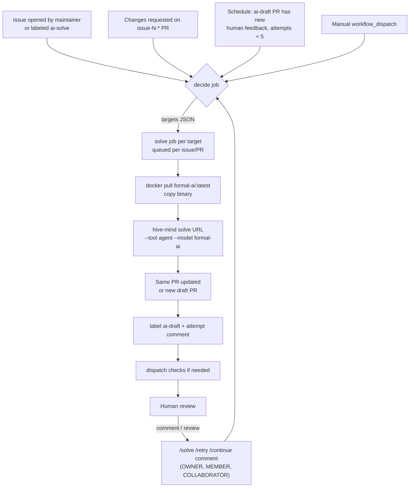

# AI Pipeline — Issue → Latest formal-ai → Pull Request, Restartable

Covers requirements **R6, R7, R8, R9** and **D5** of the
[requirements list](../case-studies/issue-1/requirements.md).

Every `links-games` repository solves its own issues with AI:

1. An issue arrives.
2. The newest [formal-ai](https://github.com/link-assistant/formal-ai) build
   runs, driven by [hive-mind](https://github.com/link-assistant/hive-mind)'s
   `solve` command.
3. A pull request appears automatically.
4. Humans review it; every comment, review or `/retry` can restart the
   same workflow on the **same** pull request, as many times as needed.

## Files

| File                                                                                      | Copied to                                                       |
| ----------------------------------------------------------------------------------------- | --------------------------------------------------------------- |
| [`templates/workflows/ai-solve-reusable.yml`](templates/workflows/ai-solve-reusable.yml)  | `links-games/.github` → `.github/workflows/ai-solve.yml` (once) |
| [`templates/workflows/ai-solve.yml`](templates/workflows/ai-solve.yml)                    | every game repository → `.github/workflows/ai-solve.yml`        |
| [`templates/pull_request_template.md`](templates/pull_request_template.md)                | every repository → `.github/pull_request_template.md`           |
| [`templates/ISSUE_TEMPLATE/`](templates/ISSUE_TEMPLATE/)                                  | every repository → `.github/ISSUE_TEMPLATE/`                    |
| [`tests/ai-solve-workflow.test.js`](../../tests/ai-solve-workflow.test.js) (in this repo) | stays here; it tests the decision logic of the reusable file    |

The templates live under `docs/` so that they do **not** run inside this
planning repository. The caller file is only ~40 lines; all logic stays in
one reusable workflow, so a fix there reaches every game at once.

## Why hive-mind + formal-ai (and not something new)

| Need                                  | Existing component that already does it                                                                                    |
| ------------------------------------- | -------------------------------------------------------------------------------------------------------------------------- |
| Turn an issue into a pull request     | hive-mind `solve <issue-url>`: forks/branches `issue-N-<hash>`, opens a draft PR, attaches logs (`--attach-logs`).         |
| Continue the same pull request        | `solve <pr-url>`, or `solve <issue-url> --auto-continue` (default on), which reuses the open `issue-N-*` PR.               |
| Use formal-ai as the brain            | `--tool agent --model formal-ai` runs formal-ai through `@link-assistant/agent`.                                           |
| Always the **latest** formal-ai       | Image `ghcr.io/link-assistant/formal-ai:latest` ships the binary at `/usr/local/bin/formal-ai`; we mount it over the copy. |
| Run in CI                             | Docker image `konard/hive-mind:latest`, user `box`, logs in `/home/box/logs` — the recipe hive-mind's own draft job uses.  |
| Token that can trigger workflows      | `link-foundation/.github/actions/resolve-github-token` (App → `AUTOMATION_TOKEN` → `GITHUB_TOKEN`).                        |
| Checks on bot-made pull requests      | `link-foundation/.github/actions/dispatch-checks` dispatches check workflows when the token cannot trigger them.           |
| Native formal-ai authoring (fallback) | `link-assistant/formal-ai/.github/actions/author-with-formal-ai` (label `formal-ai-solve`, contract-based issues).         |

Detailed source-level evidence (file paths and line numbers in both
repositories) is in
[research-formal-ai-hive-mind.md](../case-studies/issue-1/data/research-formal-ai-hive-mind.md).

## Flow

## Restartability (R9)

GitHub re-runs (`gh run rerun`) replay the **same commit and the same event
payload** and are capped per run, so they cannot carry new feedback. The
pipeline therefore restarts from **new events**, each mapped to the same
target key (`issue-N` or `pr-N`):

| Restart trigger                                       | Who                         | Target                                                                                                       |
| ----------------------------------------------------- | --------------------------- | ------------------------------------------------------------------------------------------------------------ |
| `/solve`, `/retry`, `/continue` comment               | owner, member, collaborator | that issue or PR                                                                                             |
| Review with **Request changes** on `issue-N-*` branch | owner, member, collaborator | that PR                                                                                                      |
| Label `ai-solve` added                                | anyone with triage rights   | that issue                                                                                                   |
| `workflow_dispatch` with a number                     | anyone with write rights    | issue or PR                                                                                                  |
| Schedule (every 6 h)                                  | automatic                   | `ai-draft` PRs with human comments newer than the last attempt, fewer than `max_sweep_attempts` (5) attempts |

Guarantees:

- **Same pull request every time.** PR targets pass the PR URL to `solve`.
  Issue targets set `HIVE_MIND_AUTO_CONTINUE_AGE_HOURS=0`, so hive-mind
  continues the open `issue-N-*` PR immediately rather than after 24 hours.
- **No lost attempts.** `concurrency` is keyed per target with
  `cancel-in-progress: false` and `queue: max`, so a second `/retry` waits
  for the first attempt; it neither cancels it nor races it.
- **Bounded cost.** The sweep stops after 5 attempts per PR (counted by the
  `<!-- ai-solve-attempt -->` marker comment). Each attempt has a 90-minute
  timeout. Humans can always retry manually beyond the cap.
- **Never destructive.** `--auto-merge` and `--auto-close-pull-request-on-fail`
  are never passed; merging stays a human decision.

## Security (D5)

- Only `OWNER`, `MEMBER` and `COLLABORATOR` can start a run by comment or
  review; bots (`type: Bot`, `*[bot]`) are ignored, which prevents loops.
- Issues from strangers wait for a maintainer to add the `ai-solve` label.
- The `no-ai` label opts an issue or PR out completely.
- `permissions: {}` at the top; each job requests only what it needs.
- Secrets are forwarded to Docker **by name** (`-e NAME`), never written
  into the command line; the target URL is one argv element, never
  interpolated into a shell string from the webhook payload.
- Credentials come from an organization-level GitHub App
  (`AUTOMATION_APP_ID` variable + `AUTOMATION_APP_PRIVATE_KEY` secret) when
  configured, so bot pushes trigger the normal CI; otherwise the
  `dispatch-checks` fallback runs the listed check workflows.

## Setup checklist (Phase 0 of the [roadmap](roadmap.md))

1. Create `links-games/.github` and copy `ai-solve-reusable.yml` to
   `.github/workflows/ai-solve.yml` there.
2. Create an organization GitHub App with contents, issues, pull requests
   and actions write permissions; store `AUTOMATION_APP_ID` (variable) and
   `AUTOMATION_APP_PRIVATE_KEY` (secret) at the organization level.
3. Optionally add `ANTHROPIC_API_KEY` / `CLAUDE_CODE_OAUTH_TOKEN` /
   `OPENAI_API_KEY` organization secrets for `--tool claude` or
   `--tool codex` experiments (the default `--tool agent --model formal-ai`
   needs none of them).
4. Add `ai-solve.yml` (caller), the PR template and issue templates to the
   game template repositories, so every new game gets them automatically.
5. Create labels `ai-solve`, `ai-draft`, `no-ai` (the workflow also creates
   `ai-draft` on first use).

## Known limits and how we handle them

| Limit                                                                                                   | Handling                                                                                                                                                                     |
| ------------------------------------------------------------------------------------------------------- | ---------------------------------------------------------------------------------------------------------------------------------------------------------------------------- |
| formal-ai is young: in its own benchmarks it solves a minority of coding tasks (see the research file). | Each attempt is a **draft**; failure leaves logs on the PR. The `tool`/`model` inputs let a repository switch to another hive-mind tool per run while keeping the same flow. |
| GitHub-token pushes do not trigger workflows.                                                           | GitHub App token, or `dispatch-checks` with `check_workflows`.                                                                                                               |
| `issue_comment` and `schedule` run the workflow from the default branch only.                           | Fine: the pipeline file is stable; changes to it are tested here and in `links-games/.github`.                                                                               |
| actionlint 1.7.12 does not yet know `concurrency.queue`.                                                | Documented false positive (same as formal-ai); ignore that single diagnostic.                                                                                                |
| Hosted runners stop jobs at 6 hours.                                                                    | 90-minute timeout per attempt; long tasks continue on the next restart.                                                                                                      |
