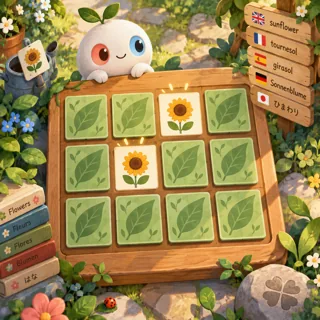
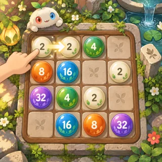
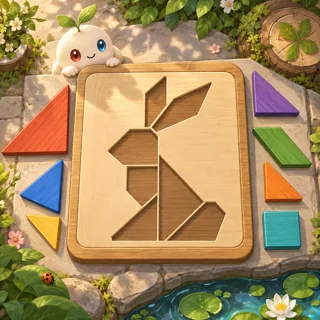
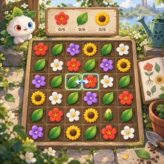

# Choose a game to prototype

Browse **216 ideas in 12 collections**. Each game has its own page with a
learning objective, mechanic, prototype scope and four independent concept-art
directions. All 168 existing IDs are preserved; 48 additions fill gaps in the
[game-ideas list](../game-ideas.md). These are proposals for choosing a prototype,
not implemented games.

## Browse by collection

| Collection                       | Ideas | New coverage                                                                                                                                                |
| -------------------------------- | ----- | ----------------------------------------------------------------------------------------------------------------------------------------------------------- |
| [Puzzles](pz.md)                 | 30    | Match-3, bubble shooter, triple matching, collapse, drop-and-merge, merge-3, parking, bus queues, conveyor sorting, one-line paths, ribbons, numbered paths |
| [Words and languages](wl.md)     | 18    | Word ladders, category grouping, rebuses                                                                                                                    |
| [Math and logic](ml.md)          | 20    | Hashi bridges, inequalities, arithmetic expressions                                                                                                         |
| [Board and card games](bc.md)    | 18    | Backgammon, hearts, cooperative trick-taking, expedition deckbuilding                                                                                       |
| [Science lab](sl.md)             | 20    | Pinball, brick-breaker, pull-pin flow puzzles                                                                                                               |
| [Nature and care](nc.md)         | 17    | Cleaning, terrarium collecting, magnet-fishing cleanup                                                                                                      |
| [Build and create](bd.md)        | 14    | Unpacking, inventory packing, pottery                                                                                                                       |
| [Music and rhythm](mr.md)        | 10    | Dance dialogue, rhythm platforming                                                                                                                          |
| [Sports and motion](sm.md)       | 17    | Crossing arcade, cooperative volleyball, precision platforming                                                                                              |
| [Space and physics](sp.md)       | 17    | Docking, survivor-style rescue, rover geology                                                                                                               |
| [Stories and adventures](sa.md)  | 15    | Metroidvania exploration, evidence-based social deduction, non-combat roguelikes                                                                            |
| [Strategy and simulation](ss.md) | 20    | Automation, helper-team synergies, restaurant queues, repair workshops, railway dispatch, disaster preparation                                              |

## Start with a small prototype

Choose a visual you like, then prefer Cx 1–2 before larger simulations.
The [complexity ladder](../game-ideas.md#complexity-ladder) is a development
estimate, not a ranking of how much fun a game will be.

| Preview                                                                           | Candidate                           | Why try it early                                                  |
| --------------------------------------------------------------------------------- | ----------------------------------- | ----------------------------------------------------------------- |
|       | [Pair Friends](pages/pz-01.md)      | One board, familiar memory interaction, pictures localize easily. |
|         | [Bead Merge](pages/pz-02.md)        | Compact deterministic rules and a readable doubling lesson.       |
|    | [Tangram Friends](pages/pz-03.md)   | A tactile visual choice with a small authored puzzle set.         |
|   | [Make Twenty-Four](pages/ml-20.md)  | Four numbers and a few operation tiles; tiny technical scope.     |
|       | [Blossom Swap](pages/pz-19.md)      | Familiar match-3 loop; requires more level tuning than memory.    |
|  | [Research Backpack](pages/bd-13.md) | Distinct tactile identity and a bounded spatial-packing problem.  |

For a decision, compare the **Gameplay** views first: can you tell what to touch
and what will change? Compare **World** for setting appeal, **Characters and
materials** for identity, and **Expanded play** for whether the idea has room to
grow. Open each image for its full native resolution. A strong world picture
alone does not prove the mechanic is readable or fun.

## Image generation and provenance

The target is **four separately generated images for each of 216 ideas**:
864 original concept images. Each is a standalone composition, with its own
prompt and generation call; images are not crops from a shared contact sheet.
Full images retain their native pixel dimensions, with a minimum of 1024 pixels
on each edge. The tool is asked for 2048 × 2048 or its highest available native
resolution. Actual dimensions are recorded; no image is upscaled to meet the
minimum. WebP quality 92 keeps the repository practical without resizing the
full images. Index-only thumbnails fit within 320 × 320.

The requested generator is **GPT Image 2.5 or the latest available**. Generation
uses the available built-in `image_gen.imagegen` tool. It exposes no model
selector and returns no model ID; `modelReported: null` records that limitation.
Do not interpret the requested model as a verified model identifier. Official
[OpenAI image documentation](https://developers.openai.com/api/docs/guides/images-vision)
lists GPT Image 2.5 and explains that tool-based generation handles model
selection; that does not attest to the hidden backend of this particular tool.

Each game's `art/<id>/manifest.json` stores the exact prompts, tool name,
generation time, actual width and height, encoding and SHA-256 hashes. Prompts
are also grouped by collection in `jobs/`. The [source catalog](catalog/)
contains the stable IDs and scene descriptions. Generated art is a visual
exploration: scientific diagrams, language handshapes, rules, and character
consistency need human review before production. No educational efficacy claim
is inferred from concept art.

Use the repository's [public-domain licensing plan](../legal.md#licensing)
and perform the usual name, likeness and trade-dress review before release.
Existing games are research references for mechanics; their imagery was not
used as generation input.

The [visual review record](../../case-studies/issue-1/data/visual-review.md)
describes the inspection method and observations for completed collections.

## Maintaining the catalog

1. Edit a game record in `catalog/<family>.json`, retaining its stable ID.
2. Run `node scripts/build-game-concepts.mjs` to rebuild pages and prompt jobs.
   This command never generates images or replaces existing artwork.
3. Generate each requested image with the built-in image tool. Persist each
   result with `python3 experiments/save-concept-art.py JOB_ID SOURCE_IMAGE`
   (requires Pillow). The script refuses to overwrite saved art. A changed
   direction should be reviewed and versioned deliberately.
4. Run `npx prettier --write docs/master-plan/concepts`, then
   `node --test tests/game-concepts.test.js tests/master-plan-docs.test.js`.
   Coverage checks reject missing pages or images, low native resolution,
   stale prompts, changed hashes, reused images and missing index links.

The [research note](../../case-studies/issue-1/data/research-visual-catalog.md)
explains the coverage expansion and generation constraints.
