# Board and card games — visual concepts

[All collections](README.md) · 18 ideas · four full-resolution views per idea.

Open a game page to compare the four views, the learning objective, the prototype scope and the estimated plan. Cx follows the [complexity ladder](../game-ideas.md#complexity-ladder); days and the toddler learnability rating (1–5) come from the [development plan](../development-plan.md).

| Gameplay preview                                                                    | Idea                                        | Mechanic                                   | Cx  | Days | Toddler |
| ----------------------------------------------------------------------------------- | ------------------------------------------- | ------------------------------------------ | --- | ---- | ------- |
| [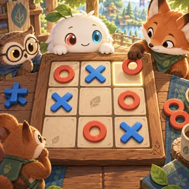](pages/bc-01.md)     | [Tic-Tac-Links](pages/bc-01.md) (BC-01)     | Tic-tac-toe and ultimate tic-tac-toe       | 1   | 20.3 | 2       |
| [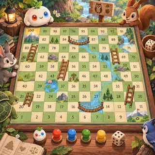](pages/bc-02.md) | [Ropes and Ladders](pages/bc-02.md) (BC-02) | Snakes and ladders (Moksha Patam)          | 1   | 20.5 | 3       |
| [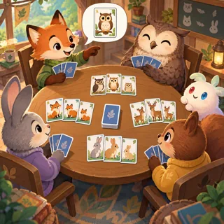](pages/bc-03.md)    | [Happy Families](pages/bc-03.md) (BC-03)    | Go Fish / families                         | 1   | 23.5 | 2       |
| [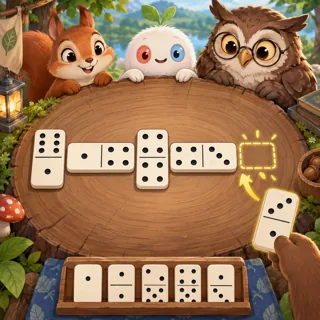](pages/bc-04.md)          | [Dominoes](pages/bc-04.md) (BC-04)          | Dominoes                                   | 1–2 | 17   | 3       |
| [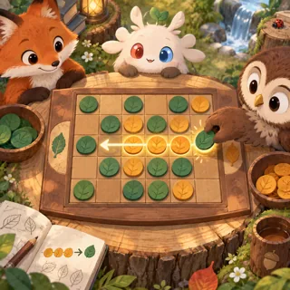](pages/bc-05.md) | [Rela's Board Club](pages/bc-05.md) (BC-05) | Reversi, checkers, mancala, four in a row  | 2–3 | 33.6 | 2       |
| [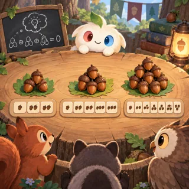](pages/bc-06.md)        | [Nim Garden](pages/bc-06.md) (BC-06)        | Nim                                        | 2   | 20.3 | 2       |
| [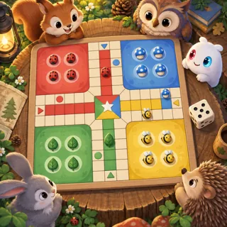](pages/bc-07.md)     | [Home Run Race](pages/bc-07.md) (BC-07)     | Ludo / pachisi (pieces go home, not "die") | 2   | 25.3 | 2       |
| [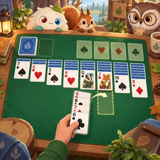](pages/bc-08.md)         | [Solitaire](pages/bc-08.md) (BC-08)         | Klondike, FreeCell, spider                 | 2   | 26.1 | 1       |
| [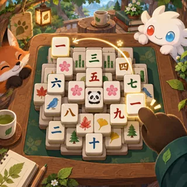](pages/bc-09.md)        | [Tile Pairs](pages/bc-09.md) (BC-09)        | Mahjong solitaire                          | 2   | 29.9 | 1       |
| [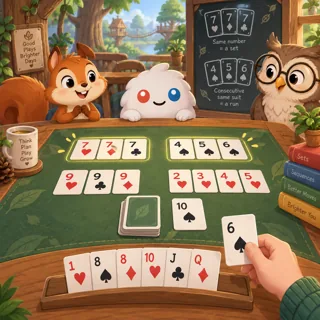](pages/bc-10.md)     | [Sets and Runs](pages/bc-10.md) (BC-10)     | Rummy                                      | 2–3 | 25.8 | 1       |
| [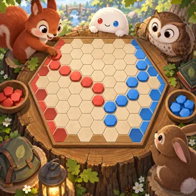](pages/bc-11.md)       | [Hex Bridges](pages/bc-11.md) (BC-11)       | Hex (connection game)                      | 3   | 29.9 | 1       |
| [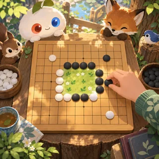](pages/bc-12.md)      | [Garden Plots](pages/bc-12.md) (BC-12)      | Go (territory)                             | 3–4 | 39.3 | 1       |
| [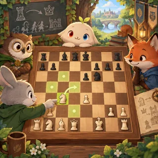](pages/bc-13.md)     | [Chess Friends](pages/bc-13.md) (BC-13)     | Chess (captured pieces "go home")          | 3–4 | 46.1 | 1       |
| [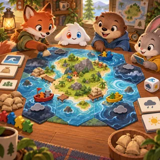](pages/bc-14.md)     | [Island Rescue](pages/bc-14.md) (BC-14)     | Cooperative board game                     | 3   | 40.6 | 1       |
| [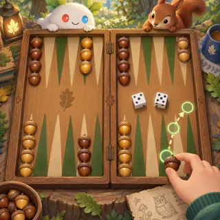](pages/bc-15.md)  | [Acorn Backgammon](pages/bc-15.md) (BC-15)  | Backgammon                                 | 3   | 29.2 | 1       |
| [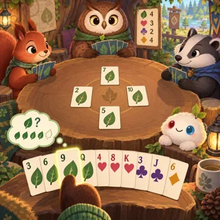](pages/bc-16.md)       | [Leaf Hearts](pages/bc-16.md) (BC-16)       | Hearts card game                           | 2   | 23.7 | 1       |
| [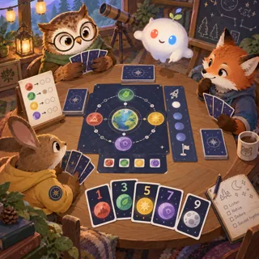](pages/bc-17.md)       | [Signal Crew](pages/bc-17.md) (BC-17)       | Cooperative trick-taking                   | 3   | 39.6 | 1       |
| [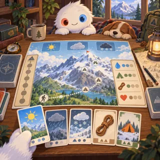](pages/bc-18.md)   | [Expedition Deck](pages/bc-18.md) (BC-18)   | Roguelite deckbuilder                      | 4   | 66   | 1       |
