# Build and create — visual concepts

[All collections](README.md) · 14 ideas · four full-resolution views per idea.

Open a game page to compare all four directions, the learning objective and prototype scope. Cx follows the [complexity ladder](../game-ideas.md#complexity-ladder).

| Gameplay preview                                                                    | Idea                                        | Mechanic                             | Cx  |
| ----------------------------------------------------------------------------------- | ------------------------------------------- | ------------------------------------ | --- |
| [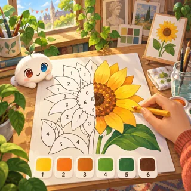](pages/bd-01.md)        | [Omi Colors](pages/bd-01.md) (BD-01)        | Coloring / color by number           | 2   |
| [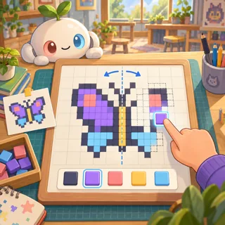](pages/bd-02.md)      | [Pixel Studio](pages/bd-02.md) (BD-02)      | Pixel art editor                     | 1–2 |
| [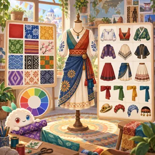](pages/bd-03.md)  | [Costume Designer](pages/bd-03.md) (BD-03)  | Dress-up / fashion                   | 2   |
| [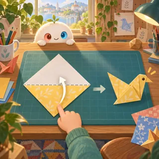](pages/bd-04.md)     | [Origami Folds](pages/bd-04.md) (BD-04)     | Folding puzzle                       | 2–3 |
| [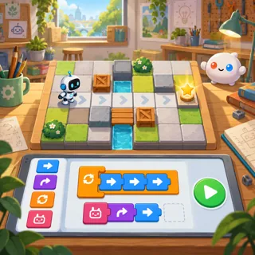](pages/bd-05.md)  | [Robot Programmer](pages/bd-05.md) (BD-05)  | Visual coding (Lightbot, Scratch Jr) | 2–3 |
| [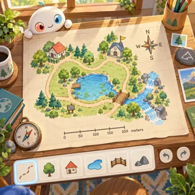](pages/bd-06.md)         | [Map Maker](pages/bd-06.md) (BD-06)         | Map editor                           | 3   |
| [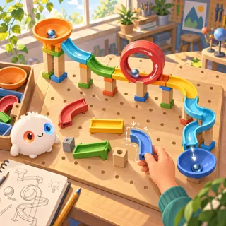](pages/bd-07.md)        | [Marble Run](pages/bd-07.md) (BD-07)        | Construction physics                 | 3   |
| [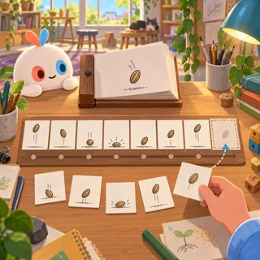](pages/bd-08.md)  | [Animation Studio](pages/bd-08.md) (BD-08)  | Flipbook maker                       | 3   |
| [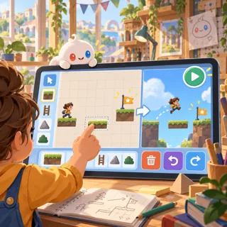](pages/bd-09.md)       | [Level Maker](pages/bd-09.md) (BD-09)       | Level editor for our other games     | 3   |
| [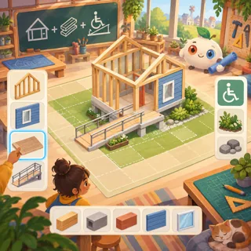](pages/bd-10.md)    | [Tiny Architect](pages/bd-10.md) (BD-10)    | Building design                      | 4   |
| [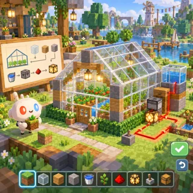](pages/bd-11.md)       | [Block World](pages/bd-11.md) (BD-11)       | Voxel sandbox (Minecraft)            | 5   |
| [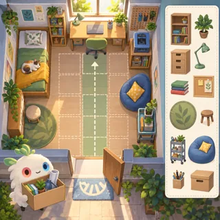](pages/bd-12.md) | [Room for Everyone](pages/bd-12.md) (BD-12) | Unpacking and room organization      | 2   |
| [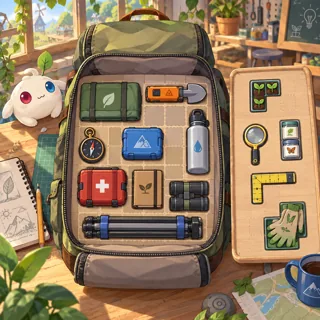](pages/bd-13.md) | [Research Backpack](pages/bd-13.md) (BD-13) | Inventory packing and synergies      | 2   |
| [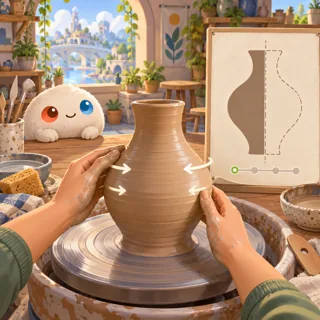](pages/bd-14.md) | [Clay and Symmetry](pages/bd-14.md) (BD-14) | Pottery shaping                      | 3   |
