# Math and logic — visual concepts

[All collections](README.md) · 20 ideas · four full-resolution views per idea.

Open a game page to compare the four views, the learning objective, the prototype scope and the estimated plan. Cx follows the [complexity ladder](../game-ideas.md#complexity-ladder); days and the toddler learnability rating (1–5) come from the [development plan](../development-plan.md).

| Gameplay preview                                                                        | Idea                                            | Mechanic                               | Cx  | Days | Toddler |
| --------------------------------------------------------------------------------------- | ----------------------------------------------- | -------------------------------------- | --- | ---- | ------- |
| [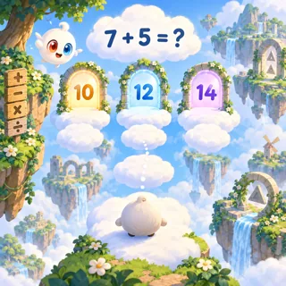](pages/ml-01.md)             | [Linky Hop](pages/ml-01.md) (ML-01)             | One-tap flyer                          | 1   | 21.8 | 1       |
| [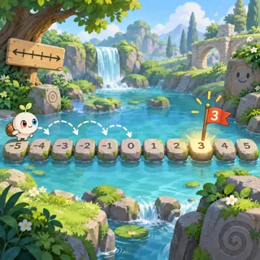](pages/ml-02.md)      | [Number Line Jump](pages/ml-02.md) (ML-02)      | Platform hop                           | 1   | 21.3 | 2       |
| [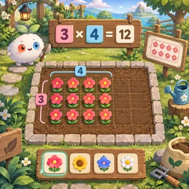](pages/ml-03.md)    | [Times Table Garden](pages/ml-03.md) (ML-03)    | Tap to grow                            | 1   | 20.3 | 1       |
| [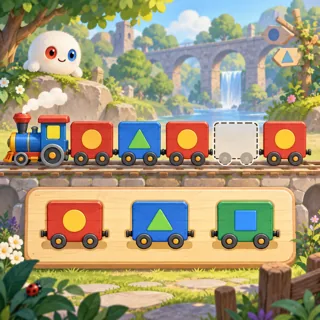](pages/ml-04.md)         | [Pattern Train](pages/ml-04.md) (ML-04)         | Sequence completion                    | 1   | 19.3 | 3       |
| [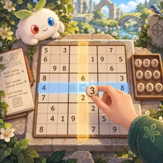](pages/ml-05.md)            | [Uni's Grid](pages/ml-05.md) (ML-05)            | Sudoku                                 | 2   | 23.6 | 1       |
| [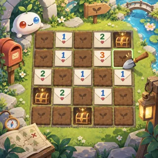](pages/ml-06.md)     | [Postie's Treasure](pages/ml-06.md) (ML-06)     | Minesweeper-like deduction             | 2   | 23.8 | 1       |
|       | [Fraction Kitchen](pages/ml-07.md) (ML-07)      | Cutting / slicing                      | 2   | 26.5 | 2       |
| [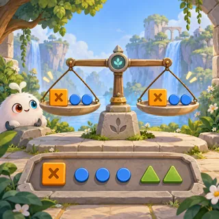](pages/ml-08.md)       | [Balance Friends](pages/ml-08.md) (ML-08)       | Balance-scale algebra (DragonBox-like) | 2   | 32.1 | 2       |
| [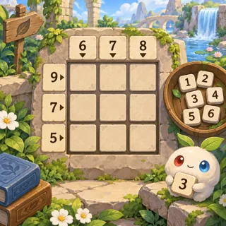](pages/ml-09.md)             | [Cage Sums](pages/ml-09.md) (ML-09)             | Kakuro / arithmetic cages              | 2   | 23.8 | 1       |
|  | [Tower of Hanoi Acorns](pages/ml-10.md) (ML-10) | Tower of Hanoi                         | 2   | 16.4 | 2       |
| [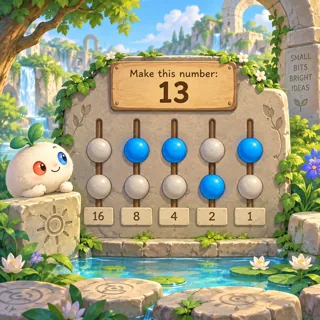](pages/ml-11.md)          | [Binary Beads](pages/ml-11.md) (ML-11)          | Switch puzzles                         | 2   | 18.6 | 1       |
| [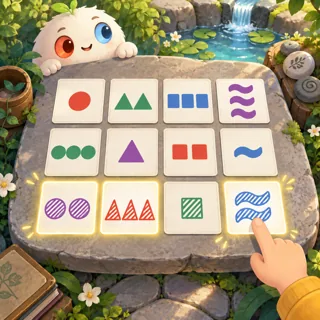](pages/ml-12.md)        | [Match the Kind](pages/ml-12.md) (ML-12)        | Attribute matching card game           | 2   | 16.9 | 3       |
| [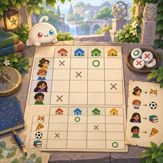](pages/ml-13.md)        | [Detective Grid](pages/ml-13.md) (ML-13)        | Logic grid (zebra puzzle)              | 2–3 | 31.9 | 1       |
| [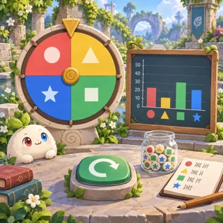](pages/ml-14.md)     | [Lucky Spinner Lab](pages/ml-14.md) (ML-14)     | Dice / spinner experiments             | 2–3 | 20.8 | 2       |
| [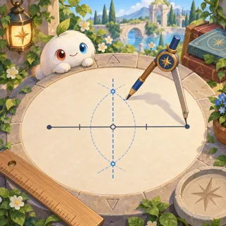](pages/ml-15.md)        | [Compass Garden](pages/ml-15.md) (ML-15)        | Compass-and-straightedge (Euclid)      | 3   | 32.8 | 1       |
|   | [Shortest Path Postie](pages/ml-16.md) (ML-16)  | Route puzzle                           | 3   | 31.8 | 1       |
| [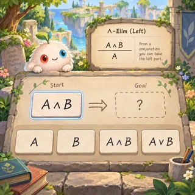](pages/ml-17.md)           | [Proof Steps](pages/ml-17.md) (ML-17)           | Rule-rewrite puzzle                    | 3–4 | 41.6 | 1       |
| [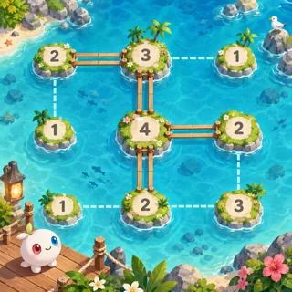](pages/ml-18.md)        | [Island Bridges](pages/ml-18.md) (ML-18)        | Hashi bridges puzzle                   | 2   | 24.9 | 1       |
| [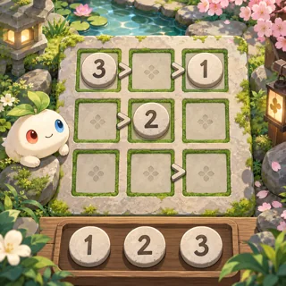](pages/ml-19.md)        | [Greater Garden](pages/ml-19.md) (ML-19)        | Futoshiki inequality puzzle            | 2   | 22.4 | 1       |
| [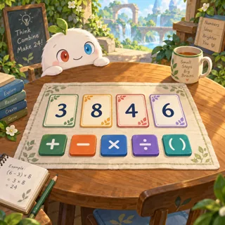](pages/ml-20.md)      | [Make Twenty-Four](pages/ml-20.md) (ML-20)      | Arithmetic expression puzzle           | 1   | 17.1 | 1       |
