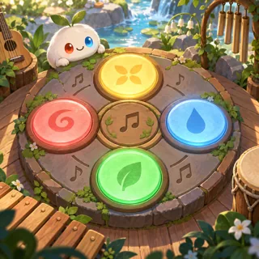
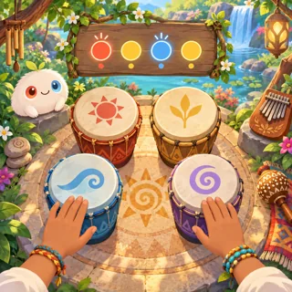
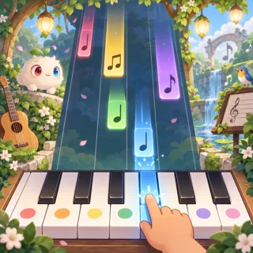
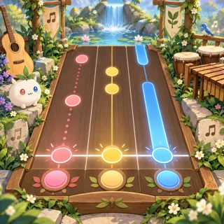
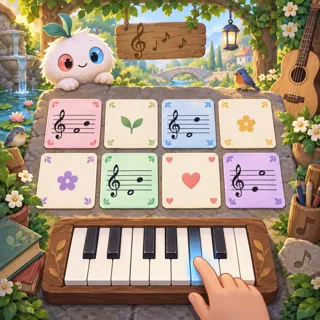
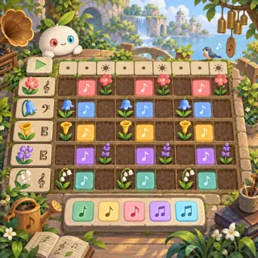
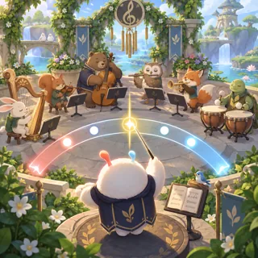
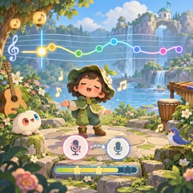
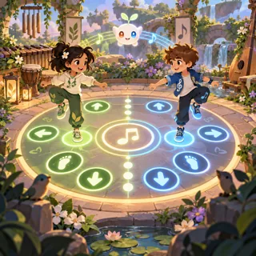
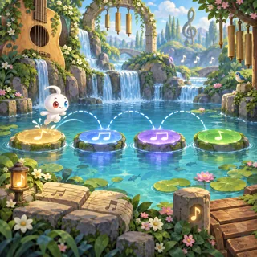

# Music and rhythm — visual concepts

[All collections](README.md) · 10 ideas · four full-resolution views per idea.

Open a game page to compare all four directions, the learning objective and prototype scope. Cx follows the [complexity ladder](../game-ideas.md#complexity-ladder).

| Gameplay preview                                                                 | Idea                                     | Mechanic                              | Cx  |
| -------------------------------------------------------------------------------- | ---------------------------------------- | ------------------------------------- | --- |
|      | [Echo Links](pages/mr-01.md) (MR-01)     | Simon (repeat the sequence)           | 1   |
|     | [Drum Circle](pages/mr-02.md) (MR-02)    | Rhythm toy                            | 1   |
|     | [Piano Steps](pages/mr-03.md) (MR-03)    | Falling tiles                         | 2   |
|      | [Rhythm Tap](pages/mr-04.md) (MR-04)     | Rhythm game                           | 2   |
|     | [Ear Trainer](pages/mr-05.md) (MR-05)    | Matching                              | 2   |
|   | [Melody Garden](pages/mr-06.md) (MR-06)  | Step sequencer (melodies grow plants) | 3   |
|       | [Conductor](pages/mr-07.md) (MR-07)      | Timing game                           | 3   |
|      | [Sing Along](pages/mr-08.md) (MR-08)     | Karaoke with pitch line               | 3   |
|  | [Dance Dialogue](pages/mr-09.md) (MR-09) | Rhythm duel                           | 3   |
|       | [Beat Path](pages/mr-10.md) (MR-10)      | Rhythm platformer                     | 3   |
