# Nature and care — visual concepts

[All collections](README.md) · 17 ideas · four full-resolution views per idea.

Open a game page to compare the four views, the learning objective, the prototype scope and the estimated plan. Cx follows the [complexity ladder](../game-ideas.md#complexity-ladder); days and the toddler learnability rating (1–5) come from the [development plan](../development-plan.md).

| Gameplay preview                                                                     | Idea                                         | Mechanic                                   | Cx  | Days | Toddler |
| ------------------------------------------------------------------------------------ | -------------------------------------------- | ------------------------------------------ | --- | ---- | ------- |
| [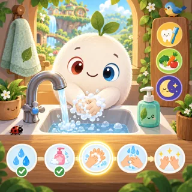](pages/nc-01.md)     | [Healthy Habits](pages/nc-01.md) (NC-01)     | Routine toy (brush teeth, wash hands)      | 1   | —    | —       |
| [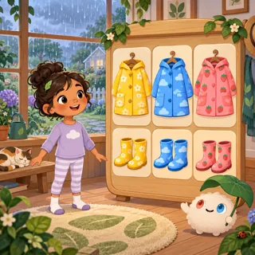](pages/nc-02.md)   | [Weather Dress-Up](pages/nc-02.md) (NC-02)   | Dress-up                                   | 1   | —    | —       |
| [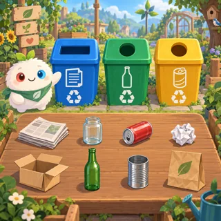](pages/nc-03.md)   | [Recycling Sorter](pages/nc-03.md) (NC-03)   | Sorting                                    | 1   | —    | —       |
| [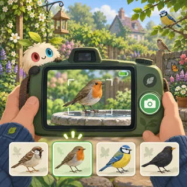](pages/nc-04.md)         | [Bird Watch](pages/nc-04.md) (NC-04)         | Photo safari (instead of hunting)          | 2   | —    | —       |
| [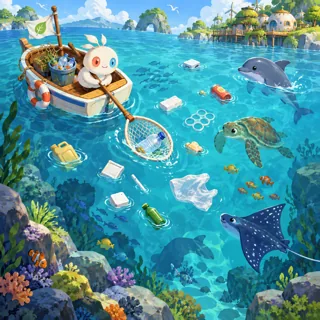](pages/nc-05.md)      | [Ocean Cleanup](pages/nc-05.md) (NC-05)      | Collecting arcade                          | 2   | —    | —       |
| [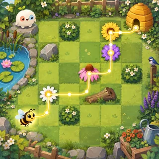](pages/nc-06.md)    | [Pollinator Path](pages/nc-06.md) (NC-06)    | Path drawing                               | 2   | —    | —       |
|          | [Animal Vet](pages/nc-07.md) (NC-07)         | Care / hospital sim                        | 2–3 | —    | —       |
| [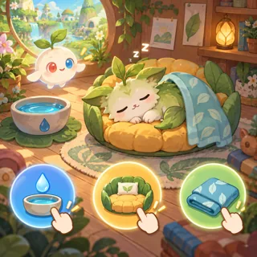](pages/nc-08.md)         | [Linky Home](pages/nc-08.md) (NC-08)         | Virtual pet                                | 3   | —    | —       |
| [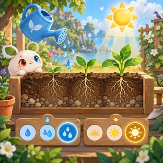](pages/nc-09.md)        | [Garden Grow](pages/nc-09.md) (NC-09)        | Garden sim                                 | 3   | —    | —       |
| [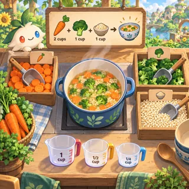](pages/nc-10.md)  | [Community Kitchen](pages/nc-10.md) (NC-10)  | Cooking (Cooking Mama, Overcooked)         | 3   | —    | —       |
| [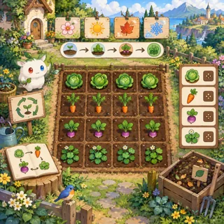](pages/nc-11.md)       | [Seasons Farm](pages/nc-11.md) (NC-11)       | Farming sim (Harvest Moon, Stardew Valley) | 4   | —    | —       |
| [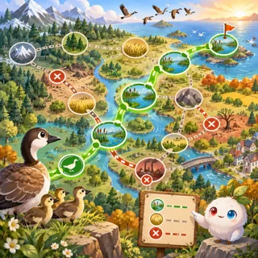](pages/nc-12.md)      | [Migration Map](pages/nc-12.md) (NC-12)      | Route strategy                             | 4   | —    | —       |
| [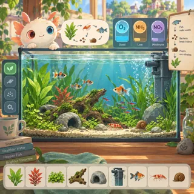](pages/nc-13.md)   | [Aquarium Balance](pages/nc-13.md) (NC-13)   | Ecosystem sim                              | 4   | —    | —       |
| [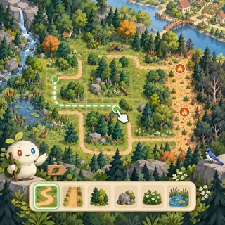](pages/nc-14.md)      | [Forest Keeper](pages/nc-14.md) (NC-14)      | Management sim                             | 4   | —    | —       |
| [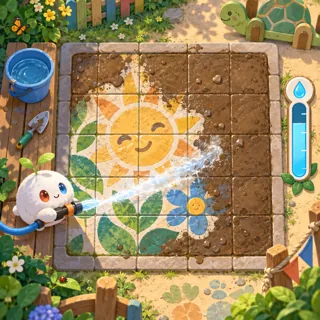](pages/nc-15.md) | [Clean Little World](pages/nc-15.md) (NC-15) | Cleaning simulator                         | 3   | —    | —       |
| [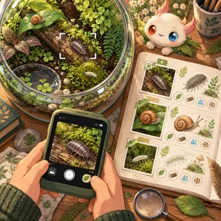](pages/nc-16.md)  | [Terrarium Journal](pages/nc-16.md) (NC-16)  | Creature collection and care               | 3   | —    | —       |
| [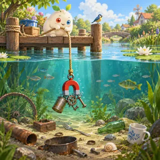](pages/nc-17.md) | [Magnet Fishing Day](pages/nc-17.md) (NC-17) | Fishing-style cleanup                      | 3   | —    | —       |
