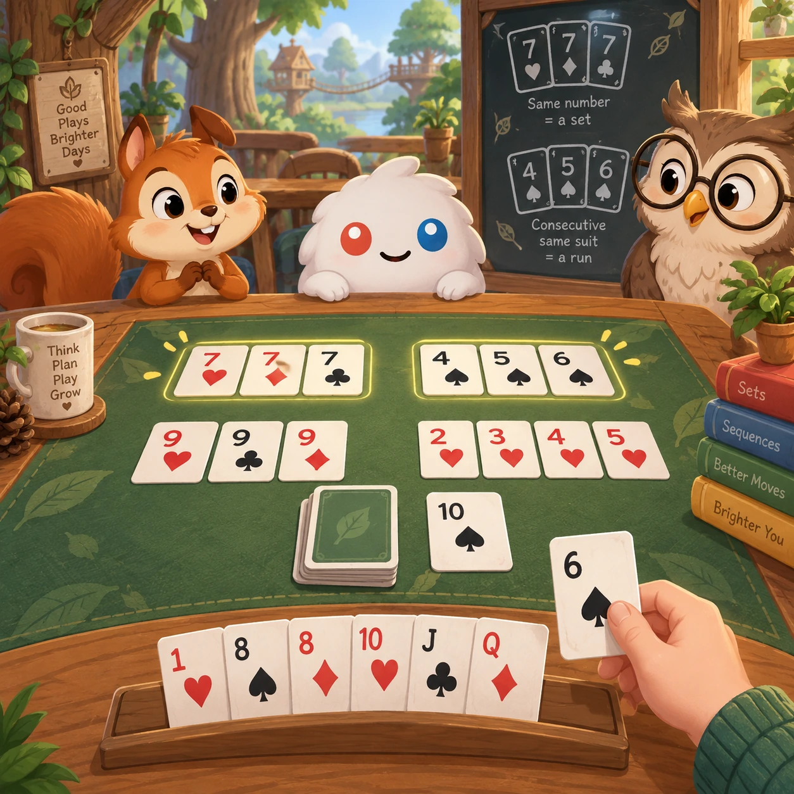
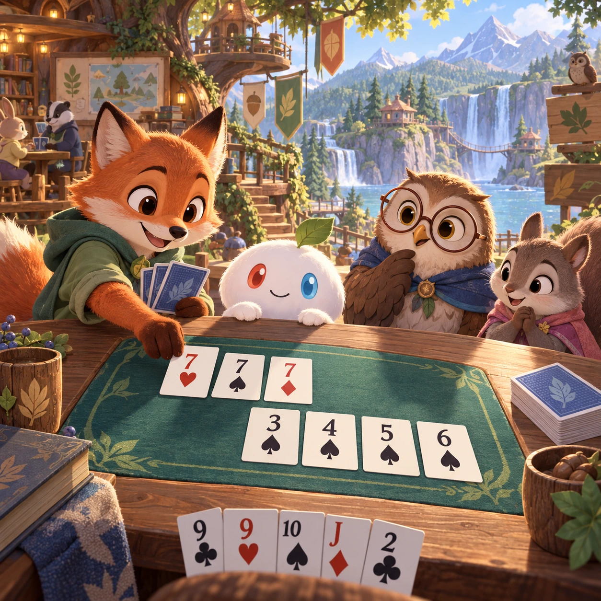
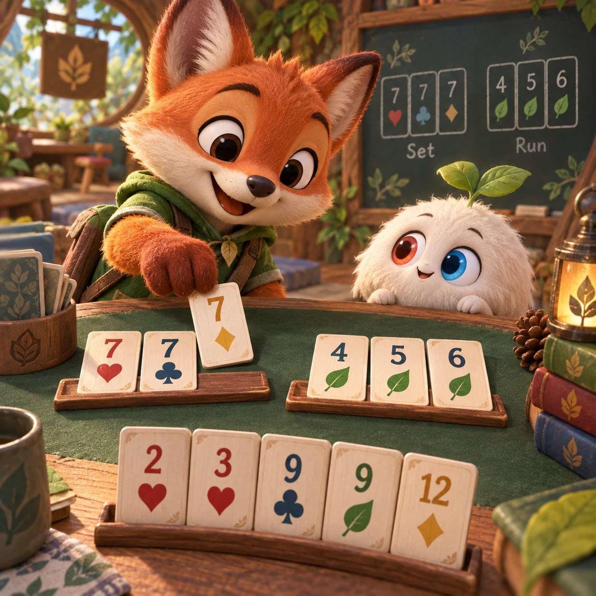
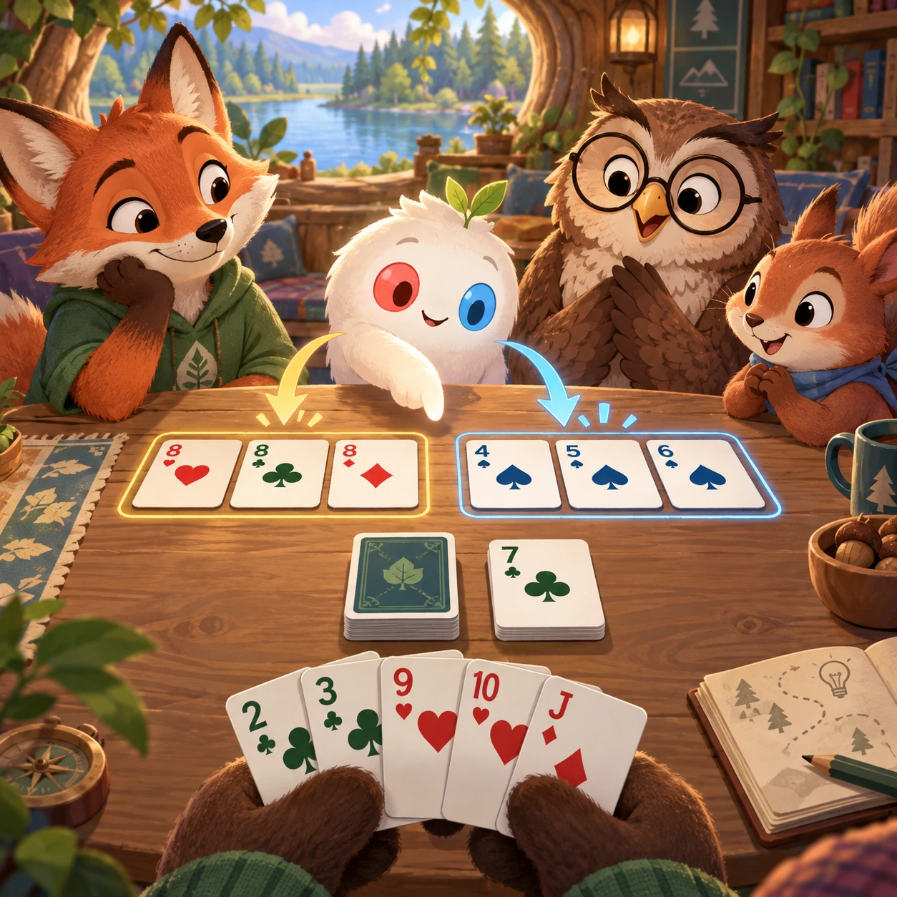

# Sets and Runs

BC-10 · [Board and card games](../bc.md) · Cx 2–3 · Original catalog

**The idea:** Lay numbered cards into a same-rank set and a consecutive same-suit run.

| Decision             | Proposal                                                                                                                                                                                    |
| -------------------- | ------------------------------------------------------------------------------------------------------------------------------------------------------------------------------------------- |
| Familiar mechanic    | Rummy                                                                                                                                                                                       |
| Learning objective   | Sets, sequences, planning                                                                                                                                                                   |
| First prototype      | One authored challenge built around the interaction above, with a clear goal, immediate feedback, restart and unlimited retries.                                                            |
| Technology           | React + SVG/DOM; deterministic state, undo and seeded levels. Start with one local screen and touch plus keyboard input.                                                                    |
| Scope boundary       | One board and one rule set; defer accounts, multiplayer, procedural content and platform SDKs.                                                                                              |
| Reuse                | Shared input, saves, accessibility, seeded state and the board and card games collection shell.                                                                                             |
| Prototype acceptance | A player can identify the next action from the screen, complete one challenge, explain the practiced idea and restart without help. Check touch and keyboard play at narrow and wide sizes. |
| Main uncertainty     | Test whether the lesson follows from play and whether the first interaction is understandable without reading.                                                                              |

## Estimated plan

**First playable version:** Two-player rummy against one AI with numbered cards in four suits, drag-to-meld sets and runs, laying off and a planning hint. Joker variants and more players are left out.

| Measure              | Estimate                                                                                                   |
| -------------------- | ---------------------------------------------------------------------------------------------------------- |
| Youngest age         | 7+                                                                                                         |
| Toddler learnability | 1 of 5 — Needs reading, precise motor control, timing pressure or abstract rules; not a toddler game (6+). |
| Code                 | 1760 LOC, 14.7 days                                                                                        |
| Assets               | 67 hours, 11.2 days                                                                                        |
| Effort               | 25.8 days, risk 3 of 5                                                                                     |
| Start score          | 77.4 (rank 190 of 300; lower is better)                                                                    |

**Algorithms:** `card-rules` (Card game rules, 450 LOC) · `shuffle-deal` (Seeded shuffle and deal, 60 LOC) · `drag-drop-snap` (Drag and snap, 150 LOC) · `game-ai-minimax` (Turn-based AI, 500 LOC)

**Assets:** 16 sprites, 3 animations, 2 backgrounds, 5 UI screens, 8 sound effects, 1 music track, 20 voice lines

How the numbers are computed: [development plan](../../development-plan.md#how-the-scores-work).

## Four visual directions

These are independently generated concept proposals for selecting a prototype.
The four views compare gameplay readability, world appeal, tactile identity and
room to grow. They are not screenshots of an implemented game. Native image
dimensions, hashes, exact prompts and generation provenance are recorded in the
[art manifest](../art/bc-10/manifest.json); see the [generation notes](../README.md#image-generation-and-provenance).

### Gameplay

### World

### Characters and materials

### Expanded play

## Design checks before prototyping

- Learning target: **Sets, sequences, planning**. Ask a domain reviewer to validate factual content in the mechanic.
- Keep goals cooperative or self-directed, using resources and needs. Avoid purchasable power. No pressure timers in the accessible mode.
- Use original layouts and character designs; the [legal checklist](../../legal.md) applies even when a mechanic is familiar.
- Choose the minimum [fidelity level](../../simulation-engine.md#determinism-and-fidelity-levels) the lesson needs; concept art does not establish scientific accuracy.
- Review silhouettes, text alternatives, reduced motion and non-color cues against the [adorability gate](../../lore/adorability-gate.md).

Genre context: [existing genre research](../../../case-studies/issue-1/data/research-genres-ideas.md)
and [expansion research](../../../case-studies/issue-1/data/research-visual-catalog.md).

[← Tile Pairs](bc-09.md) · [All concepts](../README.md) · [Hex Bridges →](bc-11.md)
