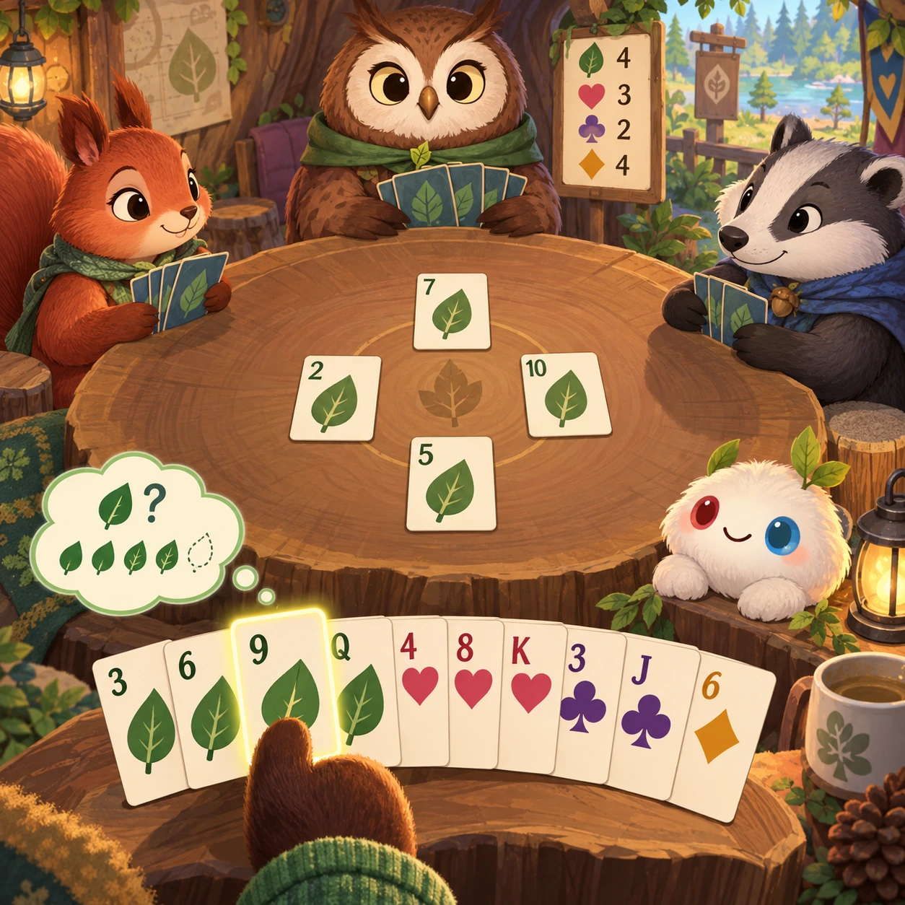
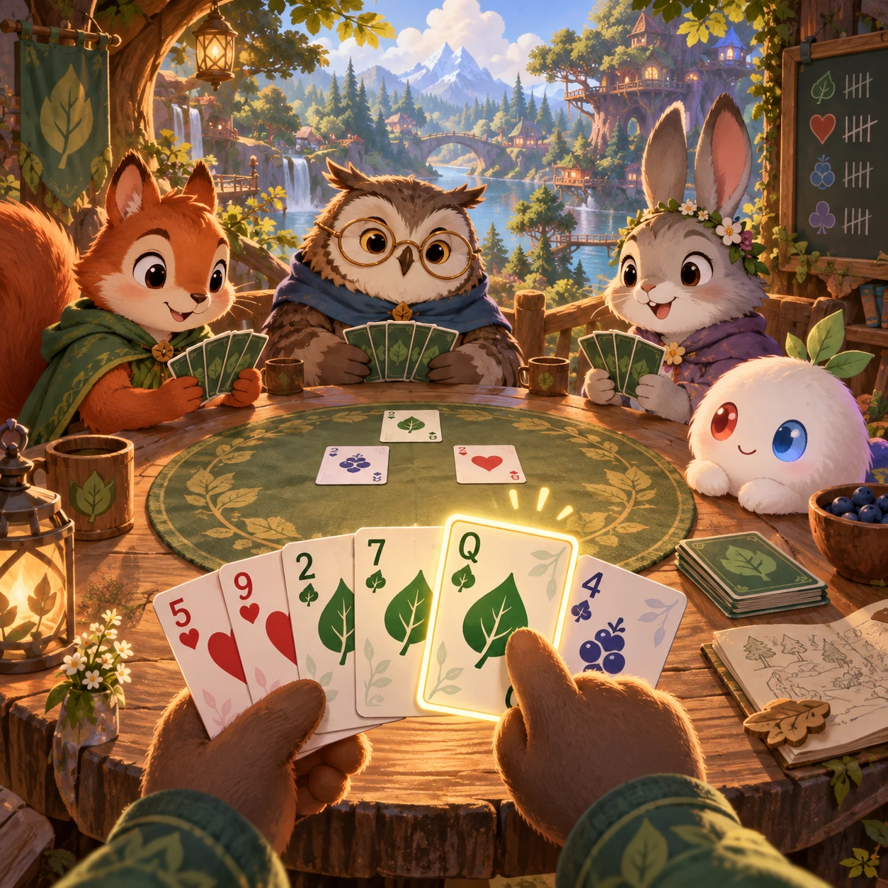
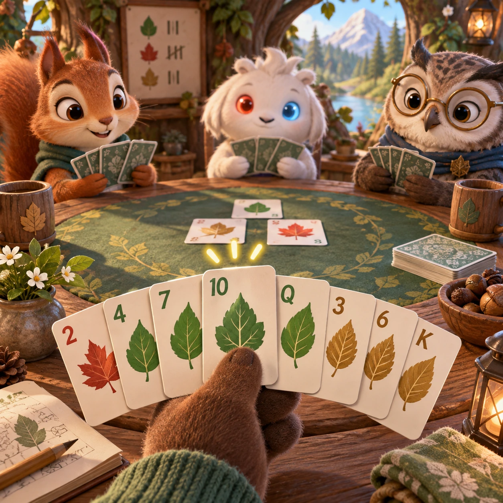
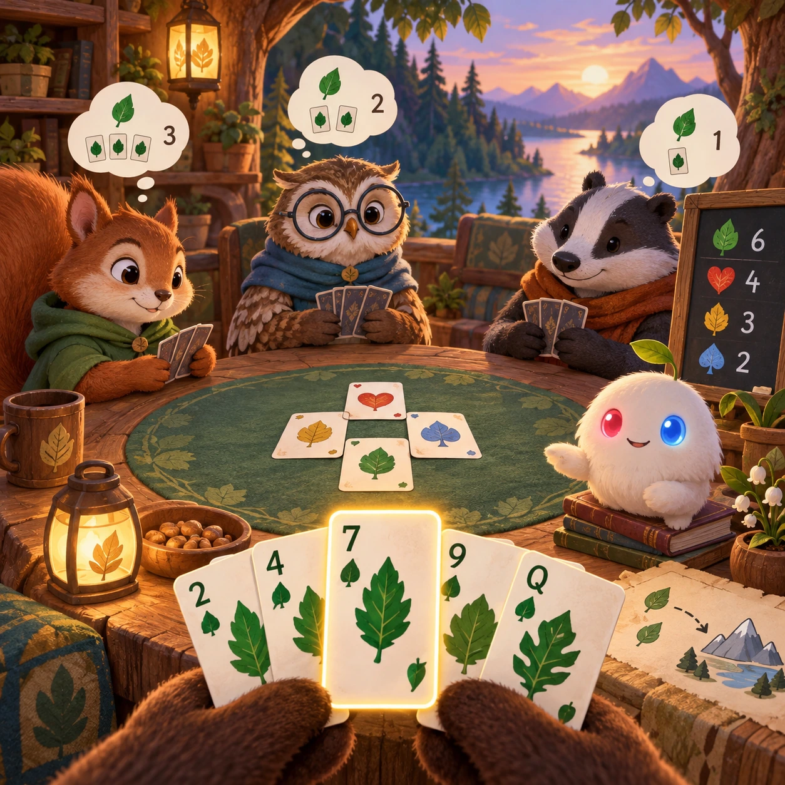

# Leaf Hearts

BC-16 · [Board and card games](../bc.md) · Cx 2 · Added in the visual-catalog expansion

**The idea:** Choose a leaf-suit card from a visible hand at a friendly four-player woodland table.

| Decision             | Proposal                                                                                                                                                                                    |
| -------------------- | ------------------------------------------------------------------------------------------------------------------------------------------------------------------------------------------- |
| Familiar mechanic    | Hearts card game                                                                                                                                                                            |
| Learning objective   | Counting suits and forecasting                                                                                                                                                              |
| First prototype      | One authored challenge built around the interaction above, with a clear goal, immediate feedback, restart and unlimited retries.                                                            |
| Technology           | React + SVG/DOM; deterministic state, undo and seeded levels. Start with one local screen and touch plus keyboard input.                                                                    |
| Scope boundary       | One board and one rule set; defer accounts, multiplayer, procedural content and platform SDKs.                                                                                              |
| Reuse                | Shared input, saves, accessibility, seeded state and the board and card games collection shell.                                                                                             |
| Prototype acceptance | A player can identify the next action from the screen, complete one challenge, explain the practiced idea and restart without help. Check touch and keyboard play at narrow and wide sizes. |
| Main uncertainty     | Test whether the lesson follows from play and whether the first interaction is understandable without reading.                                                                              |

## Estimated plan

**First playable version:** Four-player Hearts with leaf suits against three woodland AI players, passing, a played-cards tracker and gentle advice. Shooting the moon variants and online play are left out.

| Measure              | Estimate                                                                                                   |
| -------------------- | ---------------------------------------------------------------------------------------------------------- |
| Youngest age         | 8+                                                                                                         |
| Toddler learnability | 1 of 5 — Needs reading, precise motor control, timing pressure or abstract rules; not a toddler game (6+). |
| Code                 | 1540 LOC, 12.8 days                                                                                        |
| Assets               | 65 hours, 10.8 days                                                                                        |
| Effort               | 23.7 days, risk 3 of 5                                                                                     |
| Start score          | 71.1 (rank 177 of 300; lower is better)                                                                    |

**Algorithms:** `card-rules` (Card game rules, 450 LOC) · `shuffle-deal` (Seeded shuffle and deal, 60 LOC) · `game-ai-minimax` (Turn-based AI, 500 LOC) · `tap-feedback` (Tap feedback, 80 LOC)

**Assets:** 14 sprites, 4 animations, 2 backgrounds, 4 UI screens, 8 sound effects, 1 music track, 20 voice lines

How the numbers are computed: [development plan](../../development-plan.md#how-the-scores-work).

## Four visual directions

These are independently generated concept proposals for selecting a prototype.
The four views compare gameplay readability, world appeal, tactile identity and
room to grow. They are not screenshots of an implemented game. Native image
dimensions, hashes, exact prompts and generation provenance are recorded in the
[art manifest](../art/bc-16/manifest.json); see the [generation notes](../README.md#image-generation-and-provenance).

### Gameplay

### World

### Characters and materials

### Expanded play

## Design checks before prototyping

- Learning target: **Counting suits and forecasting**. Ask a domain reviewer to validate factual content in the mechanic.
- Keep goals cooperative or self-directed, using resources and needs. Avoid purchasable power. No pressure timers in the accessible mode.
- Use original layouts and character designs; the [legal checklist](../../legal.md) applies even when a mechanic is familiar.
- Choose the minimum [fidelity level](../../simulation-engine.md#determinism-and-fidelity-levels) the lesson needs; concept art does not establish scientific accuracy.
- Review silhouettes, text alternatives, reduced motion and non-color cues against the [adorability gate](../../lore/adorability-gate.md).

Genre context: [existing genre research](../../../case-studies/issue-1/data/research-genres-ideas.md)
and [expansion research](../../../case-studies/issue-1/data/research-visual-catalog.md).

[← Acorn Backgammon](bc-15.md) · [All concepts](../README.md) · [Signal Crew →](bc-17.md)
