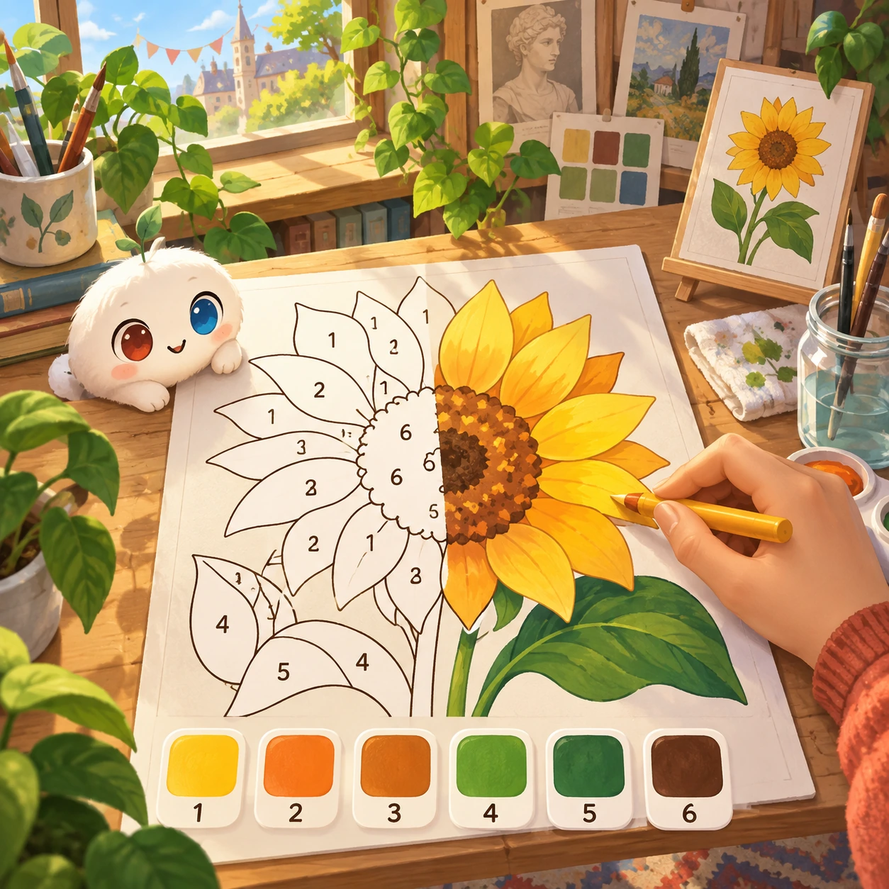
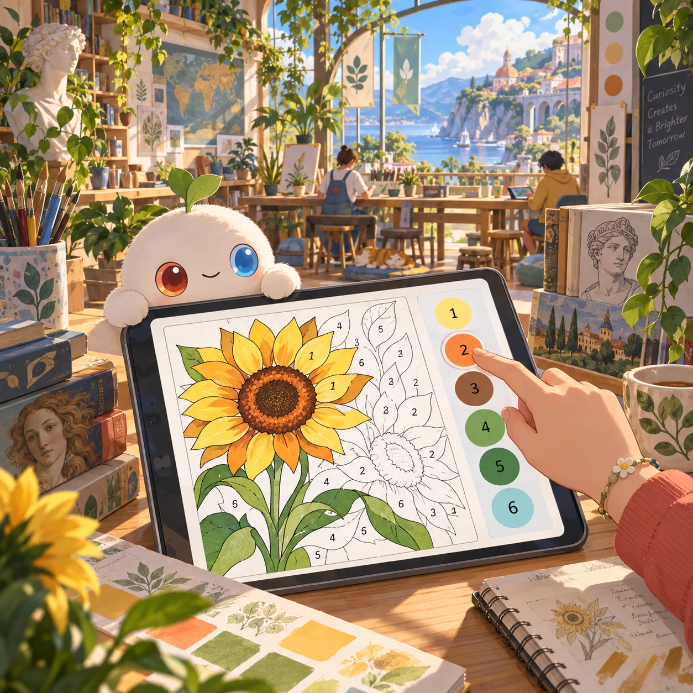
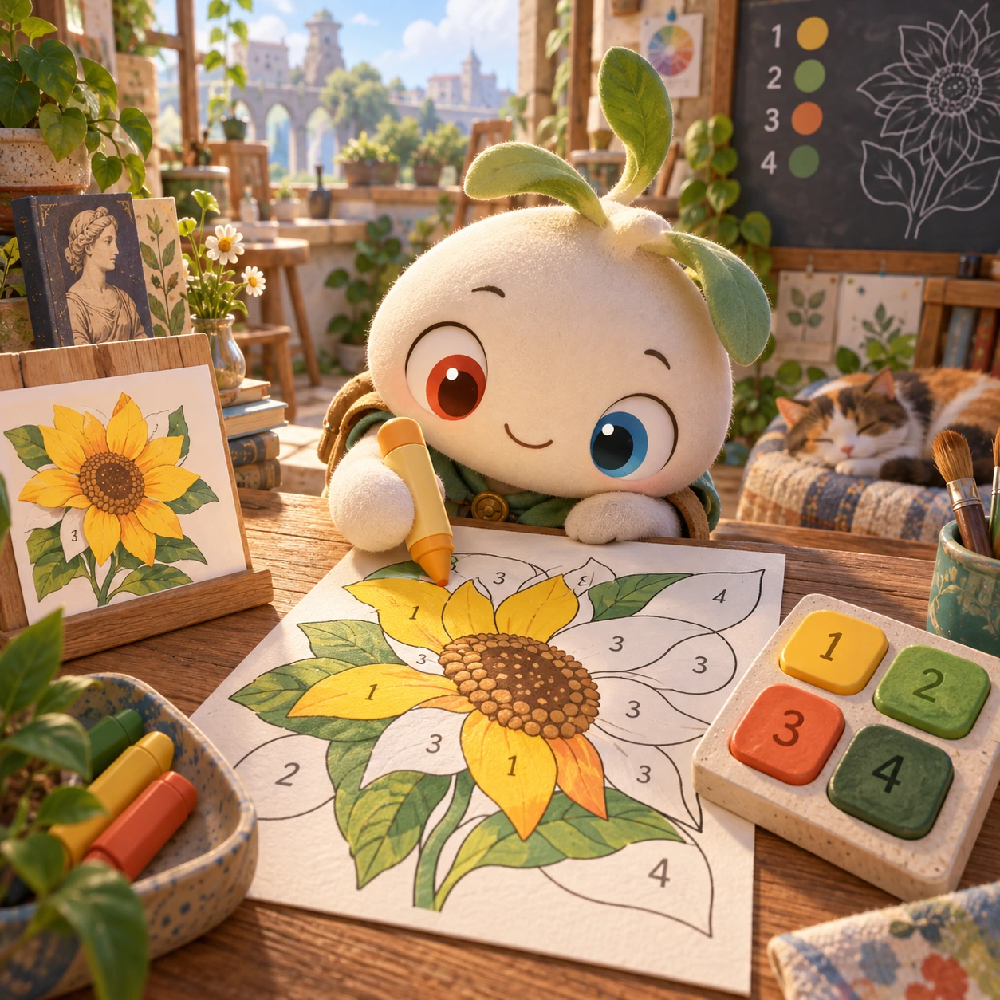
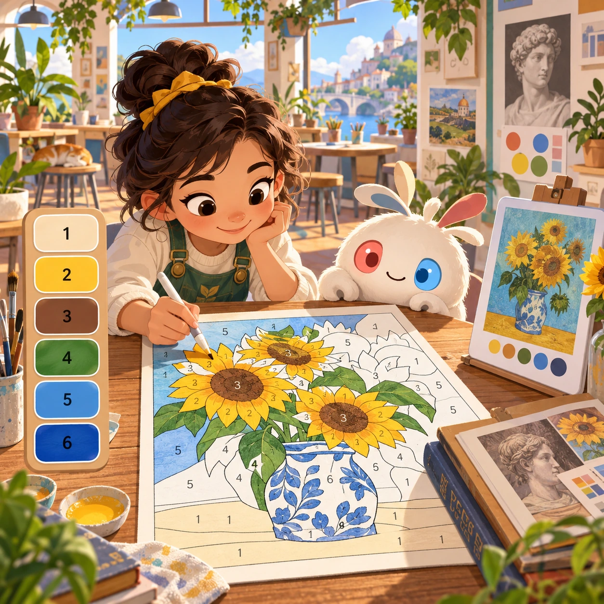

# Omi Colors

BD-01 · [Build and create](../bd.md) · Cx 2 · W1 · Original catalog

**The idea:** Fill a numbered botanical illustration with carefully chosen color swatches.

| Decision             | Proposal                                                                                                                                                                                    |
| -------------------- | ------------------------------------------------------------------------------------------------------------------------------------------------------------------------------------------- |
| Familiar mechanic    | Coloring / color by number                                                                                                                                                                  |
| Learning objective   | Colors, numbers, art history                                                                                                                                                                |
| First prototype      | One authored challenge built around the interaction above, with a clear goal, immediate feedback, restart and unlimited retries.                                                            |
| Technology           | React + SVG/DOM; deterministic state, undo and seeded levels. Start with one local screen and touch plus keyboard input.                                                                    |
| Scope boundary       | One board and one rule set; defer accounts, multiplayer, procedural content and platform SDKs.                                                                                              |
| Reuse                | Shared input, saves, accessibility, seeded state and the build and create collection shell.                                                                                                 |
| Prototype acceptance | A player can identify the next action from the screen, complete one challenge, explain the practiced idea and restart without help. Check touch and keyboard play at narrow and wide sizes. |
| Main uncertainty     | Test whether the lesson follows from play and whether the first interaction is understandable without reading.                                                                              |

## Estimated plan

**First playable version:** 12 botanical and art-history line drawings with tap-to-fill regions, a numbered palette for colour by number and a free-colour mode for toddlers, plus a gallery. No brushes, photo import or sharing.

| Measure              | Estimate                                                                                      |
| -------------------- | --------------------------------------------------------------------------------------------- |
| Youngest age         | 3+                                                                                            |
| Toddler learnability | 4 of 5 — Tap a specific big target or drag one object to a big slot; one-step goal; ages 2-3. |
| Code                 | 680 LOC, 5.7 days                                                                             |
| Assets               | 112 hours, 18.6 days                                                                          |
| Effort               | 24.3 days, risk 2 of 5                                                                        |
| Start score          | 30.4 (rank 48 of 300; lower is better)                                                        |

**Algorithms:** `flood-fill` (Coloring fill, 200 LOC) · `tap-feedback` (Tap feedback, 80 LOC)

**Assets:** 6 sprites, 3 animations, 12 backgrounds, 4 UI screens, 8 sound effects, 1 music track, 12 voice lines, 20 authored levels, 40 content items

How the numbers are computed: [development plan](../../development-plan.md#how-the-scores-work).

## Four visual directions

These are independently generated concept proposals for selecting a prototype.
The four views compare gameplay readability, world appeal, tactile identity and
room to grow. They are not screenshots of an implemented game. Native image
dimensions, hashes, exact prompts and generation provenance are recorded in the
[art manifest](../art/bd-01/manifest.json); see the [generation notes](../README.md#image-generation-and-provenance).

### Gameplay

### World

### Characters and materials

### Expanded play

## Design checks before prototyping

- Learning target: **Colors, numbers, art history**. Ask a domain reviewer to validate factual content in the mechanic.
- Keep goals cooperative or self-directed, using resources and needs. Avoid purchasable power. No pressure timers in the accessible mode.
- Use original layouts and character designs; the [legal checklist](../../legal.md) applies even when a mechanic is familiar.
- Choose the minimum [fidelity level](../../simulation-engine.md#determinism-and-fidelity-levels) the lesson needs; concept art does not establish scientific accuracy.
- Review silhouettes, text alternatives, reduced motion and non-color cues against the [adorability gate](../../lore/adorability-gate.md).

Genre context: [existing genre research](../../../case-studies/issue-1/data/research-genres-ideas.md)
and [expansion research](../../../case-studies/issue-1/data/research-visual-catalog.md).

[All concepts](../README.md) · [Pixel Studio →](bd-02.md)
