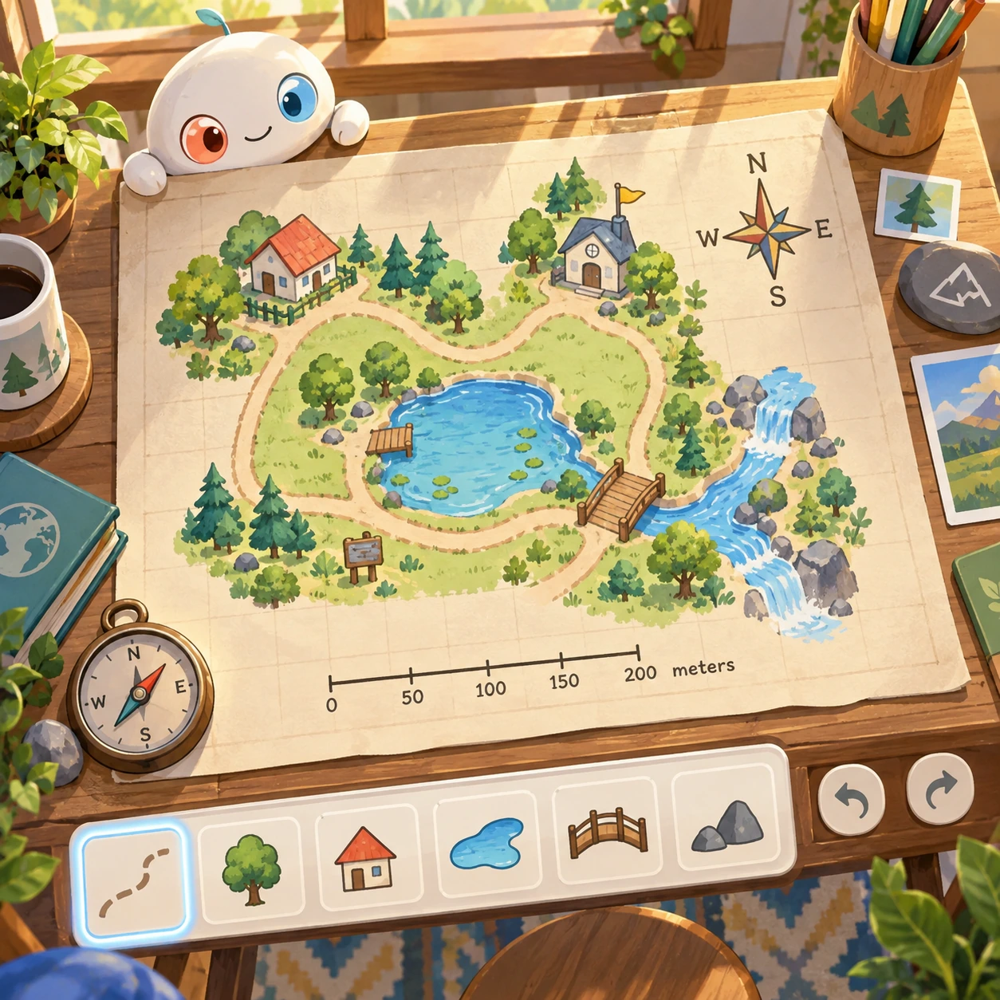
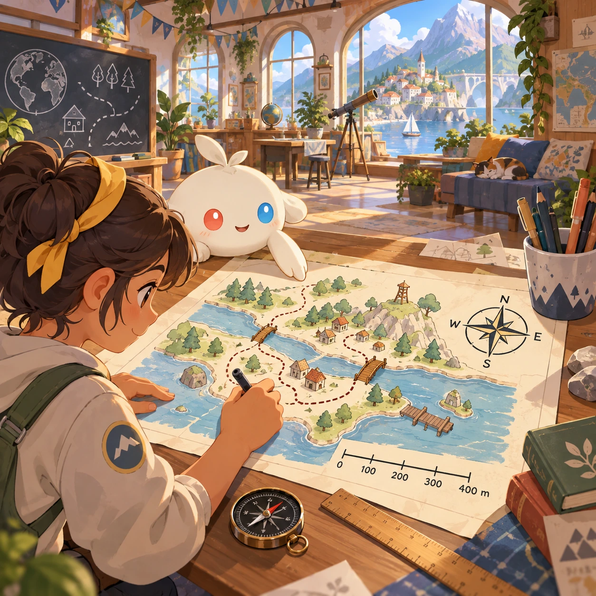
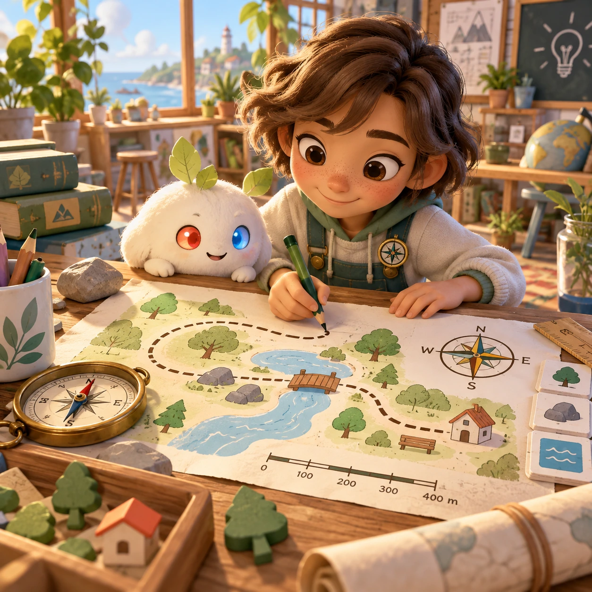
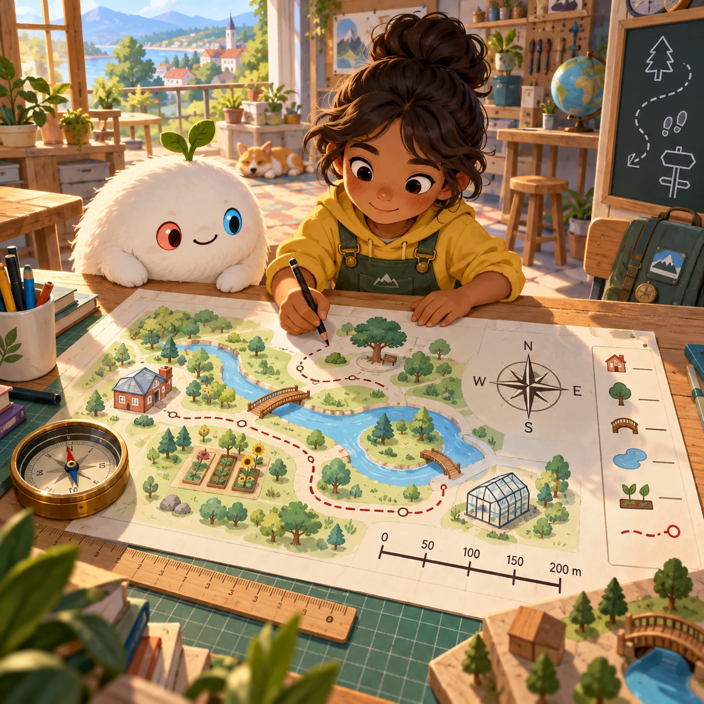
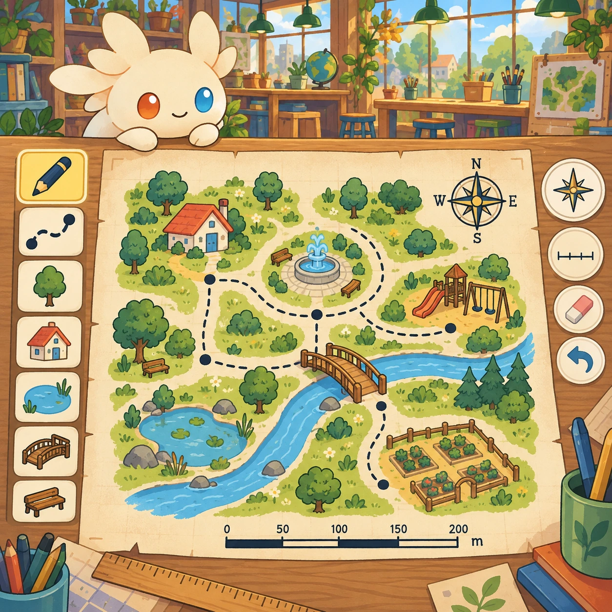
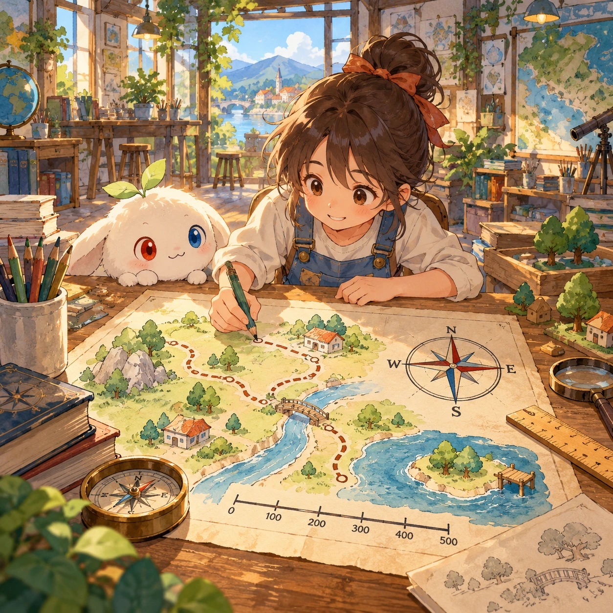

# Map Maker

BD-06 · [Build and create](../bd.md) · Cx 3 · Original catalog

**The idea:** Draw a walking map with a compass rose and a consistent distance scale.

| Decision             | Proposal                                                                                                                                                                                    |
| -------------------- | ------------------------------------------------------------------------------------------------------------------------------------------------------------------------------------------- |
| Familiar mechanic    | Map editor                                                                                                                                                                                  |
| Learning objective   | Cartography, scale, compass directions                                                                                                                                                      |
| First prototype      | One authored challenge built around the interaction above, with a clear goal, immediate feedback, restart and unlimited retries.                                                            |
| Technology           | React shell + PixiJS; use the shared simulation adapter only where motion or agent behavior requires it. Start with one bounded scene and measured frame time.                              |
| Scope boundary       | One bounded scenario and one core system; defer a full campaign, network play and production-scale content.                                                                                 |
| Reuse                | Shared input, saves, accessibility, seeded state and the build and create collection shell.                                                                                                 |
| Prototype acceptance | A player can identify the next action from the screen, complete one challenge, explain the practiced idea and restart without help. Check touch and keyboard play at narrow and wide sizes. |
| Main uncertainty     | Test whether the lesson follows from play and whether the first interaction is understandable without reading.                                                                              |

## Estimated plan

**First playable version:** Draw paths and place map symbols on a gridded sheet with a compass rose and a scale bar, plus 10 challenges to map a walking route with correct distances. No real-world map data or GPS.

| Measure              | Estimate                                                                                                   |
| -------------------- | ---------------------------------------------------------------------------------------------------------- |
| Youngest age         | 6+                                                                                                         |
| Toddler learnability | 1 of 5 — Needs reading, precise motor control, timing pressure or abstract rules; not a toddler game (6+). |
| Code                 | 1550 LOC, 12.9 days                                                                                        |
| Assets               | 129 hours, 21.5 days                                                                                       |
| Effort               | 34.4 days, risk 3 of 5                                                                                     |
| Start score          | 103.2 (rank 234 of 310; lower is better)                                                                   |

**Algorithms:** `draw-trace` (Freehand drawing, 250 LOC) · `sticker-scene` (Sticker scene, 200 LOC) · `map-geo` (Maps and geography, 400 LOC)

**Assets:** 40 sprites, 4 animations, 4 backgrounds, 6 UI screens, 8 sound effects, 1 music track, 20 voice lines, 10 authored levels, 30 content items

How the numbers are computed: [development plan](../../development-plan.md#how-the-scores-work).

## Four visual directions

These are independently generated concept proposals for selecting a prototype.
The four views compare gameplay readability, world appeal, tactile identity and
room to grow. Two additional core-screen alternatives make the flat storybook and painted anime styles explicit alongside the tactile 3D study. They are not screenshots of an implemented game. Native image
dimensions, hashes, exact prompts and generation provenance are recorded in the
[art manifest](../art/bd-06/manifest.json); see the [generation notes](../README.md#image-generation-and-provenance).

The [core prompts](../jobs/bd.json) use IDs `bd-06/01-gameplay` to `bd-06/04-discovery`. Additional [style prompts](../jobs/style-variations.json) match the two alternatives below.

### Gameplay

### World

### Characters and materials

### Expanded play

## Additional style alternatives

### Flat storybook alternative

### Painted anime alternative

## Design checks before prototyping

- Learning target: **Cartography, scale, compass directions**. Ask a domain reviewer to validate factual content in the mechanic.
- Keep goals cooperative or self-directed, using resources and needs. Avoid purchasable power. No pressure timers in the accessible mode.
- Use original layouts and character designs; the [legal checklist](../../legal.md) applies even when a mechanic is familiar.
- Choose the minimum [fidelity level](../../simulation-engine.md#determinism-and-fidelity-levels) the lesson needs; concept art does not establish scientific accuracy.
- Review silhouettes, text alternatives, reduced motion and non-color cues against the [adorability gate](../../lore/adorability-gate.md).

Genre context: [existing genre research](../../../case-studies/issue-1/data/research-genres-ideas.md)
and [expansion research](../../../case-studies/issue-1/data/research-visual-catalog.md).

[← Robot Programmer](bd-05.md) · [All concepts](../README.md) · [Marble Run →](bd-07.md)
