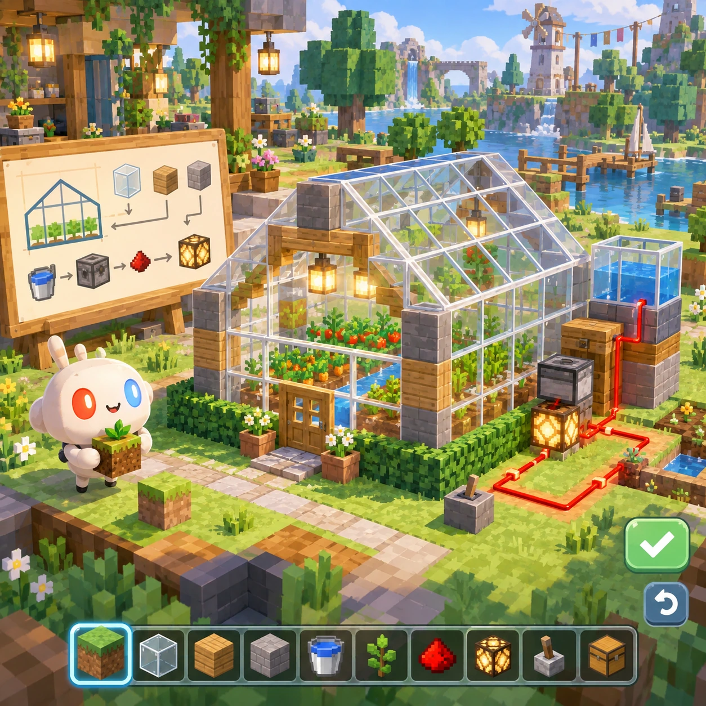
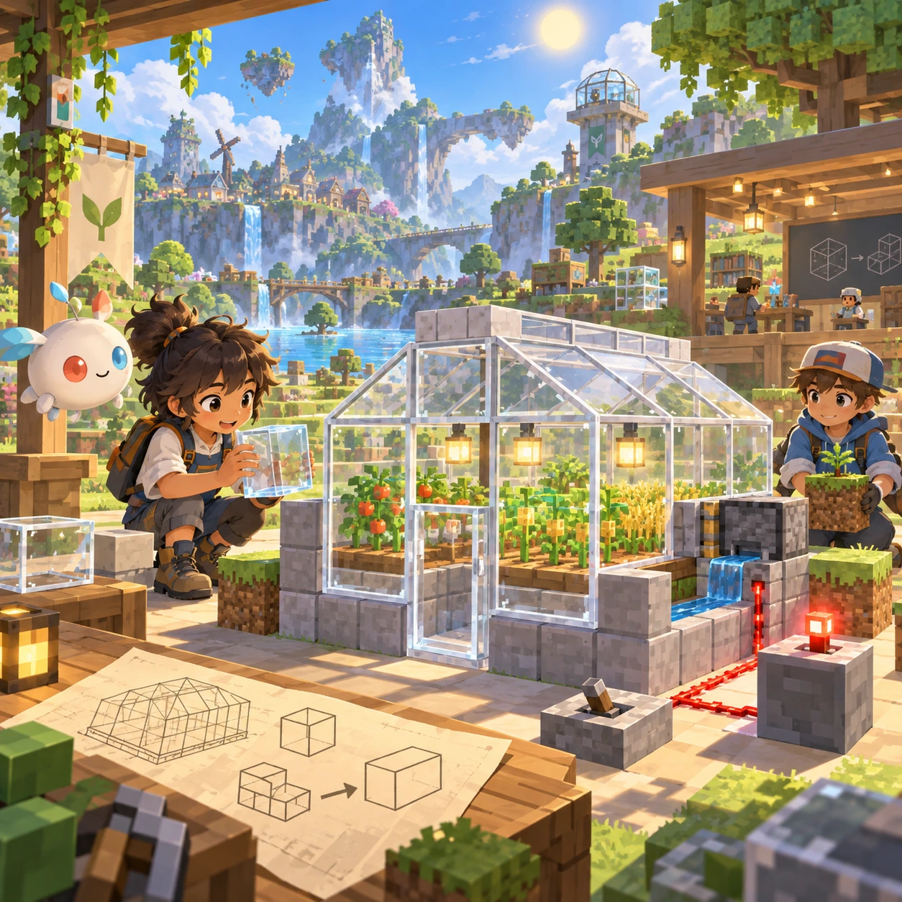
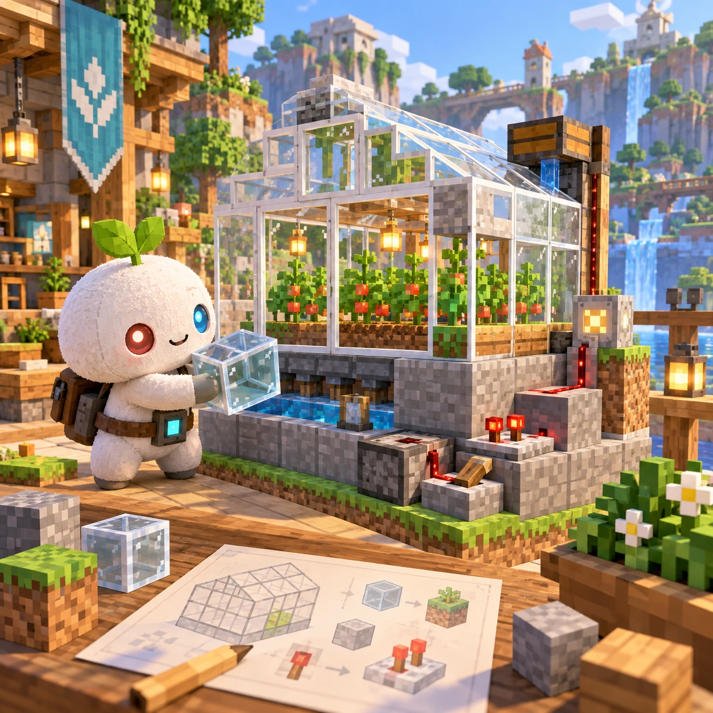
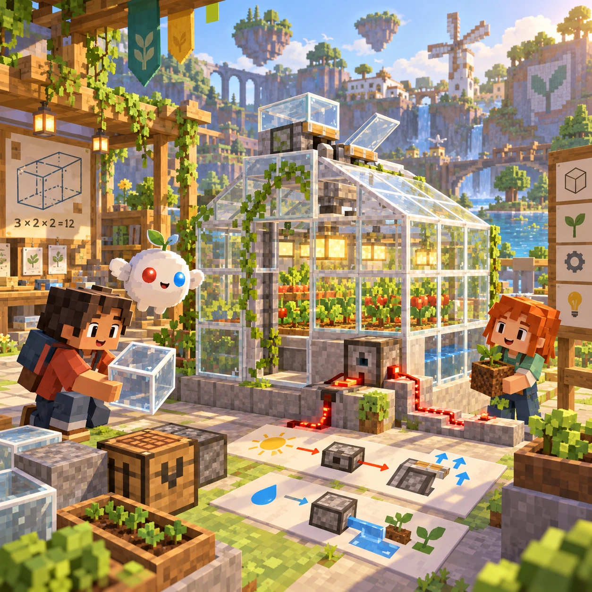
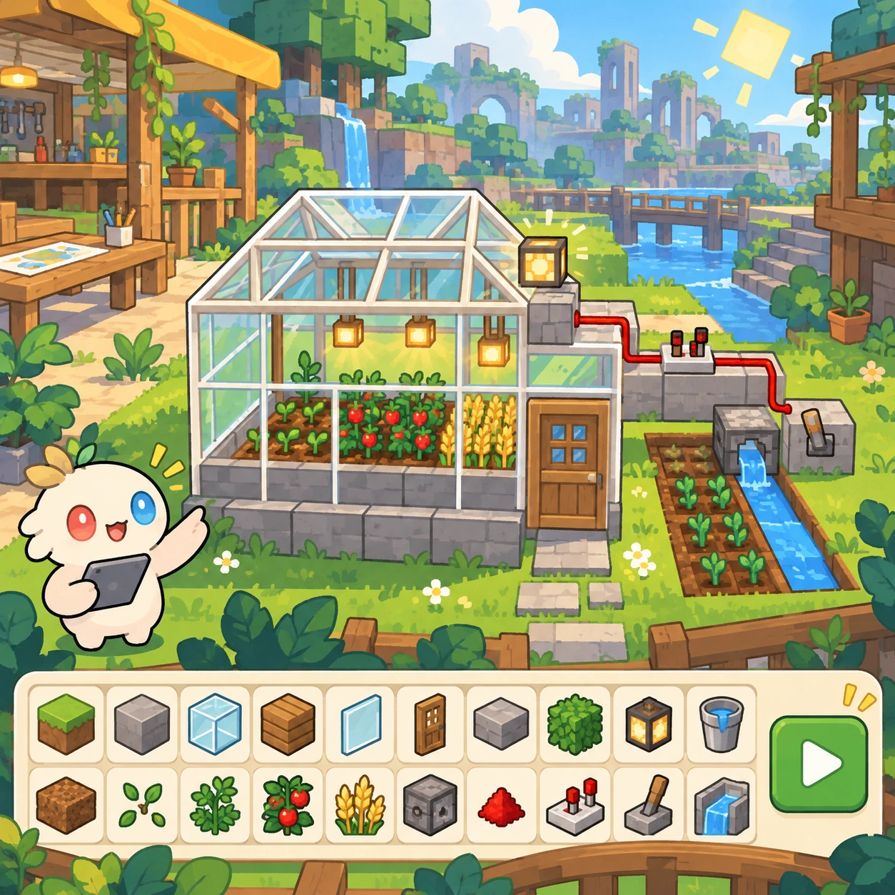
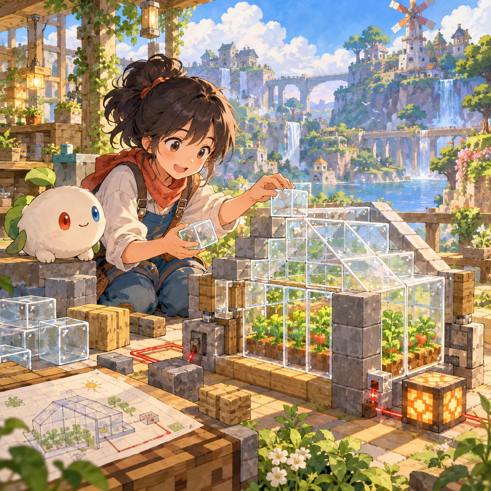

# Block World

BD-11 · [Build and create](../bd.md) · Cx 5 · Original catalog

**The idea:** Construct a small voxel greenhouse using visible blocks and simple logic wiring.

| Decision             | Proposal                                                                                                                                                                                    |
| -------------------- | ------------------------------------------------------------------------------------------------------------------------------------------------------------------------------------------- |
| Familiar mechanic    | Voxel sandbox (Minecraft)                                                                                                                                                                   |
| Learning objective   | Geometry, volume, engineering, redstone-like logic                                                                                                                                          |
| First prototype      | One authored challenge built around the interaction above, with a clear goal, immediate feedback, restart and unlimited retries.                                                            |
| Technology           | React shell + three.js/R3F and a validated simulation adapter. Begin with a small 2D reference model before a 3D vertical slice; use measured device tiers.                                 |
| Scope boundary       | One bounded scenario and one core system; defer a full campaign, network play and production-scale content.                                                                                 |
| Reuse                | Shared input, saves, accessibility, seeded state and the build and create collection shell.                                                                                                 |
| Prototype acceptance | A player can identify the next action from the screen, complete one challenge, explain the practiced idea and restart without help. Check touch and keyboard play at narrow and wide sizes. |
| Main uncertainty     | Simulation accuracy and device cost need measured evidence before extending the scenario.                                                                                                   |

## Estimated plan

**First playable version:** One small seeded 3D meadow where the player places and removes blocks, builds a greenhouse and wires simple switches and lamps, with 6 guided challenges. No survival, crafting tree or multiplayer.

| Measure              | Estimate                                                                                                   |
| -------------------- | ---------------------------------------------------------------------------------------------------------- |
| Youngest age         | 7+                                                                                                         |
| Toddler learnability | 1 of 5 — Needs reading, precise motor control, timing pressure or abstract rules; not a toddler game (6+). |
| Code                 | 5570 LOC, 46.4 days                                                                                        |
| Assets               | 306 hours, 51 days                                                                                         |
| Effort               | 97.4 days, risk 4 of 5                                                                                     |
| Start score          | 292.2 (rank 301 of 310; lower is better)                                                                   |

**Algorithms:** `voxel-build` (Voxel building, 900 LOC) · `character-3d` (3D character controller, 700 LOC) · `camera-3d` (3D camera, 300 LOC) · `terrain-gen` (Procedural terrain, 600 LOC) · `logic-circuit` (Logic circuit simulation, 450 LOC) · `day-cycle` (Day and season cycle, 120 LOC)

**Assets:** 40 sprites, 4 animations, 2 backgrounds, 10 UI screens, 24 sound effects, 3 music tracks, 20 voice lines, 6 authored levels, 40 content items, 20 3D models

How the numbers are computed: [development plan](../../development-plan.md#how-the-scores-work).

## Four visual directions

These are independently generated concept proposals for selecting a prototype.
The four views compare gameplay readability, world appeal, tactile identity and
room to grow. Two additional core-screen alternatives make the flat storybook and painted anime styles explicit alongside the tactile 3D study. They are not screenshots of an implemented game. Native image
dimensions, hashes, exact prompts and generation provenance are recorded in the
[art manifest](../art/bd-11/manifest.json); see the [generation notes](../README.md#image-generation-and-provenance).

The [core prompts](../jobs/bd.json) use IDs `bd-11/01-gameplay` to `bd-11/04-discovery`. Additional [style prompts](../jobs/style-variations.json) match the two alternatives below.

### Gameplay

### World

### Characters and materials

### Expanded play

## Additional style alternatives

### Flat storybook alternative

### Painted anime alternative

## Design checks before prototyping

- Learning target: **Geometry, volume, engineering, redstone-like logic**. Ask a domain reviewer to validate factual content in the mechanic.
- Keep goals cooperative or self-directed, using resources and needs. Avoid purchasable power. No pressure timers in the accessible mode.
- Use original layouts and character designs; the [legal checklist](../../legal.md) applies even when a mechanic is familiar.
- Choose the minimum [fidelity level](../../simulation-engine.md#determinism-and-fidelity-levels) the lesson needs; concept art does not establish scientific accuracy.
- Review silhouettes, text alternatives, reduced motion and non-color cues against the [adorability gate](../../lore/adorability-gate.md).

Genre context: [existing genre research](../../../case-studies/issue-1/data/research-genres-ideas.md)
and [expansion research](../../../case-studies/issue-1/data/research-visual-catalog.md).

[← Tiny Architect](bd-10.md) · [All concepts](../README.md) · [Room for Everyone →](bd-12.md)
