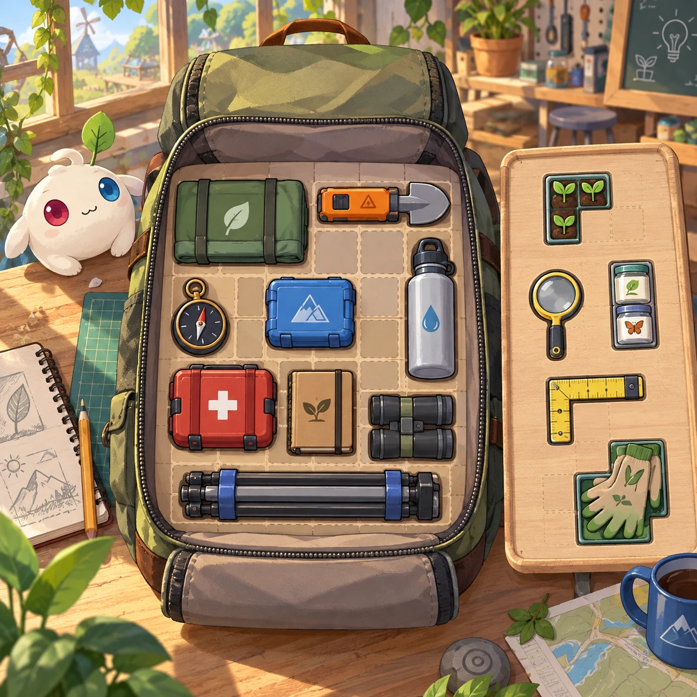
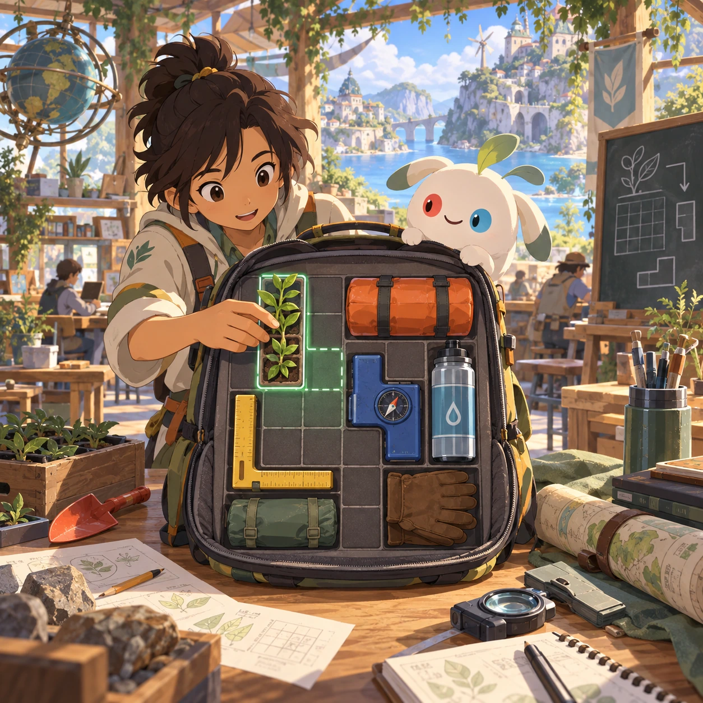
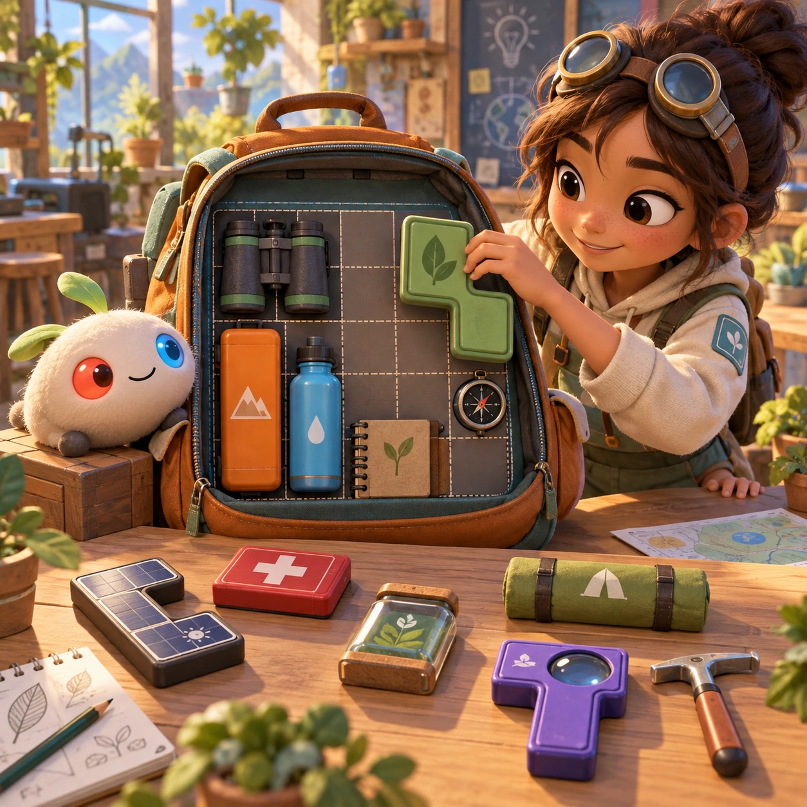
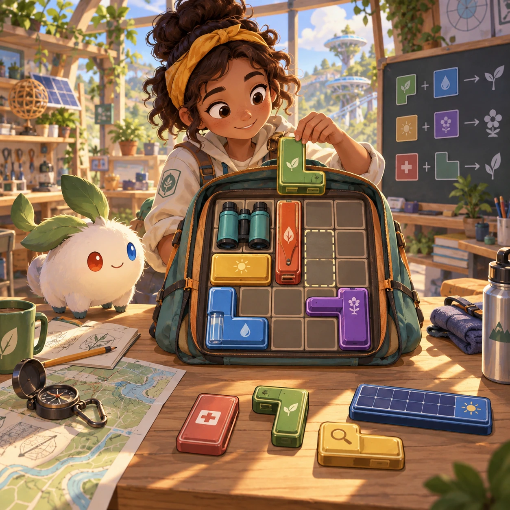

# Research Backpack

BD-13 · [Build and create](../bd.md) · Cx 2 · Added in the visual-catalog expansion

**The idea:** Fit differently shaped field tools into a gridded backpack, keeping complementary items adjacent.

| Decision             | Proposal                                                                                                                                                                                    |
| -------------------- | ------------------------------------------------------------------------------------------------------------------------------------------------------------------------------------------- |
| Familiar mechanic    | Inventory packing and synergies                                                                                                                                                             |
| Learning objective   | Area and adjacency constraints                                                                                                                                                              |
| First prototype      | One authored challenge built around the interaction above, with a clear goal, immediate feedback, restart and unlimited retries.                                                            |
| Technology           | React + SVG/DOM; deterministic state, undo and seeded levels. Start with one local screen and touch plus keyboard input.                                                                    |
| Scope boundary       | One board and one rule set; defer accounts, multiplayer, procedural content and platform SDKs.                                                                                              |
| Reuse                | Shared input, saves, accessibility, seeded state and the build and create collection shell.                                                                                                 |
| Prototype acceptance | A player can identify the next action from the screen, complete one challenge, explain the practiced idea and restart without help. Check touch and keyboard play at narrow and wide sizes. |
| Main uncertainty     | Test whether the lesson follows from play and whether the first interaction is understandable without reading.                                                                              |

## Estimated plan

**First playable version:** A gridded backpack and 30 field tools with tetromino-like shapes; drag and rotate them to fit, with glowing synergy links for complementary neighbours across 25 packing tasks. No combat or loot.

| Measure              | Estimate                                                                               |
| -------------------- | -------------------------------------------------------------------------------------- |
| Youngest age         | 5+                                                                                     |
| Toddler learnability | 2 of 5 — Needs simple rules, turns, a sequence or remembering several steps; ages 4-6. |
| Code                 | 1150 LOC, 9.6 days                                                                     |
| Assets               | 110 hours, 18.4 days                                                                   |
| Effort               | 28 days, risk 3 of 5                                                                   |
| Start score          | 56 (rank 138 of 300; lower is better)                                                  |

**Algorithms:** `grid-board` (Grid board, 150 LOC) · `drag-drop-snap` (Drag and snap, 150 LOC) · `puzzle-solver-hints` (Puzzle solver and hints, 400 LOC)

**Assets:** 30 sprites, 3 animations, 2 backgrounds, 4 UI screens, 8 sound effects, 1 music track, 8 voice lines, 25 authored levels, 30 content items

How the numbers are computed: [development plan](../../development-plan.md#how-the-scores-work).

## Four visual directions

These are independently generated concept proposals for selecting a prototype.
The four views compare gameplay readability, world appeal, tactile identity and
room to grow. They are not screenshots of an implemented game. Native image
dimensions, hashes, exact prompts and generation provenance are recorded in the
[art manifest](../art/bd-13/manifest.json); see the [generation notes](../README.md#image-generation-and-provenance).

### Gameplay

### World

### Characters and materials

### Expanded play

## Design checks before prototyping

- Learning target: **Area and adjacency constraints**. Ask a domain reviewer to validate factual content in the mechanic.
- Keep goals cooperative or self-directed, using resources and needs. Avoid purchasable power. No pressure timers in the accessible mode.
- Use original layouts and character designs; the [legal checklist](../../legal.md) applies even when a mechanic is familiar.
- Choose the minimum [fidelity level](../../simulation-engine.md#determinism-and-fidelity-levels) the lesson needs; concept art does not establish scientific accuracy.
- Review silhouettes, text alternatives, reduced motion and non-color cues against the [adorability gate](../../lore/adorability-gate.md).

Genre context: [existing genre research](../../../case-studies/issue-1/data/research-genres-ideas.md)
and [expansion research](../../../case-studies/issue-1/data/research-visual-catalog.md).

[← Room for Everyone](bd-12.md) · [All concepts](../README.md) · [Clay and Symmetry →](bd-14.md)
