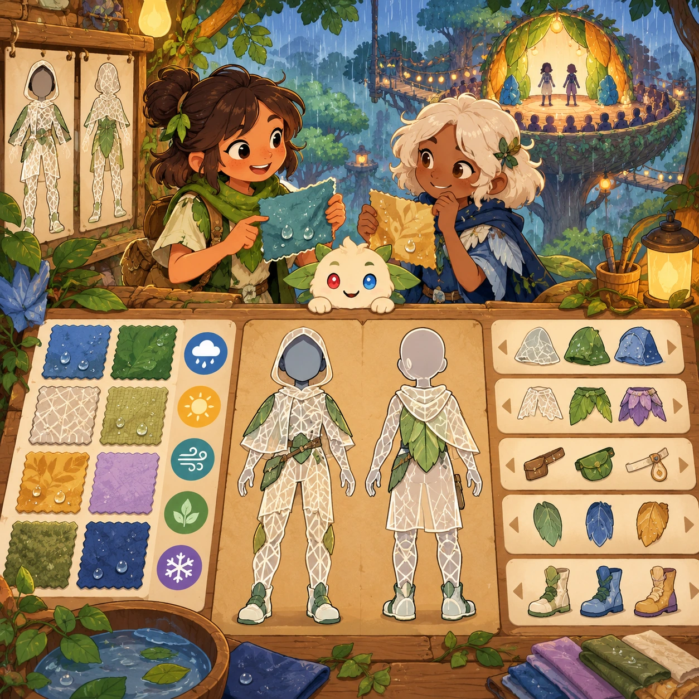
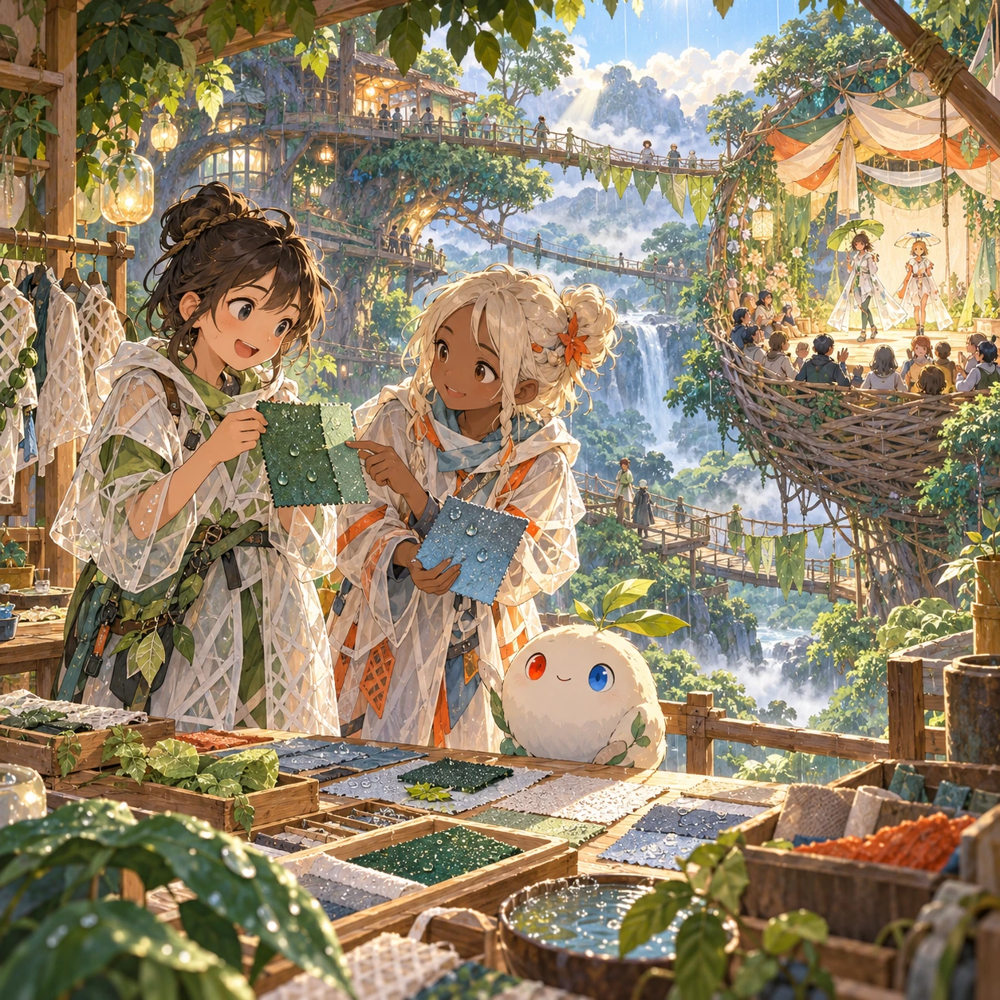
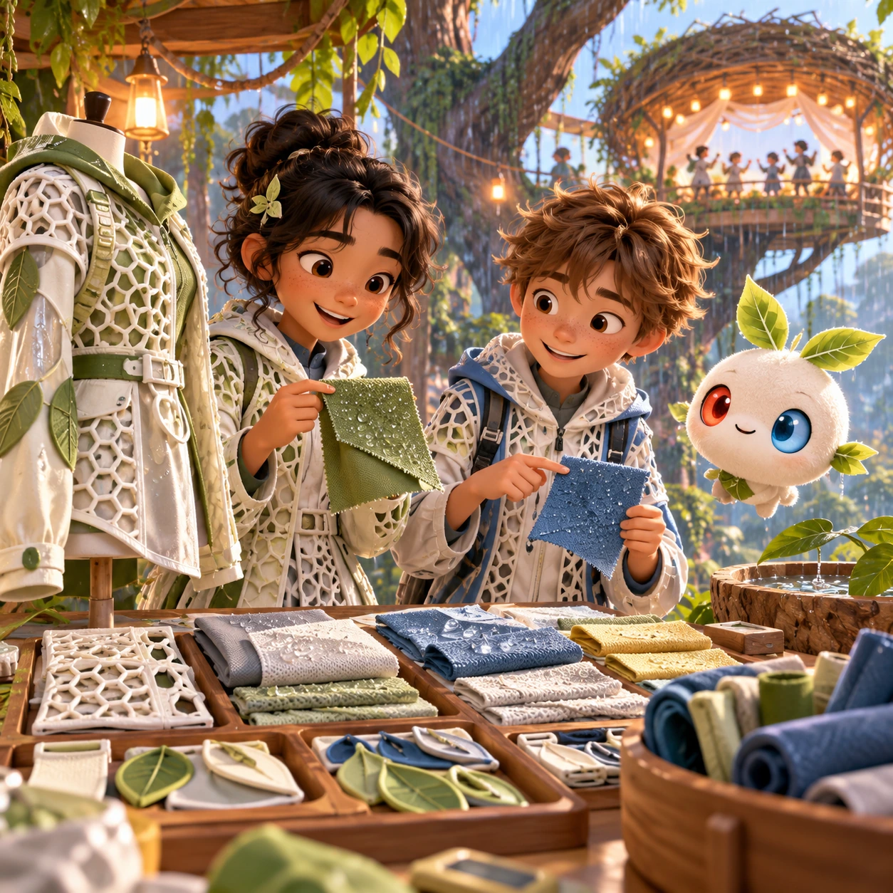
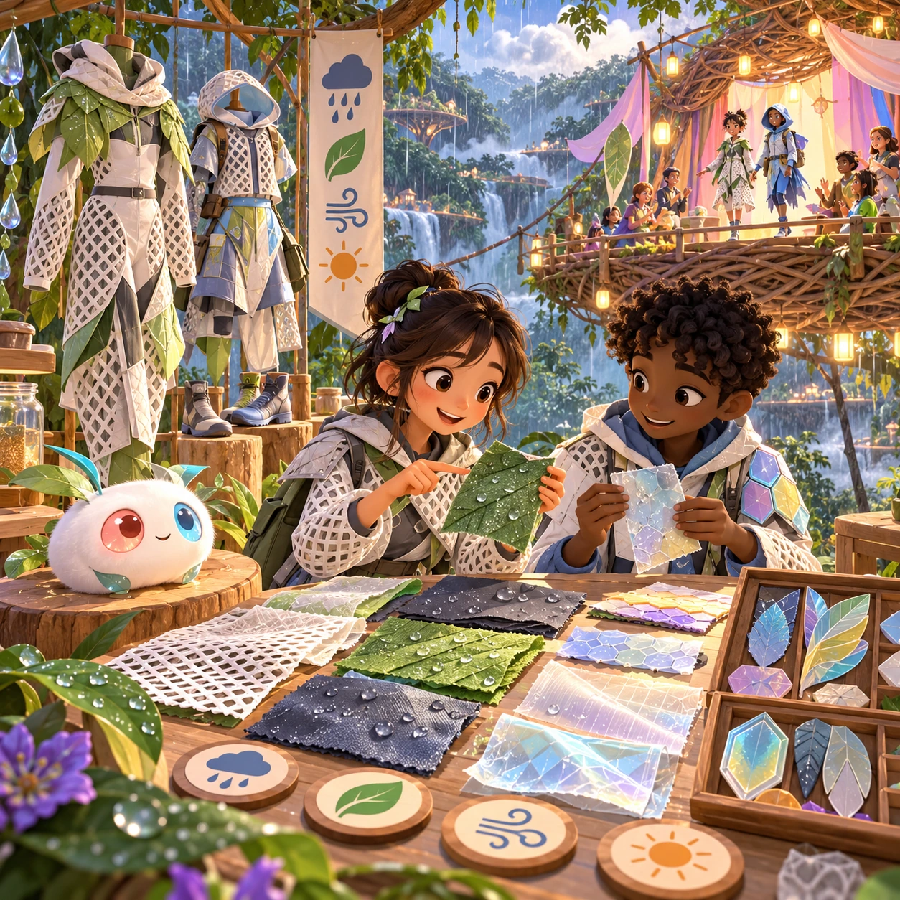

# Repair Runway

BD-15 · [Build and create](../bd.md) · Cx 2 · Ages 6+ · Research catalog

**The idea:** Choose repaired white lattice suit layers and small accent panels for a rainy forest walk; two friends compare fabric swatches under droplets before a friendly show in a tree-crown nest.

| Decision             | Proposal                                                                                                                                                                                    |
| -------------------- | ------------------------------------------------------------------------------------------------------------------------------------------------------------------------------------------- |
| Familiar mechanic    | Themed outfit design and cooperative showcase                                                                                                                                               |
| Learning objective   | Materials, reuse, weather suitability                                                                                                                                                       |
| First prototype      | One authored challenge built around the interaction above, with a clear goal, immediate feedback, restart and unlimited retries.                                                            |
| Technology           | React + SVG/DOM; deterministic state, undo and seeded levels. Start with one local screen and touch plus keyboard input.                                                                    |
| Scope boundary       | One board and one rule set; defer accounts, multiplayer, procedural content and platform SDKs.                                                                                              |
| Reuse                | Shared input, saves, accessibility, seeded state and the build and create collection shell.                                                                                                 |
| Prototype acceptance | A player can identify the next action from the screen, complete one challenge, explain the practiced idea and restart without help. Check touch and keyboard play at narrow and wide sizes. |
| Main uncertainty     | Test whether the lesson follows from play and whether the first interaction is understandable without reading.                                                                              |

## Estimated plan

**First playable version:** One host, twelve reusable garment panels and three weather briefs; explain each material choice, no body ratings, public chat, beauty rankings or paid advantages.

| Measure              | Estimate                                                                                                   |
| -------------------- | ---------------------------------------------------------------------------------------------------------- |
| Youngest age         | 6+                                                                                                         |
| Toddler learnability | 1 of 5 — Needs reading, precise motor control, timing pressure or abstract rules; not a toddler game (6+). |
| Code                 | 1020 LOC, 8.5 days                                                                                         |
| Assets               | 93 hours, 15.5 days                                                                                        |
| Effort               | 24 days, risk 2 of 5                                                                                       |
| Start score          | 72 (rank 181 of 310; lower is better)                                                                      |

**Algorithms:** `dress-up-layers` (Layered dress-up, 150 LOC) · `sort-classify` (Sorting by attribute, 120 LOC) · `quest-state` (Quest and story state, 300 LOC)

**Assets:** 24 sprites, 5 animations, 3 backgrounds, 4 UI screens, 8 sound effects, 1 music track, 12 voice lines, 6 authored levels, 24 content items

How the numbers are computed: [development plan](../../development-plan.md#how-the-scores-work).

## Four visual directions

These are independently generated concept proposals for selecting a prototype.
The four views compare gameplay readability, world appeal, tactile identity and
room to grow. They are not screenshots of an implemented game. Native image
dimensions, hashes, exact prompts and generation provenance are recorded in the
[art manifest](../art/bd-15/manifest.json); see the [generation notes](../README.md#image-generation-and-provenance).

The [core prompts](../jobs/bd.json) use IDs `bd-15/01-gameplay` to `bd-15/04-discovery`.

### Gameplay

### World

### Characters and materials

### Expanded play

## Design checks before prototyping

- Learning target: **Materials, reuse, weather suitability**. Ask a domain reviewer to validate factual content in the mechanic.
- Keep goals cooperative or self-directed, using resources and needs. Avoid purchasable power. No pressure timers in the accessible mode.
- Use original layouts and character designs; the [legal checklist](../../legal.md) applies even when a mechanic is familiar.
- Choose the minimum [fidelity level](../../simulation-engine.md#determinism-and-fidelity-levels) the lesson needs; concept art does not establish scientific accuracy.
- Review silhouettes, text alternatives, reduced motion and non-color cues against the [adorability gate](../../lore/adorability-gate.md).

Genre context: [existing genre research](../../../case-studies/issue-1/data/research-genres-ideas.md)
and [expansion research](../../../case-studies/issue-1/data/research-visual-catalog.md).

[← Clay and Symmetry](bd-14.md) · [All concepts](../README.md)
