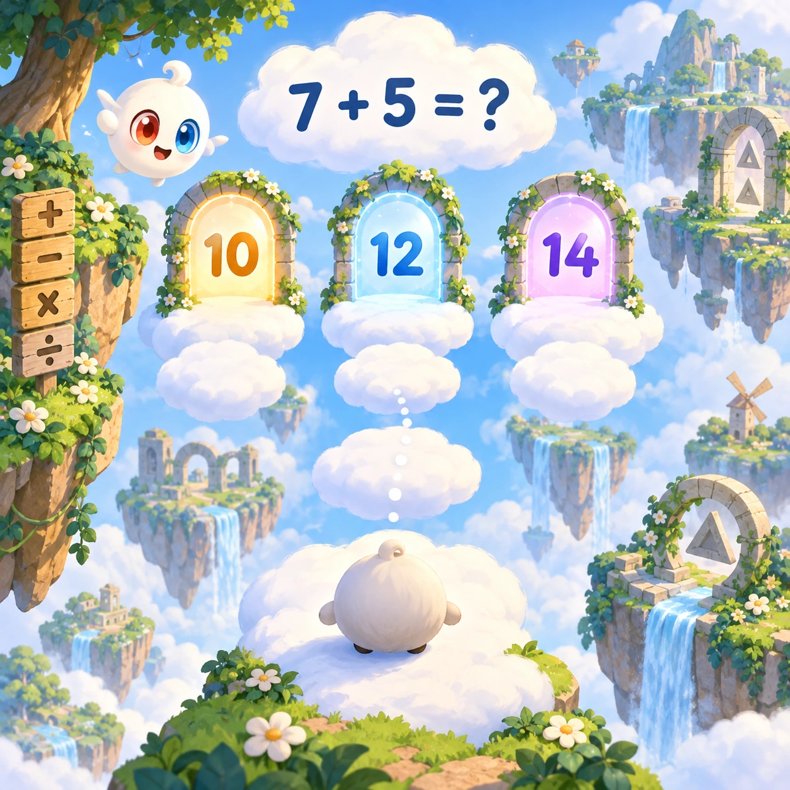
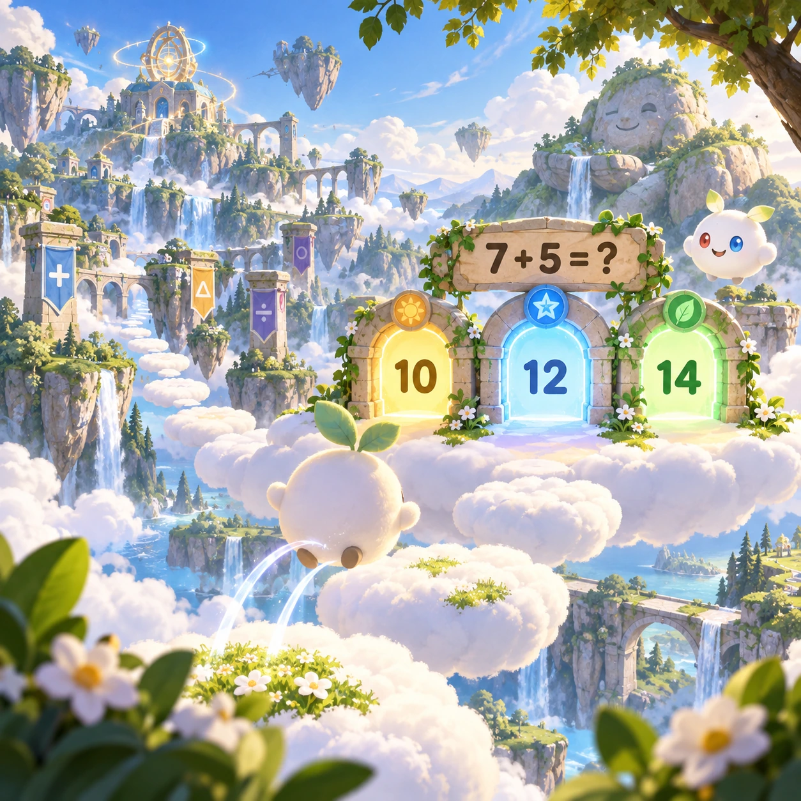
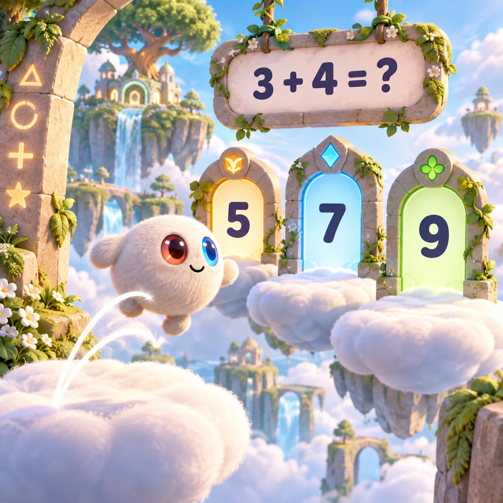
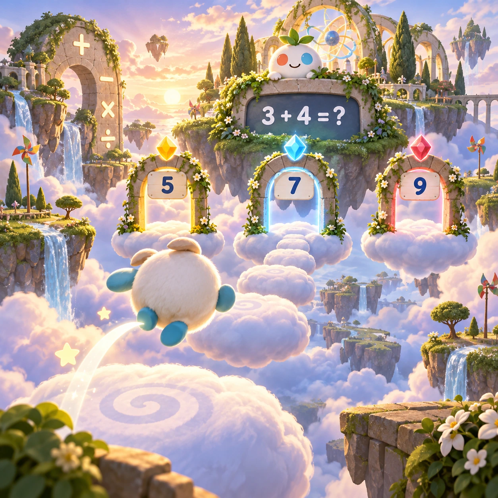
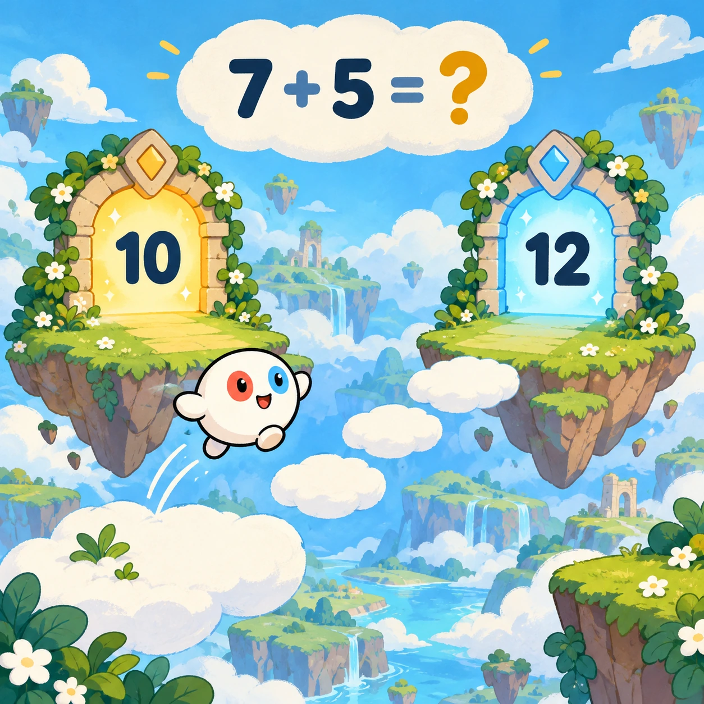
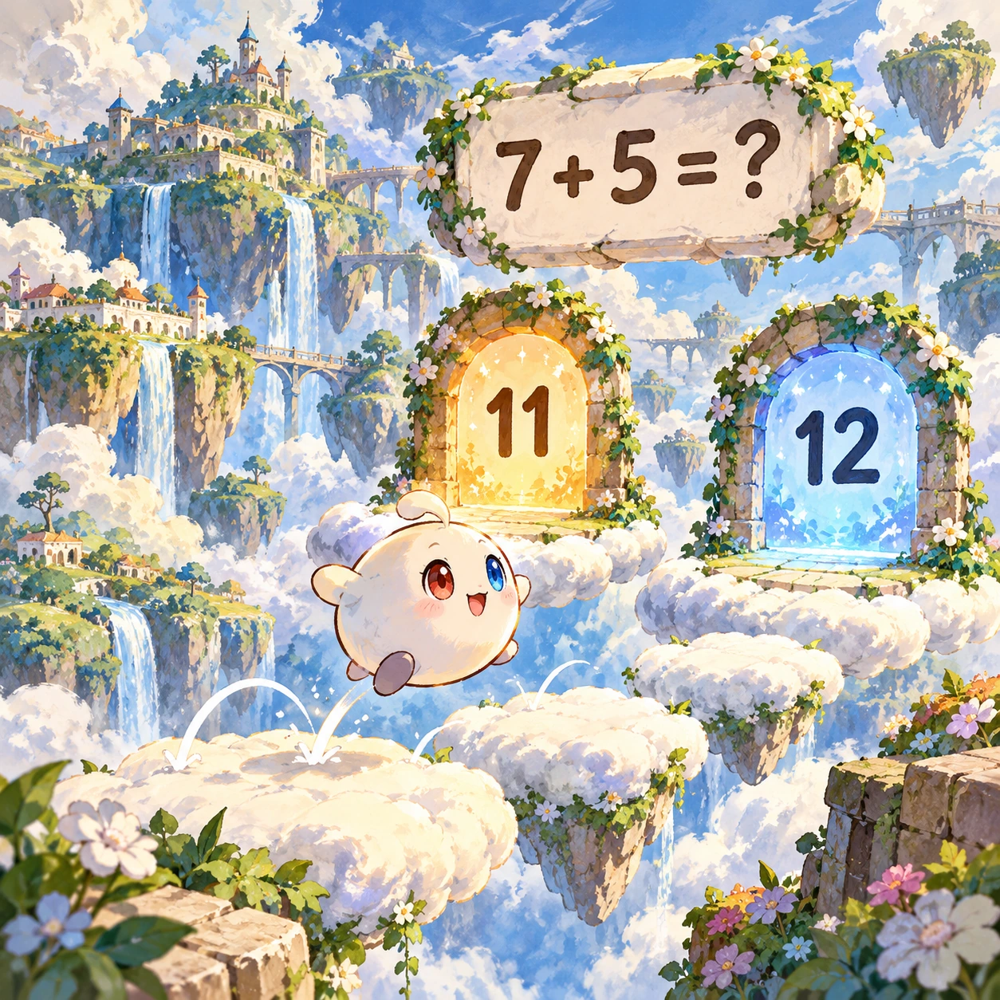

# Linky Hop

ML-01 · [Math and logic](../ml.md) · Cx 1 · W1 · Original catalog

**The idea:** Choose an arithmetic answer gate for a round link friend hopping between clouds.

| Decision             | Proposal                                                                                                                                                                                    |
| -------------------- | ------------------------------------------------------------------------------------------------------------------------------------------------------------------------------------------- |
| Familiar mechanic    | One-tap flyer                                                                                                                                                                               |
| Learning objective   | Mental arithmetic                                                                                                                                                                           |
| First prototype      | One authored challenge built around the interaction above, with a clear goal, immediate feedback, restart and unlimited retries.                                                            |
| Technology           | React + SVG/DOM; deterministic state, undo and seeded levels. Start with one local screen and touch plus keyboard input.                                                                    |
| Scope boundary       | One board and one rule set; defer accounts, multiplayer, procedural content and platform SDKs.                                                                                              |
| Reuse                | Shared input, saves, accessibility, seeded state and the math and logic collection shell.                                                                                                   |
| Prototype acceptance | A player can identify the next action from the screen, complete one challenge, explain the practiced idea and restart without help. Check touch and keyboard play at narrow and wide sizes. |
| Main uncertainty     | Test whether the lesson follows from play and whether the first interaction is understandable without reading.                                                                              |

## Estimated plan

**First playable version:** Linky hops between clouds and one tap picks one of two or three answer gates for addition and subtraction within 20, over 10 gentle stages; a wrong gate just loops back. Scores and speed-up are left out.

| Measure              | Estimate                                                                                                   |
| -------------------- | ---------------------------------------------------------------------------------------------------------- |
| Youngest age         | 6+                                                                                                         |
| Toddler learnability | 1 of 5 — Needs reading, precise motor control, timing pressure or abstract rules; not a toddler game (6+). |
| Code                 | 930 LOC, 7.8 days                                                                                          |
| Assets               | 84 hours, 14 days                                                                                          |
| Effort               | 21.8 days, risk 2 of 5                                                                                     |
| Start score          | 65.4 (rank 164 of 310; lower is better)                                                                    |

**Algorithms:** `runner-loop` (Endless runner, 350 LOC) · `arithmetic-gen` (Arithmetic generator, 200 LOC) · `tap-feedback` (Tap feedback, 80 LOC)

**Assets:** 16 sprites, 5 animations, 3 backgrounds, 3 UI screens, 10 sound effects, 1 music track, 20 voice lines, 10 authored levels

How the numbers are computed: [development plan](../../development-plan.md#how-the-scores-work).

## Four visual directions

These are independently generated concept proposals for selecting a prototype.
The four views compare gameplay readability, world appeal, tactile identity and
room to grow. Two additional core-screen alternatives make the flat storybook and painted anime styles explicit alongside the tactile 3D study. They are not screenshots of an implemented game. Native image
dimensions, hashes, exact prompts and generation provenance are recorded in the
[art manifest](../art/ml-01/manifest.json); see the [generation notes](../README.md#image-generation-and-provenance).

The [core prompts](../jobs/ml.json) use IDs `ml-01/01-gameplay` to `ml-01/04-discovery`. Additional [style prompts](../jobs/style-variations.json) match the two alternatives below.

### Gameplay

### World

### Characters and materials

### Expanded play

## Additional style alternatives

### Flat storybook alternative

### Painted anime alternative

## Design checks before prototyping

- Learning target: **Mental arithmetic**. Ask a domain reviewer to validate factual content in the mechanic.
- Keep goals cooperative or self-directed, using resources and needs. Avoid purchasable power. No pressure timers in the accessible mode.
- Use original layouts and character designs; the [legal checklist](../../legal.md) applies even when a mechanic is familiar.
- Choose the minimum [fidelity level](../../simulation-engine.md#determinism-and-fidelity-levels) the lesson needs; concept art does not establish scientific accuracy.
- Review silhouettes, text alternatives, reduced motion and non-color cues against the [adorability gate](../../lore/adorability-gate.md).

Genre context: [existing genre research](../../../case-studies/issue-1/data/research-genres-ideas.md)
and [expansion research](../../../case-studies/issue-1/data/research-visual-catalog.md).

[All concepts](../README.md) · [Number Line Jump →](ml-02.md)
