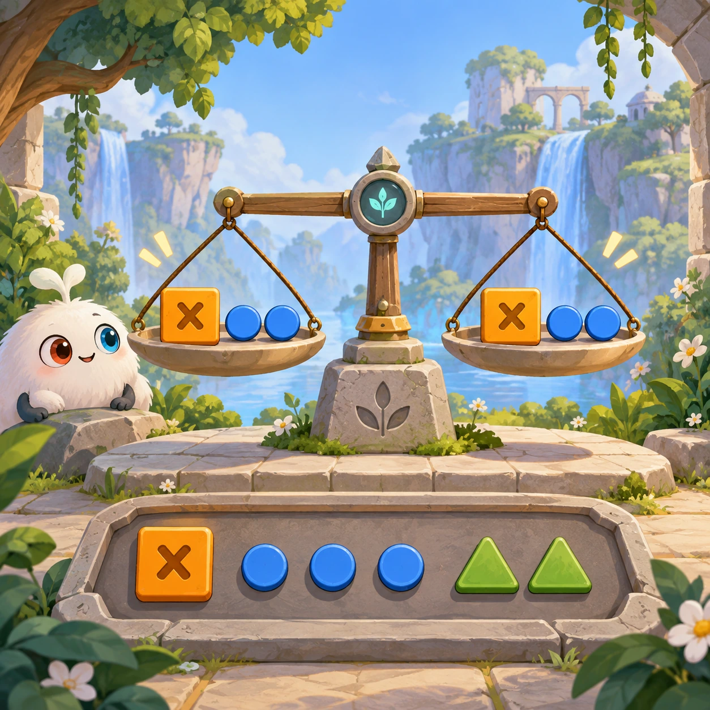
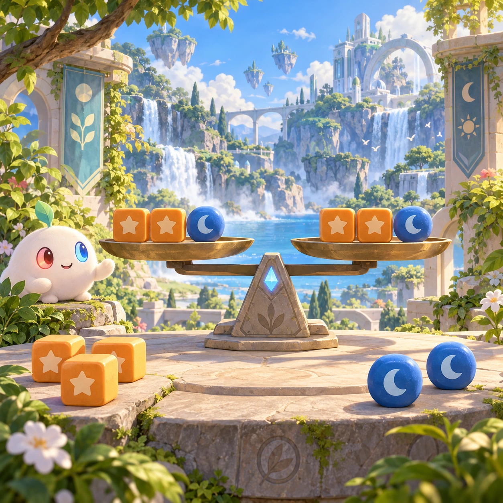
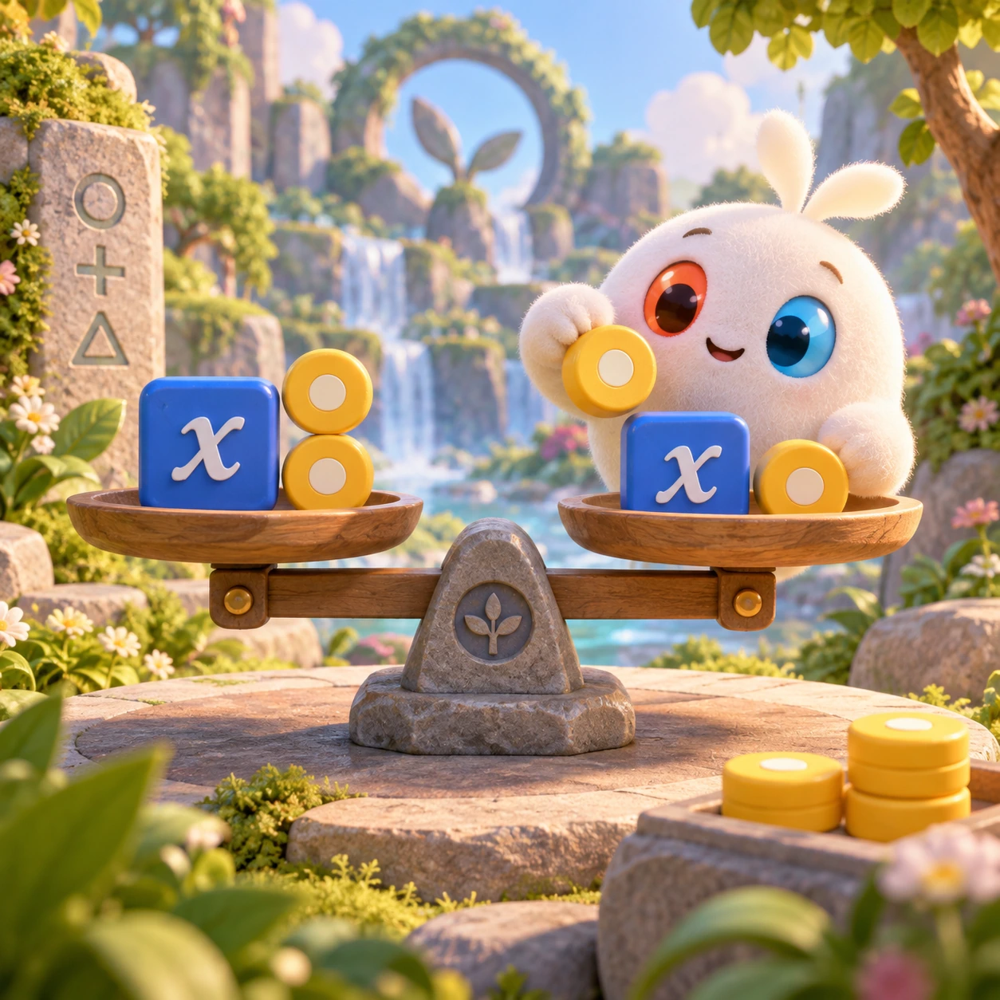
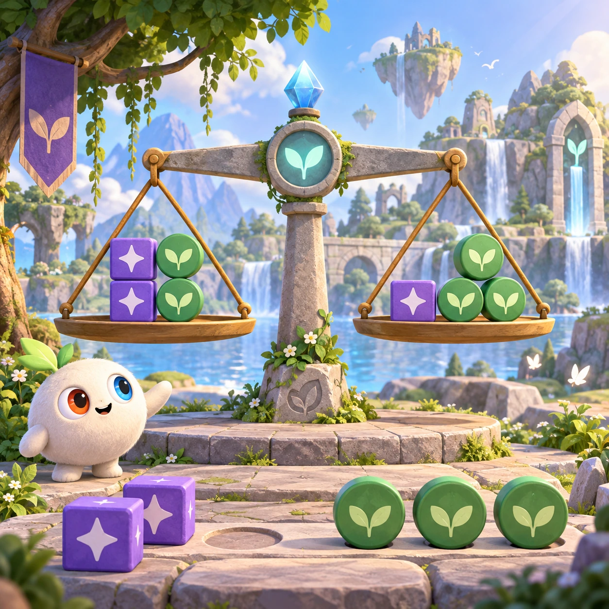

# Balance Friends

ML-08 · [Math and logic](../ml.md) · Cx 2 · Original catalog

**The idea:** Balance identical tokens on both pans of a scale to preserve an equation.

| Decision             | Proposal                                                                                                                                                                                    |
| -------------------- | ------------------------------------------------------------------------------------------------------------------------------------------------------------------------------------------- |
| Familiar mechanic    | Balance-scale algebra (DragonBox-like)                                                                                                                                                      |
| Learning objective   | Equations: do the same to both sides                                                                                                                                                        |
| First prototype      | One authored challenge built around the interaction above, with a clear goal, immediate feedback, restart and unlimited retries.                                                            |
| Technology           | React + SVG/DOM; deterministic state, undo and seeded levels. Start with one local screen and touch plus keyboard input.                                                                    |
| Scope boundary       | One board and one rule set; defer accounts, multiplayer, procedural content and platform SDKs.                                                                                              |
| Reuse                | Shared input, saves, accessibility, seeded state and the math and logic collection shell.                                                                                                   |
| Prototype acceptance | A player can identify the next action from the screen, complete one challenge, explain the practiced idea and restart without help. Check touch and keyboard play at narrow and wide sizes. |
| Main uncertainty     | Test whether the lesson follows from play and whether the first interaction is understandable without reading.                                                                              |

## Estimated plan

**First playable version:** 30 balance puzzles where tokens are added or removed from both pans of a scale until one mystery box stands alone, slowly turning into letters and numbers. Fractions and parentheses are deferred.

| Measure              | Estimate                                                                               |
| -------------------- | -------------------------------------------------------------------------------------- |
| Youngest age         | 5+                                                                                     |
| Toddler learnability | 2 of 5 — Needs simple rules, turns, a sequence or remembering several steps; ages 4-6. |
| Code                 | 1450 LOC, 12.1 days                                                                    |
| Assets               | 120 hours, 20 days                                                                     |
| Effort               | 32.1 days, risk 3 of 5                                                                 |
| Start score          | 64.2 (rank 162 of 300; lower is better)                                                |

**Algorithms:** `drag-drop-snap` (Drag and snap, 150 LOC) · `tween-cause-effect` (Cause-and-effect animation, 100 LOC) · `puzzle-solver-hints` (Puzzle solver and hints, 400 LOC)

**Assets:** 24 sprites, 6 animations, 2 backgrounds, 4 UI screens, 10 sound effects, 1 music track, 30 voice lines, 30 authored levels

How the numbers are computed: [development plan](../../development-plan.md#how-the-scores-work).

## Four visual directions

These are independently generated concept proposals for selecting a prototype.
The four views compare gameplay readability, world appeal, tactile identity and
room to grow. They are not screenshots of an implemented game. Native image
dimensions, hashes, exact prompts and generation provenance are recorded in the
[art manifest](../art/ml-08/manifest.json); see the [generation notes](../README.md#image-generation-and-provenance).

### Gameplay

### World

### Characters and materials

### Expanded play

## Design checks before prototyping

- Learning target: **Equations: do the same to both sides**. Ask a domain reviewer to validate factual content in the mechanic.
- Keep goals cooperative or self-directed, using resources and needs. Avoid purchasable power. No pressure timers in the accessible mode.
- Use original layouts and character designs; the [legal checklist](../../legal.md) applies even when a mechanic is familiar.
- Choose the minimum [fidelity level](../../simulation-engine.md#determinism-and-fidelity-levels) the lesson needs; concept art does not establish scientific accuracy.
- Review silhouettes, text alternatives, reduced motion and non-color cues against the [adorability gate](../../lore/adorability-gate.md).

Genre context: [existing genre research](../../../case-studies/issue-1/data/research-genres-ideas.md)
and [expansion research](../../../case-studies/issue-1/data/research-visual-catalog.md).

[← Fraction Kitchen](ml-07.md) · [All concepts](../README.md) · [Cage Sums →](ml-09.md)
