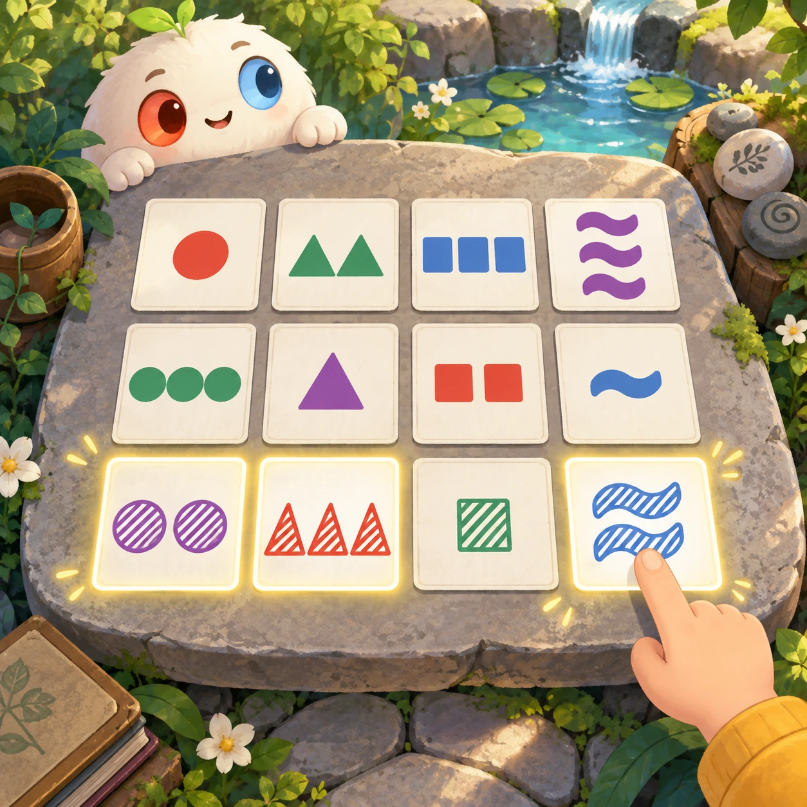
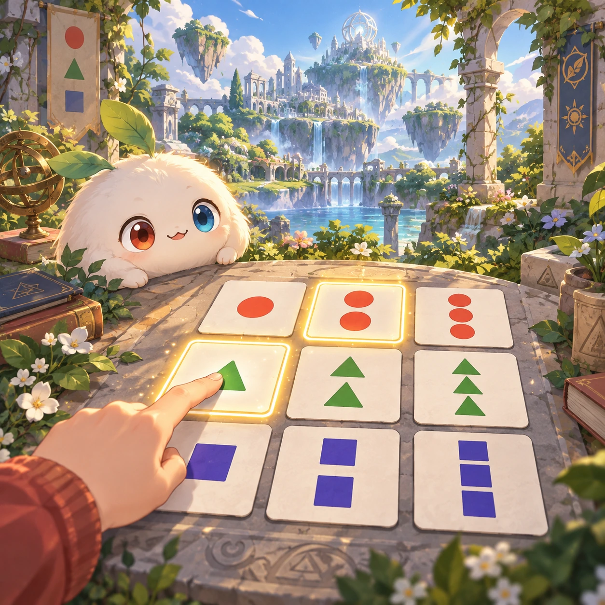
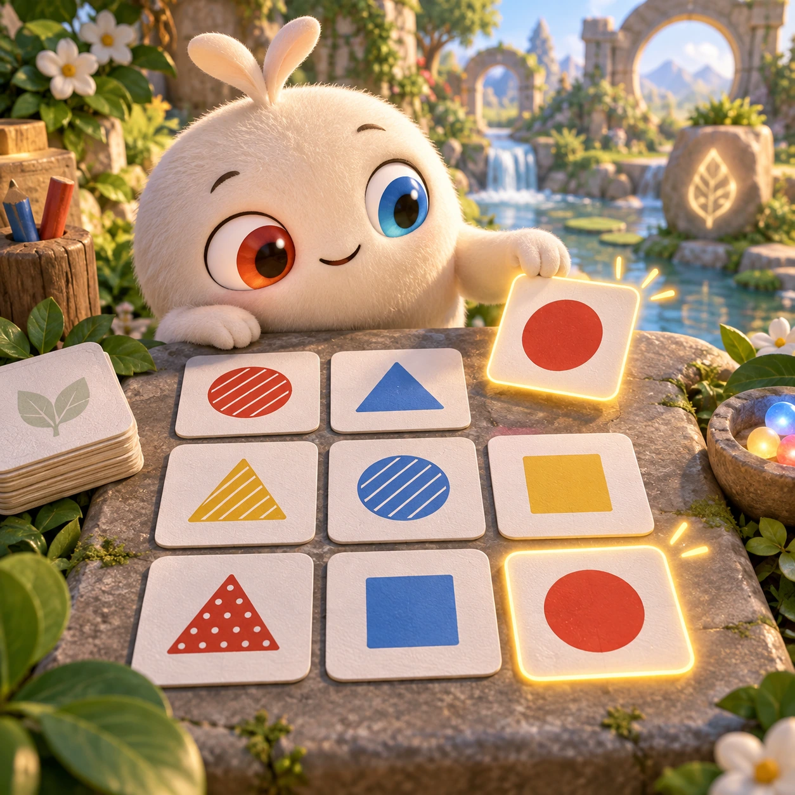
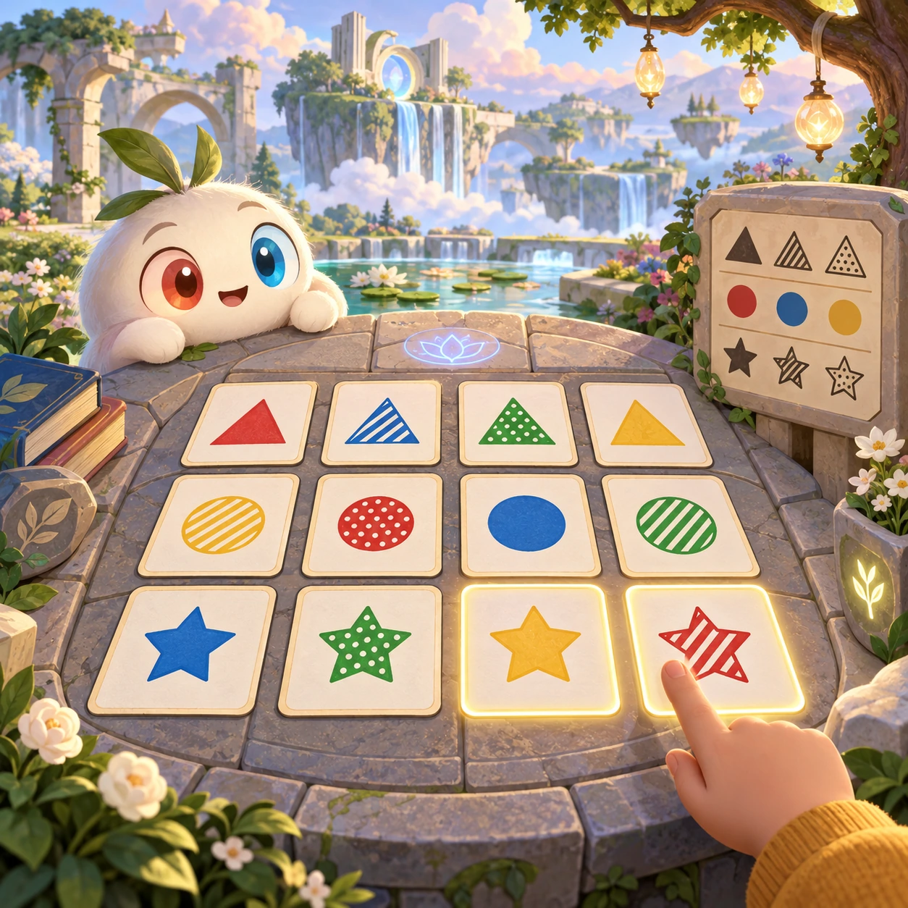

# Match the Kind

ML-12 · [Math and logic](../ml.md) · Cx 2 · Original catalog

**The idea:** Select cards sharing one attribute while differing in other attributes.

| Decision             | Proposal                                                                                                                                                                                    |
| -------------------- | ------------------------------------------------------------------------------------------------------------------------------------------------------------------------------------------- |
| Familiar mechanic    | Attribute matching card game                                                                                                                                                                |
| Learning objective   | Sets, logic of attributes                                                                                                                                                                   |
| First prototype      | One authored challenge built around the interaction above, with a clear goal, immediate feedback, restart and unlimited retries.                                                            |
| Technology           | React + SVG/DOM; deterministic state, undo and seeded levels. Start with one local screen and touch plus keyboard input.                                                                    |
| Scope boundary       | One board and one rule set; defer accounts, multiplayer, procedural content and platform SDKs.                                                                                              |
| Reuse                | Shared input, saves, accessibility, seeded state and the math and logic collection shell.                                                                                                   |
| Prototype acceptance | A player can identify the next action from the screen, complete one challenge, explain the practiced idea and restart without help. Check touch and keyboard play at narrow and wide sizes. |
| Main uncertainty     | Test whether the lesson follows from play and whether the first interaction is understandable without reading.                                                                              |

## Estimated plan

**First playable version:** Cards drawn from shape, colour, count and pattern; early rounds pick one of three cards sharing an attribute, later rounds find full sets in a deal of nine. Competitive speed play is left out.

| Measure              | Estimate                                                                          |
| -------------------- | --------------------------------------------------------------------------------- |
| Youngest age         | 4+                                                                                |
| Toddler learnability | 3 of 5 — Choose among 2-4 options, sort or match, or a two-step action; ages 3-4. |
| Code                 | 710 LOC, 5.9 days                                                                 |
| Assets               | 66 hours, 11 days                                                                 |
| Effort               | 16.9 days, risk 1 of 5                                                            |
| Start score          | 25.3 (rank 37 of 300; lower is better)                                            |

**Algorithms:** `sort-classify` (Sorting by attribute, 120 LOC) · `shuffle-deal` (Seeded shuffle and deal, 60 LOC) · `tap-feedback` (Tap feedback, 80 LOC)

**Assets:** 12 sprites, 3 animations, 2 backgrounds, 4 UI screens, 8 sound effects, 1 music track, 10 voice lines, 10 authored levels

How the numbers are computed: [development plan](../../development-plan.md#how-the-scores-work).

## Four visual directions

These are independently generated concept proposals for selecting a prototype.
The four views compare gameplay readability, world appeal, tactile identity and
room to grow. They are not screenshots of an implemented game. Native image
dimensions, hashes, exact prompts and generation provenance are recorded in the
[art manifest](../art/ml-12/manifest.json); see the [generation notes](../README.md#image-generation-and-provenance).

### Gameplay

### World

### Characters and materials

### Expanded play

## Design checks before prototyping

- Learning target: **Sets, logic of attributes**. Ask a domain reviewer to validate factual content in the mechanic.
- Keep goals cooperative or self-directed, using resources and needs. Avoid purchasable power. No pressure timers in the accessible mode.
- Use original layouts and character designs; the [legal checklist](../../legal.md) applies even when a mechanic is familiar.
- Choose the minimum [fidelity level](../../simulation-engine.md#determinism-and-fidelity-levels) the lesson needs; concept art does not establish scientific accuracy.
- Review silhouettes, text alternatives, reduced motion and non-color cues against the [adorability gate](../../lore/adorability-gate.md).

Genre context: [existing genre research](../../../case-studies/issue-1/data/research-genres-ideas.md)
and [expansion research](../../../case-studies/issue-1/data/research-visual-catalog.md).

[← Binary Beads](ml-11.md) · [All concepts](../README.md) · [Detective Grid →](ml-13.md)
