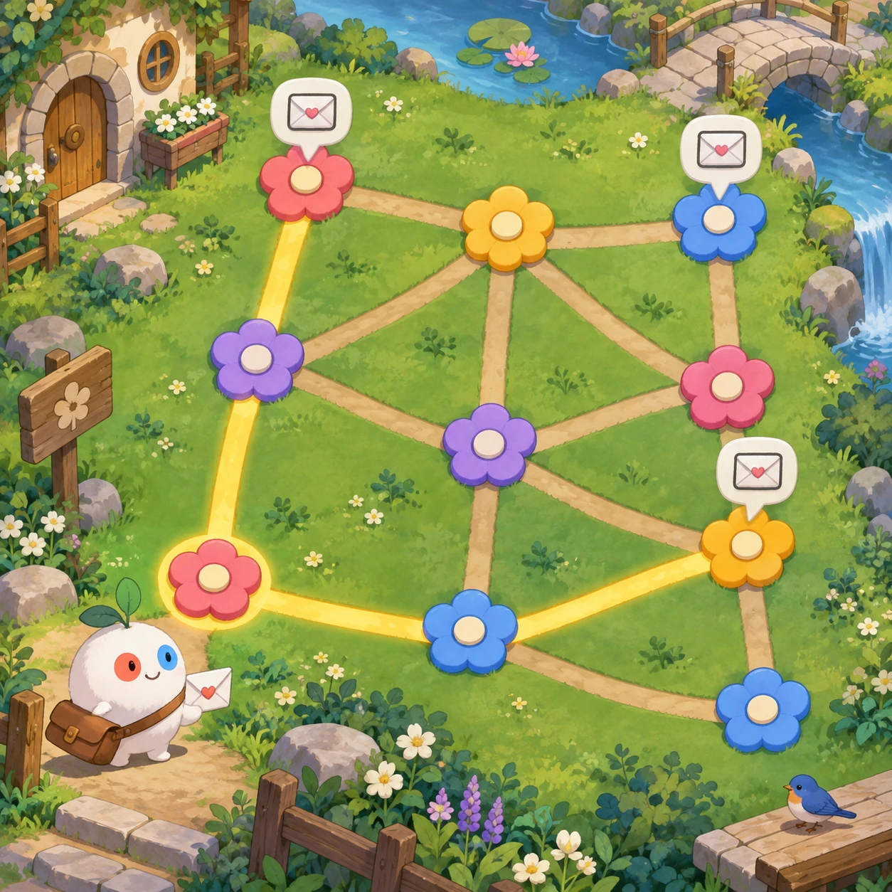
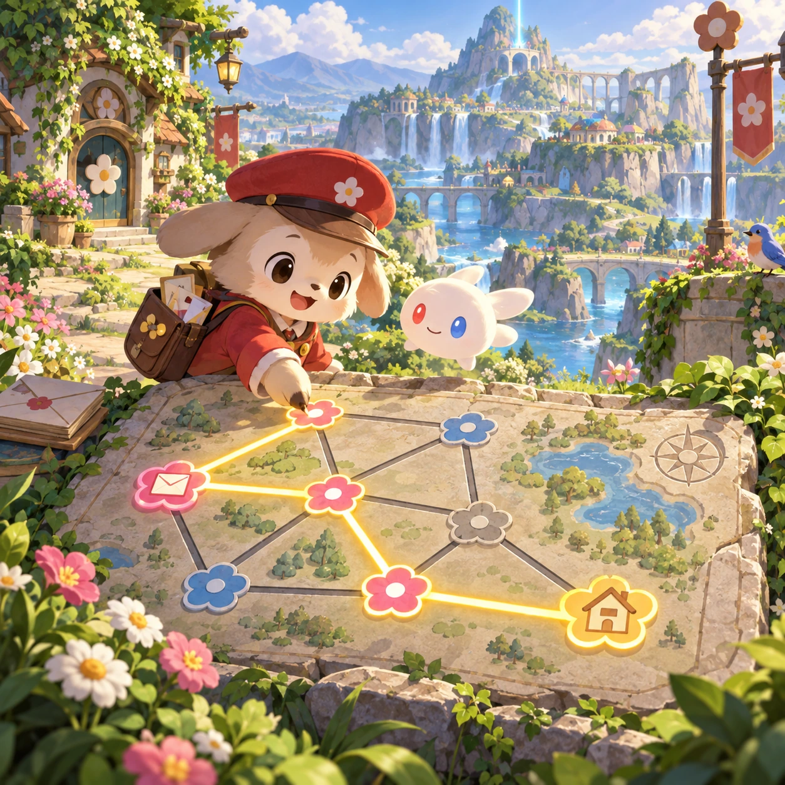
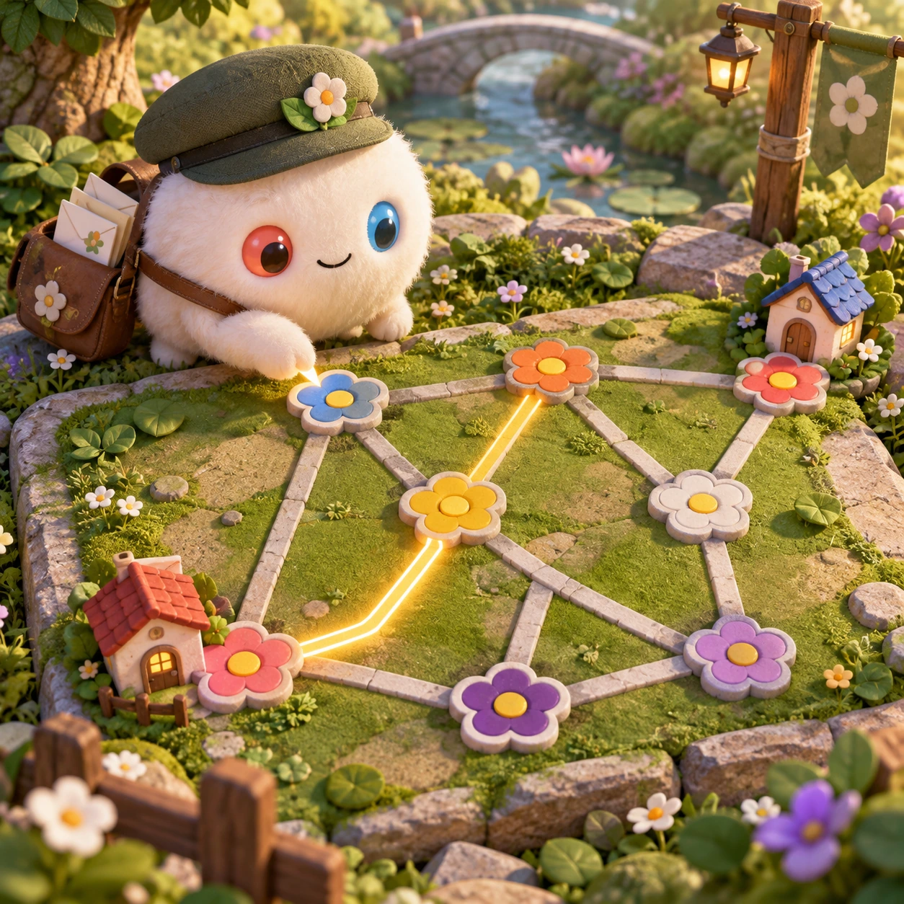
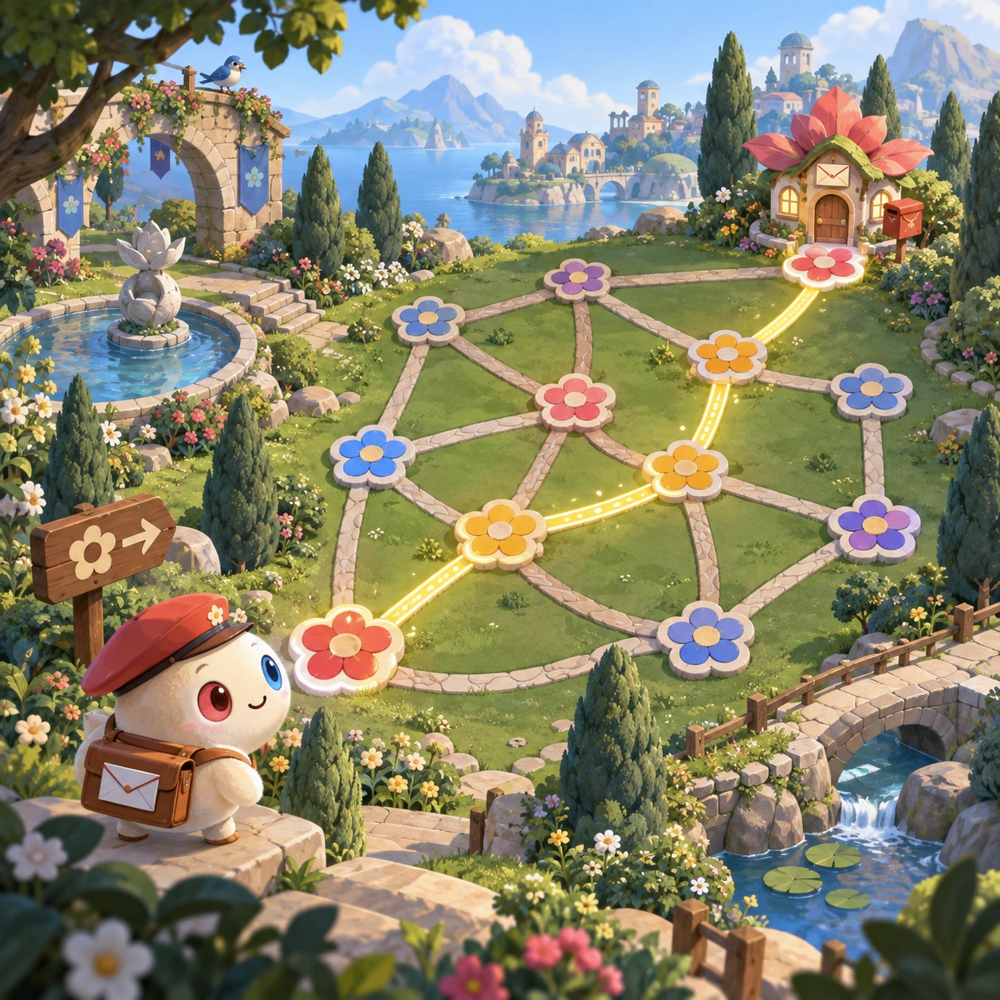

# Shortest Path Postie

ML-16 · [Math and logic](../ml.md) · Cx 3 · Original catalog

**The idea:** Draw the shortest delivery route between flower-shaped graph junctions.

| Decision             | Proposal                                                                                                                                                                                    |
| -------------------- | ------------------------------------------------------------------------------------------------------------------------------------------------------------------------------------------- |
| Familiar mechanic    | Route puzzle                                                                                                                                                                                |
| Learning objective   | Graphs, shortest paths, algorithms                                                                                                                                                          |
| First prototype      | One authored challenge built around the interaction above, with a clear goal, immediate feedback, restart and unlimited retries.                                                            |
| Technology           | React shell + PixiJS; use the shared simulation adapter only where motion or agent behavior requires it. Start with one bounded scene and measured frame time.                              |
| Scope boundary       | One bounded scenario and one core system; defer a full campaign, network play and production-scale content.                                                                                 |
| Reuse                | Shared input, saves, accessibility, seeded state and the math and logic collection shell.                                                                                                   |
| Prototype acceptance | A player can identify the next action from the screen, complete one challenge, explain the practiced idea and restart without help. Check touch and keyboard play at narrow and wide sizes. |
| Main uncertainty     | Test whether the lesson follows from play and whether the first interaction is understandable without reading.                                                                              |

## Estimated plan

**First playable version:** 20 delivery maps where routes are drawn between flower junctions on weighted paths, compared with the shortest route and replayed step by step as Dijkstra search. Travelling-salesman rounds come later.

| Measure              | Estimate                                                                                                   |
| -------------------- | ---------------------------------------------------------------------------------------------------------- |
| Youngest age         | 7+                                                                                                         |
| Toddler learnability | 1 of 5 — Needs reading, precise motor control, timing pressure or abstract rules; not a toddler game (6+). |
| Code                 | 1730 LOC, 14.4 days                                                                                        |
| Assets               | 104 hours, 17.3 days                                                                                       |
| Effort               | 31.8 days, risk 3 of 5                                                                                     |
| Start score          | 95.4 (rank 215 of 300; lower is better)                                                                    |

**Algorithms:** `graph-network` (Node-link graph, 300 LOC) · `pathfinding` (Pathfinding, 250 LOC) · `level-generator` (Procedural level generator, 500 LOC) · `tap-feedback` (Tap feedback, 80 LOC)

**Assets:** 18 sprites, 5 animations, 3 backgrounds, 5 UI screens, 10 sound effects, 1 music track, 30 voice lines, 20 authored levels

How the numbers are computed: [development plan](../../development-plan.md#how-the-scores-work).

## Four visual directions

These are independently generated concept proposals for selecting a prototype.
The four views compare gameplay readability, world appeal, tactile identity and
room to grow. They are not screenshots of an implemented game. Native image
dimensions, hashes, exact prompts and generation provenance are recorded in the
[art manifest](../art/ml-16/manifest.json); see the [generation notes](../README.md#image-generation-and-provenance).

### Gameplay

### World

### Characters and materials

### Expanded play

## Design checks before prototyping

- Learning target: **Graphs, shortest paths, algorithms**. Ask a domain reviewer to validate factual content in the mechanic.
- Keep goals cooperative or self-directed, using resources and needs. Avoid purchasable power. No pressure timers in the accessible mode.
- Use original layouts and character designs; the [legal checklist](../../legal.md) applies even when a mechanic is familiar.
- Choose the minimum [fidelity level](../../simulation-engine.md#determinism-and-fidelity-levels) the lesson needs; concept art does not establish scientific accuracy.
- Review silhouettes, text alternatives, reduced motion and non-color cues against the [adorability gate](../../lore/adorability-gate.md).

Genre context: [existing genre research](../../../case-studies/issue-1/data/research-genres-ideas.md)
and [expansion research](../../../case-studies/issue-1/data/research-visual-catalog.md).

[← Compass Garden](ml-15.md) · [All concepts](../README.md) · [Proof Steps →](ml-17.md)
