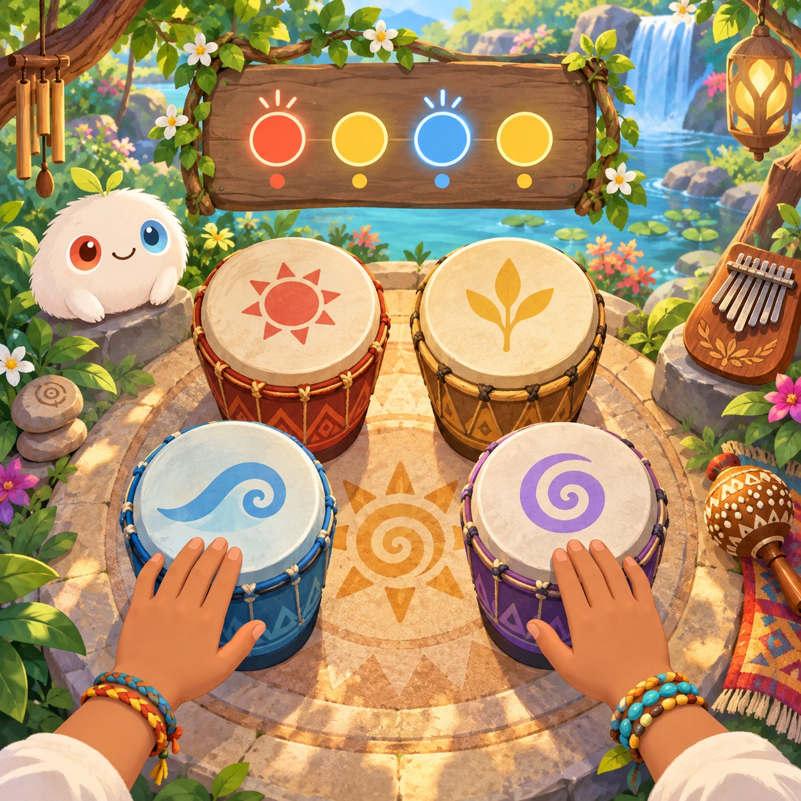
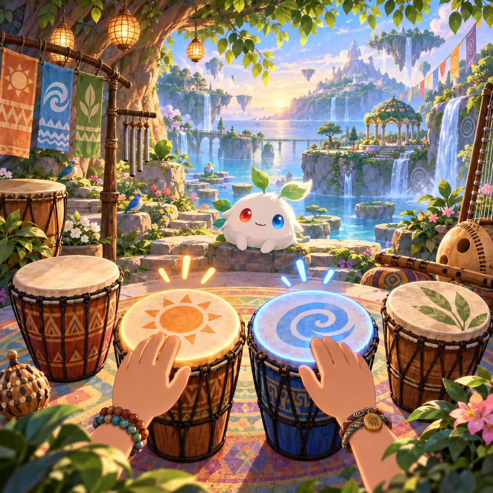
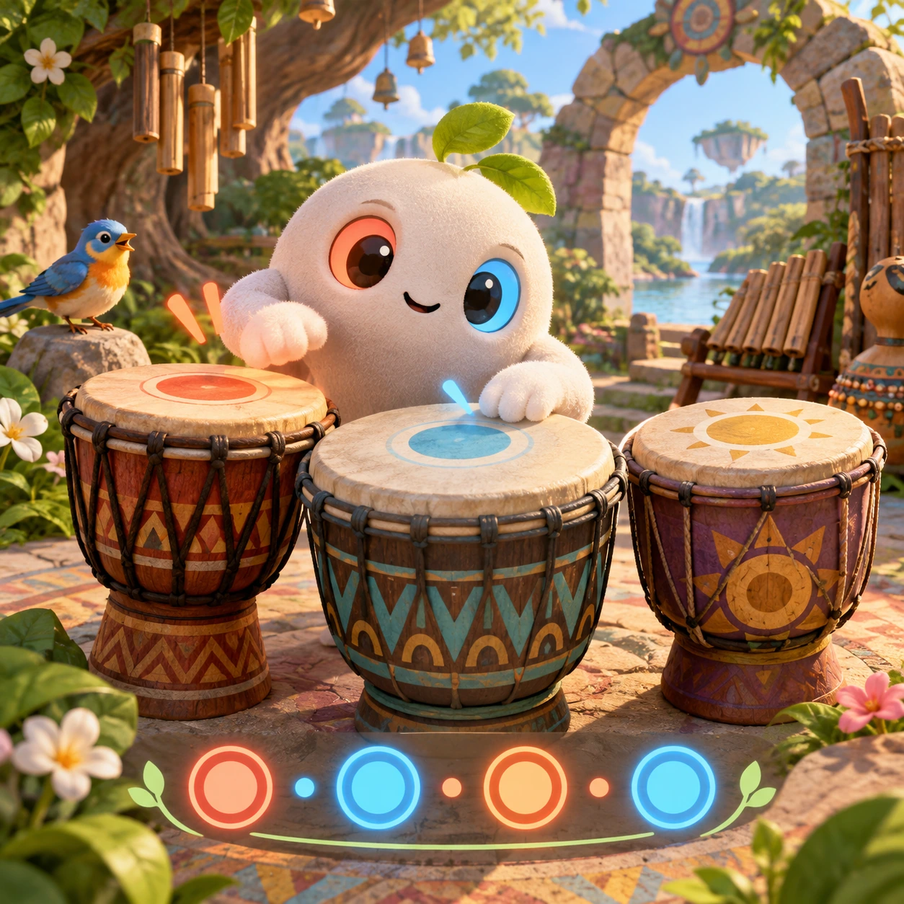
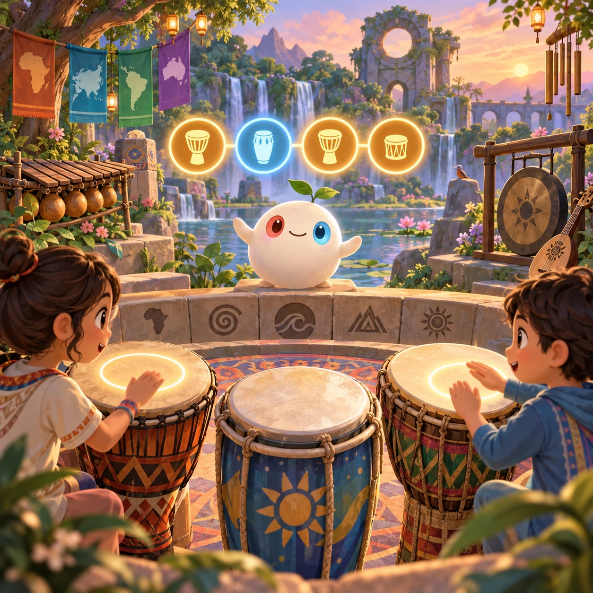

# Drum Circle

MR-02 · [Music and rhythm](../mr.md) · Cx 1 · Original catalog

**The idea:** Tap illustrated hand drums following a simple repeating rhythmic pattern.

| Decision             | Proposal                                                                                                                                                                                    |
| -------------------- | ------------------------------------------------------------------------------------------------------------------------------------------------------------------------------------------- |
| Familiar mechanic    | Rhythm toy                                                                                                                                                                                  |
| Learning objective   | Rhythms of world cultures                                                                                                                                                                   |
| First prototype      | One authored challenge built around the interaction above, with a clear goal, immediate feedback, restart and unlimited retries.                                                            |
| Technology           | React + SVG/DOM; deterministic state, undo and seeded levels. Start with one local screen and touch plus keyboard input.                                                                    |
| Scope boundary       | One board and one rule set; defer accounts, multiplayer, procedural content and platform SDKs.                                                                                              |
| Reuse                | Shared input, saves, accessibility, seeded state and the music and rhythm collection shell.                                                                                                 |
| Prototype acceptance | A player can identify the next action from the screen, complete one challenge, explain the practiced idea and restart without help. Check touch and keyboard play at narrow and wide sizes. |
| Main uncertainty     | Test whether the lesson follows from play and whether the first interaction is understandable without reading.                                                                              |

## Estimated plan

**First playable version:** Six illustrated hand drums from different cultures that sound on any tap, over three gentle backing loops with an optional echo pattern to copy. No scoring, recording or timing judgement.

| Measure              | Estimate                                                                                                |
| -------------------- | ------------------------------------------------------------------------------------------------------- |
| Youngest age         | 2+                                                                                                      |
| Toddler learnability | 5 of 5 — One tap anywhere gives an instant response; no goal or failure; works with co-play from age 1. |
| Code                 | 630 LOC, 5.3 days                                                                                       |
| Assets               | 84 hours, 14 days                                                                                       |
| Effort               | 19.3 days, risk 2 of 5                                                                                  |
| Start score          | 19.3 (rank 22 of 300; lower is better)                                                                  |

**Algorithms:** `audio-synth` (Playable instrument, 250 LOC) · `tap-feedback` (Tap feedback, 80 LOC) · `tween-cause-effect` (Cause-and-effect animation, 100 LOC)

**Assets:** 14 sprites, 6 animations, 2 backgrounds, 2 UI screens, 24 sound effects, 3 music tracks, 8 voice lines, 8 content items

How the numbers are computed: [development plan](../../development-plan.md#how-the-scores-work).

## Four visual directions

These are independently generated concept proposals for selecting a prototype.
The four views compare gameplay readability, world appeal, tactile identity and
room to grow. They are not screenshots of an implemented game. Native image
dimensions, hashes, exact prompts and generation provenance are recorded in the
[art manifest](../art/mr-02/manifest.json); see the [generation notes](../README.md#image-generation-and-provenance).

### Gameplay

### World

### Characters and materials

### Expanded play

## Design checks before prototyping

- Learning target: **Rhythms of world cultures**. Ask a domain reviewer to validate factual content in the mechanic.
- Keep goals cooperative or self-directed, using resources and needs. Avoid purchasable power. No pressure timers in the accessible mode.
- Use original layouts and character designs; the [legal checklist](../../legal.md) applies even when a mechanic is familiar.
- Choose the minimum [fidelity level](../../simulation-engine.md#determinism-and-fidelity-levels) the lesson needs; concept art does not establish scientific accuracy.
- Review silhouettes, text alternatives, reduced motion and non-color cues against the [adorability gate](../../lore/adorability-gate.md).

Genre context: [existing genre research](../../../case-studies/issue-1/data/research-genres-ideas.md)
and [expansion research](../../../case-studies/issue-1/data/research-visual-catalog.md).

[← Echo Links](mr-01.md) · [All concepts](../README.md) · [Piano Steps →](mr-03.md)
