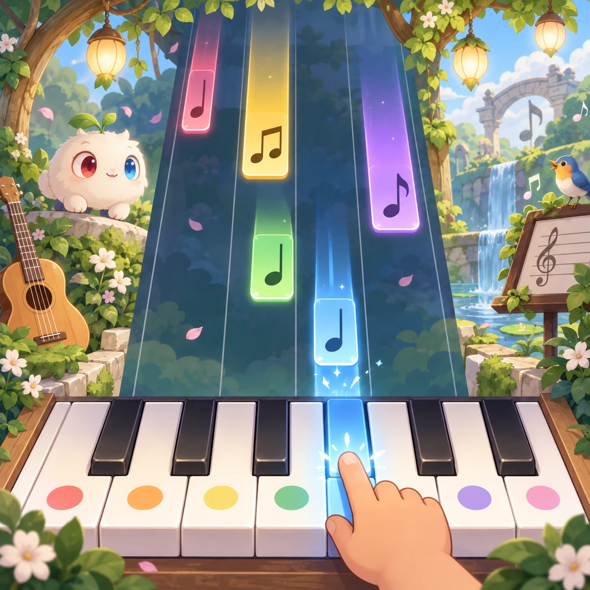
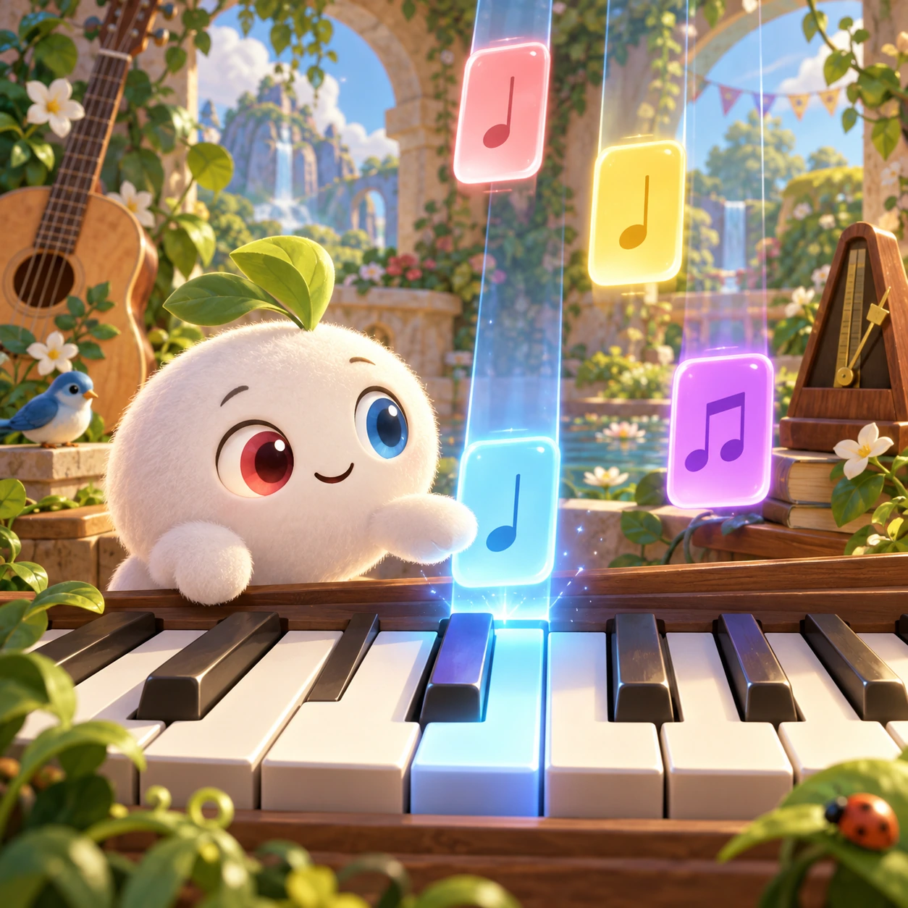

# Piano Steps

MR-03 · [Music and rhythm](../mr.md) · Cx 2 · Original catalog

**The idea:** Tap falling note tiles as they meet the corresponding piano keys.

| Decision             | Proposal                                                                                                                                                                                    |
| -------------------- | ------------------------------------------------------------------------------------------------------------------------------------------------------------------------------------------- |
| Familiar mechanic    | Falling tiles                                                                                                                                                                               |
| Learning objective   | Reading notes, melody                                                                                                                                                                       |
| First prototype      | One authored challenge built around the interaction above, with a clear goal, immediate feedback, restart and unlimited retries.                                                            |
| Technology           | React + SVG/DOM; deterministic state, undo and seeded levels. Start with one local screen and touch plus keyboard input.                                                                    |
| Scope boundary       | One board and one rule set; defer accounts, multiplayer, procedural content and platform SDKs.                                                                                              |
| Reuse                | Shared input, saves, accessibility, seeded state and the music and rhythm collection shell.                                                                                                 |
| Prototype acceptance | A player can identify the next action from the screen, complete one challenge, explain the practiced idea and restart without help. Check touch and keyboard play at narrow and wide sizes. |
| Main uncertainty     | Test whether the lesson follows from play and whether the first interaction is understandable without reading.                                                                              |

## Estimated plan

**First playable version:** Four piano lanes with falling note tiles for 10 public-domain melodies, a slow practice speed and a note-name strip on the keys. No song import, endless mode or leaderboards.

| Measure              | Estimate                                                                                                   |
| -------------------- | ---------------------------------------------------------------------------------------------------------- |
| Youngest age         | 6+                                                                                                         |
| Toddler learnability | 1 of 5 — Needs reading, precise motor control, timing pressure or abstract rules; not a toddler game (6+). |
| Code                 | 1030 LOC, 8.6 days                                                                                         |
| Assets               | 121 hours, 20.2 days                                                                                       |
| Effort               | 28.8 days, risk 2 of 5                                                                                     |
| Start score          | 86.4 (rank 204 of 300; lower is better)                                                                    |

**Algorithms:** `rhythm-timing` (Rhythm timing, 300 LOC) · `audio-synth` (Playable instrument, 250 LOC) · `tap-feedback` (Tap feedback, 80 LOC)

**Assets:** 10 sprites, 4 animations, 3 backgrounds, 4 UI screens, 6 sound effects, 10 music tracks, 4 voice lines, 10 authored levels

How the numbers are computed: [development plan](../../development-plan.md#how-the-scores-work).

## Four visual directions

These are independently generated concept proposals for selecting a prototype.
The four views compare gameplay readability, world appeal, tactile identity and
room to grow. They are not screenshots of an implemented game. Native image
dimensions, hashes, exact prompts and generation provenance are recorded in the
[art manifest](../art/mr-03/manifest.json); see the [generation notes](../README.md#image-generation-and-provenance).

### Gameplay

### World

### Characters and materials

### Expanded play

## Design checks before prototyping

- Learning target: **Reading notes, melody**. Ask a domain reviewer to validate factual content in the mechanic.
- Keep goals cooperative or self-directed, using resources and needs. Avoid purchasable power. No pressure timers in the accessible mode.
- Use original layouts and character designs; the [legal checklist](../../legal.md) applies even when a mechanic is familiar.
- Choose the minimum [fidelity level](../../simulation-engine.md#determinism-and-fidelity-levels) the lesson needs; concept art does not establish scientific accuracy.
- Review silhouettes, text alternatives, reduced motion and non-color cues against the [adorability gate](../../lore/adorability-gate.md).

Genre context: [existing genre research](../../../case-studies/issue-1/data/research-genres-ideas.md)
and [expansion research](../../../case-studies/issue-1/data/research-visual-catalog.md).

[← Drum Circle](mr-02.md) · [All concepts](../README.md) · [Rhythm Tap →](mr-04.md)
