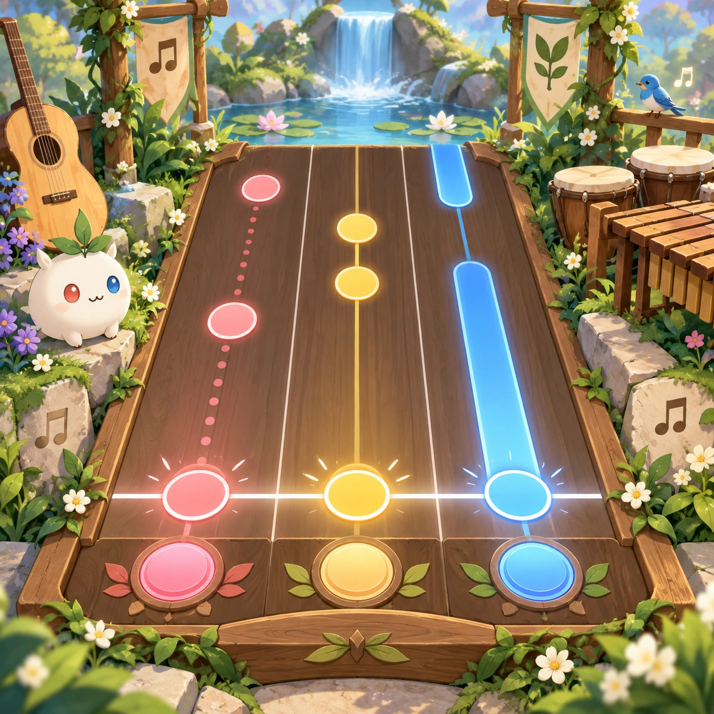
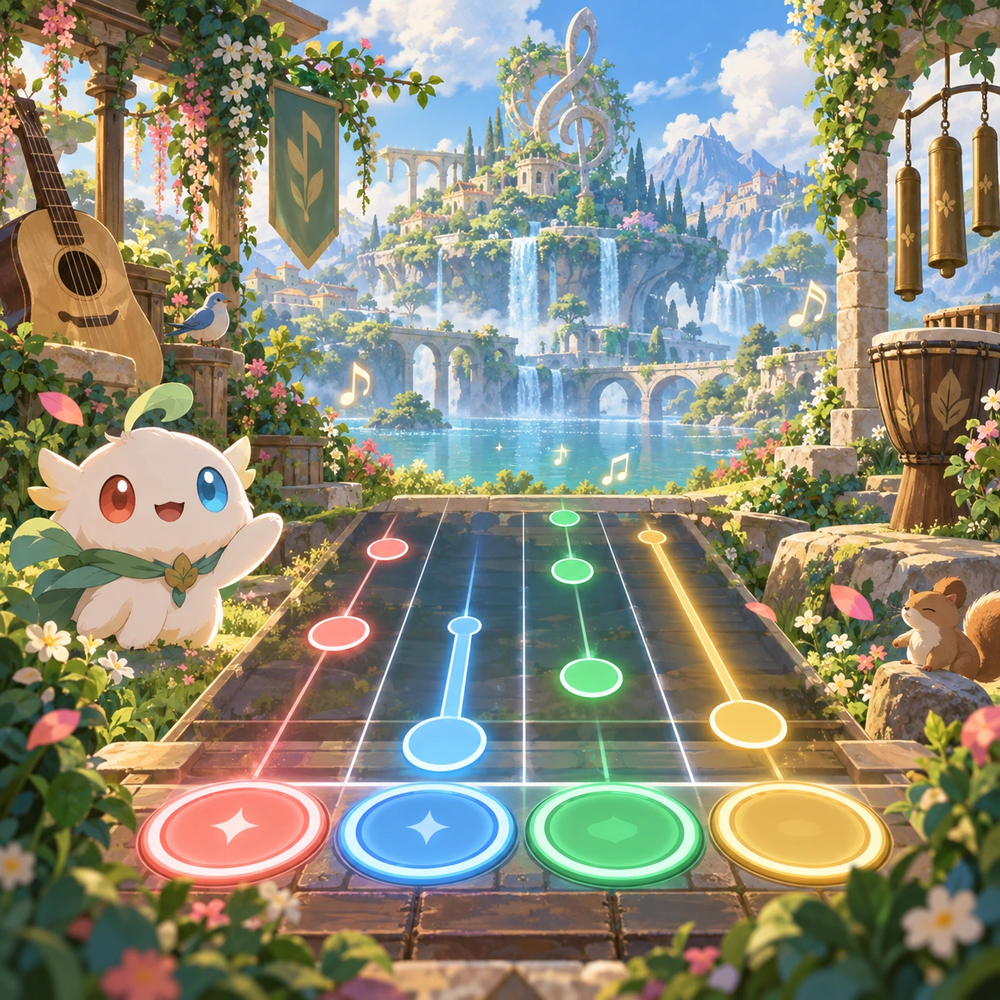
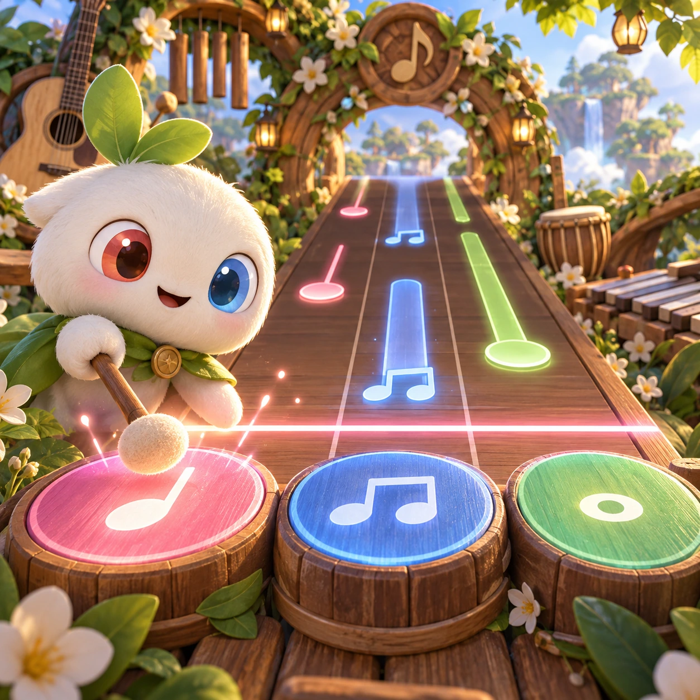
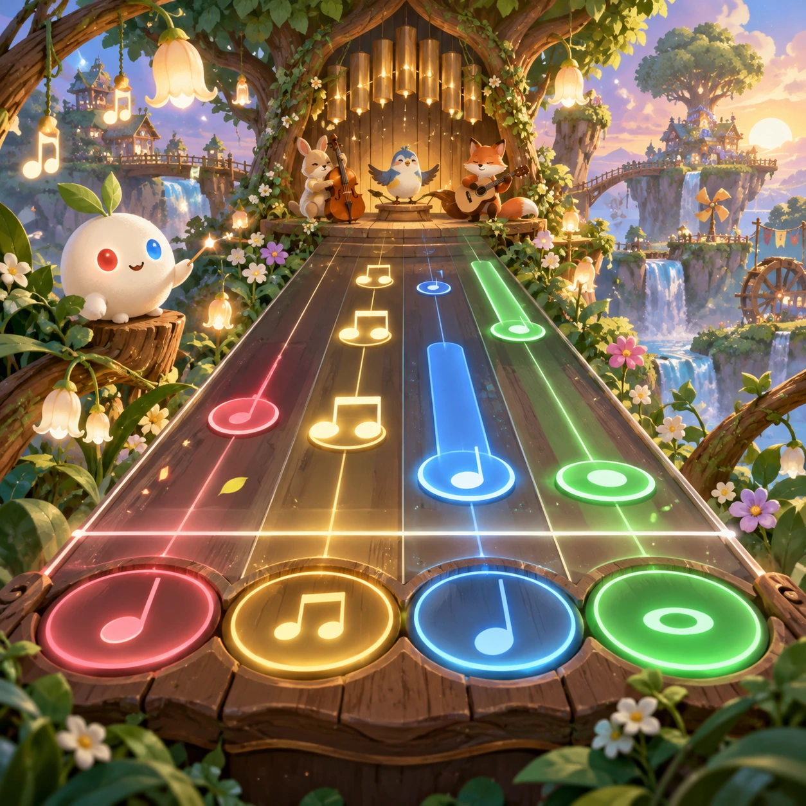
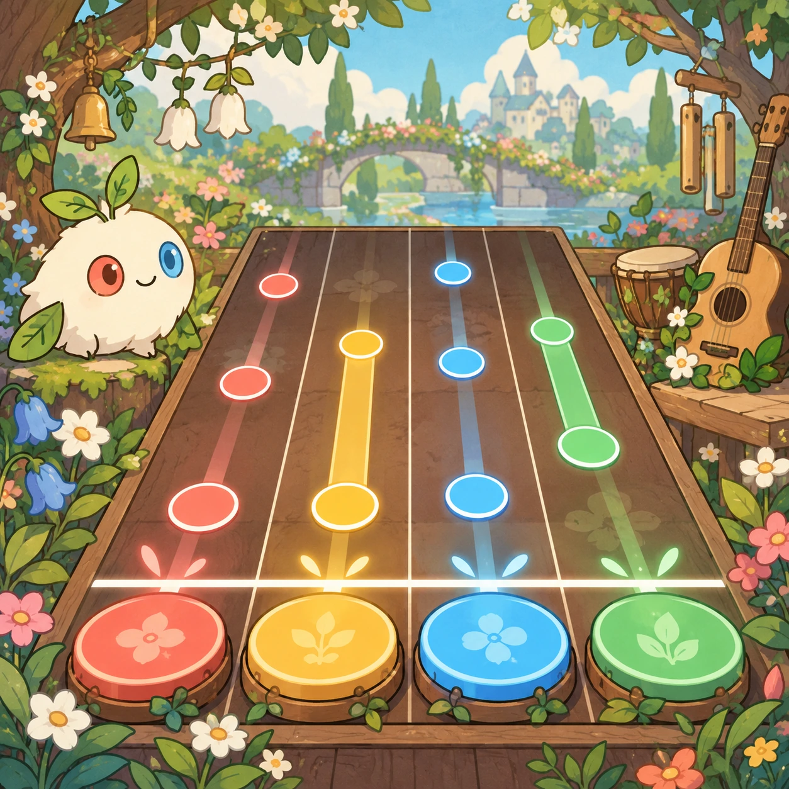
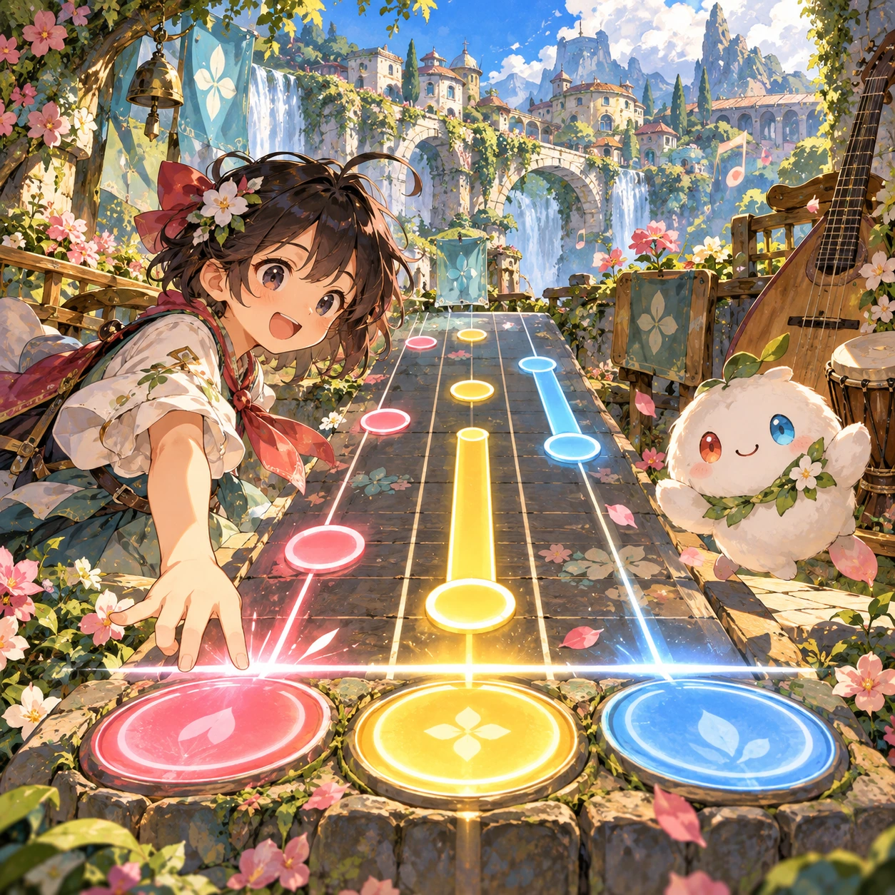

# Rhythm Tap

MR-04 · [Music and rhythm](../mr.md) · Cx 2 · Original catalog

**The idea:** Hit large rhythm targets as notes arrive on a clear beat line.

| Decision             | Proposal                                                                                                                                                                                    |
| -------------------- | ------------------------------------------------------------------------------------------------------------------------------------------------------------------------------------------- |
| Familiar mechanic    | Rhythm game                                                                                                                                                                                 |
| Learning objective   | Beats, note lengths as fractions                                                                                                                                                            |
| First prototype      | One authored challenge built around the interaction above, with a clear goal, immediate feedback, restart and unlimited retries.                                                            |
| Technology           | React + SVG/DOM; deterministic state, undo and seeded levels. Start with one local screen and touch plus keyboard input.                                                                    |
| Scope boundary       | One board and one rule set; defer accounts, multiplayer, procedural content and platform SDKs.                                                                                              |
| Reuse                | Shared input, saves, accessibility, seeded state and the music and rhythm collection shell.                                                                                                 |
| Prototype acceptance | A player can identify the next action from the screen, complete one challenge, explain the practiced idea and restart without help. Check touch and keyboard play at narrow and wide sizes. |
| Main uncertainty     | Test whether the lesson follows from play and whether the first interaction is understandable without reading.                                                                              |

## Estimated plan

**First playable version:** One beat line with big targets for quarter, half and eighth notes over 8 short tracks, latency calibration and a no-fail mode that shows notes as fractions. No charts editor or combos.

| Measure              | Estimate                                                                               |
| -------------------- | -------------------------------------------------------------------------------------- |
| Youngest age         | 5+                                                                                     |
| Toddler learnability | 2 of 5 — Needs simple rules, turns, a sequence or remembering several steps; ages 4-6. |
| Code                 | 1180 LOC, 9.8 days                                                                     |
| Assets               | 113 hours, 18.8 days                                                                   |
| Effort               | 28.6 days, risk 2 of 5                                                                 |
| Start score          | 57.2 (rank 142 of 310; lower is better)                                                |

**Algorithms:** `rhythm-timing` (Rhythm timing, 300 LOC) · `audio-synth` (Playable instrument, 250 LOC) · `tap-feedback` (Tap feedback, 80 LOC) · `particle-effects` (Particles, 150 LOC)

**Assets:** 10 sprites, 5 animations, 3 backgrounds, 4 UI screens, 8 sound effects, 8 music tracks, 6 voice lines, 8 authored levels, 10 content items

How the numbers are computed: [development plan](../../development-plan.md#how-the-scores-work).

## Four visual directions

These are independently generated concept proposals for selecting a prototype.
The four views compare gameplay readability, world appeal, tactile identity and
room to grow. Two additional core-screen alternatives make the flat storybook and painted anime styles explicit alongside the tactile 3D study. They are not screenshots of an implemented game. Native image
dimensions, hashes, exact prompts and generation provenance are recorded in the
[art manifest](../art/mr-04/manifest.json); see the [generation notes](../README.md#image-generation-and-provenance).

The [core prompts](../jobs/mr.json) use IDs `mr-04/01-gameplay` to `mr-04/04-discovery`. Additional [style prompts](../jobs/style-variations.json) match the two alternatives below.

### Gameplay

### World

### Characters and materials

### Expanded play

## Additional style alternatives

### Flat storybook alternative

### Painted anime alternative

## Design checks before prototyping

- Learning target: **Beats, note lengths as fractions**. Ask a domain reviewer to validate factual content in the mechanic.
- Keep goals cooperative or self-directed, using resources and needs. Avoid purchasable power. No pressure timers in the accessible mode.
- Use original layouts and character designs; the [legal checklist](../../legal.md) applies even when a mechanic is familiar.
- Choose the minimum [fidelity level](../../simulation-engine.md#determinism-and-fidelity-levels) the lesson needs; concept art does not establish scientific accuracy.
- Review silhouettes, text alternatives, reduced motion and non-color cues against the [adorability gate](../../lore/adorability-gate.md).

Genre context: [existing genre research](../../../case-studies/issue-1/data/research-genres-ideas.md)
and [expansion research](../../../case-studies/issue-1/data/research-visual-catalog.md).

[← Piano Steps](mr-03.md) · [All concepts](../README.md) · [Ear Trainer →](mr-05.md)
