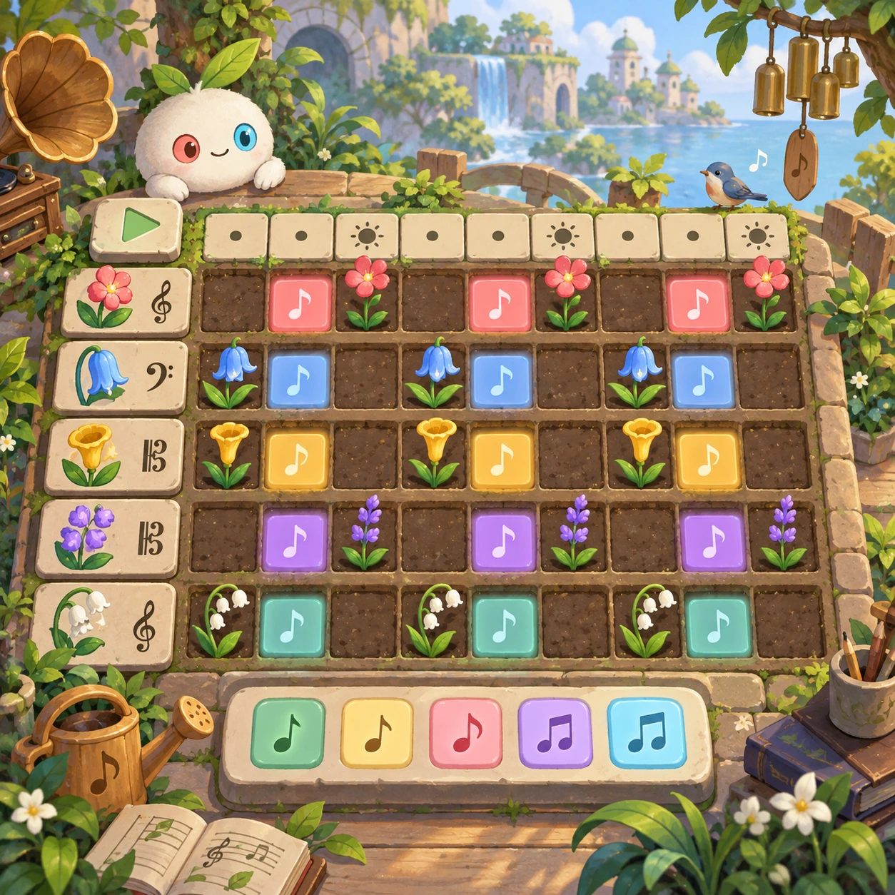
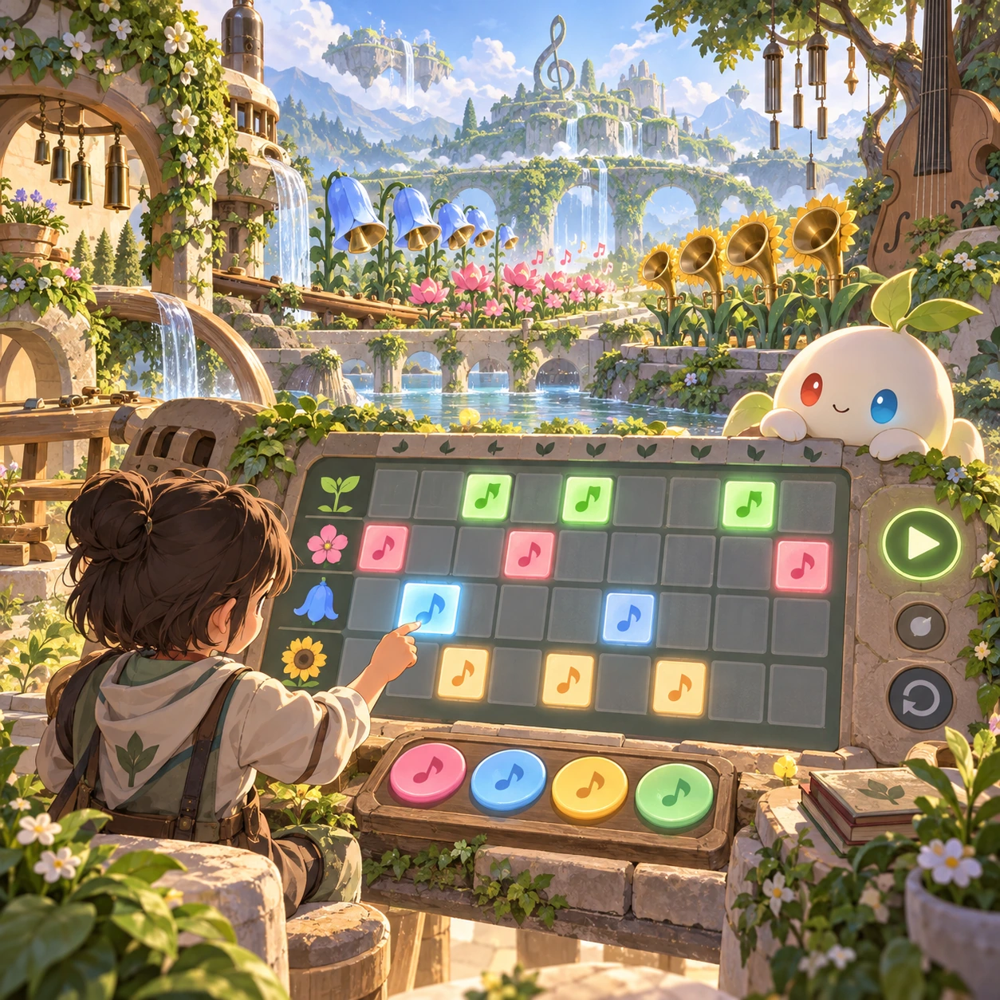
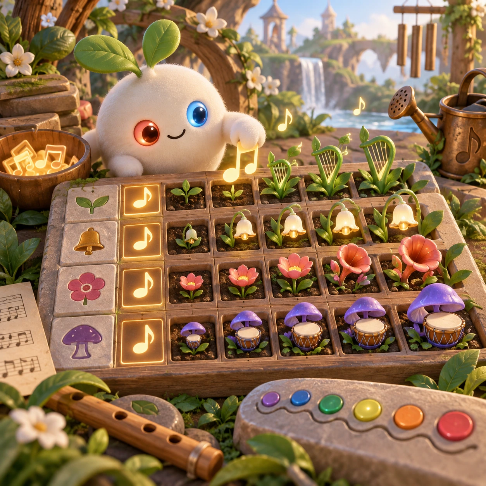
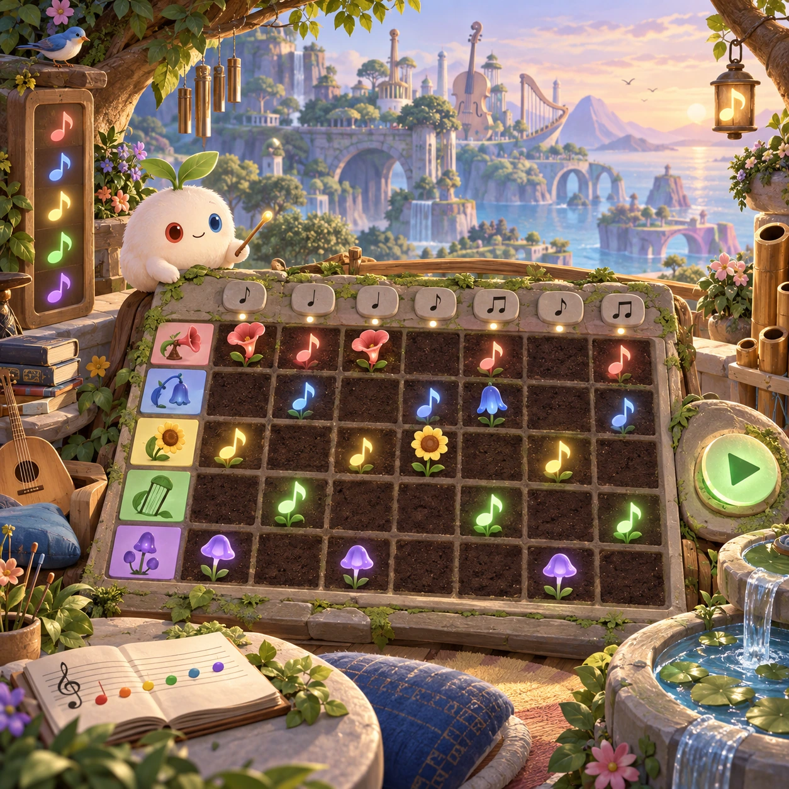

# Melody Garden

MR-06 · [Music and rhythm](../mr.md) · Cx 3 · Original catalog

**The idea:** Place notes in a step-sequencer grid whose rows grow different musical plants.

| Decision             | Proposal                                                                                                                                                                                    |
| -------------------- | ------------------------------------------------------------------------------------------------------------------------------------------------------------------------------------------- |
| Familiar mechanic    | Step sequencer (melodies grow plants)                                                                                                                                                       |
| Learning objective   | Composition, scales                                                                                                                                                                         |
| First prototype      | One authored challenge built around the interaction above, with a clear goal, immediate feedback, restart and unlimited retries.                                                            |
| Technology           | React shell + PixiJS; use the shared simulation adapter only where motion or agent behavior requires it. Start with one bounded scene and measured frame time.                              |
| Scope boundary       | One bounded scenario and one core system; defer a full campaign, network play and production-scale content.                                                                                 |
| Reuse                | Shared input, saves, accessibility, seeded state and the music and rhythm collection shell.                                                                                                 |
| Prototype acceptance | A player can identify the next action from the screen, complete one challenge, explain the practiced idea and restart without help. Check touch and keyboard play at narrow and wide sizes. |
| Main uncertainty     | Test whether the lesson follows from play and whether the first interaction is understandable without reading.                                                                              |

## Estimated plan

**First playable version:** An 8-step by 5-row pentatonic grid where tapped notes loop and each row grows its own singing plant, with free play and 8 short melody challenges. No scale switching, export or chords.

| Measure              | Estimate                                                                          |
| -------------------- | --------------------------------------------------------------------------------- |
| Youngest age         | 4+                                                                                |
| Toddler learnability | 3 of 5 — Choose among 2-4 options, sort or match, or a two-step action; ages 3-4. |
| Code                 | 1550 LOC, 12.9 days                                                               |
| Assets               | 117 hours, 19.6 days                                                              |
| Effort               | 32.5 days, risk 3 of 5                                                            |
| Start score          | 48.8 (rank 115 of 300; lower is better)                                           |

**Algorithms:** `music-sequencer` (Music sequencer, 450 LOC) · `audio-synth` (Playable instrument, 250 LOC) · `grid-board` (Grid board, 150 LOC) · `tween-cause-effect` (Cause-and-effect animation, 100 LOC)

**Assets:** 24 sprites, 10 animations, 3 backgrounds, 5 UI screens, 10 sound effects, 2 music tracks, 8 voice lines, 8 authored levels, 20 content items

How the numbers are computed: [development plan](../../development-plan.md#how-the-scores-work).

## Four visual directions

These are independently generated concept proposals for selecting a prototype.
The four views compare gameplay readability, world appeal, tactile identity and
room to grow. They are not screenshots of an implemented game. Native image
dimensions, hashes, exact prompts and generation provenance are recorded in the
[art manifest](../art/mr-06/manifest.json); see the [generation notes](../README.md#image-generation-and-provenance).

### Gameplay

### World

### Characters and materials

### Expanded play

## Design checks before prototyping

- Learning target: **Composition, scales**. Ask a domain reviewer to validate factual content in the mechanic.
- Keep goals cooperative or self-directed, using resources and needs. Avoid purchasable power. No pressure timers in the accessible mode.
- Use original layouts and character designs; the [legal checklist](../../legal.md) applies even when a mechanic is familiar.
- Choose the minimum [fidelity level](../../simulation-engine.md#determinism-and-fidelity-levels) the lesson needs; concept art does not establish scientific accuracy.
- Review silhouettes, text alternatives, reduced motion and non-color cues against the [adorability gate](../../lore/adorability-gate.md).

Genre context: [existing genre research](../../../case-studies/issue-1/data/research-genres-ideas.md)
and [expansion research](../../../case-studies/issue-1/data/research-visual-catalog.md).

[← Ear Trainer](mr-05.md) · [All concepts](../README.md) · [Conductor →](mr-07.md)
