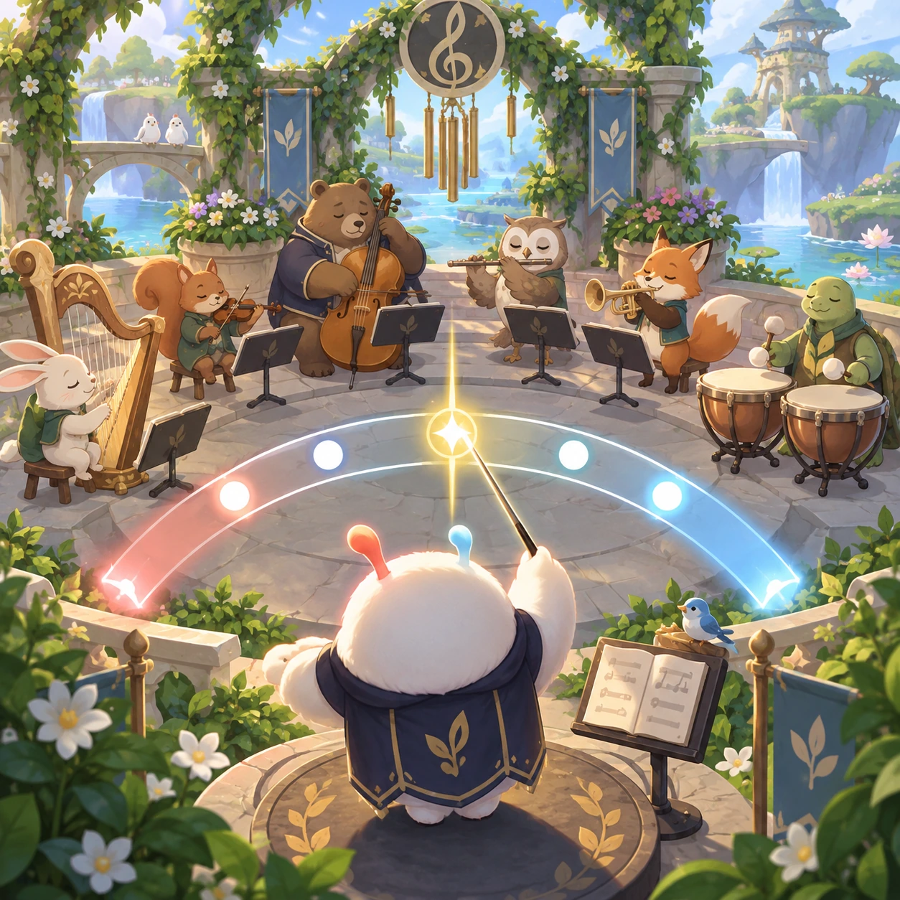
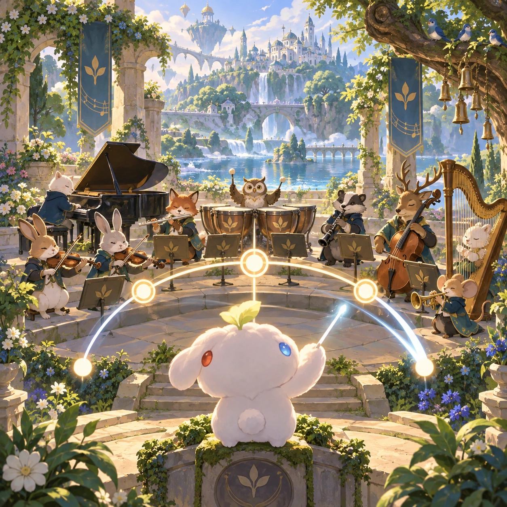
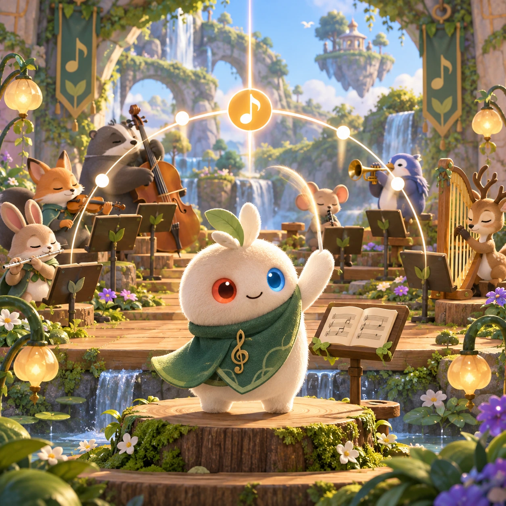
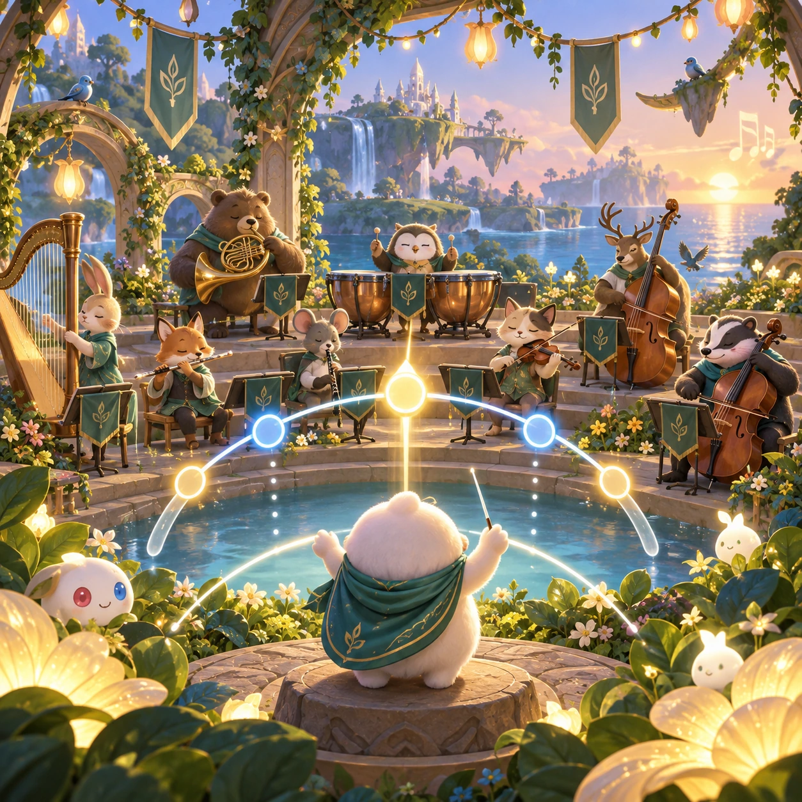

# Conductor

MR-07 · [Music and rhythm](../mr.md) · Cx 3 · Original catalog

**The idea:** Guide a tiny orchestra with a clear conducting arc and visible beat markers.

| Decision             | Proposal                                                                                                                                                                                    |
| -------------------- | ------------------------------------------------------------------------------------------------------------------------------------------------------------------------------------------- |
| Familiar mechanic    | Timing game                                                                                                                                                                                 |
| Learning objective   | Tempo, orchestra instruments                                                                                                                                                                |
| First prototype      | One authored challenge built around the interaction above, with a clear goal, immediate feedback, restart and unlimited retries.                                                            |
| Technology           | React shell + PixiJS; use the shared simulation adapter only where motion or agent behavior requires it. Start with one bounded scene and measured frame time.                              |
| Scope boundary       | One bounded scenario and one core system; defer a full campaign, network play and production-scale content.                                                                                 |
| Reuse                | Shared input, saves, accessibility, seeded state and the music and rhythm collection shell.                                                                                                 |
| Prototype acceptance | A player can identify the next action from the screen, complete one challenge, explain the practiced idea and restart without help. Check touch and keyboard play at narrow and wide sizes. |
| Main uncertainty     | Test whether the lesson follows from play and whether the first interaction is understandable without reading.                                                                              |

## Estimated plan

**First playable version:** A tiny orchestra plays 5 short pieces whose tempo follows the conducting arc traced on visible beat markers, with instrument sections that can be cued. No full scores or free composition.

| Measure              | Estimate                                                                               |
| -------------------- | -------------------------------------------------------------------------------------- |
| Youngest age         | 5+                                                                                     |
| Toddler learnability | 2 of 5 — Needs simple rules, turns, a sequence or remembering several steps; ages 4-6. |
| Code                 | 1530 LOC, 12.8 days                                                                    |
| Assets               | 138 hours, 22.9 days                                                                   |
| Effort               | 35.7 days, risk 2 of 5                                                                 |
| Start score          | 71.4 (rank 180 of 300; lower is better)                                                |

**Algorithms:** `rhythm-timing` (Rhythm timing, 300 LOC) · `audio-synth` (Playable instrument, 250 LOC) · `swipe-gesture` (Swipe gestures, 80 LOC) · `tween-cause-effect` (Cause-and-effect animation, 100 LOC)

**Assets:** 16 sprites, 16 animations, 3 backgrounds, 4 UI screens, 10 sound effects, 5 music tracks, 12 voice lines, 5 authored levels, 20 content items

How the numbers are computed: [development plan](../../development-plan.md#how-the-scores-work).

## Four visual directions

These are independently generated concept proposals for selecting a prototype.
The four views compare gameplay readability, world appeal, tactile identity and
room to grow. They are not screenshots of an implemented game. Native image
dimensions, hashes, exact prompts and generation provenance are recorded in the
[art manifest](../art/mr-07/manifest.json); see the [generation notes](../README.md#image-generation-and-provenance).

### Gameplay

### World

### Characters and materials

### Expanded play

## Design checks before prototyping

- Learning target: **Tempo, orchestra instruments**. Ask a domain reviewer to validate factual content in the mechanic.
- Keep goals cooperative or self-directed, using resources and needs. Avoid purchasable power. No pressure timers in the accessible mode.
- Use original layouts and character designs; the [legal checklist](../../legal.md) applies even when a mechanic is familiar.
- Choose the minimum [fidelity level](../../simulation-engine.md#determinism-and-fidelity-levels) the lesson needs; concept art does not establish scientific accuracy.
- Review silhouettes, text alternatives, reduced motion and non-color cues against the [adorability gate](../../lore/adorability-gate.md).

Genre context: [existing genre research](../../../case-studies/issue-1/data/research-genres-ideas.md)
and [expansion research](../../../case-studies/issue-1/data/research-visual-catalog.md).

[← Melody Garden](mr-06.md) · [All concepts](../README.md) · [Sing Along →](mr-08.md)
