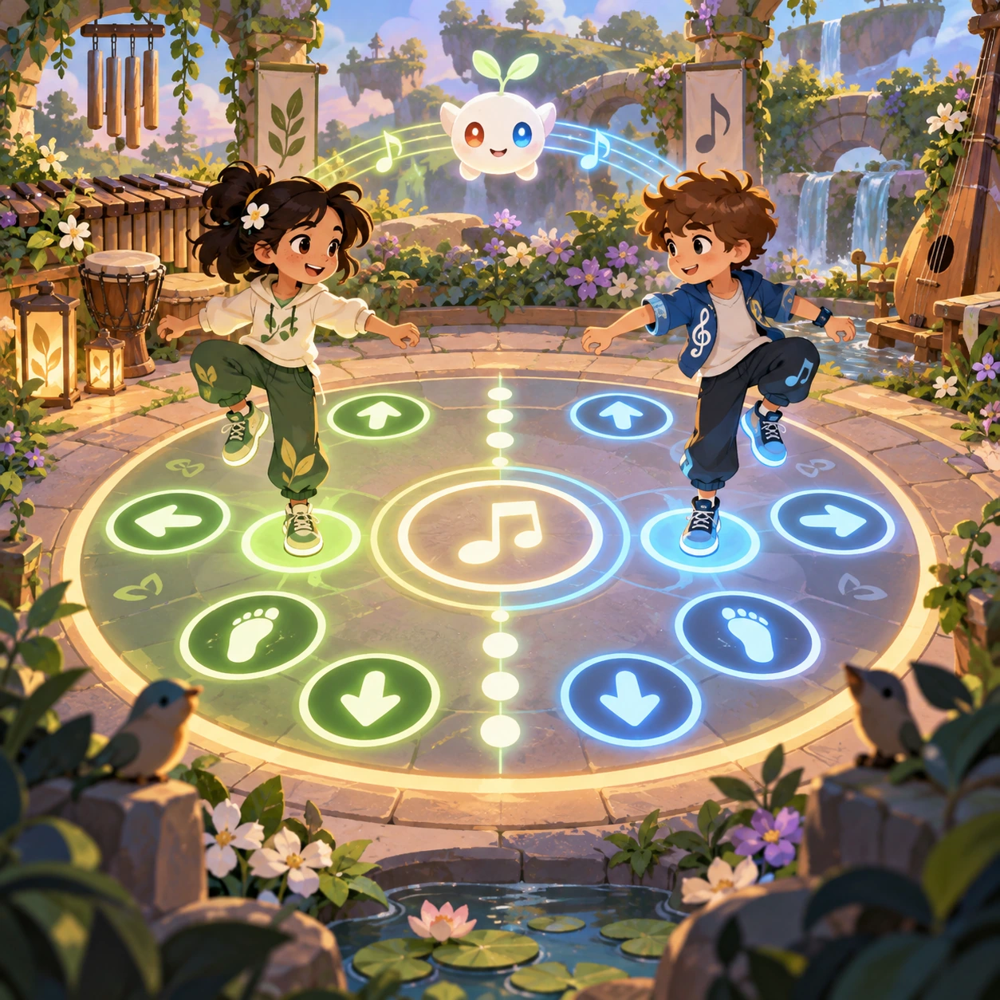
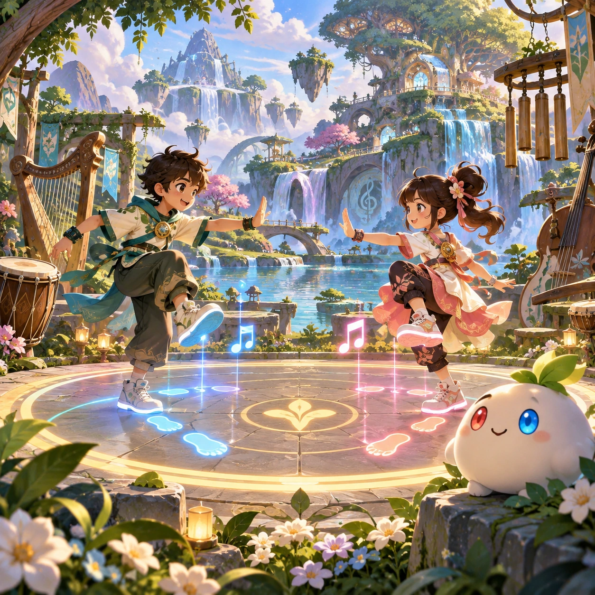
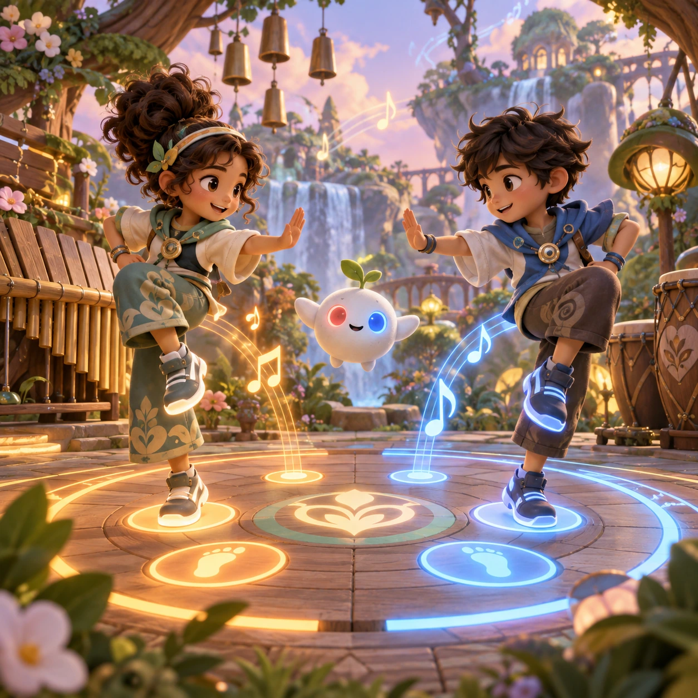
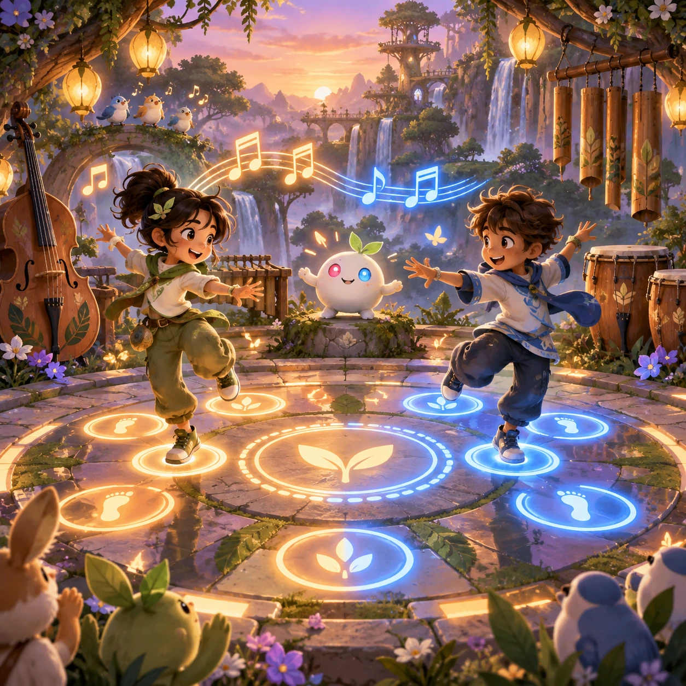

# Dance Dialogue

MR-09 · [Music and rhythm](../mr.md) · Cx 3 · Added in the visual-catalog expansion

**The idea:** Two link friends exchange mirrored dance steps across a glowing beat circle, with no fighting.

| Decision             | Proposal                                                                                                                                                                                    |
| -------------------- | ------------------------------------------------------------------------------------------------------------------------------------------------------------------------------------------- |
| Familiar mechanic    | Rhythm duel                                                                                                                                                                                 |
| Learning objective   | Call-and-response and timing                                                                                                                                                                |
| First prototype      | One authored challenge built around the interaction above, with a clear goal, immediate feedback, restart and unlimited retries.                                                            |
| Technology           | React shell + PixiJS; use the shared simulation adapter only where motion or agent behavior requires it. Start with one bounded scene and measured frame time.                              |
| Scope boundary       | One bounded scenario and one core system; defer a full campaign, network play and production-scale content.                                                                                 |
| Reuse                | Shared input, saves, accessibility, seeded state and the music and rhythm collection shell.                                                                                                 |
| Prototype acceptance | A player can identify the next action from the screen, complete one challenge, explain the practiced idea and restart without help. Check touch and keyboard play at narrow and wide sizes. |
| Main uncertainty     | Test whether the lesson follows from play and whether the first interaction is understandable without reading.                                                                              |

## Estimated plan

**First playable version:** Two link friends trade four-beat dance phrases on a glowing beat circle; the player copies each call with taps across 10 songs, with no fighting and a no-fail mode. No online duels.

| Measure              | Estimate                                                                               |
| -------------------- | -------------------------------------------------------------------------------------- |
| Youngest age         | 5+                                                                                     |
| Toddler learnability | 2 of 5 — Needs simple rules, turns, a sequence or remembering several steps; ages 4-6. |
| Code                 | 1480 LOC, 12.3 days                                                                    |
| Assets               | 146 hours, 24.3 days                                                                   |
| Effort               | 36.7 days, risk 2 of 5                                                                 |
| Start score          | 73.4 (rank 184 of 300; lower is better)                                                |

**Algorithms:** `rhythm-timing` (Rhythm timing, 300 LOC) · `pattern-sequence` (Pattern completion, 150 LOC) · `tap-feedback` (Tap feedback, 80 LOC) · `audio-synth` (Playable instrument, 250 LOC)

**Assets:** 12 sprites, 20 animations, 3 backgrounds, 4 UI screens, 10 sound effects, 5 music tracks, 10 voice lines, 10 authored levels

How the numbers are computed: [development plan](../../development-plan.md#how-the-scores-work).

## Four visual directions

These are independently generated concept proposals for selecting a prototype.
The four views compare gameplay readability, world appeal, tactile identity and
room to grow. They are not screenshots of an implemented game. Native image
dimensions, hashes, exact prompts and generation provenance are recorded in the
[art manifest](../art/mr-09/manifest.json); see the [generation notes](../README.md#image-generation-and-provenance).

### Gameplay

### World

### Characters and materials

### Expanded play

## Design checks before prototyping

- Learning target: **Call-and-response and timing**. Ask a domain reviewer to validate factual content in the mechanic.
- Keep goals cooperative or self-directed, using resources and needs. Avoid purchasable power. No pressure timers in the accessible mode.
- Use original layouts and character designs; the [legal checklist](../../legal.md) applies even when a mechanic is familiar.
- Choose the minimum [fidelity level](../../simulation-engine.md#determinism-and-fidelity-levels) the lesson needs; concept art does not establish scientific accuracy.
- Review silhouettes, text alternatives, reduced motion and non-color cues against the [adorability gate](../../lore/adorability-gate.md).

Genre context: [existing genre research](../../../case-studies/issue-1/data/research-genres-ideas.md)
and [expansion research](../../../case-studies/issue-1/data/research-visual-catalog.md).

[← Sing Along](mr-08.md) · [All concepts](../README.md) · [Beat Path →](mr-10.md)
