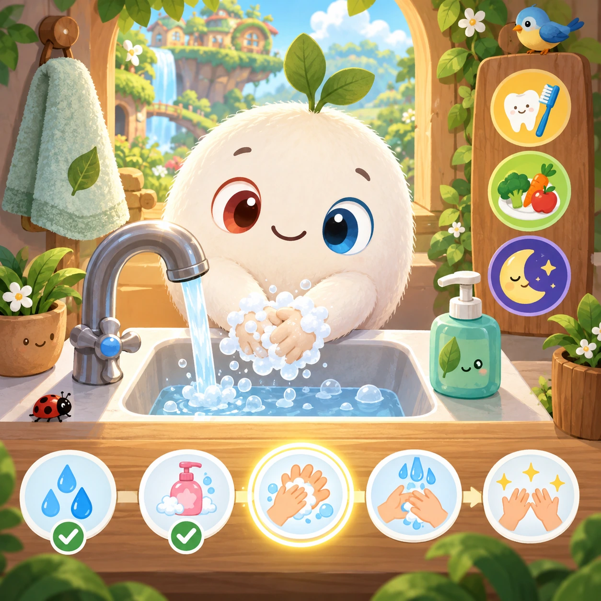
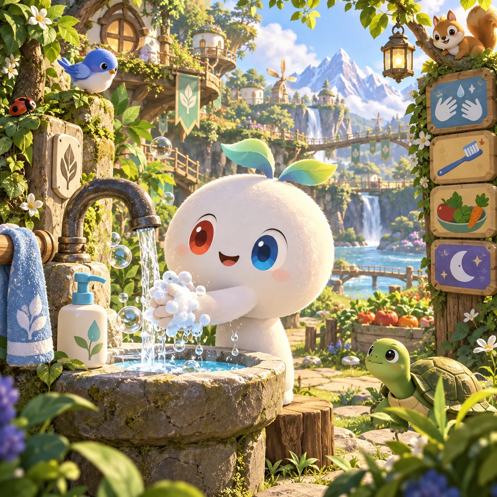
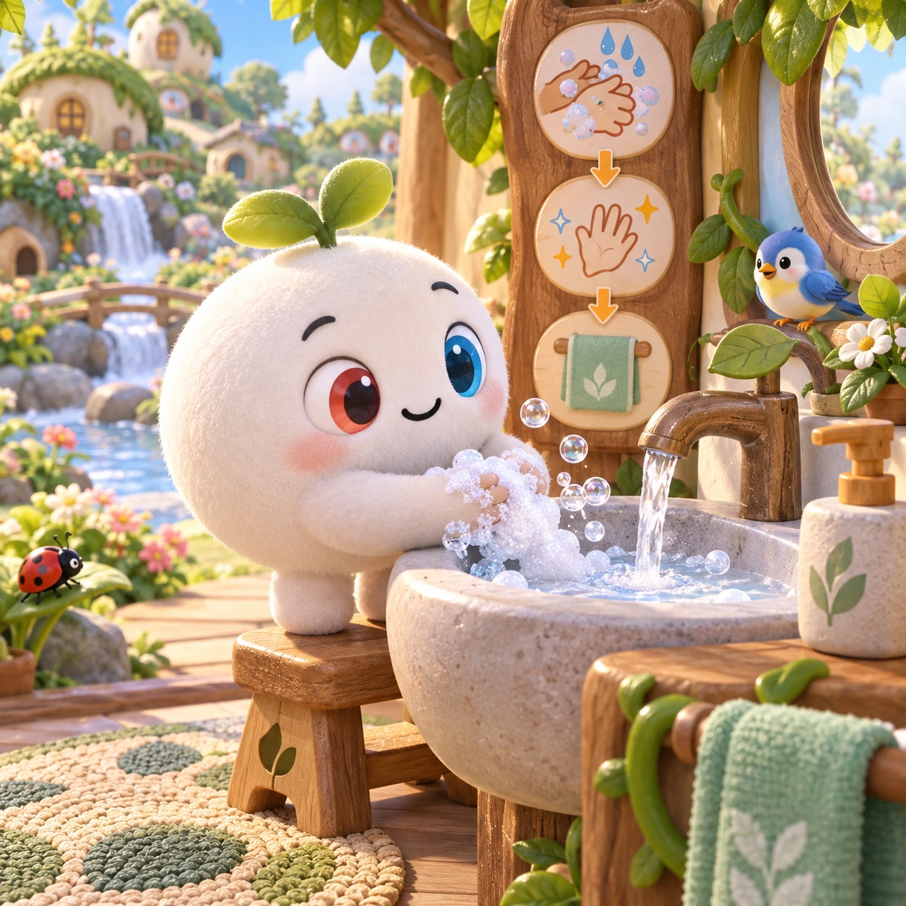
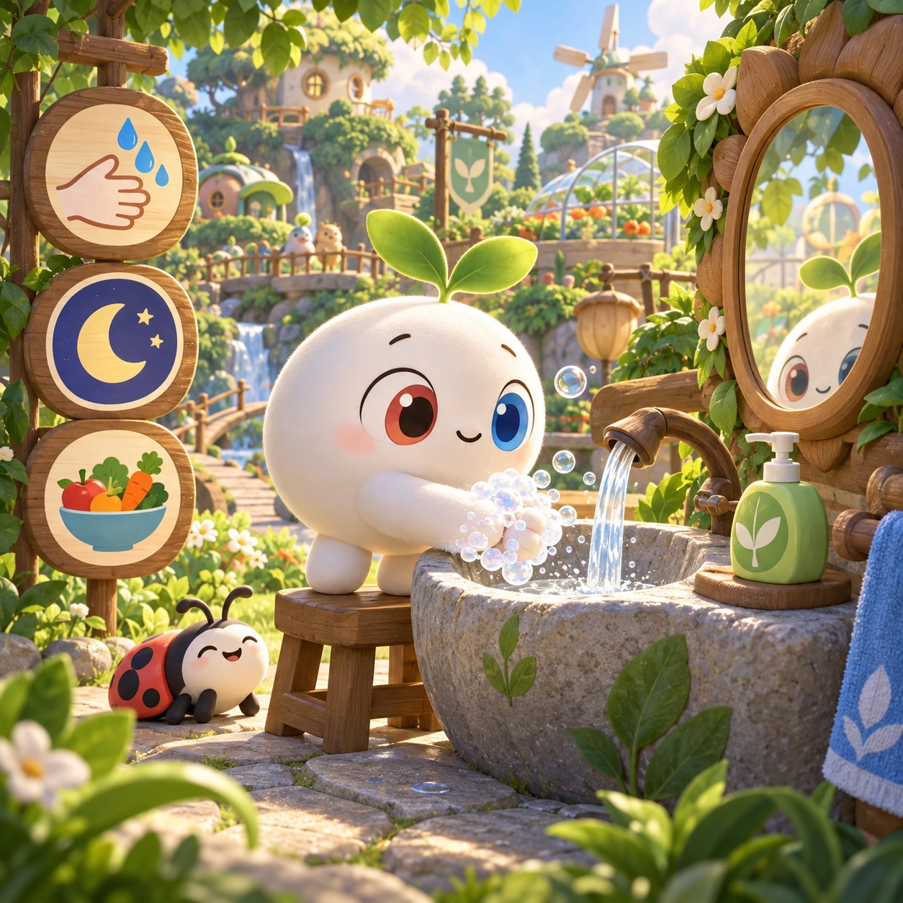
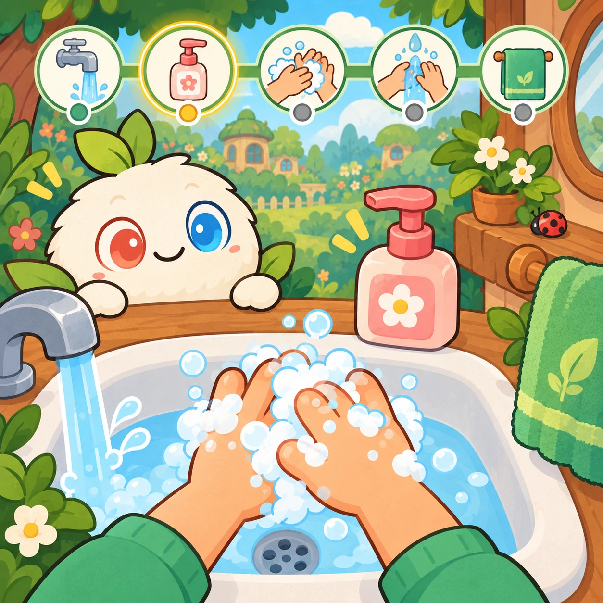
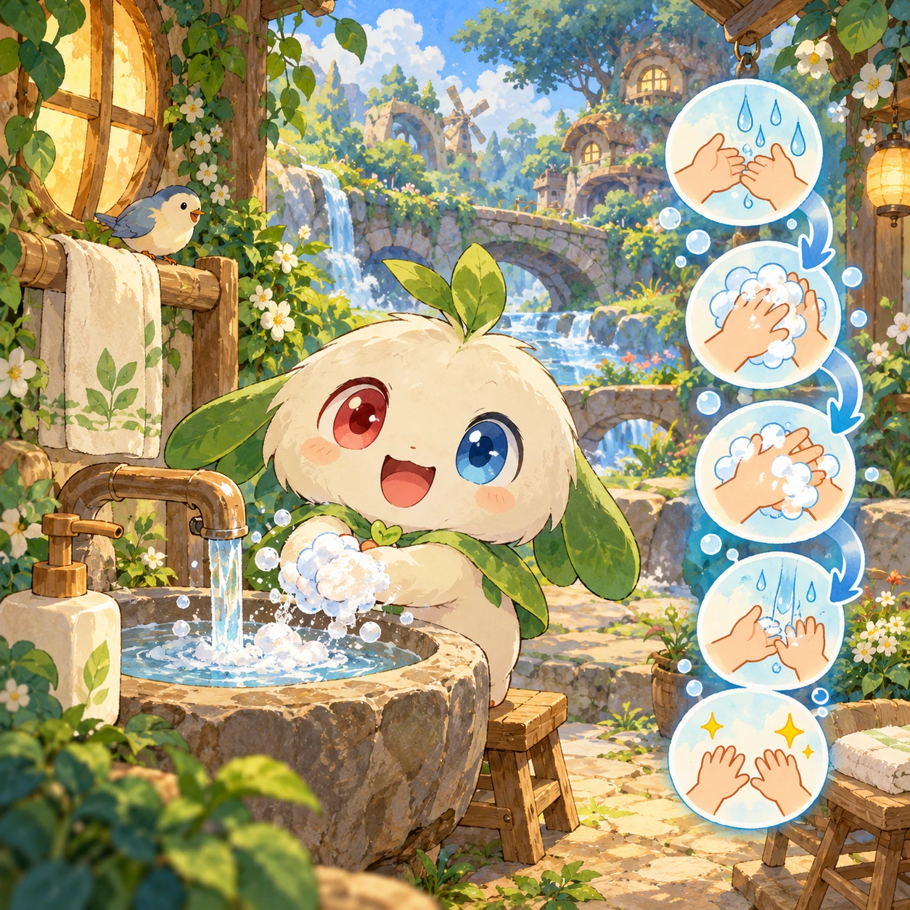

# Healthy Habits

NC-01 · [Nature and care](../nc.md) · Cx 1 · Original catalog

**The idea:** Help a round link friend complete a gentle illustrated handwashing routine.

| Decision             | Proposal                                                                                                                                                                                    |
| -------------------- | ------------------------------------------------------------------------------------------------------------------------------------------------------------------------------------------- |
| Familiar mechanic    | Routine toy (brush teeth, wash hands)                                                                                                                                                       |
| Learning objective   | Hygiene, sleep, healthy food                                                                                                                                                                |
| First prototype      | One authored challenge built around the interaction above, with a clear goal, immediate feedback, restart and unlimited retries.                                                            |
| Technology           | React + SVG/DOM; deterministic state, undo and seeded levels. Start with one local screen and touch plus keyboard input.                                                                    |
| Scope boundary       | One board and one rule set; defer accounts, multiplayer, procedural content and platform SDKs.                                                                                              |
| Reuse                | Shared input, saves, accessibility, seeded state and the nature and care collection shell.                                                                                                  |
| Prototype acceptance | A player can identify the next action from the screen, complete one challenge, explain the practiced idea and restart without help. Check touch and keyboard play at narrow and wide sizes. |
| Main uncertainty     | Test whether the lesson follows from play and whether the first interaction is understandable without reading.                                                                              |

## Estimated plan

**First playable version:** Three illustrated routines (wash hands, brush teeth, go to bed) with big tap and drag steps, bubbles and voiced praise; meal choices and a daily routine chart are left out.

| Measure              | Estimate                                                                                      |
| -------------------- | --------------------------------------------------------------------------------------------- |
| Youngest age         | 2+                                                                                            |
| Toddler learnability | 4 of 5 — Tap a specific big target or drag one object to a big slot; one-step goal; ages 2-3. |
| Code                 | 780 LOC, 6.5 days                                                                             |
| Assets               | 83 hours, 13.8 days                                                                           |
| Effort               | 20.3 days, risk 1 of 5                                                                        |
| Start score          | 25.4 (rank 38 of 310; lower is better)                                                        |

**Algorithms:** `tap-feedback` (Tap feedback, 80 LOC) · `drag-drop-snap` (Drag and snap, 150 LOC) · `tween-cause-effect` (Cause-and-effect animation, 100 LOC) · `particle-effects` (Particles, 150 LOC)

**Assets:** 18 sprites, 6 animations, 3 backgrounds, 2 UI screens, 12 sound effects, 1 music track, 20 voice lines, 3 authored levels, 10 content items

How the numbers are computed: [development plan](../../development-plan.md#how-the-scores-work).

## Four visual directions

These are independently generated concept proposals for selecting a prototype.
The four views compare gameplay readability, world appeal, tactile identity and
room to grow. Two additional core-screen alternatives make the flat storybook and painted anime styles explicit alongside the tactile 3D study. They are not screenshots of an implemented game. Native image
dimensions, hashes, exact prompts and generation provenance are recorded in the
[art manifest](../art/nc-01/manifest.json); see the [generation notes](../README.md#image-generation-and-provenance).

The [core prompts](../jobs/nc.json) use IDs `nc-01/01-gameplay` to `nc-01/04-discovery`. Additional [style prompts](../jobs/style-variations.json) match the two alternatives below.

### Gameplay

### World

### Characters and materials

### Expanded play

## Additional style alternatives

### Flat storybook alternative

### Painted anime alternative

## Design checks before prototyping

- Learning target: **Hygiene, sleep, healthy food**. Ask a domain reviewer to validate factual content in the mechanic.
- Keep goals cooperative or self-directed, using resources and needs. Avoid purchasable power. No pressure timers in the accessible mode.
- Use original layouts and character designs; the [legal checklist](../../legal.md) applies even when a mechanic is familiar.
- Choose the minimum [fidelity level](../../simulation-engine.md#determinism-and-fidelity-levels) the lesson needs; concept art does not establish scientific accuracy.
- Review silhouettes, text alternatives, reduced motion and non-color cues against the [adorability gate](../../lore/adorability-gate.md).

Genre context: [existing genre research](../../../case-studies/issue-1/data/research-genres-ideas.md)
and [expansion research](../../../case-studies/issue-1/data/research-visual-catalog.md).

[All concepts](../README.md) · [Weather Dress-Up →](nc-02.md)
