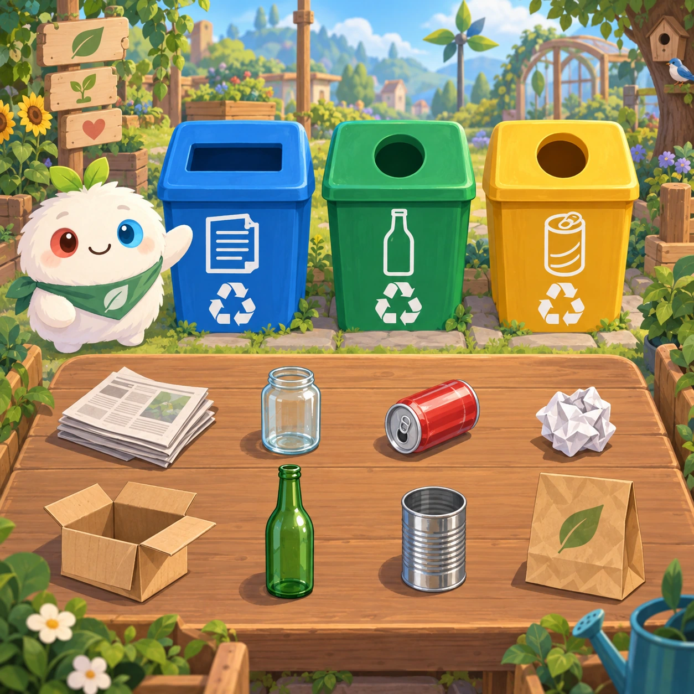
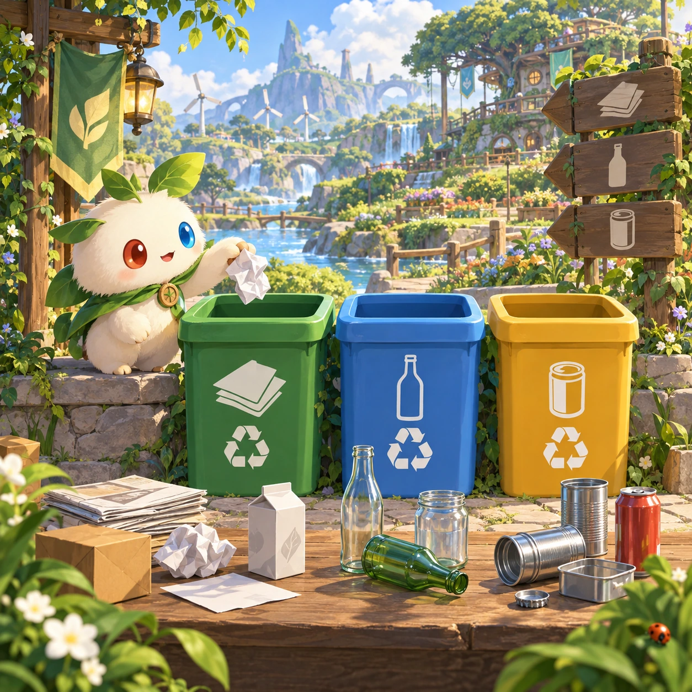
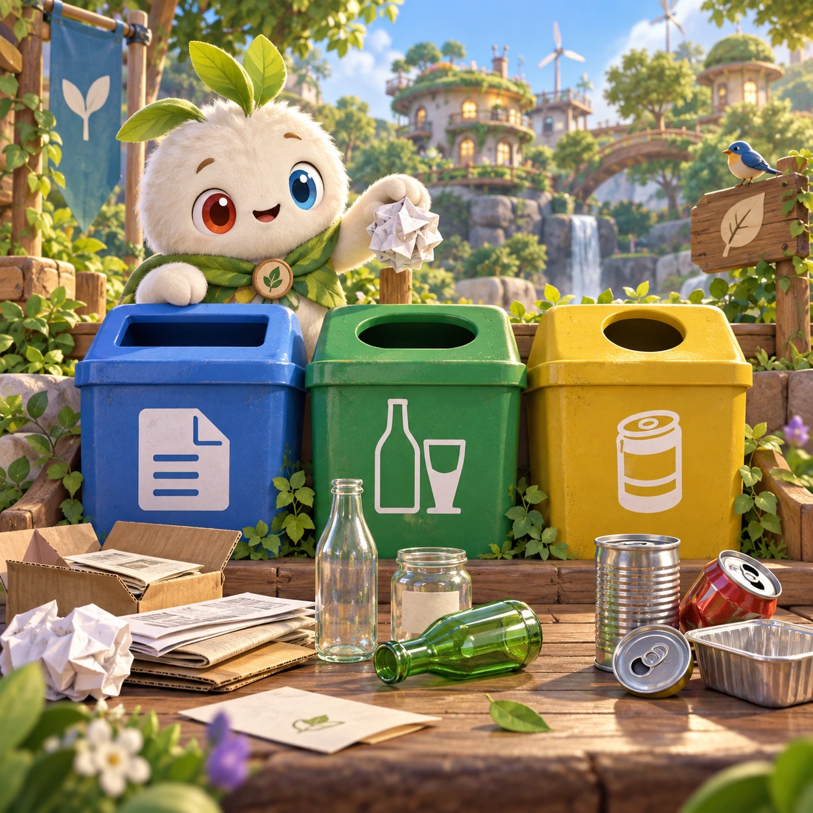
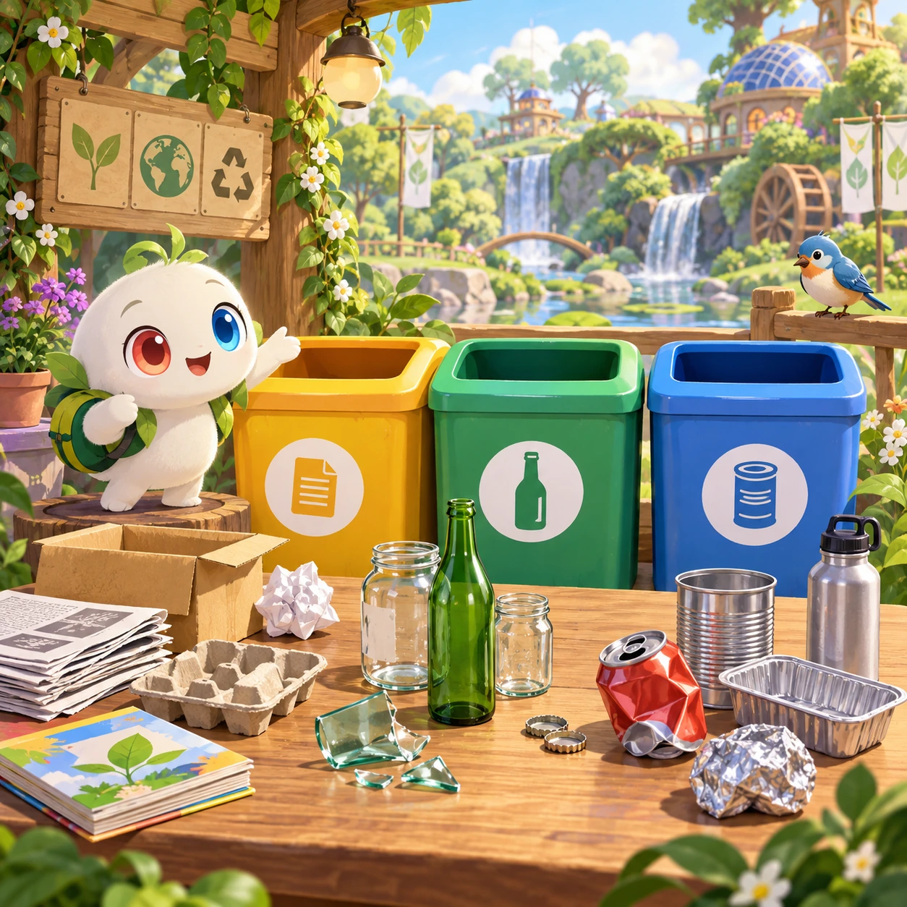

# Recycling Sorter

NC-03 · [Nature and care](../nc.md) · Cx 1 · Original catalog

**The idea:** Sort paper, glass and metal objects into distinct symbol-marked recycling bins.

| Decision             | Proposal                                                                                                                                                                                    |
| -------------------- | ------------------------------------------------------------------------------------------------------------------------------------------------------------------------------------------- |
| Familiar mechanic    | Sorting                                                                                                                                                                                     |
| Learning objective   | Materials, recycling rules                                                                                                                                                                  |
| First prototype      | One authored challenge built around the interaction above, with a clear goal, immediate feedback, restart and unlimited retries.                                                            |
| Technology           | React + SVG/DOM; deterministic state, undo and seeded levels. Start with one local screen and touch plus keyboard input.                                                                    |
| Scope boundary       | One board and one rule set; defer accounts, multiplayer, procedural content and platform SDKs.                                                                                              |
| Reuse                | Shared input, saves, accessibility, seeded state and the nature and care collection shell.                                                                                                  |
| Prototype acceptance | A player can identify the next action from the screen, complete one challenge, explain the practiced idea and restart without help. Check touch and keyboard play at narrow and wide sizes. |
| Main uncertainty     | Test whether the lesson follows from play and whether the first interaction is understandable without reading.                                                                              |

## Estimated plan

**First playable version:** 30 everyday objects dragged into paper, glass and metal bins marked with symbols, over 6 rounds with voiced names and gentle retries; compost, local rules and scoring are left out.

| Measure              | Estimate                                                                          |
| -------------------- | --------------------------------------------------------------------------------- |
| Youngest age         | 3+                                                                                |
| Toddler learnability | 3 of 5 — Choose among 2-4 options, sort or match, or a two-step action; ages 3-4. |
| Code                 | 660 LOC, 5.5 days                                                                 |
| Assets               | 93 hours, 15.4 days                                                               |
| Effort               | 20.9 days, risk 1 of 5                                                            |
| Start score          | 31.4 (rank 53 of 300; lower is better)                                            |

**Algorithms:** `sort-classify` (Sorting by attribute, 120 LOC) · `drag-drop-snap` (Drag and snap, 150 LOC) · `tap-feedback` (Tap feedback, 80 LOC) · `shuffle-deal` (Seeded shuffle and deal, 60 LOC)

**Assets:** 30 sprites, 4 animations, 2 backgrounds, 2 UI screens, 8 sound effects, 1 music track, 15 voice lines, 6 authored levels, 30 content items

How the numbers are computed: [development plan](../../development-plan.md#how-the-scores-work).

## Four visual directions

These are independently generated concept proposals for selecting a prototype.
The four views compare gameplay readability, world appeal, tactile identity and
room to grow. They are not screenshots of an implemented game. Native image
dimensions, hashes, exact prompts and generation provenance are recorded in the
[art manifest](../art/nc-03/manifest.json); see the [generation notes](../README.md#image-generation-and-provenance).

### Gameplay

### World

### Characters and materials

### Expanded play

## Design checks before prototyping

- Learning target: **Materials, recycling rules**. Ask a domain reviewer to validate factual content in the mechanic.
- Keep goals cooperative or self-directed, using resources and needs. Avoid purchasable power. No pressure timers in the accessible mode.
- Use original layouts and character designs; the [legal checklist](../../legal.md) applies even when a mechanic is familiar.
- Choose the minimum [fidelity level](../../simulation-engine.md#determinism-and-fidelity-levels) the lesson needs; concept art does not establish scientific accuracy.
- Review silhouettes, text alternatives, reduced motion and non-color cues against the [adorability gate](../../lore/adorability-gate.md).

Genre context: [existing genre research](../../../case-studies/issue-1/data/research-genres-ideas.md)
and [expansion research](../../../case-studies/issue-1/data/research-visual-catalog.md).

[← Weather Dress-Up](nc-02.md) · [All concepts](../README.md) · [Bird Watch →](nc-04.md)
