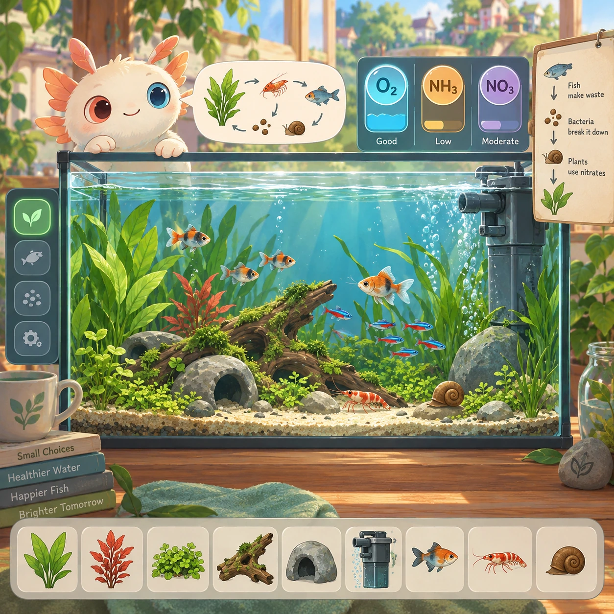
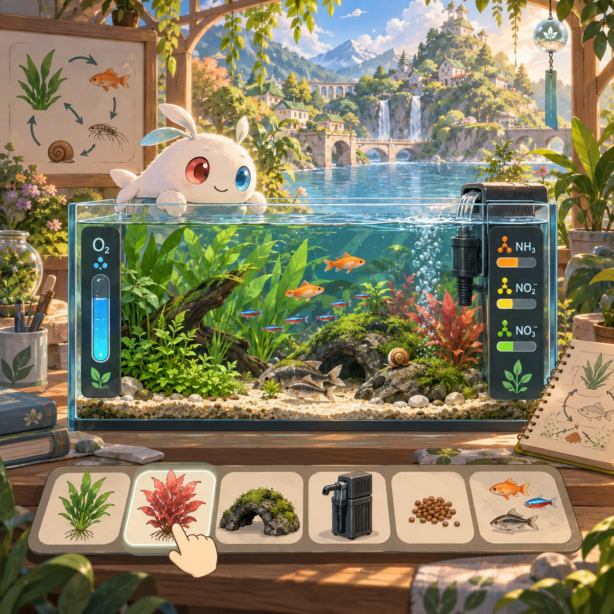
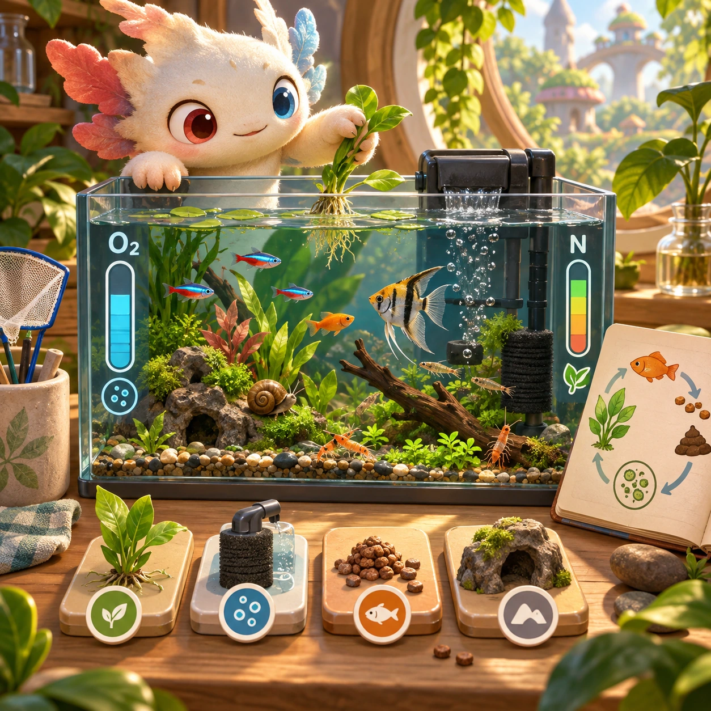
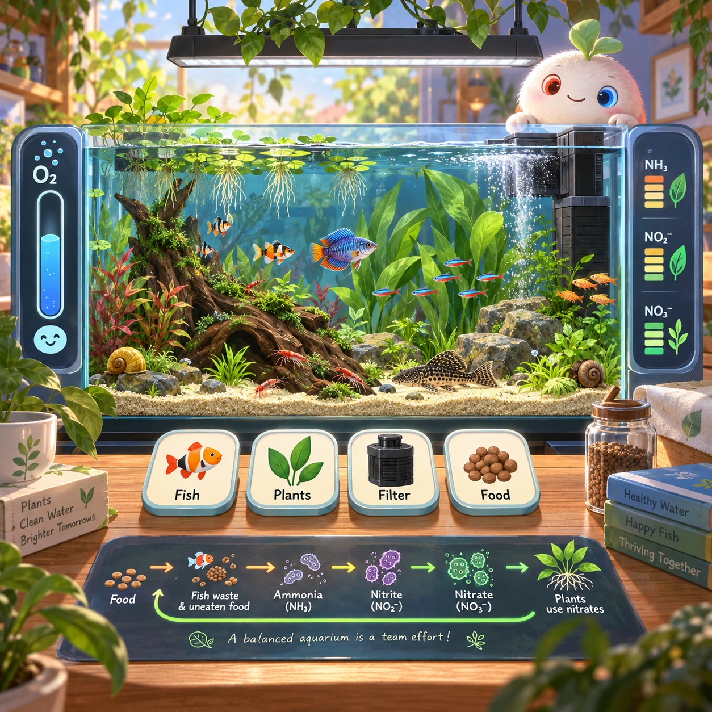

# Aquarium Balance

NC-13 · [Nature and care](../nc.md) · Cx 4 · Original catalog

**The idea:** Balance plants, filters and fish in a cutaway aquarium with oxygen and nitrogen indicators.

| Decision             | Proposal                                                                                                                                                                                    |
| -------------------- | ------------------------------------------------------------------------------------------------------------------------------------------------------------------------------------------- |
| Familiar mechanic    | Ecosystem sim                                                                                                                                                                               |
| Learning objective   | Food webs, nitrogen cycle                                                                                                                                                                   |
| First prototype      | One authored challenge built around the interaction above, with a clear goal, immediate feedback, restart and unlimited retries.                                                            |
| Technology           | React shell + PixiJS; use the shared simulation adapter only where motion or agent behavior requires it. Start with one bounded scene and measured frame time.                              |
| Scope boundary       | One bounded scenario and one core system; defer a full campaign, network play and production-scale content.                                                                                 |
| Reuse                | Shared input, saves, accessibility, seeded state and the nature and care collection shell.                                                                                                  |
| Prototype acceptance | A player can identify the next action from the screen, complete one challenge, explain the practiced idea and restart without help. Check touch and keyboard play at narrow and wide sizes. |
| Main uncertainty     | Simulation accuracy and device cost need measured evidence before extending the scenario.                                                                                                   |

## Estimated plan

**First playable version:** One cutaway aquarium with 8 fish, 6 plants and filters where oxygen and nitrogen gauges respond to choices, plus 10 balance goals; breeding, diseases and multiple tanks are left out.

| Measure              | Estimate                                                                                                   |
| -------------------- | ---------------------------------------------------------------------------------------------------------- |
| Youngest age         | 6+                                                                                                         |
| Toddler learnability | 1 of 5 — Needs reading, precise motor control, timing pressure or abstract rules; not a toddler game (6+). |
| Code                 | 2650 LOC, 22.1 days                                                                                        |
| Assets               | 160 hours, 26.6 days                                                                                       |
| Effort               | 48.7 days, risk 4 of 5                                                                                     |
| Start score          | 146.1 (rank 267 of 300; lower is better)                                                                   |

**Algorithms:** `ecosystem-sim` (Ecosystem simulation, 700 LOC) · `agent-steering` (Agent steering, 350 LOC) · `drag-drop-snap` (Drag and snap, 150 LOC) · `particle-effects` (Particles, 150 LOC)

**Assets:** 35 sprites, 15 animations, 3 backgrounds, 6 UI screens, 12 sound effects, 2 music tracks, 20 voice lines, 10 authored levels, 40 content items

How the numbers are computed: [development plan](../../development-plan.md#how-the-scores-work).

## Four visual directions

These are independently generated concept proposals for selecting a prototype.
The four views compare gameplay readability, world appeal, tactile identity and
room to grow. They are not screenshots of an implemented game. Native image
dimensions, hashes, exact prompts and generation provenance are recorded in the
[art manifest](../art/nc-13/manifest.json); see the [generation notes](../README.md#image-generation-and-provenance).

### Gameplay

### World

### Characters and materials

### Expanded play

## Design checks before prototyping

- Learning target: **Food webs, nitrogen cycle**. Ask a domain reviewer to validate factual content in the mechanic.
- Keep goals cooperative or self-directed, using resources and needs. Avoid purchasable power. No pressure timers in the accessible mode.
- Use original layouts and character designs; the [legal checklist](../../legal.md) applies even when a mechanic is familiar.
- Choose the minimum [fidelity level](../../simulation-engine.md#determinism-and-fidelity-levels) the lesson needs; concept art does not establish scientific accuracy.
- Review silhouettes, text alternatives, reduced motion and non-color cues against the [adorability gate](../../lore/adorability-gate.md).

Genre context: [existing genre research](../../../case-studies/issue-1/data/research-genres-ideas.md)
and [expansion research](../../../case-studies/issue-1/data/research-visual-catalog.md).

[← Migration Map](nc-12.md) · [All concepts](../README.md) · [Forest Keeper →](nc-14.md)
