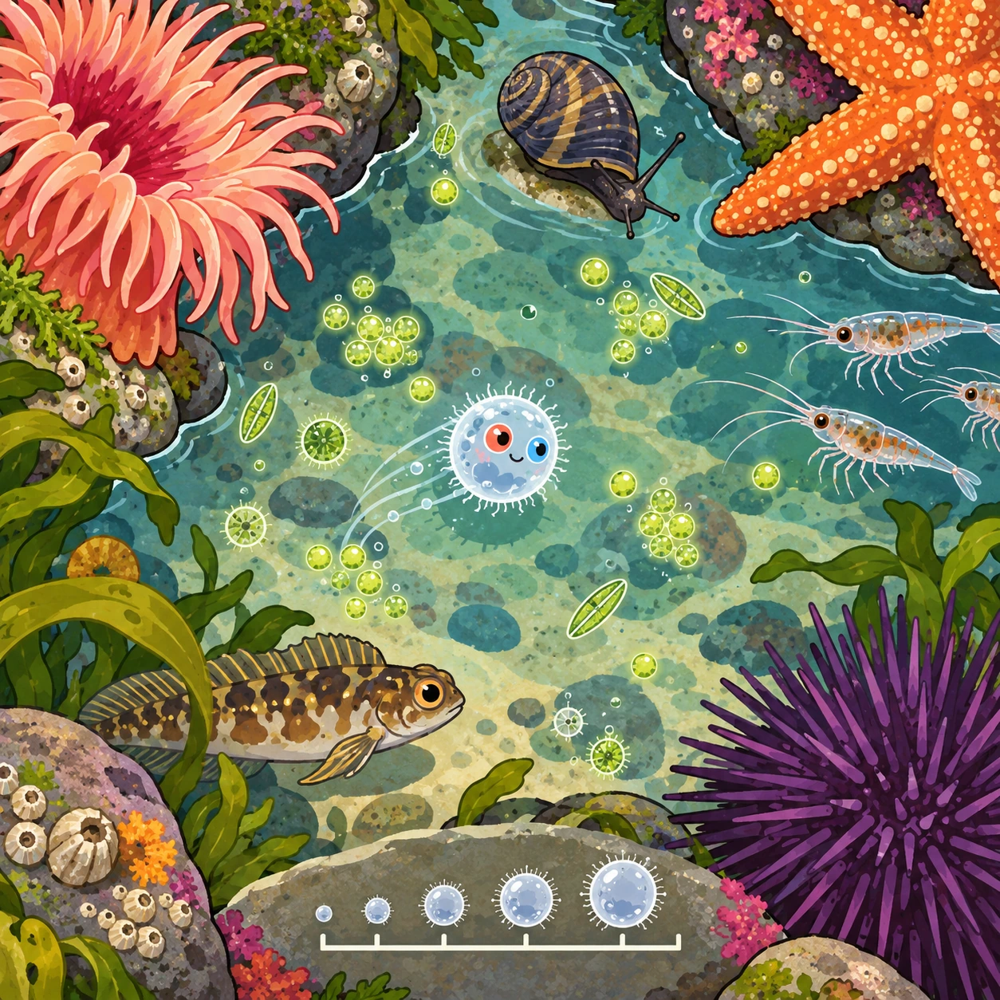
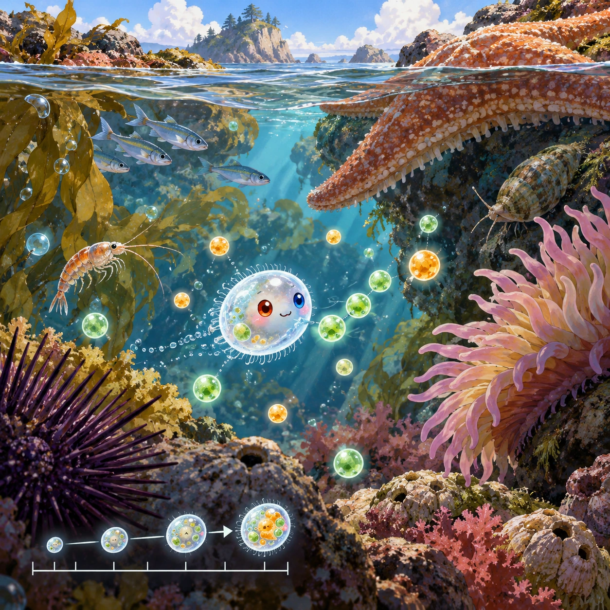
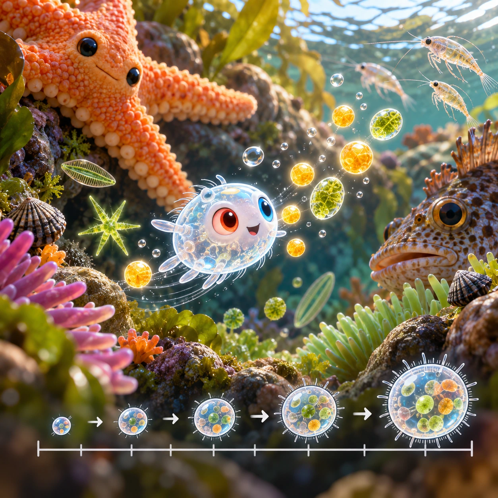
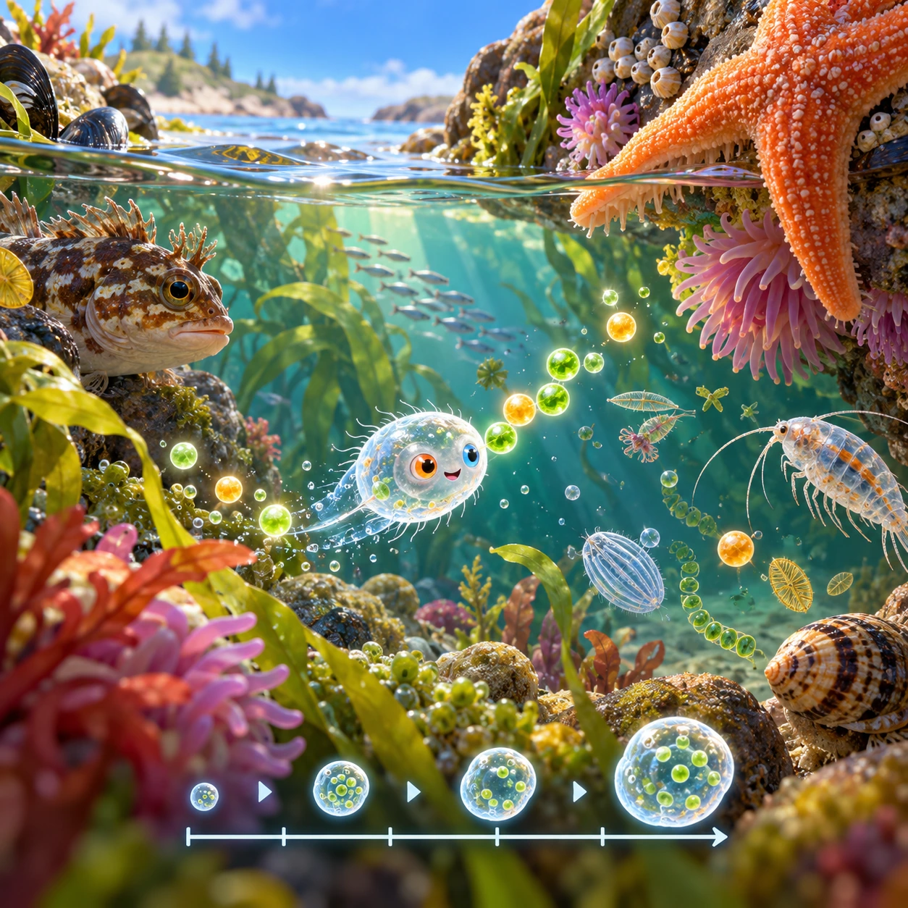

# Tidepool Sizes

NC-18 · [Nature and care](../nc.md) · Cx 3 · Ages 6+ · Research catalog

**The idea:** Guide a translucent round microbe through a magnified tidepool, gathering floating nutrient beads while larger organisms pass peacefully; a scale bar compares its changing diameter.

| Decision             | Proposal                                                                                                                                                                                    |
| -------------------- | ------------------------------------------------------------------------------------------------------------------------------------------------------------------------------------------- |
| Familiar mechanic    | Growth-and-navigation arcade                                                                                                                                                                |
| Learning objective   | Scale, food webs, conservation                                                                                                                                                              |
| First prototype      | One authored challenge built around the interaction above, with a clear goal, immediate feedback, restart and unlimited retries.                                                            |
| Technology           | React shell + PixiJS; use the shared simulation adapter only where motion or agent behavior requires it. Start with one bounded scene and measured frame time.                              |
| Scope boundary       | One bounded scenario and one core system; defer a full campaign, network play and production-scale content.                                                                                 |
| Reuse                | Shared input, saves, accessibility, seeded state and the nature and care collection shell.                                                                                                  |
| Prototype acceptance | A player can identify the next action from the screen, complete one challenge, explain the practiced idea and restart without help. Check touch and keyboard play at narrow and wide sizes. |
| Main uncertainty     | Test whether the lesson follows from play and whether the first interaction is understandable without reading.                                                                              |

## Estimated plan

**First playable version:** One microscopic water droplet with inert nutrients and three organism sizes; mass is conserved and other organisms remain unharmed, no online arena or predation.

| Measure              | Estimate                                                                                                   |
| -------------------- | ---------------------------------------------------------------------------------------------------------- |
| Youngest age         | 6+                                                                                                         |
| Toddler learnability | 1 of 5 — Needs reading, precise motor control, timing pressure or abstract rules; not a toddler game (6+). |
| Code                 | 1800 LOC, 15 days                                                                                          |
| Assets               | 93 hours, 15.5 days                                                                                        |
| Effort               | 30.5 days, risk 4 of 5                                                                                     |
| Start score          | 91.5 (rank 222 of 310; lower is better)                                                                    |

**Algorithms:** `agent-steering` (Agent steering, 350 LOC) · `ecosystem-sim` (Ecosystem simulation, 700 LOC) · `physics-2d` (2D physics, 300 LOC)

**Assets:** 24 sprites, 5 animations, 3 backgrounds, 4 UI screens, 8 sound effects, 1 music track, 12 voice lines, 6 authored levels, 24 content items

How the numbers are computed: [development plan](../../development-plan.md#how-the-scores-work).

## Four visual directions

These are independently generated concept proposals for selecting a prototype.
The four views compare gameplay readability, world appeal, tactile identity and
room to grow. They are not screenshots of an implemented game. Native image
dimensions, hashes, exact prompts and generation provenance are recorded in the
[art manifest](../art/nc-18/manifest.json); see the [generation notes](../README.md#image-generation-and-provenance).

The [core prompts](../jobs/nc.json) use IDs `nc-18/01-gameplay` to `nc-18/04-discovery`.

### Gameplay

### World

### Characters and materials

### Expanded play

## Design checks before prototyping

- Learning target: **Scale, food webs, conservation**. Ask a domain reviewer to validate factual content in the mechanic.
- Keep goals cooperative or self-directed, using resources and needs. Avoid purchasable power. No pressure timers in the accessible mode.
- Use original layouts and character designs; the [legal checklist](../../legal.md) applies even when a mechanic is familiar.
- Choose the minimum [fidelity level](../../simulation-engine.md#determinism-and-fidelity-levels) the lesson needs; concept art does not establish scientific accuracy.
- Review silhouettes, text alternatives, reduced motion and non-color cues against the [adorability gate](../../lore/adorability-gate.md).

Genre context: [existing genre research](../../../case-studies/issue-1/data/research-genres-ideas.md)
and [expansion research](../../../case-studies/issue-1/data/research-visual-catalog.md).

[← Magnet Fishing Day](nc-17.md) · [All concepts](../README.md)
