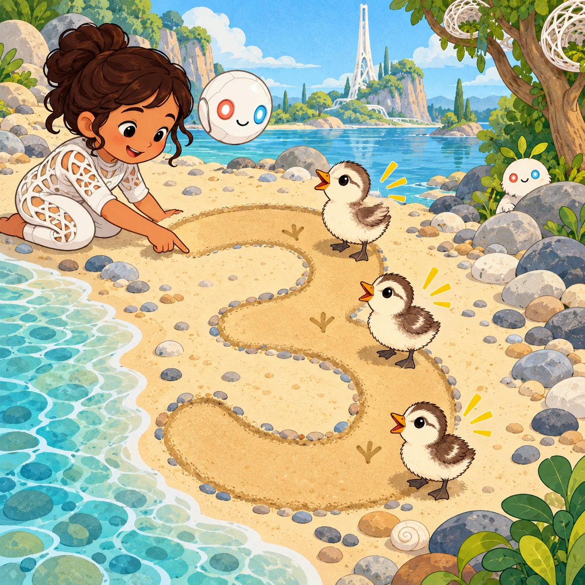
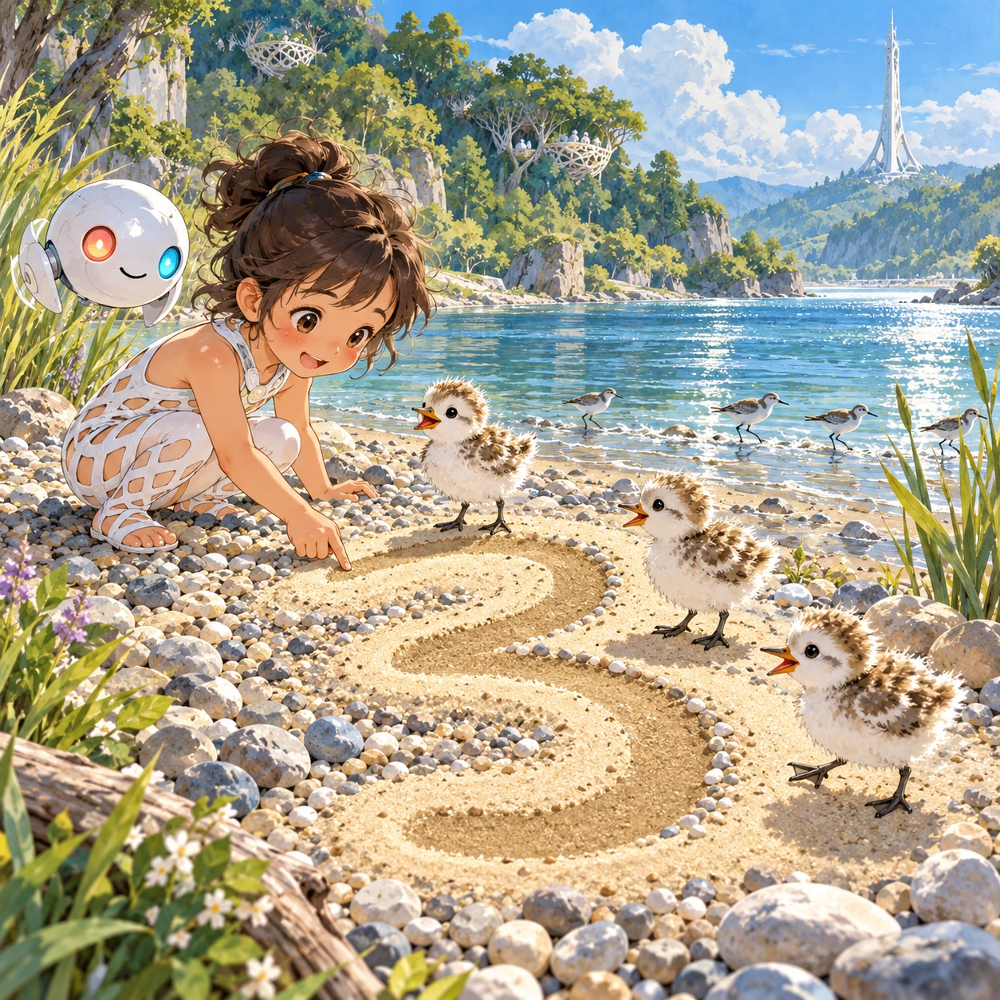
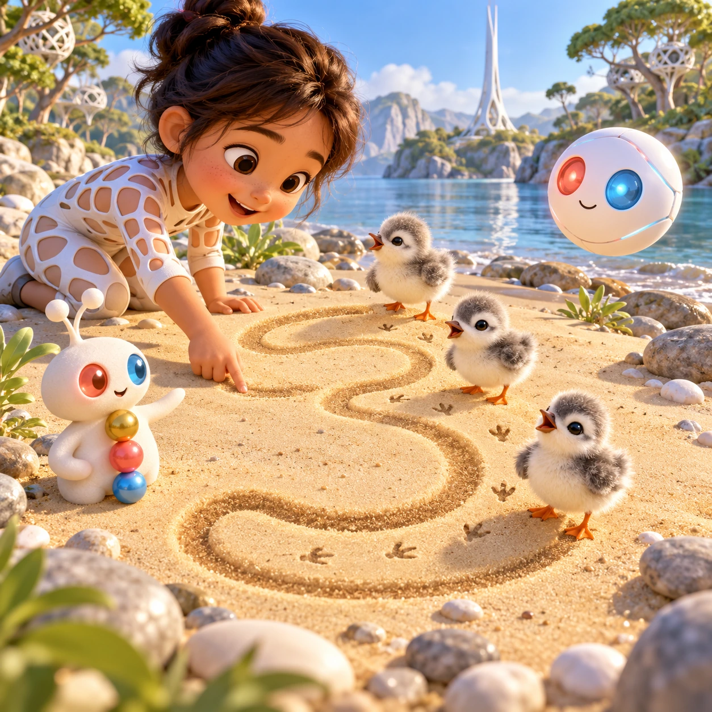
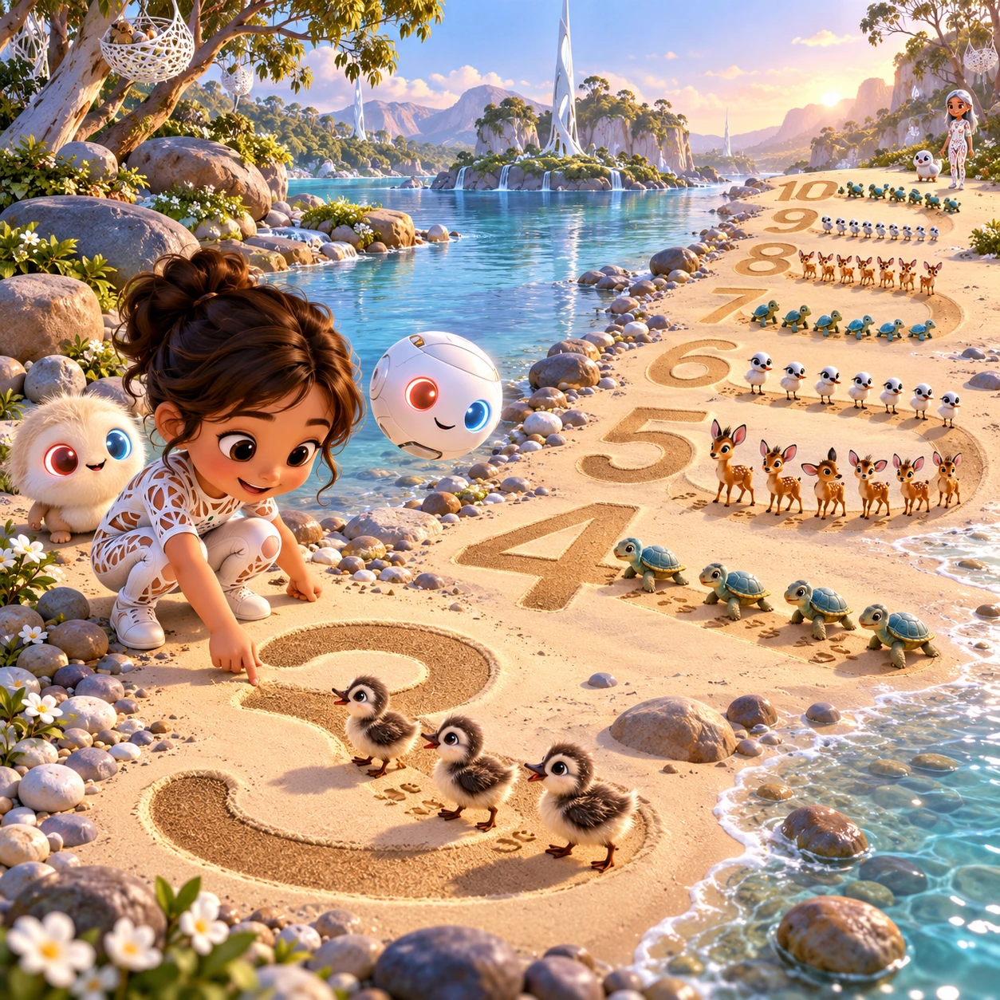

# Footprint Numbers

PK-02 · [Preschool (3–5)](../pk.md) · Cx 1 · Ages 3–5 · Raya story catalog

**The idea:** A huge numeral three lies as a wide path of soft sand on the beach. The child traces it with one finger, then three fluffy river chicks waddle onto the path, and each one cheeps when tapped and counted.

| Decision             | Proposal                                                                                                                                                                                    |
| -------------------- | ------------------------------------------------------------------------------------------------------------------------------------------------------------------------------------------- |
| Familiar mechanic    | Number tracing and counting to ten                                                                                                                                                          |
| Learning objective   | Numerals 1 to 10, one-to-one counting                                                                                                                                                       |
| First prototype      | One authored challenge built around the interaction above, with a clear goal, immediate feedback, restart and unlimited retries.                                                            |
| Technology           | React + SVG/DOM; deterministic state, undo and seeded levels. Start with one local screen and touch plus keyboard input.                                                                    |
| Scope boundary       | One board and one rule set; defer accounts, multiplayer, procedural content and platform SDKs.                                                                                              |
| Reuse                | Shared input, saves, accessibility, seeded state and the preschool (3–5) collection shell.                                                                                                  |
| Prototype acceptance | A player can identify the next action from the screen, complete one challenge, explain the practiced idea and restart without help. Check touch and keyboard play at narrow and wide sizes. |
| Main uncertainty     | Test whether the lesson follows from play and whether the first interaction is understandable without reading.                                                                              |

## Estimated plan

**First playable version:** Ten levels for numerals 1 to 10: trace the sand numeral, then tap each waddling chick once while the Orbi counts aloud. Turtle and fawn variants and the Beadle line are deferred.

| Measure              | Estimate                                                                          |
| -------------------- | --------------------------------------------------------------------------------- |
| Youngest age         | 3+                                                                                |
| Toddler learnability | 3 of 5 — Choose among 2-4 options, sort or match, or a two-step action; ages 3-4. |
| Code                 | 800 LOC, 6.7 days                                                                 |
| Assets               | 99 hours, 16.4 days                                                               |
| Effort               | 23.1 days, risk 2 of 5                                                            |
| Start score          | 34.7 (rank 68 of 310; lower is better)                                            |

**Algorithms:** `trace-check` (Trace checking, 200 LOC) · `counting` (Counting and quantity, 120 LOC) · `tap-feedback` (Tap feedback, 80 LOC) · `tween-cause-effect` (Cause-and-effect animation, 100 LOC)

**Assets:** 25 sprites, 6 animations, 2 backgrounds, 2 UI screens, 10 sound effects, 1 music track, 30 voice lines, 10 authored levels, 10 content items

How the numbers are computed: [development plan](../../development-plan.md#how-the-scores-work).

## Story

Three river chicks wanted to walk to the water, but they kept getting lost in the sand. "I will draw you a path," said the Beadle of three. He drew a big curly three in the sand, slowly, from the top. One chick stepped on. Then two. Then three. "One, two, three!" the Beadle counted, and touched each fluffy head once, never twice. The chicks marched along the curly path and splashed into the shallows. Every one was counted, and no one was left behind.

> **Wisdom:** Count each friend once, and no one is missed.

## Four visual directions

These are independently generated concept proposals for selecting a prototype.
The four views compare gameplay readability, world appeal, tactile identity and
room to grow. They are not screenshots of an implemented game. Native image
dimensions, hashes, exact prompts and generation provenance are recorded in the
[art manifest](../art/pk-02/manifest.json); see the [generation notes](../README.md#image-generation-and-provenance).

The [core prompts](../jobs/pk.json) use IDs `pk-02/01-gameplay` to `pk-02/04-discovery`.

### Gameplay

A huge numeral three lies as a wide path of soft sand on the beach. The child traces it with one finger, then three fluffy river chicks waddle onto the path, and each one cheeps when tapped and counted.

### World

The pebble beach at midday, warm and bright, with gentle river water sparkling at the edge. Reeds sway in small clumps, and sandpipers dash along the waterline. White lattice nests rest in leafy trees on the far bank. A thin white Chord tower stands beyond the trees under a pale blue sky with puffy clouds. Wide, low camera, cheerful mood.

### Characters and materials

Fluffy gray-and-cream river chicks with orange feet leave tiny footprints in the sand. The Beadles, little bead-chain creatures, stand beside the path, the Beadle of three with three shiny beads. A white Orbi floats near the numeral, its coral-red and sky-blue eyes blinking. Sand is warm beige, footprints darker, outlines soft gray.

### Expanded play

Numbers grow from one to ten. After each trace, the right number of chicks, baby turtles or grazer fawns walks the path, and the child counts them by tapping each once. Later the Beadle of each number joins the line, and the finished numerals stay along the river as a long trail of footprints and friends.

## Design checks before prototyping

- Learning target: **Numerals 1 to 10, one-to-one counting**. Ask a domain reviewer to validate factual content in the mechanic.
- Keep goals cooperative or self-directed, using resources and needs. Avoid purchasable power. No pressure timers in the accessible mode.
- Use original layouts and character designs; the [legal checklist](../../legal.md) applies even when a mechanic is familiar.
- Choose the minimum [fidelity level](../../simulation-engine.md#determinism-and-fidelity-levels) the lesson needs; concept art does not establish scientific accuracy.
- Review silhouettes, text alternatives, reduced motion and non-color cues against the [adorability gate](../../lore/adorability-gate.md).
- Follow the [toddler design rules](../../../case-studies/issue-1/data/research-raya-shacados.md#7-toddlers-and-screens-r68-r69) and keep every instruction voiced; reading is never required.

Genre context: [existing genre research](../../../case-studies/issue-1/data/research-genres-ideas.md)
and [expansion research](../../../case-studies/issue-1/data/research-visual-catalog.md).

[← Wet Sand Letters](pk-01.md) · [All concepts](../README.md) · [First Sound Boats →](pk-03.md)
