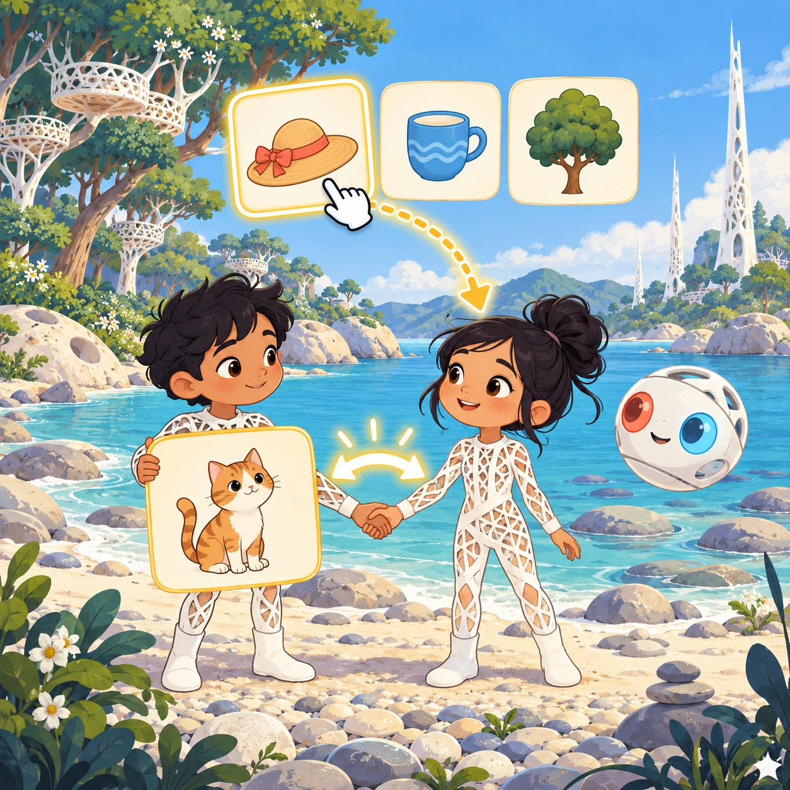
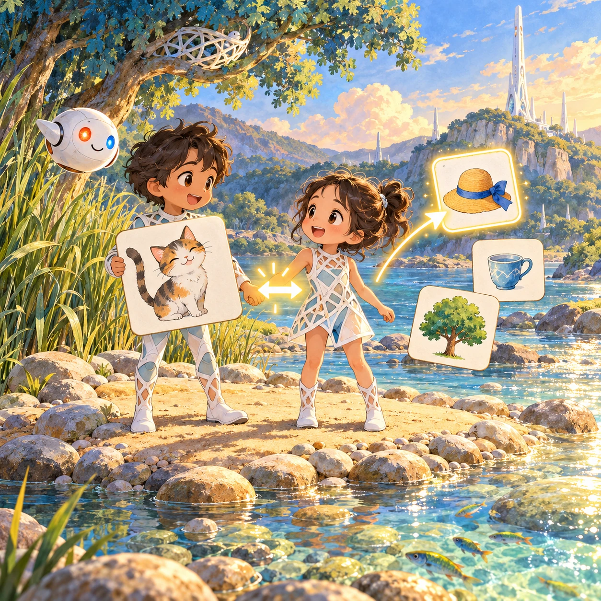
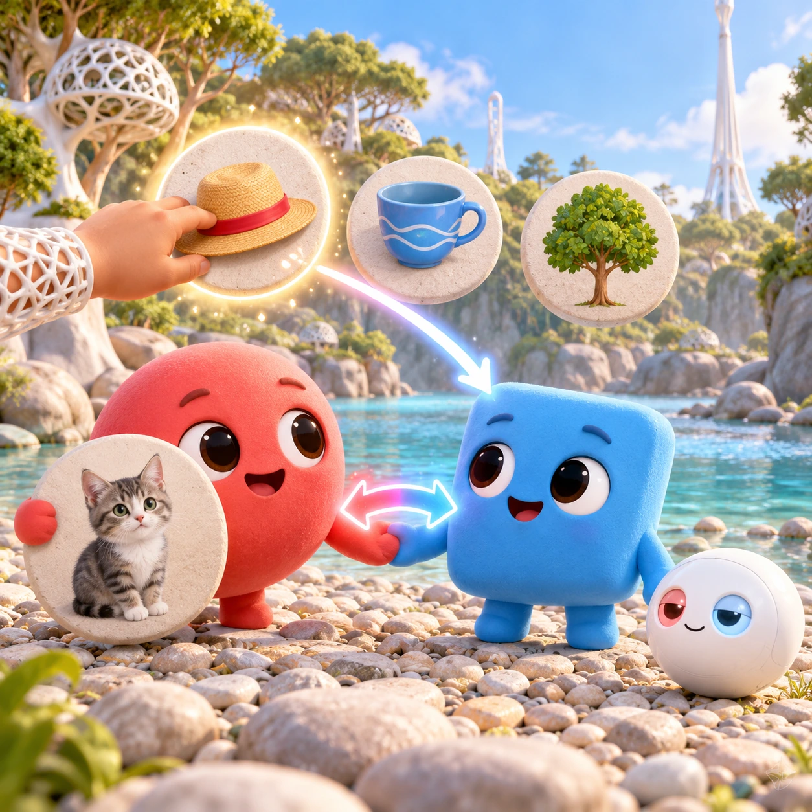
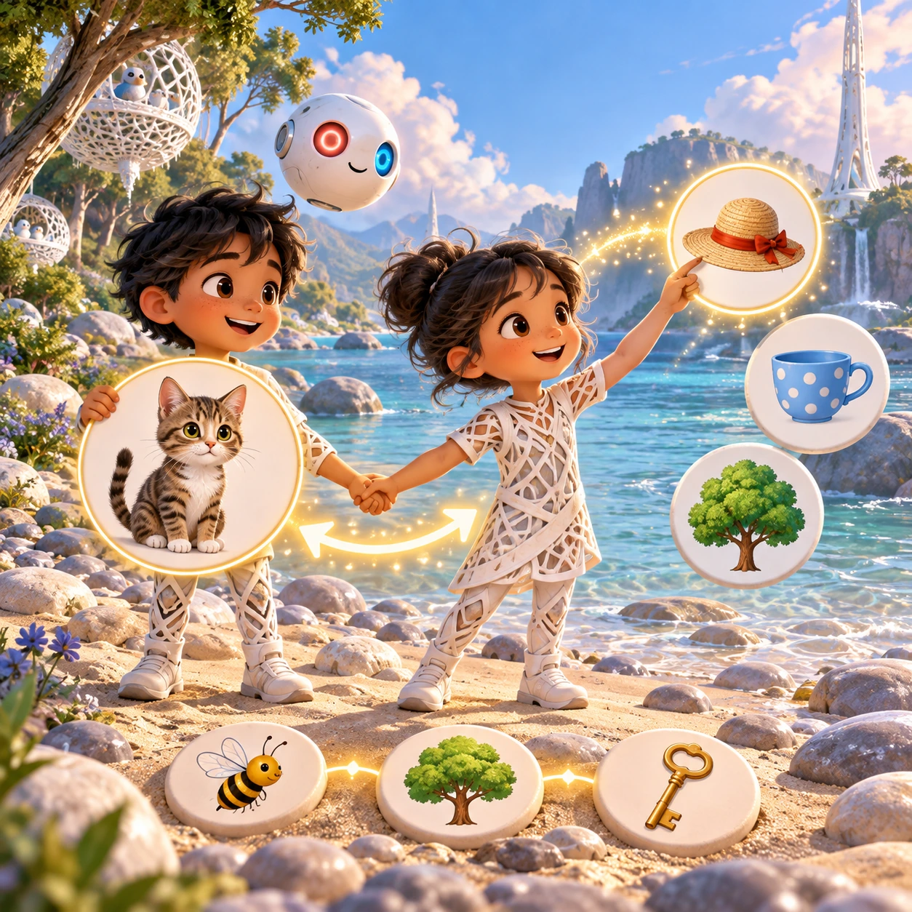

# Rhyming Twins

PK-04 · [Preschool (3–5)](../pk.md) · Cx 1 · Ages 3–5 · Raya story catalog

**The idea:** Soru holds a big picture of a cat. Three pictures float beside Tari: a hat, a cup and a tree. The child drags the hat to Tari, and the twins hold hands as a glowing arrow appears between them.

| Decision             | Proposal                                                                                                                                                                                    |
| -------------------- | ------------------------------------------------------------------------------------------------------------------------------------------------------------------------------------------- |
| Familiar mechanic    | Rhyme matching pairs                                                                                                                                                                        |
| Learning objective   | Hearing rhymes, playing with sounds                                                                                                                                                         |
| First prototype      | One authored challenge built around the interaction above, with a clear goal, immediate feedback, restart and unlimited retries.                                                            |
| Technology           | React + SVG/DOM; deterministic state, undo and seeded levels. Start with one local screen and touch plus keyboard input.                                                                    |
| Scope boundary       | One board and one rule set; defer accounts, multiplayer, procedural content and platform SDKs.                                                                                              |
| Reuse                | Shared input, saves, accessibility, seeded state and the preschool (3–5) collection shell.                                                                                                  |
| Prototype acceptance | A player can identify the next action from the screen, complete one challenge, explain the practiced idea and restart without help. Check touch and keyboard play at narrow and wide sizes. |
| Main uncertainty     | Test whether the lesson follows from play and whether the first interaction is understandable without reading.                                                                              |

## Estimated plan

**First playable version:** Sandbar screen where Soru shows a picture and the child drags its rhyme from three choices to Tari; 20 rhyme pairs, all voiced. Rhyme chains and the sing-along mode are left out.

| Measure              | Estimate                                                                          |
| -------------------- | --------------------------------------------------------------------------------- |
| Youngest age         | 3+                                                                                |
| Toddler learnability | 3 of 5 — Choose among 2-4 options, sort or match, or a two-step action; ages 3-4. |
| Code                 | 700 LOC, 5.8 days                                                                 |
| Assets               | 97 hours, 16.2 days                                                               |
| Effort               | 22 days, risk 1 of 5                                                              |
| Start score          | 33 (rank 63 of 310; lower is better)                                              |

**Algorithms:** `drag-drop-snap` (Drag and snap, 150 LOC) · `word-list` (Word lists and validation, 150 LOC) · `tween-cause-effect` (Cause-and-effect animation, 100 LOC)

**Assets:** 30 sprites, 5 animations, 1 background, 2 UI screens, 8 sound effects, 1 music track, 50 voice lines, 40 content items

How the numbers are computed: [development plan](../../development-plan.md#how-the-scores-work).

## Story

Soru held up a picture of a cat. "Cat!" she said. Tari looked at a cup, a tree and a hat. "Cup? No, that sounds different. Tree? No." Then Tari picked up the hat. "Cat, hat! Cat, hat!" The twins laughed and held hands, and an arrow glowed between them. "Our words sound like friends," said Soru. "They end the same way," said Tari, "just like our arrow." They hopped on the sandbar singing cat, hat, sat, until the little fish came up to listen.

> **Wisdom:** Words that end alike are friends.

## Four visual directions

These are independently generated concept proposals for selecting a prototype.
The four views compare gameplay readability, world appeal, tactile identity and
room to grow. They are not screenshots of an implemented game. Native image
dimensions, hashes, exact prompts and generation provenance are recorded in the
[art manifest](../art/pk-04/manifest.json); see the [generation notes](../README.md#image-generation-and-provenance).

The [core prompts](../jobs/pk.json) use IDs `pk-04/01-gameplay` to `pk-04/04-discovery`.

### Gameplay

Soru holds a big picture of a cat. Three pictures float beside Tari: a hat, a cup and a tree. The child drags the hat to Tari, and the twins hold hands as a glowing arrow appears between them.

### World

A sunny sandbar in the middle of the river, ringed by round pebbles and shallow, glittering water. Tall reeds and one blue-green tree with a white lattice nest give soft shade. On the far shore a white Chord tower rises beside a gentle hill. The light is warm and golden, and small fish flash in the shallows.

### Characters and materials

Soru is a coral-red round blob and Tari a sky-blue square blob, both chibi with big low eyes and soft gray outlines. A glowing red-to-blue arrow links their hands. The floating pictures sit on round pebble discs. A white Orbi rests in the sand like a quiet ball, eyes half open. Coral, sky blue, sand and soft green.

### Expanded play

Rhyme families grow from pairs like cat and hat to chains like bee, tree and key. Later Soru says a word and the child chooses from four pictures. In a song mode the twins sing a short silly rhyme on the sandbar and pause, and the child taps the picture that finishes the line.

## Design checks before prototyping

- Learning target: **Hearing rhymes, playing with sounds**. Ask a domain reviewer to validate factual content in the mechanic.
- Keep goals cooperative or self-directed, using resources and needs. Avoid purchasable power. No pressure timers in the accessible mode.
- Use original layouts and character designs; the [legal checklist](../../legal.md) applies even when a mechanic is familiar.
- Choose the minimum [fidelity level](../../simulation-engine.md#determinism-and-fidelity-levels) the lesson needs; concept art does not establish scientific accuracy.
- Review silhouettes, text alternatives, reduced motion and non-color cues against the [adorability gate](../../lore/adorability-gate.md).
- Follow the [toddler design rules](../../../case-studies/issue-1/data/research-raya-shacados.md#7-toddlers-and-screens-r68-r69) and keep every instruction voiced; reading is never required.

Genre context: [existing genre research](../../../case-studies/issue-1/data/research-genres-ideas.md)
and [expansion research](../../../case-studies/issue-1/data/research-visual-catalog.md).

[← First Sound Boats](pk-03.md) · [All concepts](../README.md) · [Rela's Two Sides →](pk-05.md)
