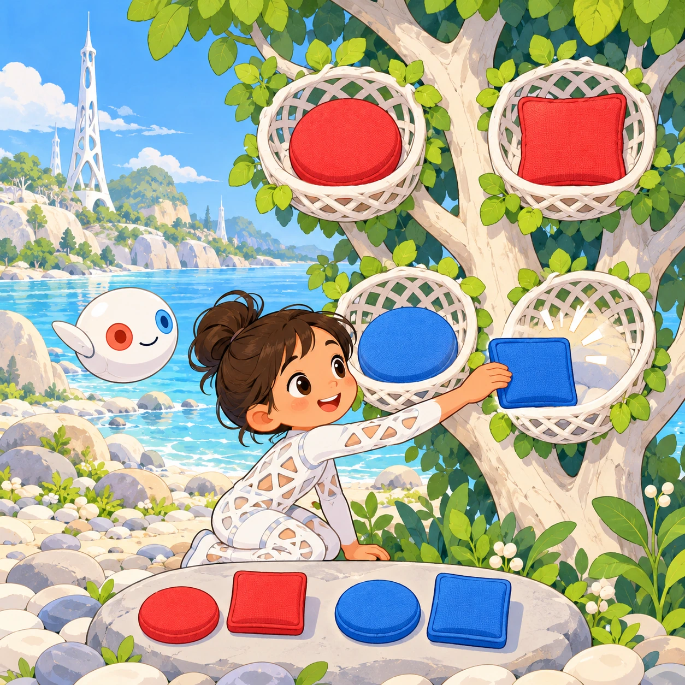
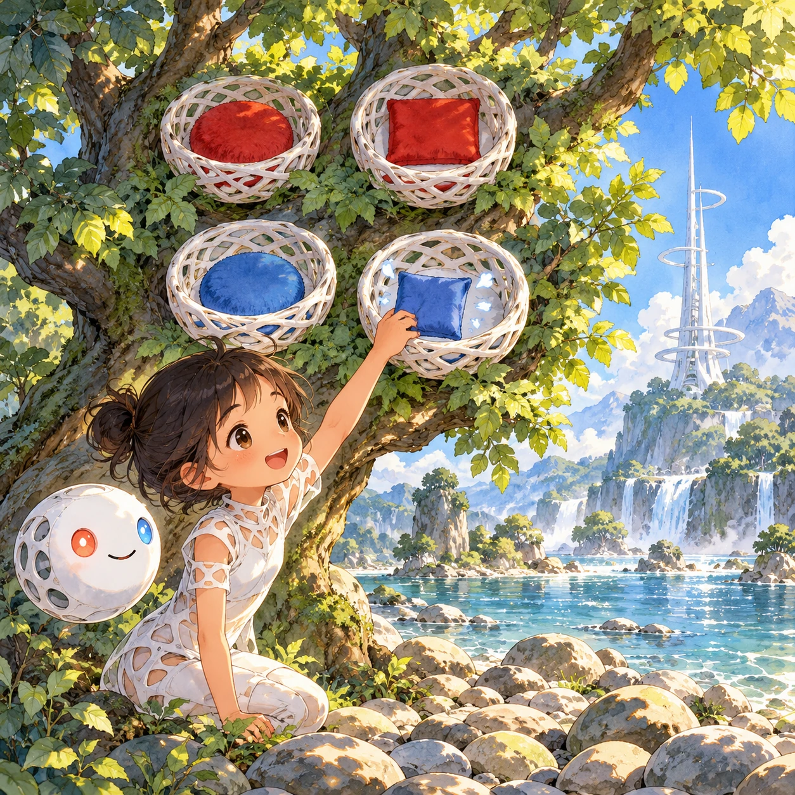
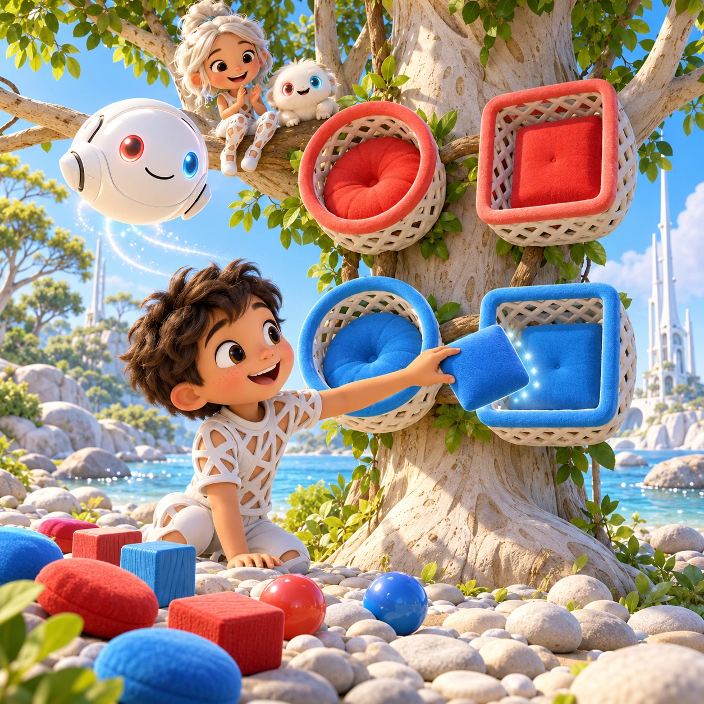
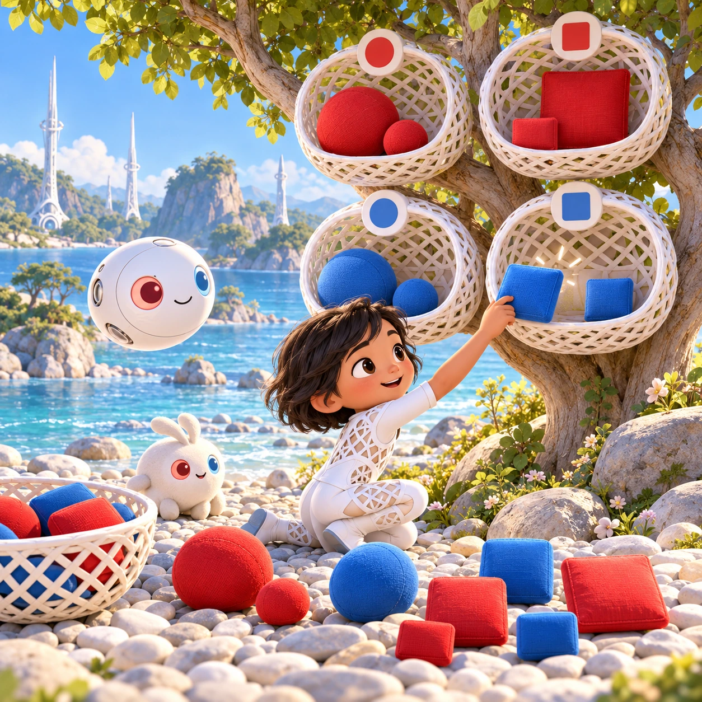

# Four Nest Sorting

PK-07 · [Preschool (3–5)](../pk.md) · Cx 2 · Ages 4–6 · Raya story catalog

**The idea:** A tree holds four white lattice nests in a square: red round, red square, blue round and blue square. The child drags a small blue square cushion into the blue square nest, and it settles with a soft puff.

| Decision             | Proposal                                                                                                                                                                                    |
| -------------------- | ------------------------------------------------------------------------------------------------------------------------------------------------------------------------------------------- |
| Familiar mechanic    | Sorting by two attributes                                                                                                                                                                   |
| Learning objective   | Sorting by color and shape together, classification                                                                                                                                         |
| First prototype      | One authored challenge built around the interaction above, with a clear goal, immediate feedback, restart and unlimited retries.                                                            |
| Technology           | React + SVG/DOM; deterministic state, undo and seeded levels. Start with one local screen and touch plus keyboard input.                                                                    |
| Scope boundary       | One board and one rule set; defer accounts, multiplayer, procedural content and platform SDKs.                                                                                              |
| Reuse                | Shared input, saves, accessibility, seeded state and the preschool (3–5) collection shell.                                                                                                  |
| Prototype acceptance | A player can identify the next action from the screen, complete one challenge, explain the practiced idea and restart without help. Check touch and keyboard play at narrow and wide sizes. |
| Main uncertainty     | Test whether the lesson follows from play and whether the first interaction is understandable without reading.                                                                              |

## Estimated plan

**First playable version:** Tree screen with four nests: 20 levels moving from color only to shape only to color and shape together, 40 items to sort. Size as a third rule and the secret rule game are left out.

| Measure              | Estimate                                                                               |
| -------------------- | -------------------------------------------------------------------------------------- |
| Youngest age         | 4+                                                                                     |
| Toddler learnability | 2 of 5 — Needs simple rules, turns, a sequence or remembering several steps; ages 4-6. |
| Code                 | 830 LOC, 6.9 days                                                                      |
| Assets               | 135 hours, 22.4 days                                                                   |
| Effort               | 29.3 days, risk 1 of 5                                                                 |
| Start score          | 58.6 (rank 148 of 310; lower is better)                                                |

**Algorithms:** `sort-classify` (Sorting by attribute, 120 LOC) · `drag-drop-snap` (Drag and snap, 150 LOC) · `tween-cause-effect` (Cause-and-effect animation, 100 LOC) · `shuffle-deal` (Seeded shuffle and deal, 60 LOC)

**Assets:** 40 sprites, 5 animations, 2 backgrounds, 3 UI screens, 10 sound effects, 1 music track, 35 voice lines, 20 authored levels, 40 content items

How the numbers are computed: [development plan](../../development-plan.md#how-the-scores-work).

## Story

The wind tossed the nest cushions everywhere. Soru said, "Red ones go in red nests!" Tari said, "Square ones go in square nests!" They began to argue. Then Verbi jumped between them. "Look! This one is red and square. Where does it go?" The twins looked up at the tree. One nest was red and square. "There!" they said together. They sorted every cushion by color and by shape. When they finished, each nest was cozy, and the twins were laughing again.

> **Wisdom:** Two ideas together find the right place.

## Four visual directions

These are independently generated concept proposals for selecting a prototype.
The four views compare gameplay readability, world appeal, tactile identity and
room to grow. They are not screenshots of an implemented game. Native image
dimensions, hashes, exact prompts and generation provenance are recorded in the
[art manifest](../art/pk-07/manifest.json); see the [generation notes](../README.md#image-generation-and-provenance).

The [core prompts](../jobs/pk.json) use IDs `pk-07/01-gameplay` to `pk-07/04-discovery`.

### Gameplay

A tree holds four white lattice nests in a square: red round, red square, blue round and blue square. The child drags a small blue square cushion into the blue square nest, and it settles with a soft puff.

### World

A big blue-green tree on the riverbank with wide, low branches. Four woven white nests sit in a neat square among the leaves, and sunlight filters through in warm spots. Below, round pebbles cover the beach and the river glints. A white Chord tower stands far off, its rings shining softly. Front view, calm and tidy.

### Characters and materials

The nests are woven from white lattice, two with coral-red rims and two with sky-blue rims, two round and two square. Items to sort are soft cushions, wooden blocks and toy balls in clear colors and shapes. Soru and Tari sit on a branch to cheer. A white Orbi floats by the trunk, lifting items with a shimmer.

### Expanded play

First one rule at a time: color only, then shape only. Then both together in the four nests. Later size joins as a third idea with big and small items, and the child can invent a secret rule for the twins to guess. A tidy-up round brings every item back to its own place.

## Design checks before prototyping

- Learning target: **Sorting by color and shape together, classification**. Ask a domain reviewer to validate factual content in the mechanic.
- Keep goals cooperative or self-directed, using resources and needs. Avoid purchasable power. No pressure timers in the accessible mode.
- Use original layouts and character designs; the [legal checklist](../../legal.md) applies even when a mechanic is familiar.
- Choose the minimum [fidelity level](../../simulation-engine.md#determinism-and-fidelity-levels) the lesson needs; concept art does not establish scientific accuracy.
- Review silhouettes, text alternatives, reduced motion and non-color cues against the [adorability gate](../../lore/adorability-gate.md).
- Follow the [toddler design rules](../../../case-studies/issue-1/data/research-raya-shacados.md#7-toddlers-and-screens-r68-r69) and keep every instruction voiced; reading is never required.

Genre context: [existing genre research](../../../case-studies/issue-1/data/research-genres-ideas.md)
and [expansion research](../../../case-studies/issue-1/data/research-visual-catalog.md).

[← Stepping Stone Patterns](pk-06.md) · [All concepts](../README.md) · [Little Paths Home →](pk-08.md)
