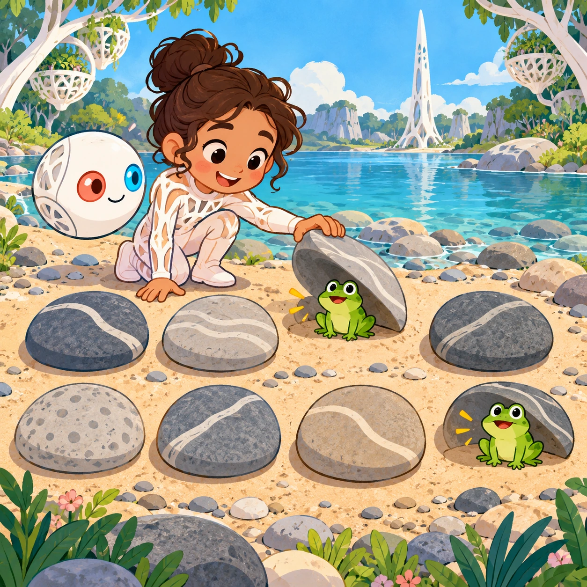
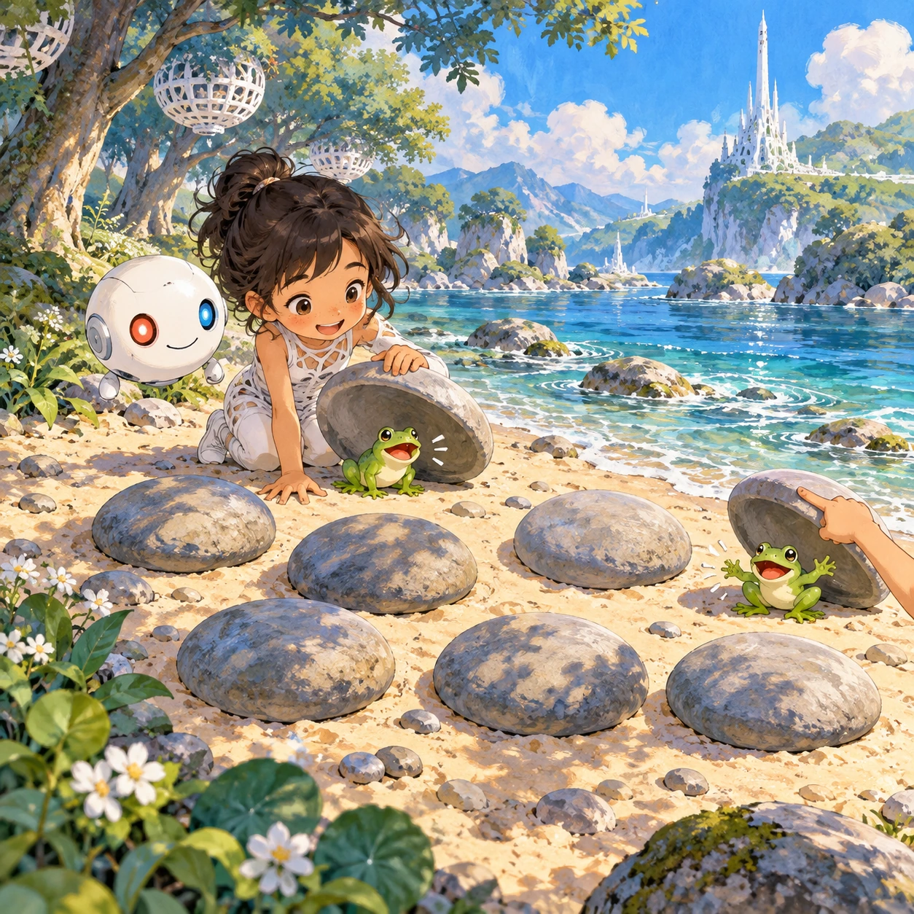
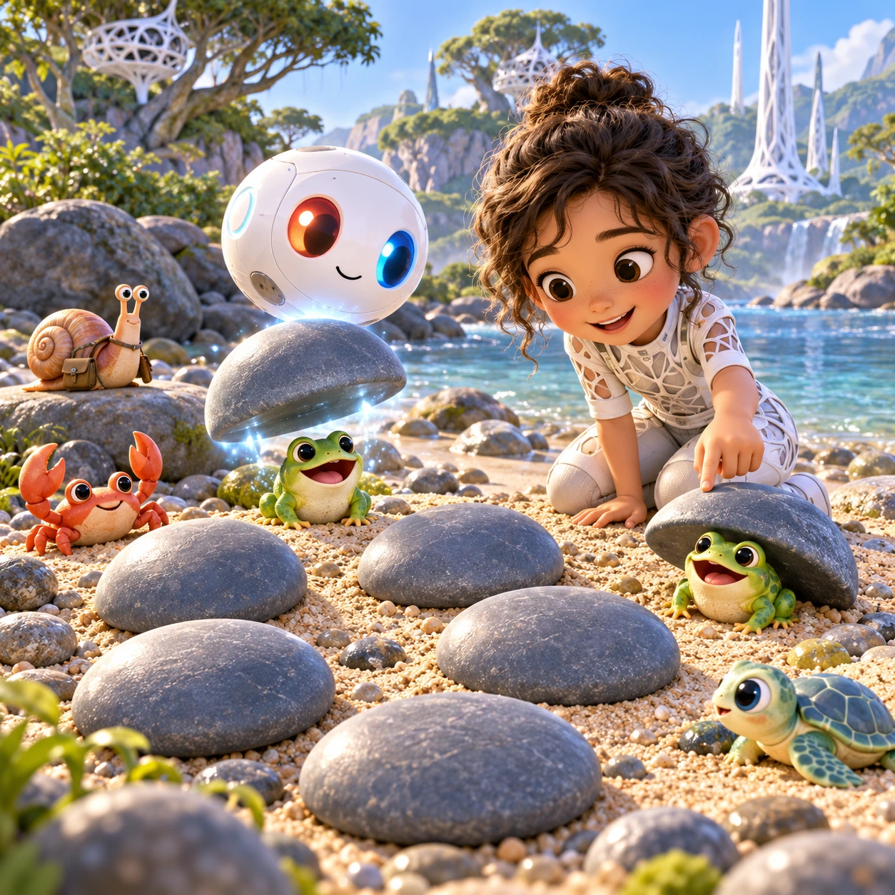
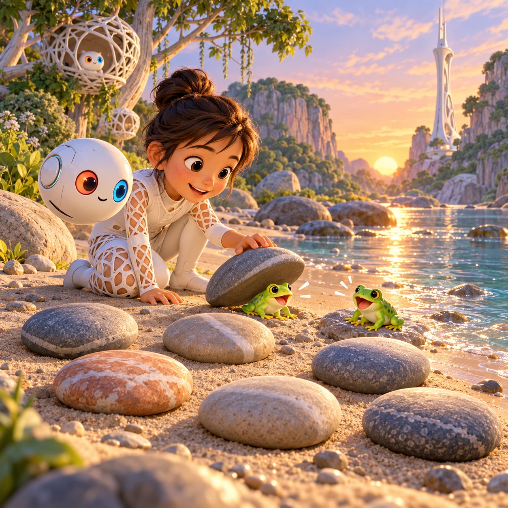

# Peek Under Pebbles

PK-10 · [Preschool (3–5)](../pk.md) · Cx 1 · Ages 3–5 · Raya story catalog

**The idea:** Eight big round pebbles lie scattered on the sand. The Orbi lifts one to reveal a tiny frog that croaks, then the child taps another pebble and finds the matching frog, and both hop happily.

| Decision             | Proposal                                                                                                                                                                                    |
| -------------------- | ------------------------------------------------------------------------------------------------------------------------------------------------------------------------------------------- |
| Familiar mechanic    | Memory pairs with 6 to 12 pebbles                                                                                                                                                           |
| Learning objective   | Visual and sound memory, matching                                                                                                                                                           |
| First prototype      | One authored challenge built around the interaction above, with a clear goal, immediate feedback, restart and unlimited retries.                                                            |
| Technology           | React + SVG/DOM; deterministic state, undo and seeded levels. Start with one local screen and touch plus keyboard input.                                                                    |
| Scope boundary       | One board and one rule set; defer accounts, multiplayer, procedural content and platform SDKs.                                                                                              |
| Reuse                | Shared input, saves, accessibility, seeded state and the preschool (3–5) collection shell.                                                                                                  |
| Prototype acceptance | A player can identify the next action from the screen, complete one challenge, explain the practiced idea and restart without help. Check touch and keyboard play at narrow and wide sizes. |
| Main uncertainty     | Test whether the lesson follows from play and whether the first interaction is understandable without reading.                                                                              |

## Estimated plan

**First playable version:** Beach memory game with 6, 8 and 12 pebbles hiding ten animal friends with their own sounds, ending with the Orbi tidying every pebble back. The sound-only round is deferred.

| Measure              | Estimate                                                                          |
| -------------------- | --------------------------------------------------------------------------------- |
| Youngest age         | 3+                                                                                |
| Toddler learnability | 3 of 5 — Choose among 2-4 options, sort or match, or a two-step action; ages 3-4. |
| Code                 | 590 LOC, 4.9 days                                                                 |
| Assets               | 108 hours, 17.9 days                                                              |
| Effort               | 22.8 days, risk 1 of 5                                                            |
| Start score          | 34.2 (rank 66 of 310; lower is better)                                            |

**Algorithms:** `card-memory` (Memory cards, 120 LOC) · `shuffle-deal` (Seeded shuffle and deal, 60 LOC) · `tap-feedback` (Tap feedback, 80 LOC) · `peekaboo-reveal` (Hide and reveal, 80 LOC)

**Assets:** 20 sprites, 12 animations, 2 backgrounds, 2 UI screens, 20 sound effects, 1 music track, 25 voice lines, 6 authored levels

How the numbers are computed: [development plan](../../development-plan.md#how-the-scores-work).

## Story

Under the pebbles, little friends were playing hide and seek. The Orbi lifted one pebble. A frog said, "Ribbit!" and ducked back down. The Orbi lifted another. A crab waved and hid again. "Where is the frog's twin?" asked Postie the snail. "The ribbit came from over here," said the Orbi, and lifted a pebble near the first. Two frogs hopped out and hugged. When all the friends were found, the Orbi set every pebble back just where it was, as if no one had played there at all.

> **Wisdom:** Leave the beach as you found it.

## Four visual directions

These are independently generated concept proposals for selecting a prototype.
The four views compare gameplay readability, world appeal, tactile identity and
room to grow. They are not screenshots of an implemented game. Native image
dimensions, hashes, exact prompts and generation provenance are recorded in the
[art manifest](../art/pk-10/manifest.json); see the [generation notes](../README.md#image-generation-and-provenance).

The [core prompts](../jobs/pk.json) use IDs `pk-10/01-gameplay` to `pk-10/04-discovery`.

### Gameplay

Eight big round pebbles lie scattered on the sand. The Orbi lifts one to reveal a tiny frog that croaks, then the child taps another pebble and finds the matching frog, and both hop happily.

### World

A sunlit patch of beach where large smooth pebbles rest on soft sand near the river's edge. Small waves lap the shore. Blue-green trees with white lattice nests stand behind, and a white Chord tower rises far away. The sky is soft blue with a few fluffy clouds. Top-down camera, playful and calm.

### Characters and materials

Pebbles are big, round and gray-blue, with a soft shine. Under them hide chibi animal friends: frogs, crabs, snails and baby turtles, each with its own sound. A white Orbi hovers above, lifting pebbles with a gentle shimmer, coral-red and sky-blue eyes bright. Postie Index, the mail-carrier snail, watches from a flat stone.

### Expanded play

Rounds grow from 6 to 8 to 12 pebbles. Found pairs stay out and play together at the water's edge. Later a listening round hides friends that are only heard, not seen. Every round ends with a tidy-up, where the Orbi puts each pebble back exactly where it lay, because the beach should stay as it was.

## Design checks before prototyping

- Learning target: **Visual and sound memory, matching**. Ask a domain reviewer to validate factual content in the mechanic.
- Keep goals cooperative or self-directed, using resources and needs. Avoid purchasable power. No pressure timers in the accessible mode.
- Use original layouts and character designs; the [legal checklist](../../legal.md) applies even when a mechanic is familiar.
- Choose the minimum [fidelity level](../../simulation-engine.md#determinism-and-fidelity-levels) the lesson needs; concept art does not establish scientific accuracy.
- Review silhouettes, text alternatives, reduced motion and non-color cues against the [adorability gate](../../lore/adorability-gate.md).
- Follow the [toddler design rules](../../../case-studies/issue-1/data/research-raya-shacados.md#7-toddlers-and-screens-r68-r69) and keep every instruction voiced; reading is never required.

Genre context: [existing genre research](../../../case-studies/issue-1/data/research-genres-ideas.md)
and [expansion research](../../../case-studies/issue-1/data/research-visual-catalog.md).

[← Big Piece Pictures](pk-09.md) · [All concepts](../README.md) · [Twin Nests →](pk-11.md)
