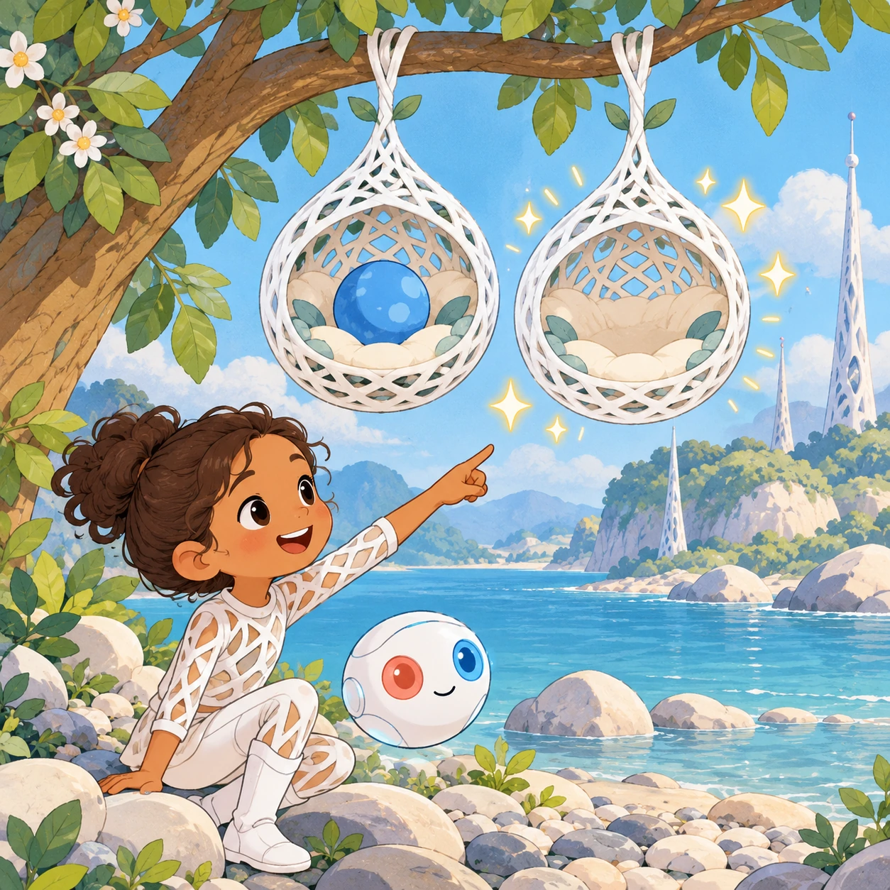
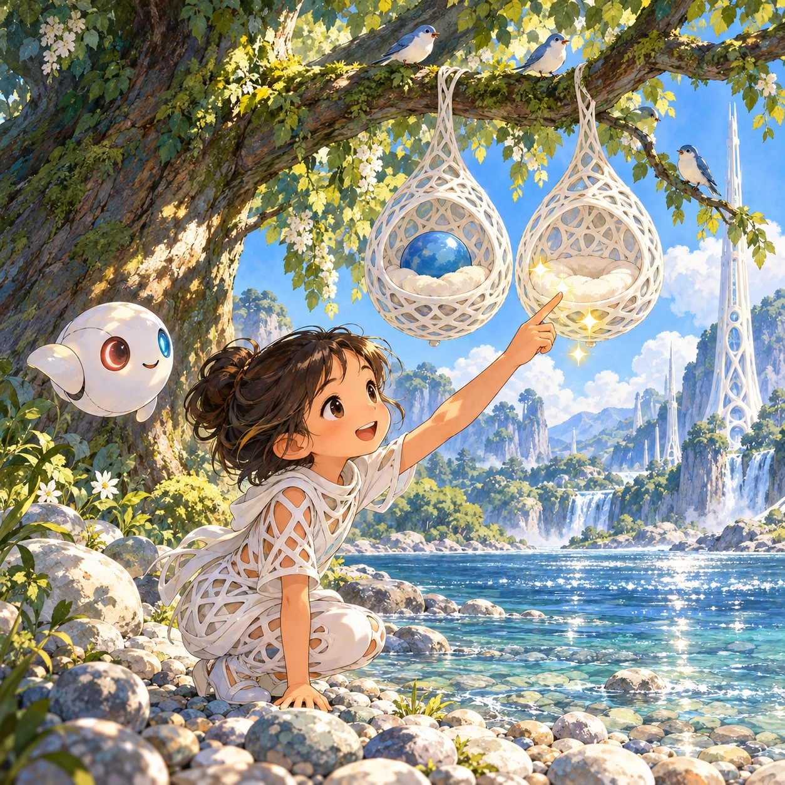
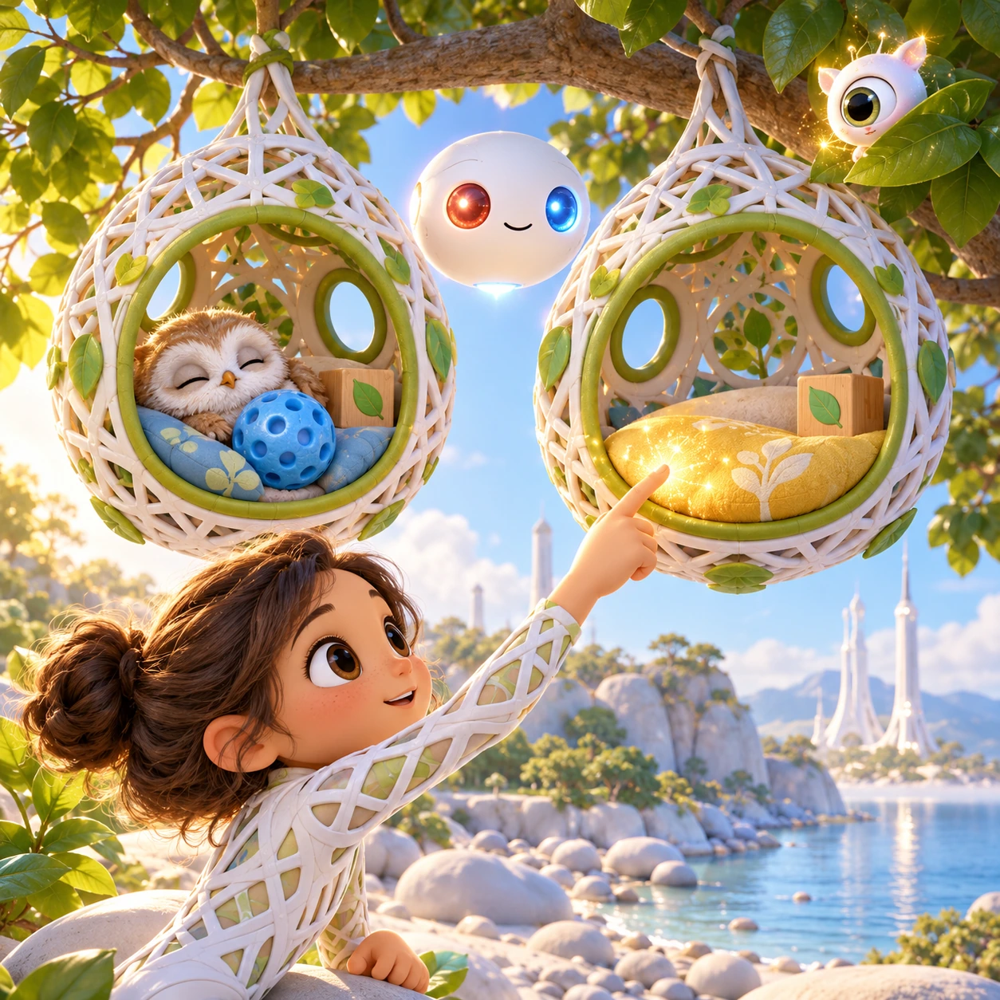
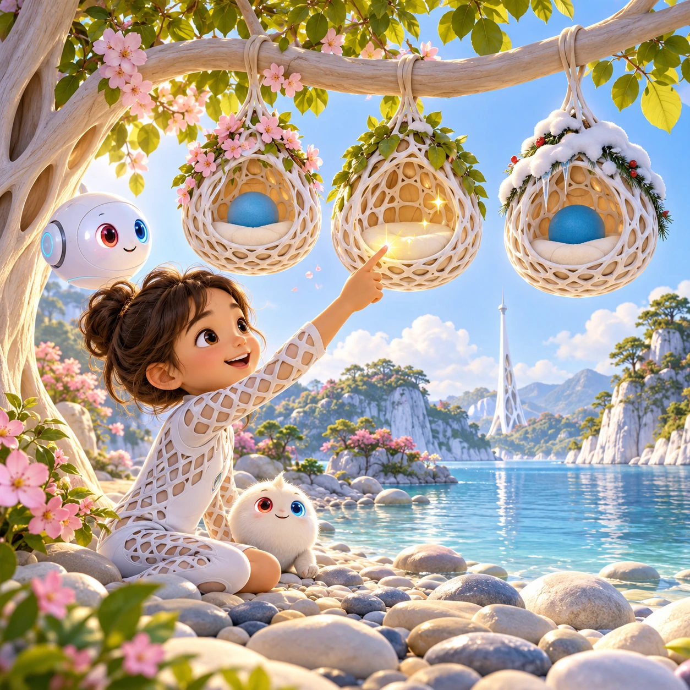

# Twin Nests

PK-11 · [Preschool (3–5)](../pk.md) · Cx 1 · Ages 3–5 · Raya story catalog

**The idea:** Two white lattice nests hang side by side on one branch. They look the same, but one holds a blue ball and the other an empty cushion. The child taps the empty cushion, and it sparkles.

| Decision             | Proposal                                                                                                                                                                                    |
| -------------------- | ------------------------------------------------------------------------------------------------------------------------------------------------------------------------------------------- |
| Familiar mechanic    | Spot one to three differences                                                                                                                                                               |
| Learning objective   | Careful looking, same and different                                                                                                                                                         |
| First prototype      | One authored challenge built around the interaction above, with a clear goal, immediate feedback, restart and unlimited retries.                                                            |
| Technology           | React + SVG/DOM; deterministic state, undo and seeded levels. Start with one local screen and touch plus keyboard input.                                                                    |
| Scope boundary       | One board and one rule set; defer accounts, multiplayer, procedural content and platform SDKs.                                                                                              |
| Reuse                | Shared input, saves, accessibility, seeded state and the preschool (3–5) collection shell.                                                                                                  |
| Prototype acceptance | A player can identify the next action from the screen, complete one challenge, explain the practiced idea and restart without help. Check touch and keyboard play at narrow and wide sizes. |
| Main uncertainty     | Test whether the lesson follows from play and whether the first interaction is understandable without reading.                                                                              |

## Estimated plan

**First playable version:** Twenty twin nest pictures over eight nest scenes with one to three big differences and a wiggle hint after a pause. Seasonal nests and making a change for a friend are left out.

| Measure              | Estimate                                                                          |
| -------------------- | --------------------------------------------------------------------------------- |
| Youngest age         | 3+                                                                                |
| Toddler learnability | 3 of 5 — Choose among 2-4 options, sort or match, or a two-step action; ages 3-4. |
| Code                 | 550 LOC, 4.6 days                                                                 |
| Assets               | 111 hours, 18.5 days                                                              |
| Effort               | 23.1 days, risk 1 of 5                                                            |
| Start score          | 34.7 (rank 69 of 310; lower is better)                                            |

**Algorithms:** `spot-difference` (Spot the difference, 120 LOC) · `tap-feedback` (Tap feedback, 80 LOC) · `tween-cause-effect` (Cause-and-effect animation, 100 LOC)

**Assets:** 20 sprites, 3 animations, 8 backgrounds, 2 UI screens, 8 sound effects, 1 music track, 20 voice lines, 20 authored levels

How the numbers are computed: [development plan](../../development-plan.md#how-the-scores-work).

## Story

Two nests hung on the same branch. "They are twins," said the owl chick. Uni blinked her one big eye. "Almost twins. Look closely." The chick looked. Both nests had a white roof. Both had a round window. Both had a red cushion. But one nest had a little blue ball inside, and the other did not. "There!" said the chick. Uni sparkled. "Things can look the same, but each one is its own." The chick rolled the blue ball across, so both nests could play.

> **Wisdom:** Look slowly, and small things become big.

## Four visual directions

These are independently generated concept proposals for selecting a prototype.
The four views compare gameplay readability, world appeal, tactile identity and
room to grow. They are not screenshots of an implemented game. Native image
dimensions, hashes, exact prompts and generation provenance are recorded in the
[art manifest](../art/pk-11/manifest.json); see the [generation notes](../README.md#image-generation-and-provenance).

The [core prompts](../jobs/pk.json) use IDs `pk-11/01-gameplay` to `pk-11/04-discovery`.

### Gameplay

Two white lattice nests hang side by side on one branch. They look the same, but one holds a blue ball and the other an empty cushion. The child taps the empty cushion, and it sparkles.

### World

A large blue-green tree leaning over the pebble beach, with two matching white lattice nests hanging from one branch like lanterns. The river glitters below, and a white Chord tower stands tall in the distance. Late morning light shines through the leaves in dappled spots. Birds sing, and the mood is cozy and curious.

### Characters and materials

The nests are round, woven from white lattice with green trims and round windows. Inside are cushions, toy blocks and a sleepy owl chick. Uni, a little sparkle with one big eye, peeks from a leaf. A white Orbi floats between the nests, glowing gently. Differences are big and clear: a missing toy, a color swap, a moved cushion.

### Expanded play

First one big difference, then two, then three. If the child looks for a while, a voiced hint makes the right nest wiggle. Later the nests show seasons, with snow on one roof and blossoms on the other, and the child can make a change in one nest for a friend to find.

## Design checks before prototyping

- Learning target: **Careful looking, same and different**. Ask a domain reviewer to validate factual content in the mechanic.
- Keep goals cooperative or self-directed, using resources and needs. Avoid purchasable power. No pressure timers in the accessible mode.
- Use original layouts and character designs; the [legal checklist](../../legal.md) applies even when a mechanic is familiar.
- Choose the minimum [fidelity level](../../simulation-engine.md#determinism-and-fidelity-levels) the lesson needs; concept art does not establish scientific accuracy.
- Review silhouettes, text alternatives, reduced motion and non-color cues against the [adorability gate](../../lore/adorability-gate.md).
- Follow the [toddler design rules](../../../case-studies/issue-1/data/research-raya-shacados.md#7-toddlers-and-screens-r68-r69) and keep every instruction voiced; reading is never required.

Genre context: [existing genre research](../../../case-studies/issue-1/data/research-genres-ideas.md)
and [expansion research](../../../case-studies/issue-1/data/research-visual-catalog.md).

[← Peek Under Pebbles](pk-10.md) · [All concepts](../README.md) · [Pebble Dot Friends →](pk-12.md)
