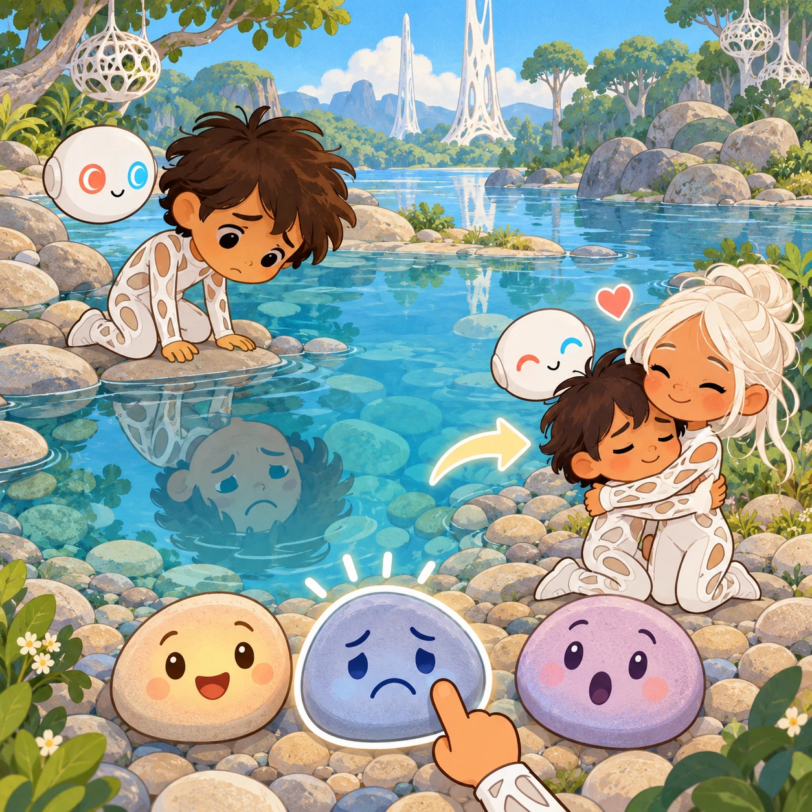
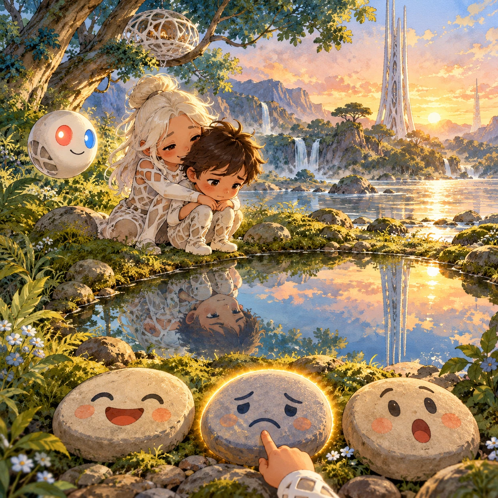
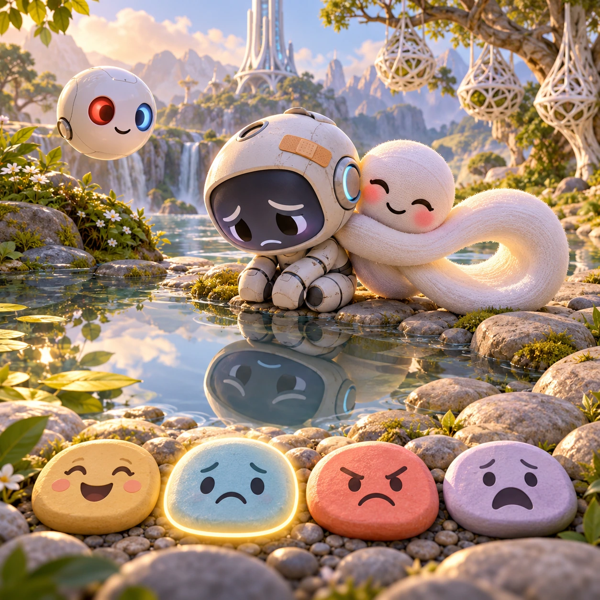
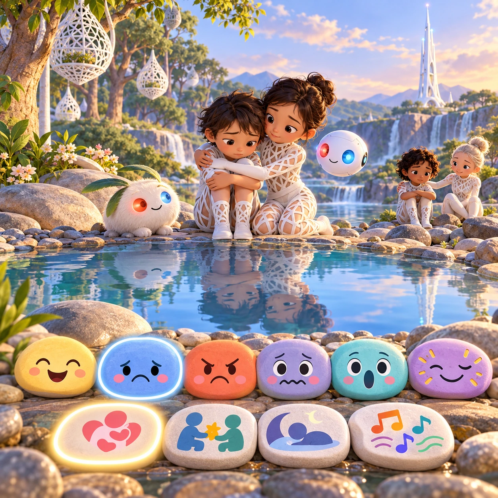

# Mirror Pond Feelings

PK-14 · [Preschool (3–5)](../pk.md) · Cx 1 · Ages 3–5 · Raya story catalog

**The idea:** Oopsy looks into a still pond, and his reflection shows a sad face. Three big face pebbles wait below: happy, sad and surprised. The child taps sad, then chooses a hug, and Itsy hugs him.

| Decision             | Proposal                                                                                                                                                                                    |
| -------------------- | ------------------------------------------------------------------------------------------------------------------------------------------------------------------------------------------- |
| Familiar mechanic    | Emotions matching                                                                                                                                                                           |
| Learning objective   | Naming feelings, empathy, choosing a kind action                                                                                                                                            |
| First prototype      | One authored challenge built around the interaction above, with a clear goal, immediate feedback, restart and unlimited retries.                                                            |
| Technology           | React + SVG/DOM; deterministic state, undo and seeded levels. Start with one local screen and touch plus keyboard input.                                                                    |
| Scope boundary       | One board and one rule set; defer accounts, multiplayer, procedural content and platform SDKs.                                                                                              |
| Reuse                | Shared input, saves, accessibility, seeded state and the preschool (3–5) collection shell.                                                                                                  |
| Prototype acceptance | A player can identify the next action from the screen, complete one challenge, explain the practiced idea and restart without help. Check touch and keyboard play at narrow and wide sizes. |
| Main uncertainty     | Test whether the lesson follows from play and whether the first interaction is understandable without reading.                                                                              |

## Estimated plan

**First playable version:** Mirror pond scenes for four feelings: tap the face pebble that matches a friend, then pick a kind action, 24 little scenes, all voiced. Two-friend scenes and proud or surprised come later.

| Measure              | Estimate                                                                          |
| -------------------- | --------------------------------------------------------------------------------- |
| Youngest age         | 3+                                                                                |
| Toddler learnability | 3 of 5 — Choose among 2-4 options, sort or match, or a two-step action; ages 3-4. |
| Code                 | 540 LOC, 4.5 days                                                                 |
| Assets               | 113 hours, 18.8 days                                                              |
| Effort               | 23.3 days, risk 1 of 5                                                            |
| Start score          | 35 (rank 72 of 310; lower is better)                                              |

**Algorithms:** `tap-feedback` (Tap feedback, 80 LOC) · `tween-cause-effect` (Cause-and-effect animation, 100 LOC) · `shuffle-deal` (Seeded shuffle and deal, 60 LOC)

**Assets:** 25 sprites, 12 animations, 2 backgrounds, 2 UI screens, 8 sound effects, 1 music track, 50 voice lines, 24 content items

How the numbers are computed: [development plan](../../development-plan.md#how-the-scores-work).

## Story

Oopsy dropped his favorite pebble into the pond. His face crumpled. He looked into the water and saw his own face, wet and sad. Itsy floated over. "What do you feel?" she asked. "Sad," said Oopsy, very quietly. "That is okay," said Itsy. "Feelings are like weather. They come, and they go." She gave him a hug. Then the Orbi lifted the pebble gently from the water. Oopsy looked into the pond again. Now his face was smiling. "The pond changed," he said. "No," said Itsy, "you did."

> **Wisdom:** Name a feeling, and it gets lighter.

## Four visual directions

These are independently generated concept proposals for selecting a prototype.
The four views compare gameplay readability, world appeal, tactile identity and
room to grow. They are not screenshots of an implemented game. Native image
dimensions, hashes, exact prompts and generation provenance are recorded in the
[art manifest](../art/pk-14/manifest.json); see the [generation notes](../README.md#image-generation-and-provenance).

The [core prompts](../jobs/pk.json) use IDs `pk-14/01-gameplay` to `pk-14/04-discovery`.

### Gameplay

Oopsy looks into a still pond, and his reflection shows a sad face. Three big face pebbles wait below: happy, sad and surprised. The child taps sad, then chooses a hug, and Itsy hugs him.

### World

A small, round pond beside the river, so still it is a mirror. Ferns and soft moss circle its edge. A blue-green tree leans overhead with a white lattice nest. A white Chord tower is reflected upside down in the water. Soft, late afternoon light with warm golden tones. Close, eye-level camera at the water's edge.

### Characters and materials

Oopsy is a small, clumsy chibi robot with a band-aid and a big face. Itsy is an infinity loop that hugs itself, with blushing cheeks. Feeling pebbles show four clear faces: happy, sad, angry and scared, in soft colors. A white Orbi floats near the pond, eyes coral red and sky blue. Moss green, water silver, warm gold.

### Expanded play

Feelings grow from happy and sad to angry, scared, surprised and proud. After naming a feeling, the child picks a kind action: a hug, sharing, a quiet rest or a song. Later little scenes show two friends feeling different things at once, and the child helps each one in their own way.

## Design checks before prototyping

- Learning target: **Naming feelings, empathy, choosing a kind action**. Ask a domain reviewer to validate factual content in the mechanic.
- Keep goals cooperative or self-directed, using resources and needs. Avoid purchasable power. No pressure timers in the accessible mode.
- Use original layouts and character designs; the [legal checklist](../../legal.md) applies even when a mechanic is familiar.
- Choose the minimum [fidelity level](../../simulation-engine.md#determinism-and-fidelity-levels) the lesson needs; concept art does not establish scientific accuracy.
- Review silhouettes, text alternatives, reduced motion and non-color cues against the [adorability gate](../../lore/adorability-gate.md).
- Follow the [toddler design rules](../../../case-studies/issue-1/data/research-raya-shacados.md#7-toddlers-and-screens-r68-r69) and keep every instruction voiced; reading is never required.

Genre context: [existing genre research](../../../case-studies/issue-1/data/research-genres-ideas.md)
and [expansion research](../../../case-studies/issue-1/data/research-visual-catalog.md).

[← Mixing Puddles](pk-13.md) · [All concepts](../README.md) · [Story Stones →](pk-15.md)
