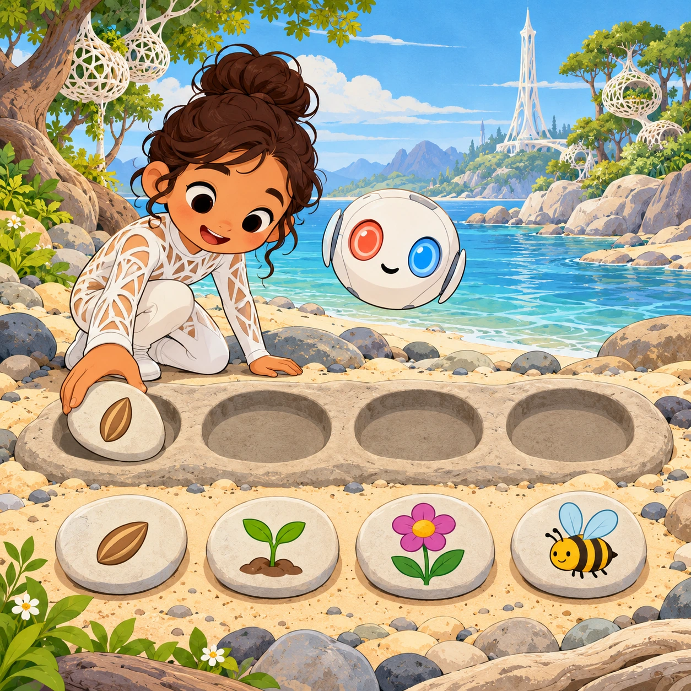
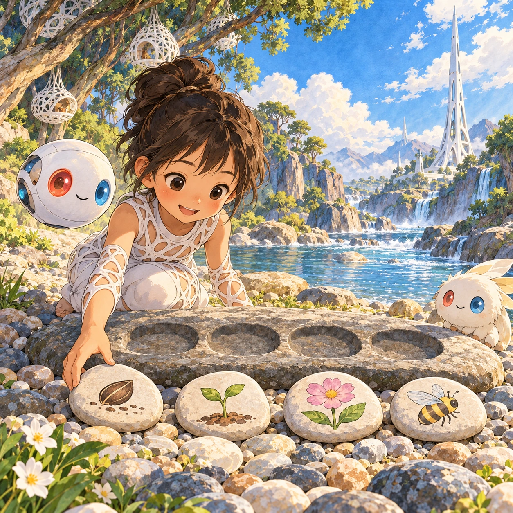
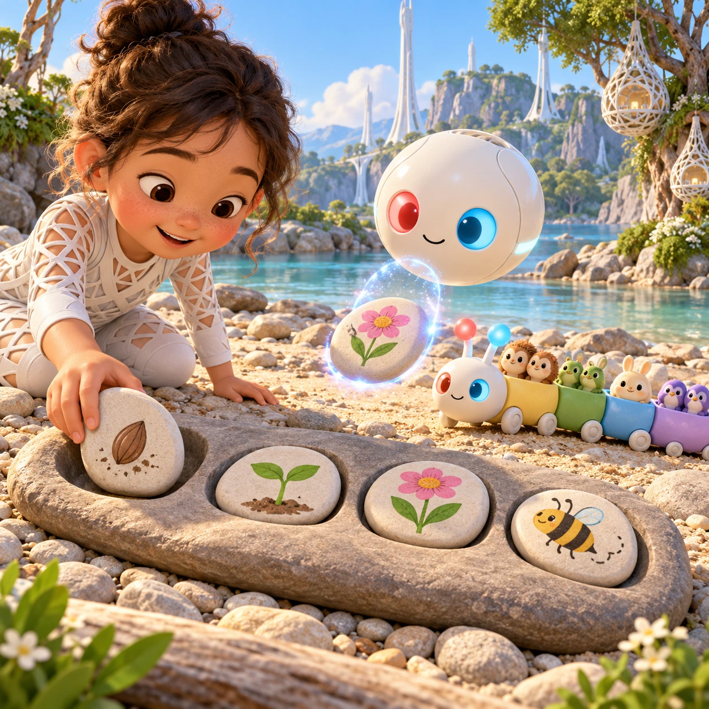
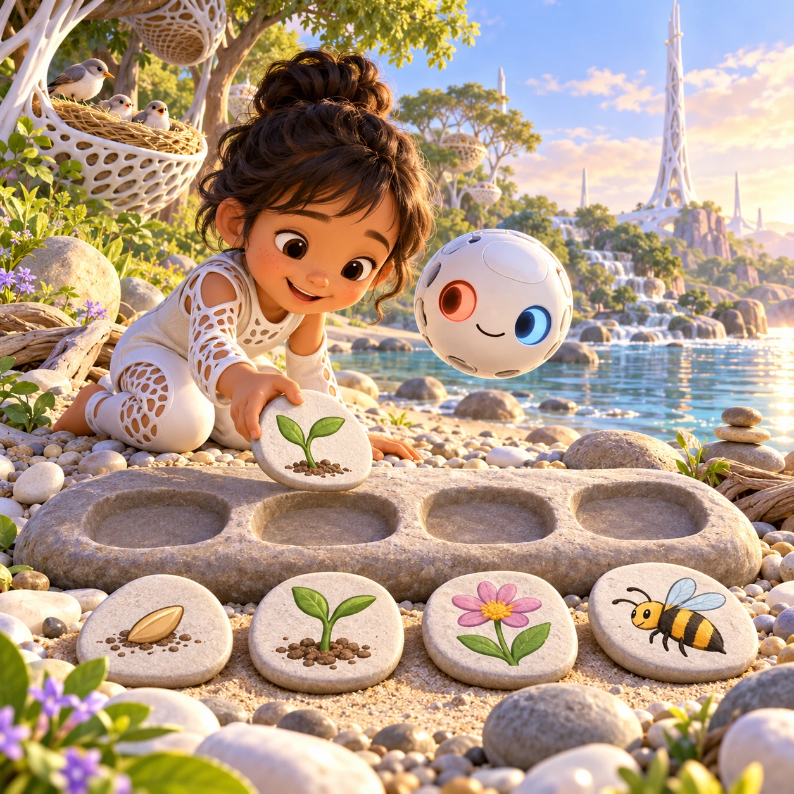

# Story Stones

PK-15 · [Preschool (3–5)](../pk.md) · Cx 2 · Ages 4–6 · Raya story catalog

**The idea:** Four flat story stones lie on the beach showing a seed, a sprout, a flower and a bee. The child drags them into a row of hollows, and when the order is right, the story plays as a short voiced cartoon.

| Decision             | Proposal                                                                                                                                                                                    |
| -------------------- | ------------------------------------------------------------------------------------------------------------------------------------------------------------------------------------------- |
| Familiar mechanic    | Picture sequencing, 3 to 4 pictures                                                                                                                                                         |
| Learning objective   | Before and after, daily routines, retelling a story                                                                                                                                         |
| First prototype      | One authored challenge built around the interaction above, with a clear goal, immediate feedback, restart and unlimited retries.                                                            |
| Technology           | React + SVG/DOM; deterministic state, undo and seeded levels. Start with one local screen and touch plus keyboard input.                                                                    |
| Scope boundary       | One board and one rule set; defer accounts, multiplayer, procedural content and platform SDKs.                                                                                              |
| Reuse                | Shared input, saves, accessibility, seeded state and the preschool (3–5) collection shell.                                                                                                  |
| Prototype acceptance | A player can identify the next action from the screen, complete one challenge, explain the practiced idea and restart without help. Check touch and keyboard play at narrow and wide sizes. |
| Main uncertainty     | Test whether the lesson follows from play and whether the first interaction is understandable without reading.                                                                              |

## Estimated plan

**First playable version:** Twelve three- and four-stone stories, starting with a nest day routine and then seeds, eggs and rain; the right order plays a short voiced cartoon. The silly free-order story mode is left out.

| Measure              | Estimate                                                                               |
| -------------------- | -------------------------------------------------------------------------------------- |
| Youngest age         | 4+                                                                                     |
| Toddler learnability | 2 of 5 — Needs simple rules, turns, a sequence or remembering several steps; ages 4-6. |
| Code                 | 650 LOC, 5.4 days                                                                      |
| Assets               | 155 hours, 25.8 days                                                                   |
| Effort               | 31.3 days, risk 1 of 5                                                                 |
| Start score          | 62.6 (rank 158 of 310; lower is better)                                                |

**Algorithms:** `drag-drop-snap` (Drag and snap, 150 LOC) · `tween-cause-effect` (Cause-and-effect animation, 100 LOC)

**Assets:** 40 sprites, 14 animations, 2 backgrounds, 2 UI screens, 10 sound effects, 1 music track, 60 voice lines, 12 authored levels

How the numbers are computed: [development plan](../../development-plan.md#how-the-scores-work).

## Story

Choo-Choo Seq found four stones on the beach. One showed a chick waking up. One showed the chick eating. One showed the chick playing. One showed a moon. "Which comes first?" asked Seq. The child set them in a row: wake up, eat, play, and sleep under the moon. Seq rolled along the row, and the stones told the story of a whole day. "Every story has a beginning, a middle and an end," said Seq, "like cars on a train." Then he curled up by the moon stone and fell asleep.

> **Wisdom:** Every story has a beginning, middle and end.

## Four visual directions

These are independently generated concept proposals for selecting a prototype.
The four views compare gameplay readability, world appeal, tactile identity and
room to grow. They are not screenshots of an implemented game. Native image
dimensions, hashes, exact prompts and generation provenance are recorded in the
[art manifest](../art/pk-15/manifest.json); see the [generation notes](../README.md#image-generation-and-provenance).

The [core prompts](../jobs/pk.json) use IDs `pk-15/01-gameplay` to `pk-15/04-discovery`.

### Gameplay

Four flat story stones lie on the beach showing a seed, a sprout, a flower and a bee. The child drags them into a row of hollows, and when the order is right, the story plays as a short voiced cartoon.

### World

A gentle curve of the pebble beach where a long flat rock holds a row of shallow hollows, like seats for stones. Behind it the river flows, and the trees hold white lattice nests. A white Chord tower stands against a clear sky. Warm morning light and a calm, storybook mood. Front view, low and close.

### Characters and materials

Story stones are flat, smooth and oval, each painted with one large, clear picture in soft colors. Choo-Choo Seq, a little caterpillar train whose cars are pairs of friends, curls beside the row. A white Orbi lifts stones with a shimmer, eyes coral red and sky blue. Simple shapes, gray outlines, warm sand and stone tones.

### Expanded play

The first stories are a day in a nest: wake up, wash, eat, play and sleep. Then come little nature tales: an egg hatches, a seed grows, rain falls and a puddle dries. Later the child sets four stones in any order, and the Orbi tells a silly new story that matches the child's choice.

## Design checks before prototyping

- Learning target: **Before and after, daily routines, retelling a story**. Ask a domain reviewer to validate factual content in the mechanic.
- Keep goals cooperative or self-directed, using resources and needs. Avoid purchasable power. No pressure timers in the accessible mode.
- Use original layouts and character designs; the [legal checklist](../../legal.md) applies even when a mechanic is familiar.
- Choose the minimum [fidelity level](../../simulation-engine.md#determinism-and-fidelity-levels) the lesson needs; concept art does not establish scientific accuracy.
- Review silhouettes, text alternatives, reduced motion and non-color cues against the [adorability gate](../../lore/adorability-gate.md).
- Follow the [toddler design rules](../../../case-studies/issue-1/data/research-raya-shacados.md#7-toddlers-and-screens-r68-r69) and keep every instruction voiced; reading is never required.

Genre context: [existing genre research](../../../case-studies/issue-1/data/research-genres-ideas.md)
and [expansion research](../../../case-studies/issue-1/data/research-visual-catalog.md).

[← Mirror Pond Feelings](pk-14.md) · [All concepts](../README.md) · [Pebble Beach Picnic →](pk-16.md)
