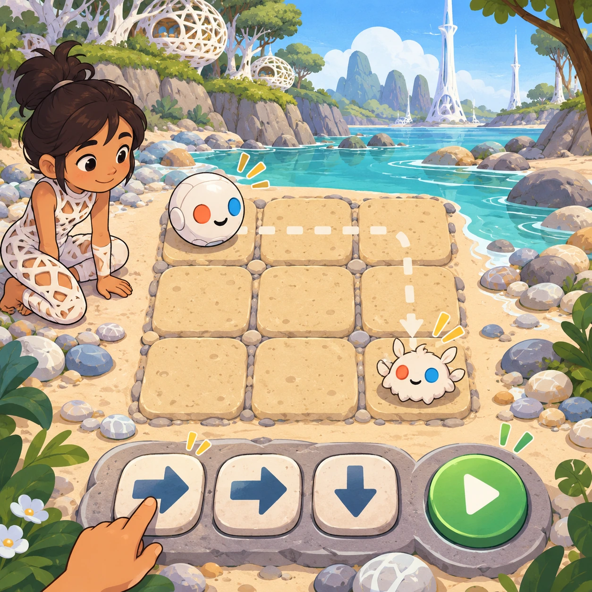
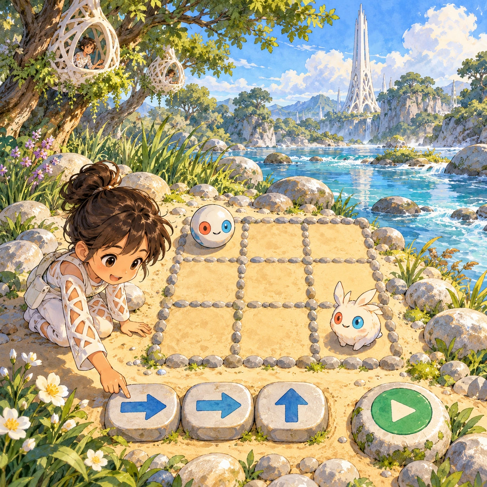
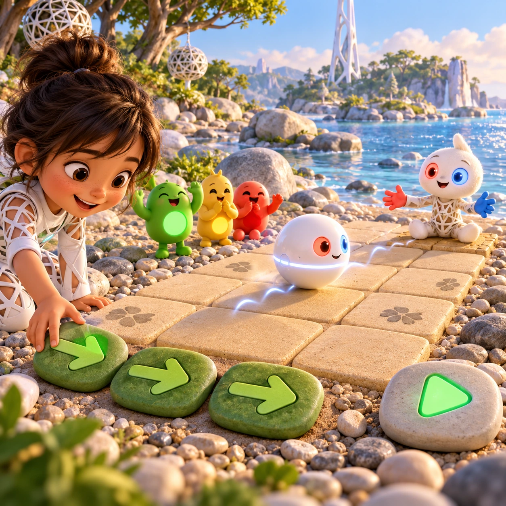
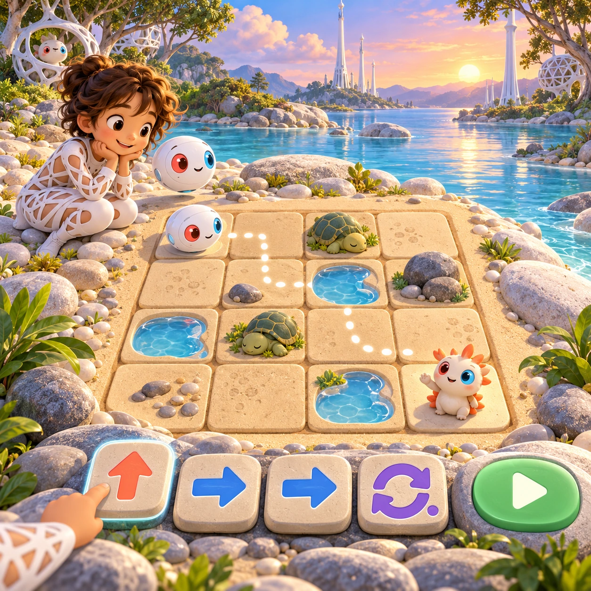

# Arrow Stones for Orbi

PK-19 · [Preschool (3–5)](../pk.md) · Cx 2 · Ages 4–6 · Raya story catalog

**The idea:** An Orbi waits at one corner of a small grid of sand squares, and Linky waits at the other. The child drags three big arrow stones into a row, taps go, and the Orbi rolls step by step to Linky.

| Decision             | Proposal                                                                                                                                                                                    |
| -------------------- | ------------------------------------------------------------------------------------------------------------------------------------------------------------------------------------------- |
| Familiar mechanic    | First coding with arrow paths                                                                                                                                                               |
| Learning objective   | Steps in order, directions, early coding                                                                                                                                                    |
| First prototype      | One authored challenge built around the interaction above, with a clear goal, immediate feedback, restart and unlimited retries.                                                            |
| Technology           | React + SVG/DOM; deterministic state, undo and seeded levels. Start with one local screen and touch plus keyboard input.                                                                    |
| Scope boundary       | One board and one rule set; defer accounts, multiplayer, procedural content and platform SDKs.                                                                                              |
| Reuse                | Shared input, saves, accessibility, seeded state and the preschool (3–5) collection shell.                                                                                                  |
| Prototype acceptance | A player can identify the next action from the screen, complete one challenge, explain the practiced idea and restart without help. Check touch and keyboard play at narrow and wide sizes. |
| Main uncertainty     | Test whether the lesson follows from play and whether the first interaction is understandable without reading.                                                                              |

## Estimated plan

**First playable version:** Twenty-four arrow stone puzzles on 2x2 to 3x3 sand grids; the Orbi rolls the path and giggles back on a wrong step. Loop stones, obstacles and 4x4 grids are deferred.

| Measure              | Estimate                                                                               |
| -------------------- | -------------------------------------------------------------------------------------- |
| Youngest age         | 4+                                                                                     |
| Toddler learnability | 2 of 5 — Needs simple rules, turns, a sequence or remembering several steps; ages 4-6. |
| Code                 | 1150 LOC, 9.6 days                                                                     |
| Assets               | 106 hours, 17.7 days                                                                   |
| Effort               | 27.3 days, risk 3 of 5                                                                 |
| Start score          | 54.6 (rank 134 of 310; lower is better)                                                |

**Algorithms:** `grid-board` (Grid board, 150 LOC) · `drag-drop-snap` (Drag and snap, 150 LOC) · `puzzle-solver-hints` (Puzzle solver and hints, 400 LOC) · `tween-cause-effect` (Cause-and-effect animation, 100 LOC)

**Assets:** 20 sprites, 6 animations, 2 backgrounds, 3 UI screens, 10 sound effects, 1 music track, 30 voice lines, 24 authored levels

How the numbers are computed: [development plan](../../development-plan.md#how-the-scores-work).

## Story

The Orbi wanted to visit Linky, but it would only roll where the arrows told it. "Forward, forward, turn," said the child, putting down arrow stones. The Orbi rolled forward, forward, and turned, right into a puddle. It giggled. "Splash!" Oopsy waved from the side. "That is how we learn!" The child changed one stone. Forward, turn, forward. The Orbi rolled, turned and rolled again, and stopped right beside Linky. "You showed me the way, step by step," said the Orbi. "Let's link!" said Linky.

> **Wisdom:** Big trips are made of little steps.

## Four visual directions

These are independently generated concept proposals for selecting a prototype.
The four views compare gameplay readability, world appeal, tactile identity and
room to grow. They are not screenshots of an implemented game. Native image
dimensions, hashes, exact prompts and generation provenance are recorded in the
[art manifest](../art/pk-19/manifest.json); see the [generation notes](../README.md#image-generation-and-provenance).

The [core prompts](../jobs/pk.json) use IDs `pk-19/01-gameplay` to `pk-19/04-discovery`.

### Gameplay

An Orbi waits at one corner of a small grid of sand squares, and Linky waits at the other. The child drags three big arrow stones into a row, taps go, and the Orbi rolls step by step to Linky.

### World

A smooth patch of beach where round pebbles mark a grid of sand squares, three by three, near the river. Reeds and a few wildflowers grow at its edges. White lattice nests watch from the trees, and a white Chord tower stands tall in the distance. Clear morning light, a playful puzzle mood. Top-down camera over the grid.

### Characters and materials

Arrow stones are big flat pebbles with a bold carved arrow shape, colored leaf green for actions. A white Orbi rolls across the grid, its glowing equator pulsing, coral-red and sky-blue eyes bright. Go, Stop and Hop, the traffic-light siblings, cheer from the side. Linky waits at the goal with open red and blue hands.

### Expanded play

Grids grow from two squares to four by four, with puddles and sleeping turtles to go around. If a path goes wrong, the Orbi stops, giggles and points back, and the child changes one stone. Later a loop stone repeats a step, and friends wait in different squares to be visited one after another.

## Design checks before prototyping

- Learning target: **Steps in order, directions, early coding**. Ask a domain reviewer to validate factual content in the mechanic.
- Keep goals cooperative or self-directed, using resources and needs. Avoid purchasable power. No pressure timers in the accessible mode.
- Use original layouts and character designs; the [legal checklist](../../legal.md) applies even when a mechanic is familiar.
- Choose the minimum [fidelity level](../../simulation-engine.md#determinism-and-fidelity-levels) the lesson needs; concept art does not establish scientific accuracy.
- Review silhouettes, text alternatives, reduced motion and non-color cues against the [adorability gate](../../lore/adorability-gate.md).
- Follow the [toddler design rules](../../../case-studies/issue-1/data/research-raya-shacados.md#7-toddlers-and-screens-r68-r69) and keep every instruction voiced; reading is never required.

Genre context: [existing genre research](../../../case-studies/issue-1/data/research-genres-ideas.md)
and [expansion research](../../../case-studies/issue-1/data/research-visual-catalog.md).

[← Sharing Circle](pk-18.md) · [All concepts](../README.md) · [Shape Spotting Walk →](pk-20.md)
