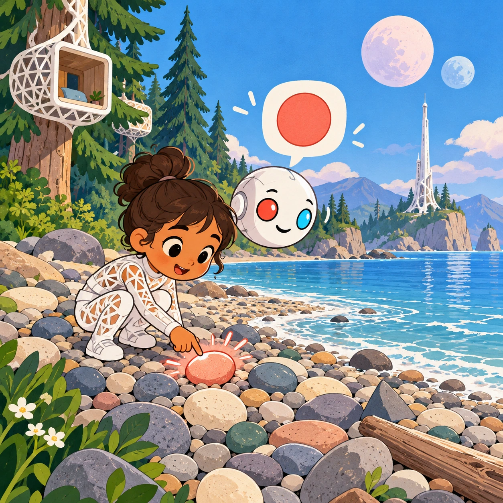
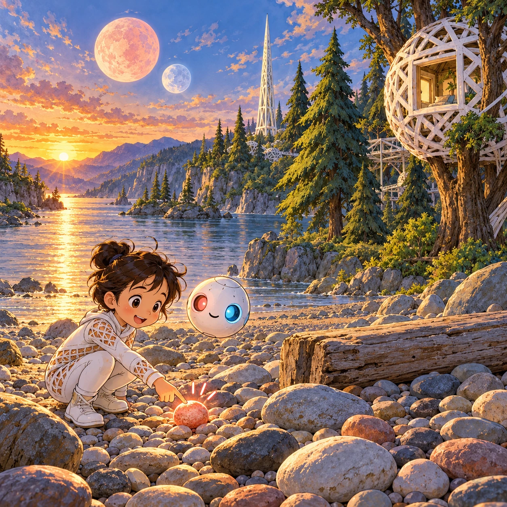
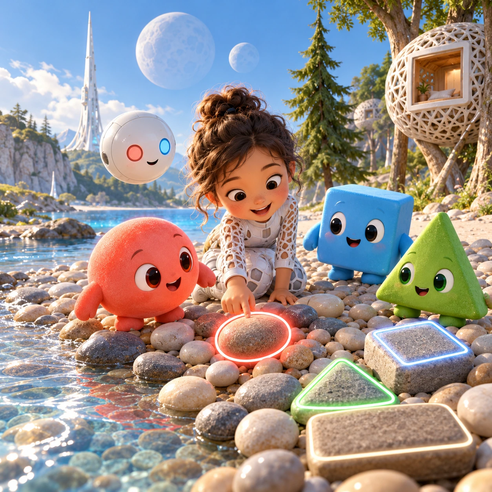

# Shape Spotting Walk

PK-20 · [Preschool (3–5)](../pk.md) · Cx 1 · Ages 3–5 · Raya story catalog

**The idea:** A wide beach scene shows round pebbles, a pointed fir, a square nest window and two round moons. The Orbi asks for circles, and the child taps a round pebble, which glows coral red and chimes.

| Decision             | Proposal                                                                                                                                                                                    |
| -------------------- | ------------------------------------------------------------------------------------------------------------------------------------------------------------------------------------------- |
| Familiar mechanic    | Find shapes in a scene                                                                                                                                                                      |
| Learning objective   | Circles, squares, triangles and rectangles in the world                                                                                                                                     |
| First prototype      | One authored challenge built around the interaction above, with a clear goal, immediate feedback, restart and unlimited retries.                                                            |
| Technology           | React + SVG/DOM; deterministic state, undo and seeded levels. Start with one local screen and touch plus keyboard input.                                                                    |
| Scope boundary       | One board and one rule set; defer accounts, multiplayer, procedural content and platform SDKs.                                                                                              |
| Reuse                | Shared input, saves, accessibility, seeded state and the preschool (3–5) collection shell.                                                                                                  |
| Prototype acceptance | A player can identify the next action from the screen, complete one challenge, explain the practiced idea and restart without help. Check touch and keyboard play at narrow and wide sizes. |
| Main uncertainty     | Test whether the lesson follows from play and whether the first interaction is understandable without reading.                                                                              |

## Estimated plan

**First playable version:** Six panorama scenes where the Orbi asks for circles, squares, triangles or rectangles and the child taps them, 12 rounds. The build-a-friend collecting mode is left for later.

| Measure              | Estimate                                                                          |
| -------------------- | --------------------------------------------------------------------------------- |
| Youngest age         | 3+                                                                                |
| Toddler learnability | 3 of 5 — Choose among 2-4 options, sort or match, or a two-step action; ages 3-4. |
| Code                 | 480 LOC, 4 days                                                                   |
| Assets               | 92 hours, 15.3 days                                                               |
| Effort               | 19.3 days, risk 1 of 5                                                            |
| Start score          | 29 (rank 45 of 310; lower is better)                                              |

**Algorithms:** `hidden-object` (Hidden objects, 150 LOC) · `tap-feedback` (Tap feedback, 80 LOC)

**Assets:** 15 sprites, 4 animations, 6 backgrounds, 2 UI screens, 8 sound effects, 1 music track, 25 voice lines, 12 authored levels

How the numbers are computed: [development plan](../../development-plan.md#how-the-scores-work).

## Story

Soru, Tari and Verbi went for a walk on the beach. "Let's find shapes like us," said Soru. She found round pebbles and a round moon. Tari found a square window in a nest and a square flat stone. Verbi found a pointy fir tree and the tip of a tower, both triangles. "Shapes are everywhere," said Tari. "The world is full of friends like us," said Verbi. They walked home, and even their nest looked like a happy shape.

> **Wisdom:** Look around, shapes are everywhere.

## Four visual directions

These are independently generated concept proposals for selecting a prototype.
The four views compare gameplay readability, world appeal, tactile identity and
room to grow. They are not screenshots of an implemented game. Native image
dimensions, hashes, exact prompts and generation provenance are recorded in the
[art manifest](../art/pk-20/manifest.json); see the [generation notes](../README.md#image-generation-and-provenance).

The [core prompts](../jobs/pk.json) use IDs `pk-20/01-gameplay` to `pk-20/04-discovery`.

### Gameplay

A wide beach scene shows round pebbles, a pointed fir, a square nest window and two round moons. The Orbi asks for circles, and the child taps a round pebble, which glows coral red and chimes.

### World

A long panorama of the river beach at golden hour: round pebbles, triangle-shaped fir trees, a square window in a lattice nest, a long rectangle of driftwood and the two round moons, Pim and Pom, in the sky. A white Chord tower points up like a slim triangle. Warm light, long shadows, an inviting walk.

### Characters and materials

Soru, the round coral-red blob, leads circle walks, and Tari, the square sky-blue blob, leads square walks. Verbi, the green triangle, helps with triangles. Found shapes glow with a bright outline in their color. A white Orbi floats beside them, eyes coral red and sky blue. Big clear shapes, soft gray outlines.

### Expanded play

The first walk finds circles only. Then squares, triangles, rectangles and stars. Later the scenes change: inside a nest, a forest path, a festival night by the tower. A collecting mode lets the child build a picture of a friend from the shapes they found, and the shape names are sung back.

## Design checks before prototyping

- Learning target: **Circles, squares, triangles and rectangles in the world**. Ask a domain reviewer to validate factual content in the mechanic.
- Keep goals cooperative or self-directed, using resources and needs. Avoid purchasable power. No pressure timers in the accessible mode.
- Use original layouts and character designs; the [legal checklist](../../legal.md) applies even when a mechanic is familiar.
- Choose the minimum [fidelity level](../../simulation-engine.md#determinism-and-fidelity-levels) the lesson needs; concept art does not establish scientific accuracy.
- Review silhouettes, text alternatives, reduced motion and non-color cues against the [adorability gate](../../lore/adorability-gate.md).
- Follow the [toddler design rules](../../../case-studies/issue-1/data/research-raya-shacados.md#7-toddlers-and-screens-r68-r69) and keep every instruction voiced; reading is never required.

Genre context: [existing genre research](../../../case-studies/issue-1/data/research-genres-ideas.md)
and [expansion research](../../../case-studies/issue-1/data/research-visual-catalog.md).

[← Arrow Stones for Orbi](pk-19.md) · [All concepts](../README.md) · [Long Stick, Heavy Stone →](pk-21.md)
