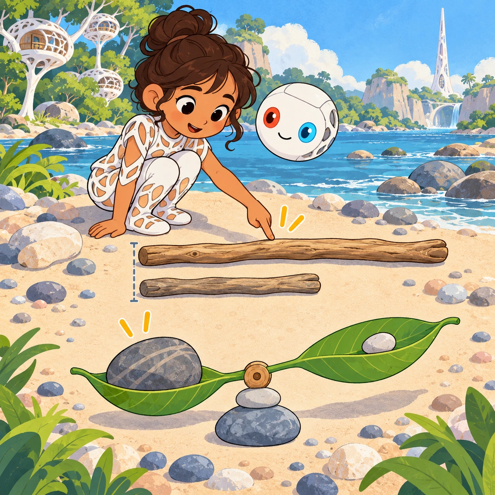
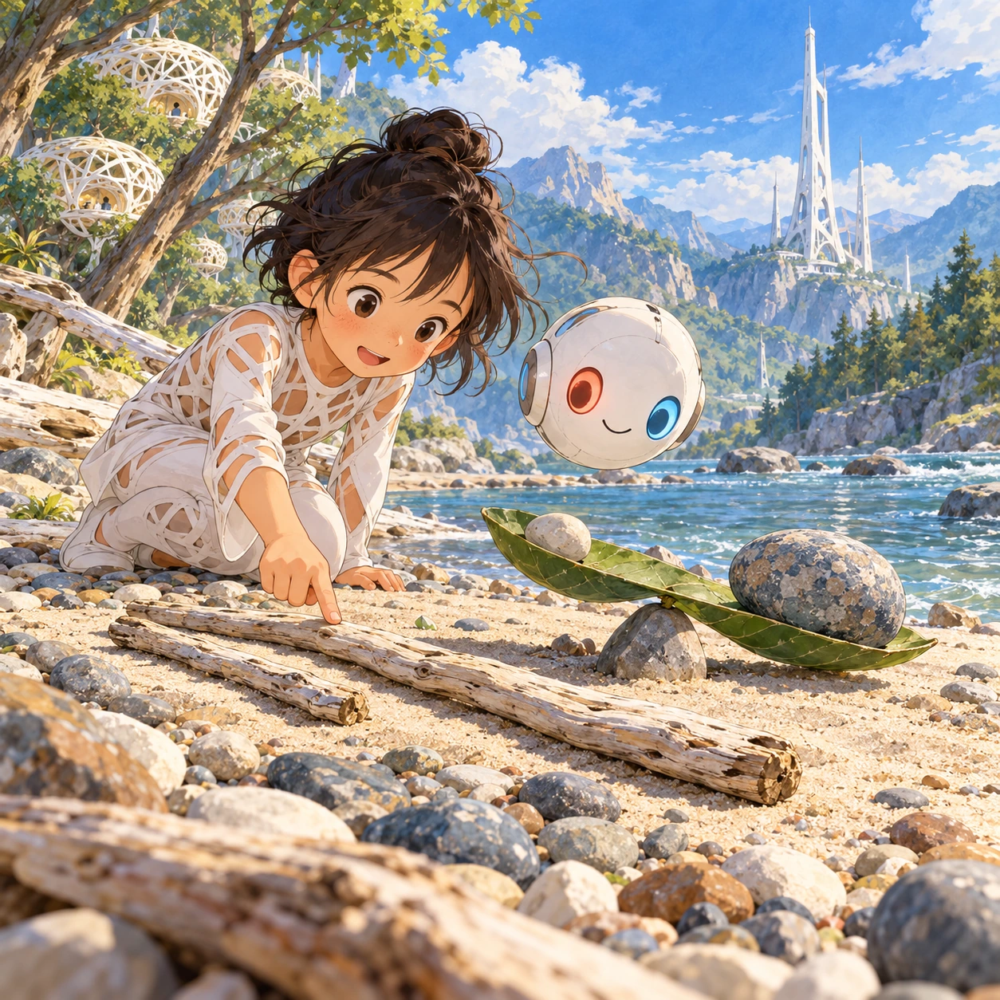
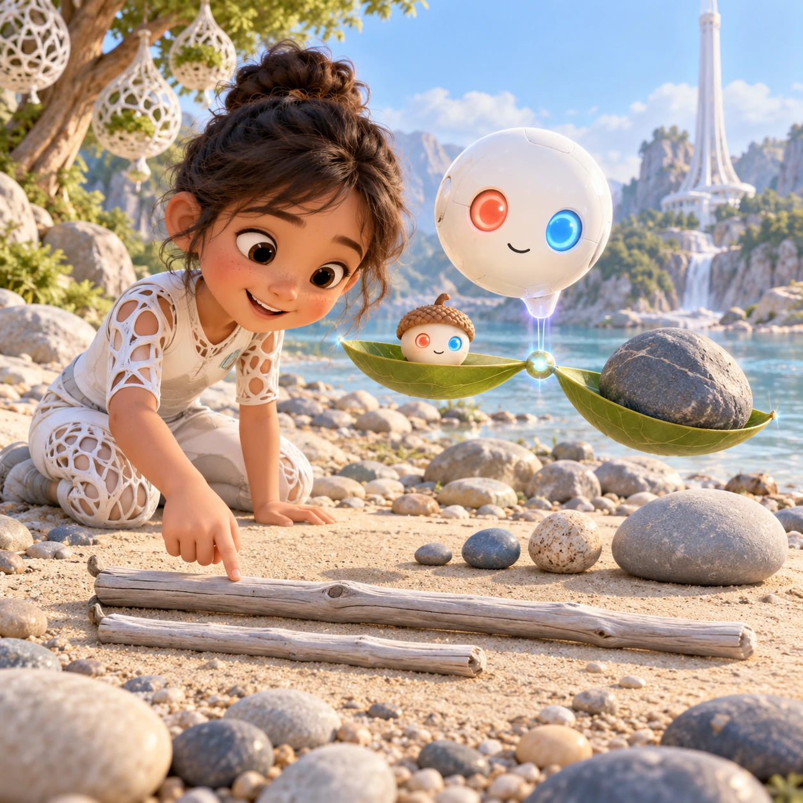
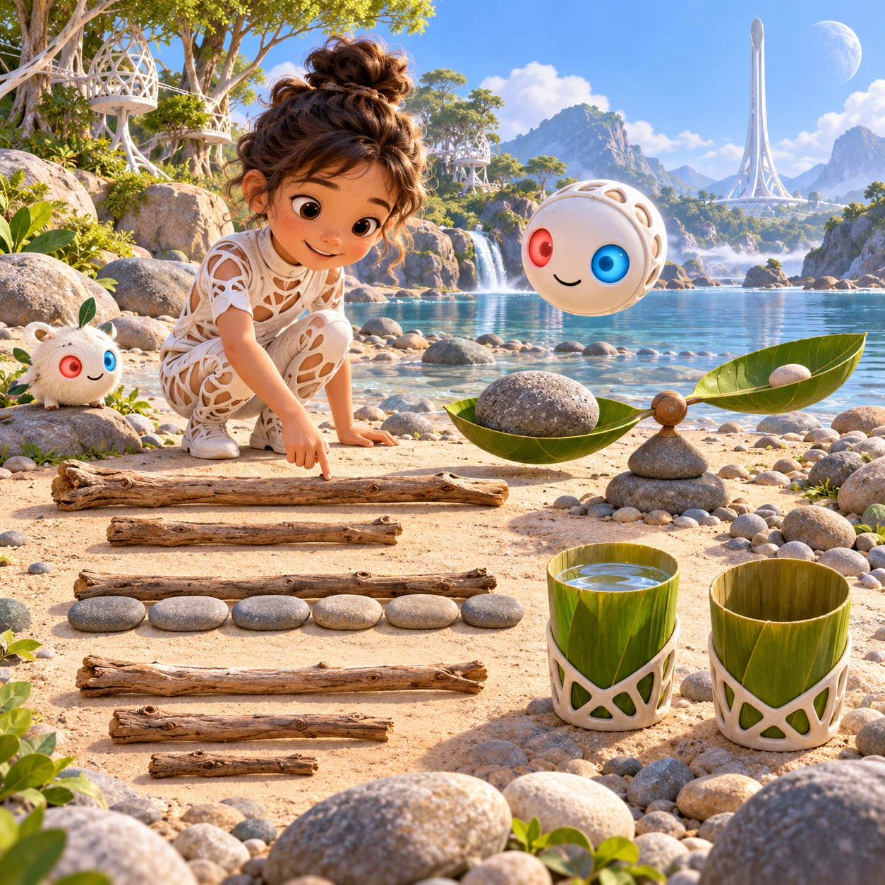

# Long Stick, Heavy Stone

PK-21 · [Preschool (3–5)](../pk.md) · Cx 1 · Ages 3–5 · Raya story catalog

**The idea:** Two driftwood sticks lie side by side on the sand, ends lined up. The child taps the longer one. Then a wide leaf balance held by the Orbi tips down under a big pebble, showing it is heavier.

| Decision             | Proposal                                                                                                                                                                                    |
| -------------------- | ------------------------------------------------------------------------------------------------------------------------------------------------------------------------------------------- |
| Familiar mechanic    | Comparing length and weight                                                                                                                                                                 |
| Learning objective   | Longer and shorter, heavier and lighter, first measuring                                                                                                                                    |
| First prototype      | One authored challenge built around the interaction above, with a clear goal, immediate feedback, restart and unlimited retries.                                                            |
| Technology           | React + SVG/DOM; deterministic state, undo and seeded levels. Start with one local screen and touch plus keyboard input.                                                                    |
| Scope boundary       | One board and one rule set; defer accounts, multiplayer, procedural content and platform SDKs.                                                                                              |
| Reuse                | Shared input, saves, accessibility, seeded state and the preschool (3–5) collection shell.                                                                                                  |
| Prototype acceptance | A player can identify the next action from the screen, complete one challenge, explain the practiced idea and restart without help. Check touch and keyboard play at narrow and wide sizes. |
| Main uncertainty     | Test whether the lesson follows from play and whether the first interaction is understandable without reading.                                                                              |

## Estimated plan

**First playable version:** Twenty comparison rounds: tap the longer stick or watch the leaf balance tip under the heavier thing, then order three. Measuring in pebbles and full or empty cups come later.

| Measure              | Estimate                                                                          |
| -------------------- | --------------------------------------------------------------------------------- |
| Youngest age         | 3+                                                                                |
| Toddler learnability | 3 of 5 — Choose among 2-4 options, sort or match, or a two-step action; ages 3-4. |
| Code                 | 680 LOC, 5.7 days                                                                 |
| Assets               | 115 hours, 19.2 days                                                              |
| Effort               | 24.8 days, risk 1 of 5                                                            |
| Start score          | 37.2 (rank 79 of 310; lower is better)                                            |

**Algorithms:** `tap-feedback` (Tap feedback, 80 LOC) · `drag-drop-snap` (Drag and snap, 150 LOC) · `tween-cause-effect` (Cause-and-effect animation, 100 LOC)

**Assets:** 30 sprites, 6 animations, 2 backgrounds, 2 UI screens, 10 sound effects, 1 music track, 30 voice lines, 20 authored levels

How the numbers are computed: [development plan](../../development-plan.md#how-the-scores-work).

## Story

Akoren and a little heron argued. "My stick is longer!" said the heron. "My stone is heavier!" said Akoren. The Orbi laughed softly. "Let us check." It laid the sticks side by side, with the ends together. The heron's stick was longer. Then it held a wide leaf like a balance, with Akoren's stone on one side and the heron's feather on the other. The stone went down. "You were both right," said the Orbi. "Long is one way to measure. Heavy is another."

> **Wisdom:** Put things side by side to know.

## Four visual directions

These are independently generated concept proposals for selecting a prototype.
The four views compare gameplay readability, world appeal, tactile identity and
room to grow. They are not screenshots of an implemented game. Native image
dimensions, hashes, exact prompts and generation provenance are recorded in the
[art manifest](../art/pk-21/manifest.json); see the [generation notes](../README.md#image-generation-and-provenance).

The [core prompts](../jobs/pk.json) use IDs `pk-21/01-gameplay` to `pk-21/04-discovery`.

### Gameplay

Two driftwood sticks lie side by side on the sand, ends lined up. The child taps the longer one. Then a wide leaf balance held by the Orbi tips down under a big pebble, showing it is heavier.

### World

A breezy part of the pebble beach where driftwood lies bleached and smooth, and stones of every size rest on the sand. The river flows gently, and a white Chord tower rises behind trees with white lattice nests. Bright, clear daylight, a fresh wind and a curious, hands-on mood. Low, close camera.

### Characters and materials

Driftwood sticks are pale gray and smooth; pebbles range from tiny to big, in gray, blue and sand colors. The balance is a wide green leaf held in the air by the Orbi's shimmer. Akoren, the tiny glowing acorn, sits on one side to be weighed. The white Orbi floats in the middle, eyes coral red and sky blue.

### Expanded play

Comparisons start with two very different things, then closer ones, then three to put in order from short to long. Later the child measures with pebbles laid in a row, counting how many pebbles long a stick is. A tall and short round compares friends, and a full and empty round uses rain cups.

## Design checks before prototyping

- Learning target: **Longer and shorter, heavier and lighter, first measuring**. Ask a domain reviewer to validate factual content in the mechanic.
- Keep goals cooperative or self-directed, using resources and needs. Avoid purchasable power. No pressure timers in the accessible mode.
- Use original layouts and character designs; the [legal checklist](../../legal.md) applies even when a mechanic is familiar.
- Choose the minimum [fidelity level](../../simulation-engine.md#determinism-and-fidelity-levels) the lesson needs; concept art does not establish scientific accuracy.
- Review silhouettes, text alternatives, reduced motion and non-color cues against the [adorability gate](../../lore/adorability-gate.md).
- Follow the [toddler design rules](../../../case-studies/issue-1/data/research-raya-shacados.md#7-toddlers-and-screens-r68-r69) and keep every instruction voiced; reading is never required.

Genre context: [existing genre research](../../../case-studies/issue-1/data/research-genres-ideas.md)
and [expansion research](../../../case-studies/issue-1/data/research-visual-catalog.md).

[← Shape Spotting Walk](pk-20.md) · [All concepts](../README.md) · [One Tree, Four Seasons →](pk-22.md)
