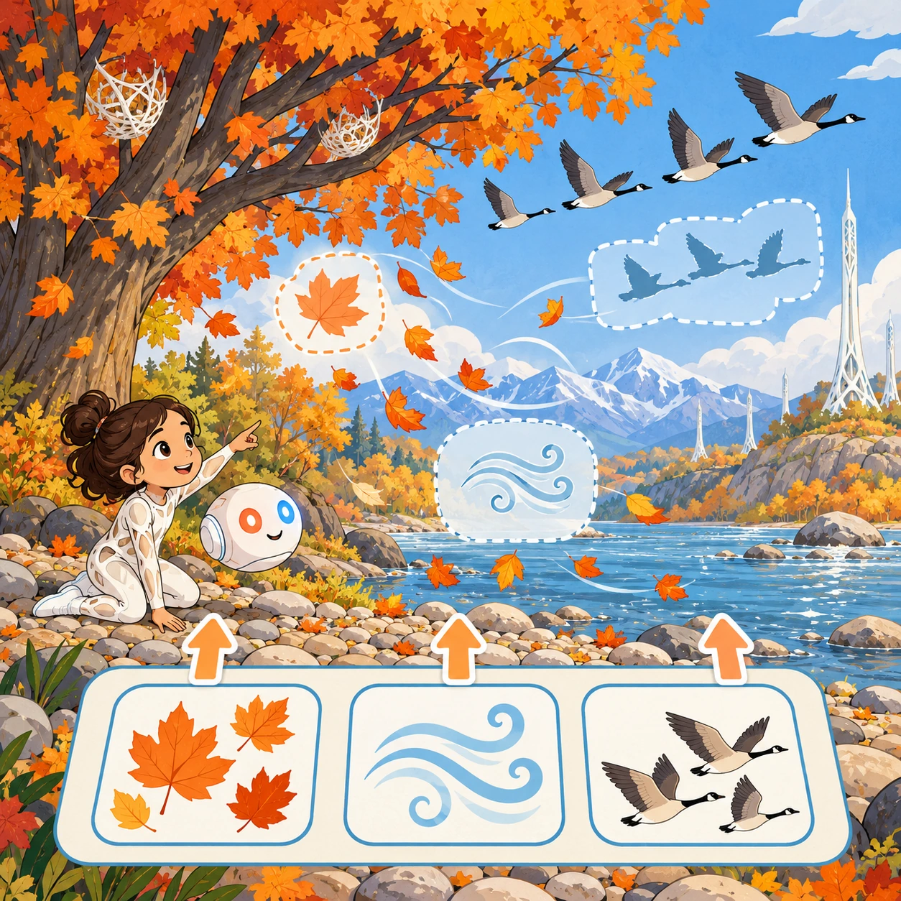
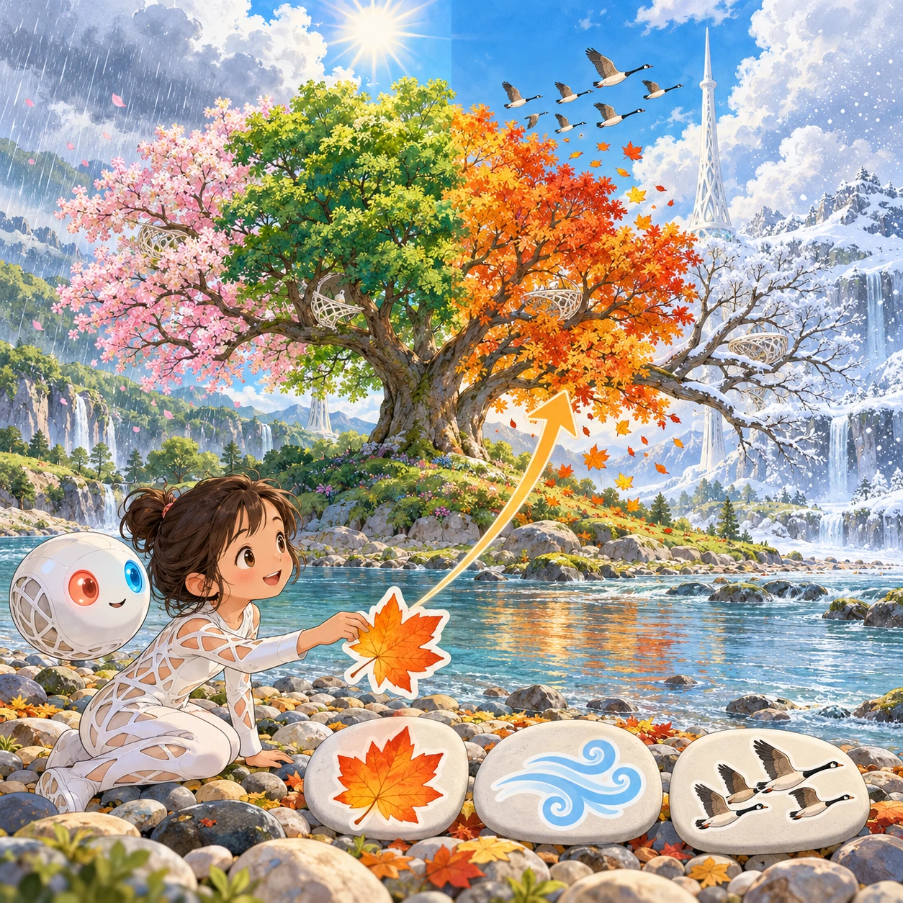
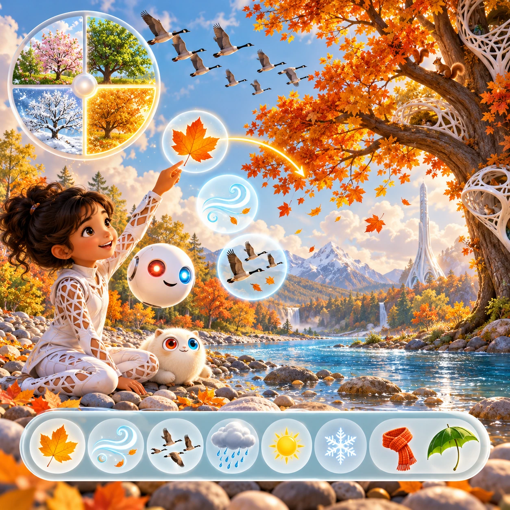

# One Tree, Four Seasons

PK-22 · [Preschool (3–5)](../pk.md) · Cx 1 · Ages 3–5 · Raya story catalog

**The idea:** A big tree on the riverbank changes with each season. The Orbi shows autumn, and the child drags the matching things into the picture: orange leaves, wind, and geese flying south over the river.

| Decision             | Proposal                                                                                                                                                                                    |
| -------------------- | ------------------------------------------------------------------------------------------------------------------------------------------------------------------------------------------- |
| Familiar mechanic    | Seasons and weather matching                                                                                                                                                                |
| Learning objective   | The four seasons, weather, and what nature does in each                                                                                                                                     |
| First prototype      | One authored challenge built around the interaction above, with a clear goal, immediate feedback, restart and unlimited retries.                                                            |
| Technology           | React + SVG/DOM; deterministic state, undo and seeded levels. Start with one local screen and touch plus keyboard input.                                                                    |
| Scope boundary       | One board and one rule set; defer accounts, multiplayer, procedural content and platform SDKs.                                                                                              |
| Reuse                | Shared input, saves, accessibility, seeded state and the preschool (3–5) collection shell.                                                                                                  |
| Prototype acceptance | A player can identify the next action from the screen, complete one challenge, explain the practiced idea and restart without help. Check touch and keyboard play at narrow and wide sizes. |
| Main uncertainty     | Test whether the lesson follows from play and whether the first interaction is understandable without reading.                                                                              |

## Estimated plan

**First playable version:** One riverbank tree shown in four seasons; drag matching weather, animals and clothes into the picture over eight rounds. The season wheel and daily weather dress choices are deferred.

| Measure              | Estimate                                                                          |
| -------------------- | --------------------------------------------------------------------------------- |
| Youngest age         | 3+                                                                                |
| Toddler learnability | 3 of 5 — Choose among 2-4 options, sort or match, or a two-step action; ages 3-4. |
| Code                 | 720 LOC, 6 days                                                                   |
| Assets               | 111 hours, 18.4 days                                                              |
| Effort               | 24.4 days, risk 1 of 5                                                            |
| Start score          | 36.6 (rank 76 of 310; lower is better)                                            |

**Algorithms:** `day-cycle` (Day and season cycle, 120 LOC) · `drag-drop-snap` (Drag and snap, 150 LOC) · `particle-effects` (Particles, 150 LOC)

**Assets:** 25 sprites, 8 animations, 4 backgrounds, 2 UI screens, 12 sound effects, 1 music track, 30 voice lines, 8 authored levels

How the numbers are computed: [development plan](../../development-plan.md#how-the-scores-work).

## Story

Linky loved his tree by the river. In spring it wore pink flowers, and the rain made puddles. In summer it was green and gave cool shade. In autumn its leaves turned orange and danced away in the wind. "Oh no, my tree is leaving!" said Linky. The Orbi floated close. "It is only resting. Watch." Winter came, and snow covered the branches. Linky waited and waited. Then one morning, a tiny green bud appeared. "Everything comes back in its time," said the Orbi.

> **Wisdom:** Everything comes back in its time.

## Four visual directions

These are independently generated concept proposals for selecting a prototype.
The four views compare gameplay readability, world appeal, tactile identity and
room to grow. They are not screenshots of an implemented game. Native image
dimensions, hashes, exact prompts and generation provenance are recorded in the
[art manifest](../art/pk-22/manifest.json); see the [generation notes](../README.md#image-generation-and-provenance).

The [core prompts](../jobs/pk.json) use IDs `pk-22/01-gameplay` to `pk-22/04-discovery`.

### Gameplay

A big tree on the riverbank changes with each season. The Orbi shows autumn, and the child drags the matching things into the picture: orange leaves, wind, and geese flying south over the river.

### World

A single wide tree on a gentle riverbank above the pebble beach, shown four ways: pink spring blossom in soft rain, deep green summer under bright sun, orange autumn with wind and falling leaves, and quiet white winter snow. A white Chord tower stands behind it in every season. Wide, calm and beautiful.

### Characters and materials

The tree has a round crown and a small white lattice nest. Season items are big friendly stickers: rain clouds, sun, falling leaves, snowflakes, blossoms, migrating geese, a sleepy fawn. Linky and the white Orbi visit in every season, the Orbi glowing coral red and sky blue. Colors shift from pink to green to orange to white.

### Expanded play

First the child matches one season at a time. Then today's weather appears, rainy, windy, sunny or snowy, and the child chooses what Linky needs, like a scarf or a leaf umbrella. Later the seasons turn in order on a big wheel, and animals arrive and leave: birds fly away, fawns are born, frogs sleep.

## Design checks before prototyping

- Learning target: **The four seasons, weather, and what nature does in each**. Ask a domain reviewer to validate factual content in the mechanic.
- Keep goals cooperative or self-directed, using resources and needs. Avoid purchasable power. No pressure timers in the accessible mode.
- Use original layouts and character designs; the [legal checklist](../../legal.md) applies even when a mechanic is familiar.
- Choose the minimum [fidelity level](../../simulation-engine.md#determinism-and-fidelity-levels) the lesson needs; concept art does not establish scientific accuracy.
- Review silhouettes, text alternatives, reduced motion and non-color cues against the [adorability gate](../../lore/adorability-gate.md).
- Follow the [toddler design rules](../../../case-studies/issue-1/data/research-raya-shacados.md#7-toddlers-and-screens-r68-r69) and keep every instruction voiced; reading is never required.

Genre context: [existing genre research](../../../case-studies/issue-1/data/research-genres-ideas.md)
and [expansion research](../../../case-studies/issue-1/data/research-visual-catalog.md).

[← Long Stick, Heavy Stone](pk-21.md) · [All concepts](../README.md)
