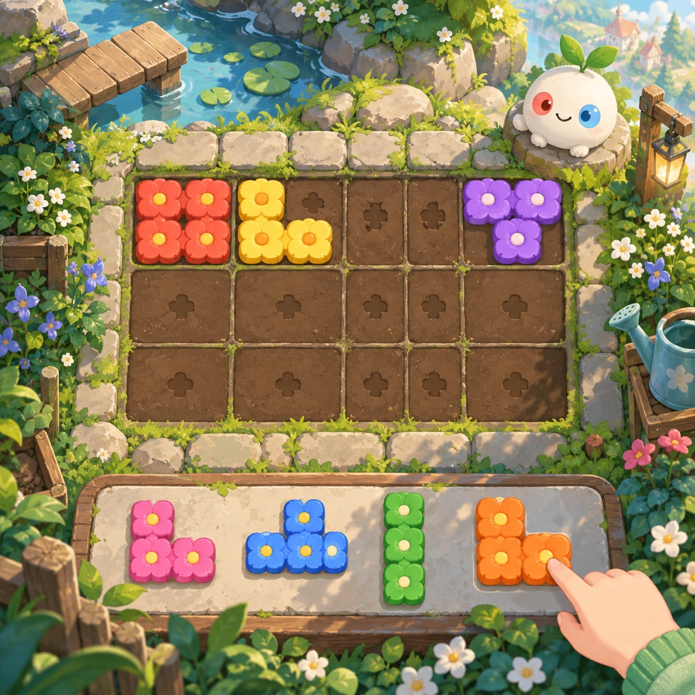
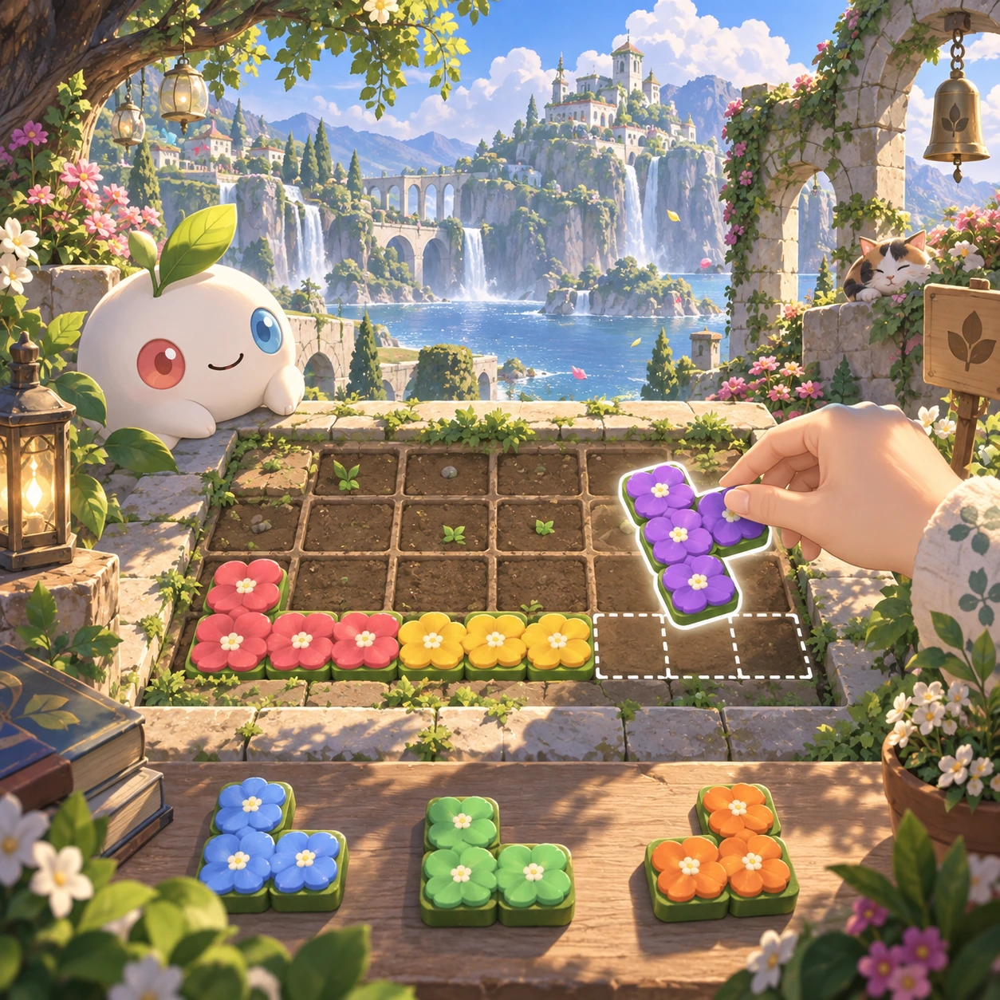
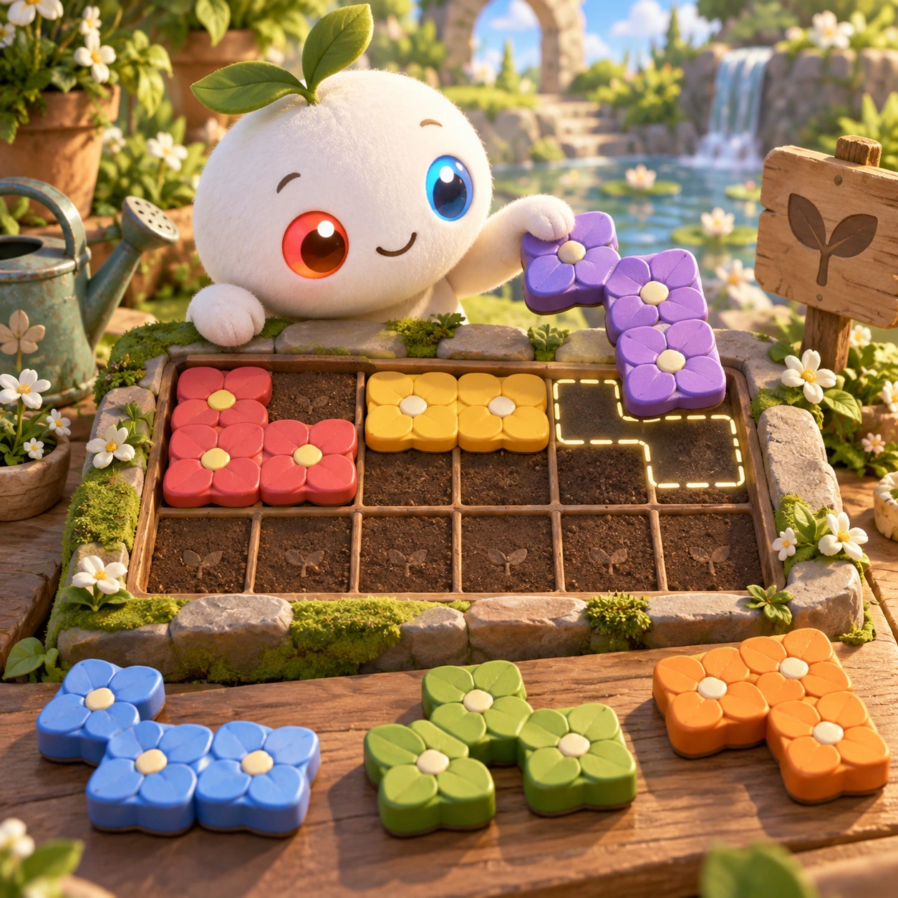
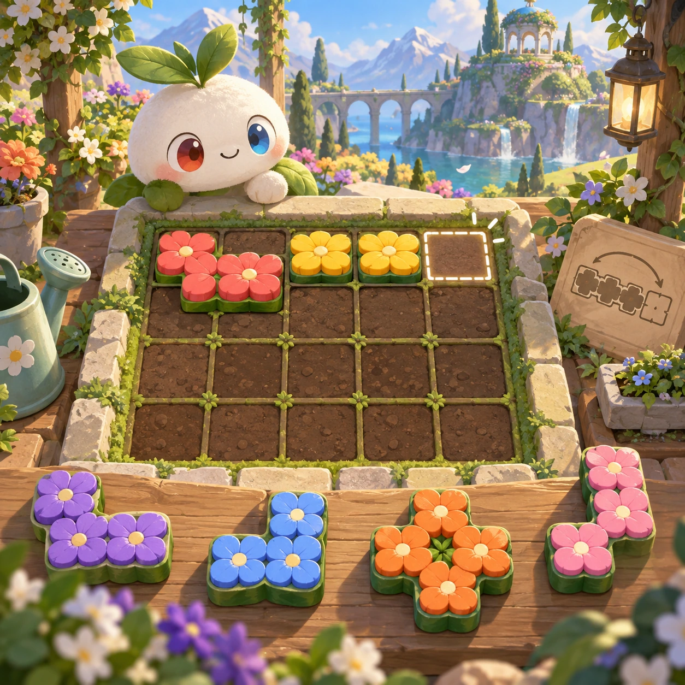

# Shape Garden

PZ-09 · [Puzzles](../pz.md) · Cx 2 · W1 · Original catalog

**The idea:** Fit flower-shaped polyominoes into an open garden grid to complete a row.

| Decision             | Proposal                                                                                                                                                                                    |
| -------------------- | ------------------------------------------------------------------------------------------------------------------------------------------------------------------------------------------- |
| Familiar mechanic    | Block placement                                                                                                                                                                             |
| Learning objective   | Area, spatial reasoning                                                                                                                                                                     |
| First prototype      | One authored challenge built around the interaction above, with a clear goal, immediate feedback, restart and unlimited retries.                                                            |
| Technology           | React + SVG/DOM; deterministic state, undo and seeded levels. Start with one local screen and touch plus keyboard input.                                                                    |
| Scope boundary       | One board and one rule set; defer accounts, multiplayer, procedural content and platform SDKs.                                                                                              |
| Reuse                | Shared input, saves, accessibility, seeded state and the puzzles collection shell.                                                                                                          |
| Prototype acceptance | A player can identify the next action from the screen, complete one challenge, explain the practiced idea and restart without help. Check touch and keyboard play at narrow and wide sizes. |
| Main uncertainty     | Test whether the lesson follows from play and whether the first interaction is understandable without reading.                                                                              |

## Estimated plan

**First playable version:** An 8x8 garden grid where three flower polyominoes are dealt per round, rows and columns bloom when full, plus 10 goal gardens. No endless high-score mode, boosters or piece rotation.

| Measure              | Estimate                                                                               |
| -------------------- | -------------------------------------------------------------------------------------- |
| Youngest age         | 5+                                                                                     |
| Toddler learnability | 2 of 5 — Needs simple rules, turns, a sequence or remembering several steps; ages 4-6. |
| Code                 | 960 LOC, 8 days                                                                        |
| Assets               | 84 hours, 14 days                                                                      |
| Effort               | 22 days, risk 1 of 5                                                                   |
| Start score          | 44 (rank 97 of 300; lower is better)                                                   |

**Algorithms:** `grid-board` (Grid board, 150 LOC) · `drag-drop-snap` (Drag and snap, 150 LOC) · `shuffle-deal` (Seeded shuffle and deal, 60 LOC) · `particle-effects` (Particles, 150 LOC)

**Assets:** 20 sprites, 4 animations, 3 backgrounds, 4 UI screens, 10 sound effects, 1 music track, 4 voice lines, 10 authored levels

How the numbers are computed: [development plan](../../development-plan.md#how-the-scores-work).

## Four visual directions

These are independently generated concept proposals for selecting a prototype.
The four views compare gameplay readability, world appeal, tactile identity and
room to grow. They are not screenshots of an implemented game. Native image
dimensions, hashes, exact prompts and generation provenance are recorded in the
[art manifest](../art/pz-09/manifest.json); see the [generation notes](../README.md#image-generation-and-provenance).

### Gameplay

### World

### Characters and materials

### Expanded play

## Design checks before prototyping

- Learning target: **Area, spatial reasoning**. Ask a domain reviewer to validate factual content in the mechanic.
- Keep goals cooperative or self-directed, using resources and needs. Avoid purchasable power. No pressure timers in the accessible mode.
- Use original layouts and character designs; the [legal checklist](../../legal.md) applies even when a mechanic is familiar.
- Choose the minimum [fidelity level](../../simulation-engine.md#determinism-and-fidelity-levels) the lesson needs; concept art does not establish scientific accuracy.
- Review silhouettes, text alternatives, reduced motion and non-color cues against the [adorability gate](../../lore/adorability-gate.md).

Genre context: [existing genre research](../../../case-studies/issue-1/data/research-genres-ideas.md)
and [expansion research](../../../case-studies/issue-1/data/research-visual-catalog.md).

[← Color Cups](pz-08.md) · [All concepts](../README.md) · [Link It! →](pz-10.md)
