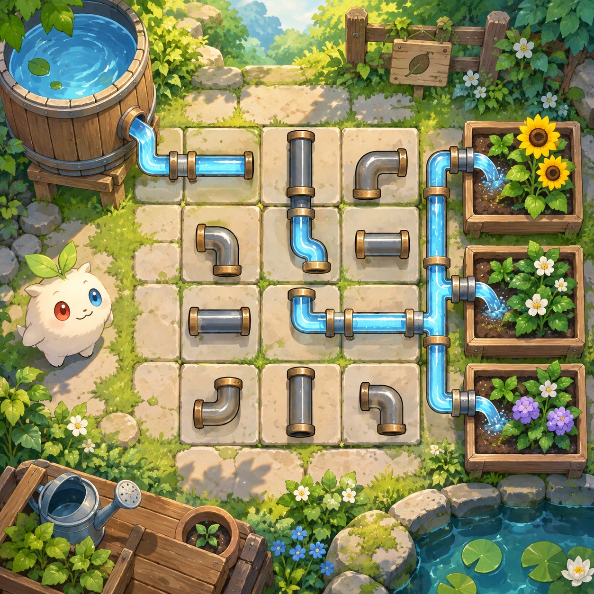
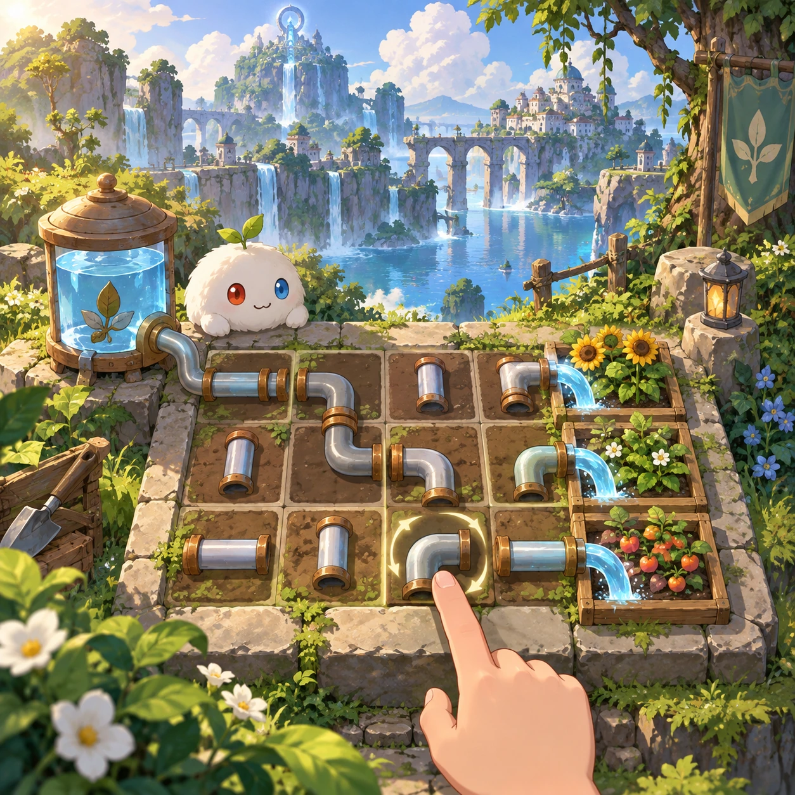
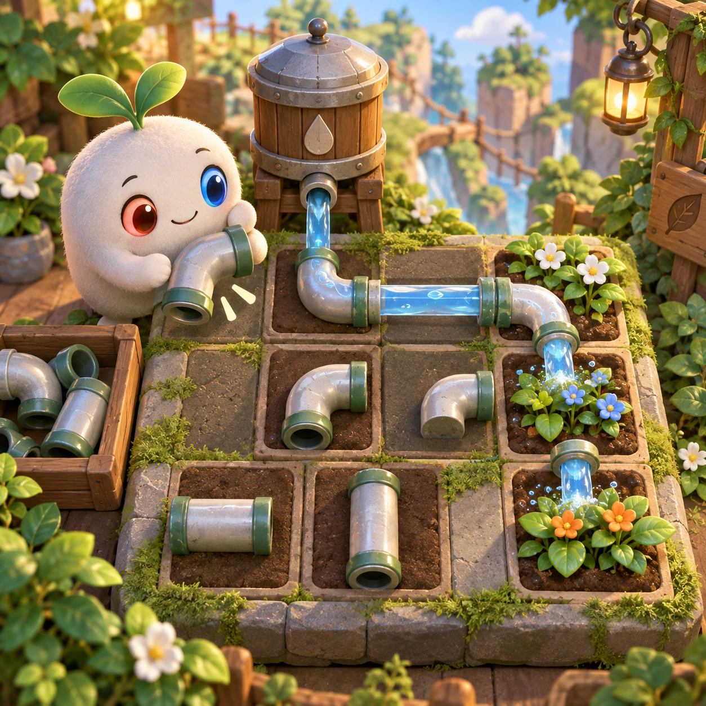
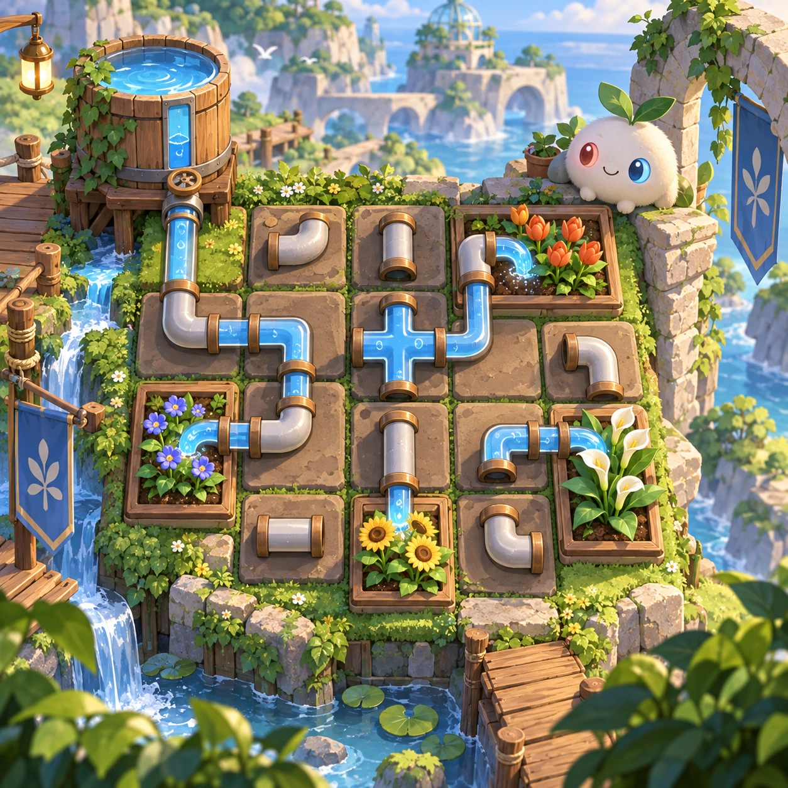
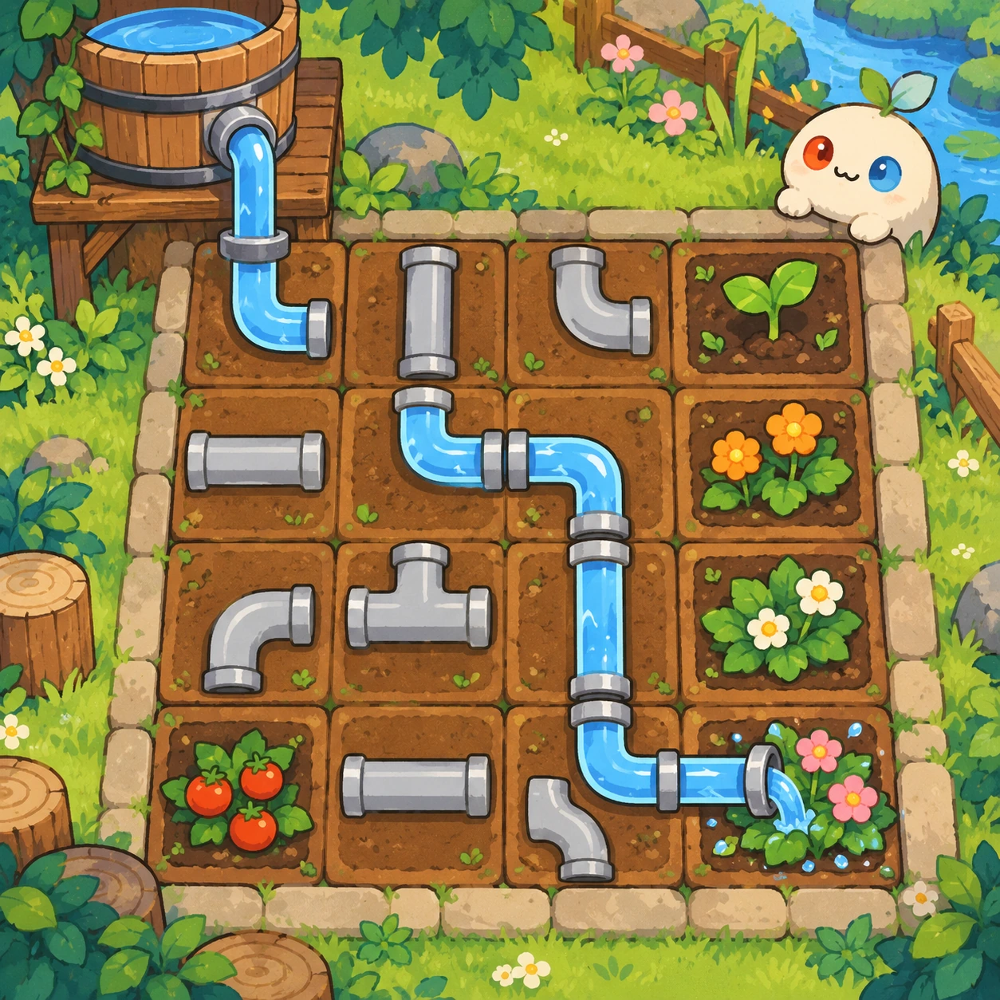
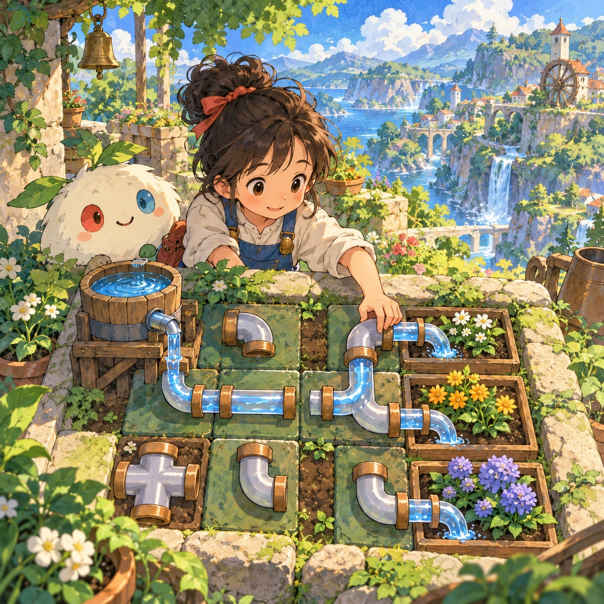

# Pipe Garden

PZ-13 · [Puzzles](../pz.md) · Cx 2 · Original catalog

**The idea:** Rotate pipe elbows to connect a water tank to planted beds in a small grid.

| Decision             | Proposal                                                                                                                                                                                    |
| -------------------- | ------------------------------------------------------------------------------------------------------------------------------------------------------------------------------------------- |
| Familiar mechanic    | Rotate pipes (Pipe Mania, Net)                                                                                                                                                              |
| Learning objective   | Water flow, closed circuits                                                                                                                                                                 |
| First prototype      | One authored challenge built around the interaction above, with a clear goal, immediate feedback, restart and unlimited retries.                                                            |
| Technology           | React + SVG/DOM; deterministic state, undo and seeded levels. Start with one local screen and touch plus keyboard input.                                                                    |
| Scope boundary       | One board and one rule set; defer accounts, multiplayer, procedural content and platform SDKs.                                                                                              |
| Reuse                | Shared input, saves, accessibility, seeded state and the puzzles collection shell.                                                                                                          |
| Prototype acceptance | A player can identify the next action from the screen, complete one challenge, explain the practiced idea and restart without help. Check touch and keyboard play at narrow and wide sizes. |
| Main uncertainty     | Test whether the lesson follows from play and whether the first interaction is understandable without reading.                                                                              |

## Estimated plan

**First playable version:** Tap-to-rotate pipe tiles on 3x3 to 7x7 garden grids, water flowing from the tank through closed connections to beds, 20 tutorial levels plus generated boards. No leaks, timer or wrap-around boards.

| Measure              | Estimate                                                                               |
| -------------------- | -------------------------------------------------------------------------------------- |
| Youngest age         | 4+                                                                                     |
| Toddler learnability | 2 of 5 — Needs simple rules, turns, a sequence or remembering several steps; ages 4-6. |
| Code                 | 1330 LOC, 11.1 days                                                                    |
| Assets               | 81 hours, 13.5 days                                                                    |
| Effort               | 24.6 days, risk 3 of 5                                                                 |
| Start score          | 49.2 (rank 120 of 310; lower is better)                                                |

**Algorithms:** `grid-board` (Grid board, 150 LOC) · `graph-network` (Node-link graph, 300 LOC) · `tap-feedback` (Tap feedback, 80 LOC) · `level-generator` (Procedural level generator, 500 LOC)

**Assets:** 16 sprites, 4 animations, 2 backgrounds, 3 UI screens, 8 sound effects, 1 music track, 4 voice lines, 20 authored levels

How the numbers are computed: [development plan](../../development-plan.md#how-the-scores-work).

## Four visual directions

These are independently generated concept proposals for selecting a prototype.
The four views compare gameplay readability, world appeal, tactile identity and
room to grow. Two additional core-screen alternatives make the flat storybook and painted anime styles explicit alongside the tactile 3D study. They are not screenshots of an implemented game. Native image
dimensions, hashes, exact prompts and generation provenance are recorded in the
[art manifest](../art/pz-13/manifest.json); see the [generation notes](../README.md#image-generation-and-provenance).

The [core prompts](../jobs/pz.json) use IDs `pz-13/01-gameplay` to `pz-13/04-discovery`. Additional [style prompts](../jobs/style-variations.json) match the two alternatives below.

### Gameplay

### World

### Characters and materials

### Expanded play

## Additional style alternatives

### Flat storybook alternative

### Painted anime alternative

## Design checks before prototyping

- Learning target: **Water flow, closed circuits**. Ask a domain reviewer to validate factual content in the mechanic.
- Keep goals cooperative or self-directed, using resources and needs. Avoid purchasable power. No pressure timers in the accessible mode.
- Use original layouts and character designs; the [legal checklist](../../legal.md) applies even when a mechanic is familiar.
- Choose the minimum [fidelity level](../../simulation-engine.md#determinism-and-fidelity-levels) the lesson needs; concept art does not establish scientific accuracy.
- Review silhouettes, text alternatives, reduced motion and non-color cues against the [adorability gate](../../lore/adorability-gate.md).

Genre context: [existing genre research](../../../case-studies/issue-1/data/research-genres-ideas.md)
and [expansion research](../../../case-studies/issue-1/data/research-visual-catalog.md).

[← Light the Links](pz-12.md) · [All concepts](../README.md) · [Untangle →](pz-14.md)
