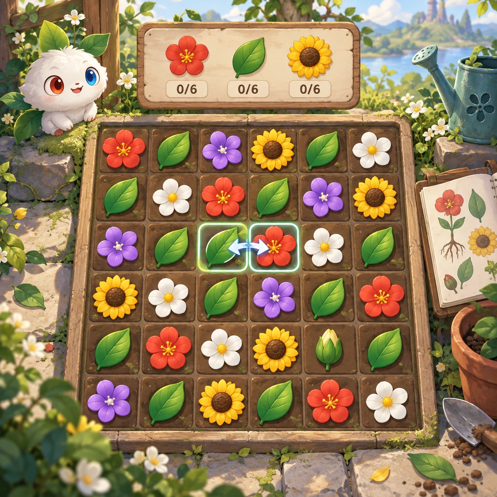
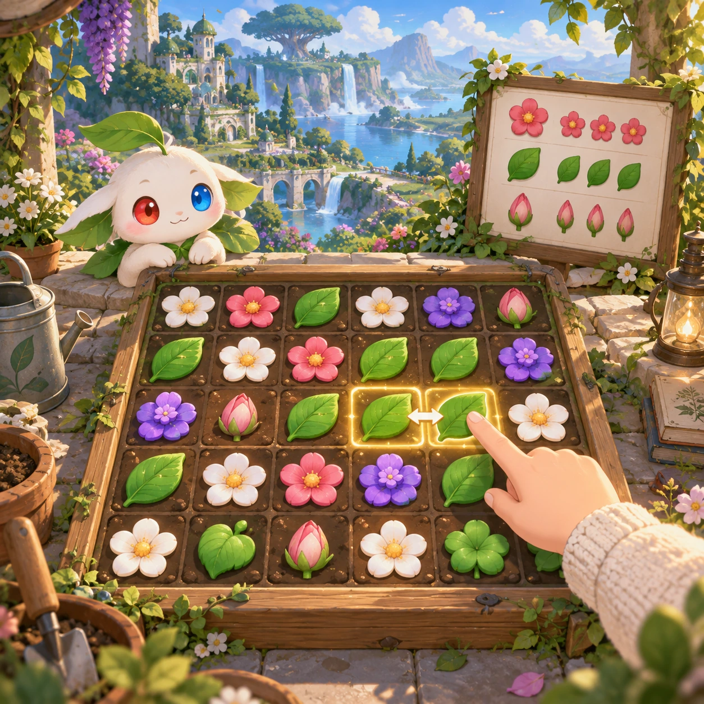
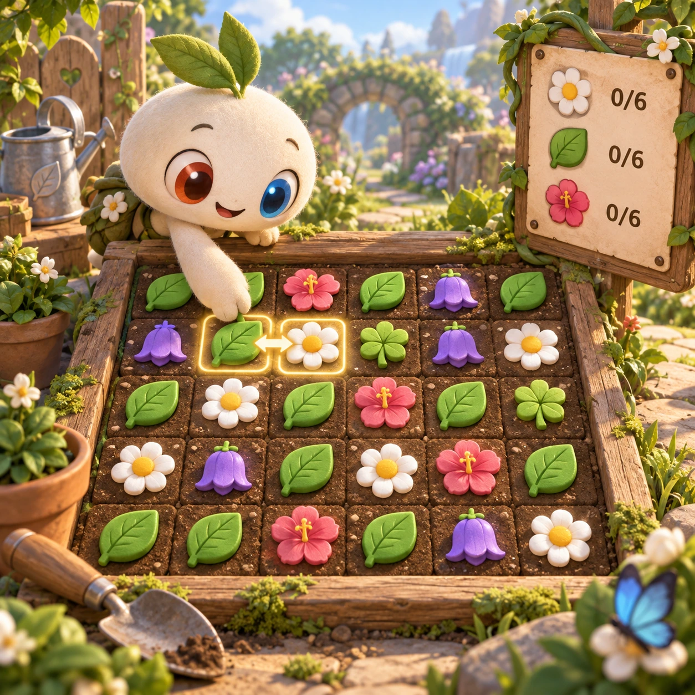
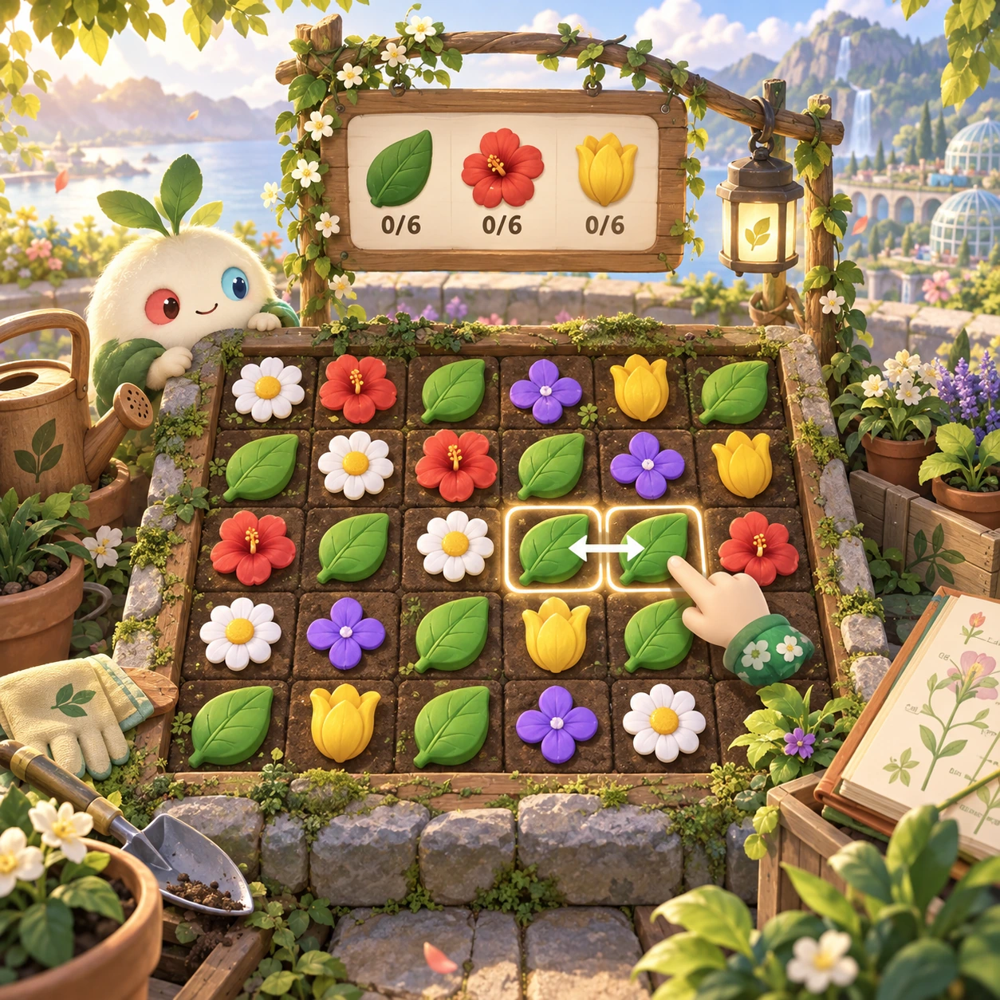

# Blossom Swap

PZ-19 · [Puzzles](../pz.md) · Cx 2 · Added in the visual-catalog expansion

**The idea:** Swap adjacent leaf and flower tiles on a six-by-six garden bed to complete a visible collection goal.

| Decision             | Proposal                                                                                                                                                                                    |
| -------------------- | ------------------------------------------------------------------------------------------------------------------------------------------------------------------------------------------- |
| Familiar mechanic    | Match-3                                                                                                                                                                                     |
| Learning objective   | Planning cascades and recognizing plant parts                                                                                                                                               |
| First prototype      | One authored challenge built around the interaction above, with a clear goal, immediate feedback, restart and unlimited retries.                                                            |
| Technology           | React + SVG/DOM; deterministic state, undo and seeded levels. Start with one local screen and touch plus keyboard input.                                                                    |
| Scope boundary       | One board and one rule set; defer accounts, multiplayer, procedural content and platform SDKs.                                                                                              |
| Reuse                | Shared input, saves, accessibility, seeded state and the puzzles collection shell.                                                                                                          |
| Prototype acceptance | A player can identify the next action from the screen, complete one challenge, explain the practiced idea and restart without help. Check touch and keyboard play at narrow and wide sizes. |
| Main uncertainty     | Test whether the lesson follows from play and whether the first interaction is understandable without reading.                                                                              |

## Estimated plan

**First playable version:** A 6x6 garden bed with swap-to-match leaf and flower tiles, cascades and 30 levels with visible collection goals and plant-part cards. No lives, timers, boosters or purchases.

| Measure              | Estimate                                                                               |
| -------------------- | -------------------------------------------------------------------------------------- |
| Youngest age         | 5+                                                                                     |
| Toddler learnability | 2 of 5 — Needs simple rules, turns, a sequence or remembering several steps; ages 4-6. |
| Code                 | 1280 LOC, 10.7 days                                                                    |
| Assets               | 122 hours, 20.3 days                                                                   |
| Effort               | 31 days, risk 2 of 5                                                                   |
| Start score          | 62 (rank 157 of 300; lower is better)                                                  |

**Algorithms:** `match-cascade` (Match-3 cascade, 400 LOC) · `grid-board` (Grid board, 150 LOC) · `swipe-gesture` (Swipe gestures, 80 LOC) · `particle-effects` (Particles, 150 LOC)

**Assets:** 20 sprites, 6 animations, 3 backgrounds, 5 UI screens, 12 sound effects, 2 music tracks, 6 voice lines, 30 authored levels, 20 content items

How the numbers are computed: [development plan](../../development-plan.md#how-the-scores-work).

## Four visual directions

These are independently generated concept proposals for selecting a prototype.
The four views compare gameplay readability, world appeal, tactile identity and
room to grow. They are not screenshots of an implemented game. Native image
dimensions, hashes, exact prompts and generation provenance are recorded in the
[art manifest](../art/pz-19/manifest.json); see the [generation notes](../README.md#image-generation-and-provenance).

### Gameplay

### World

### Characters and materials

### Expanded play

## Design checks before prototyping

- Learning target: **Planning cascades and recognizing plant parts**. Ask a domain reviewer to validate factual content in the mechanic.
- Keep goals cooperative or self-directed, using resources and needs. Avoid purchasable power. No pressure timers in the accessible mode.
- Use original layouts and character designs; the [legal checklist](../../legal.md) applies even when a mechanic is familiar.
- Choose the minimum [fidelity level](../../simulation-engine.md#determinism-and-fidelity-levels) the lesson needs; concept art does not establish scientific accuracy.
- Review silhouettes, text alternatives, reduced motion and non-color cues against the [adorability gate](../../lore/adorability-gate.md).

Genre context: [existing genre research](../../../case-studies/issue-1/data/research-genres-ideas.md)
and [expansion research](../../../case-studies/issue-1/data/research-visual-catalog.md).

[← Gravity Turn](pz-18.md) · [All concepts](../README.md) · [Bubble Canopy →](pz-20.md)
