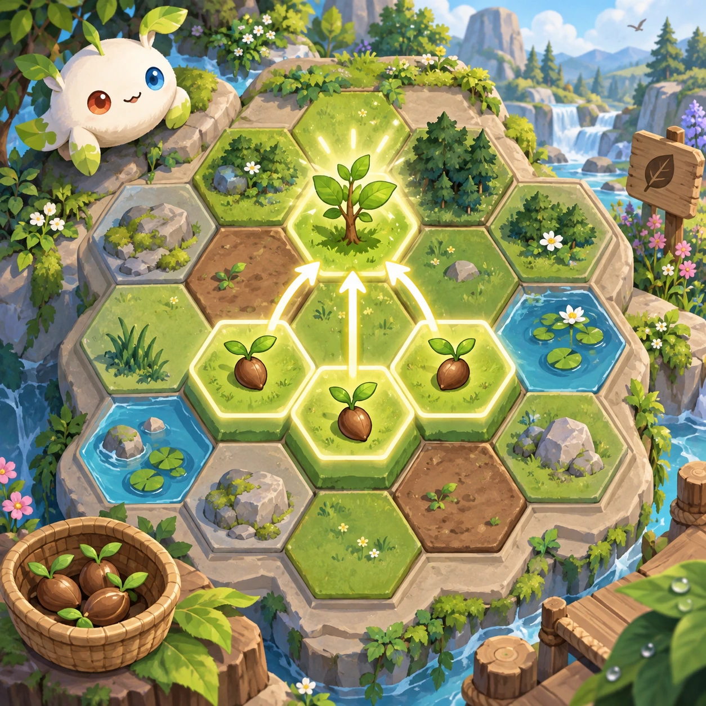
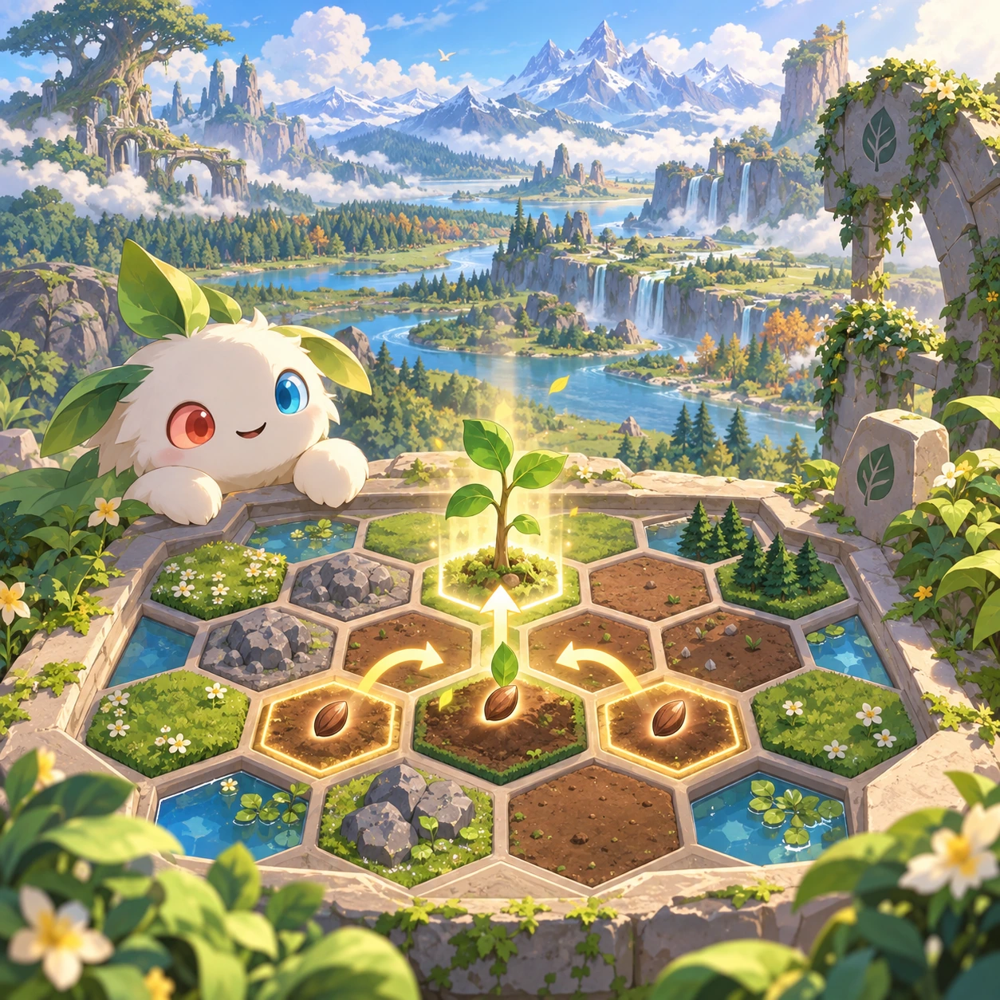
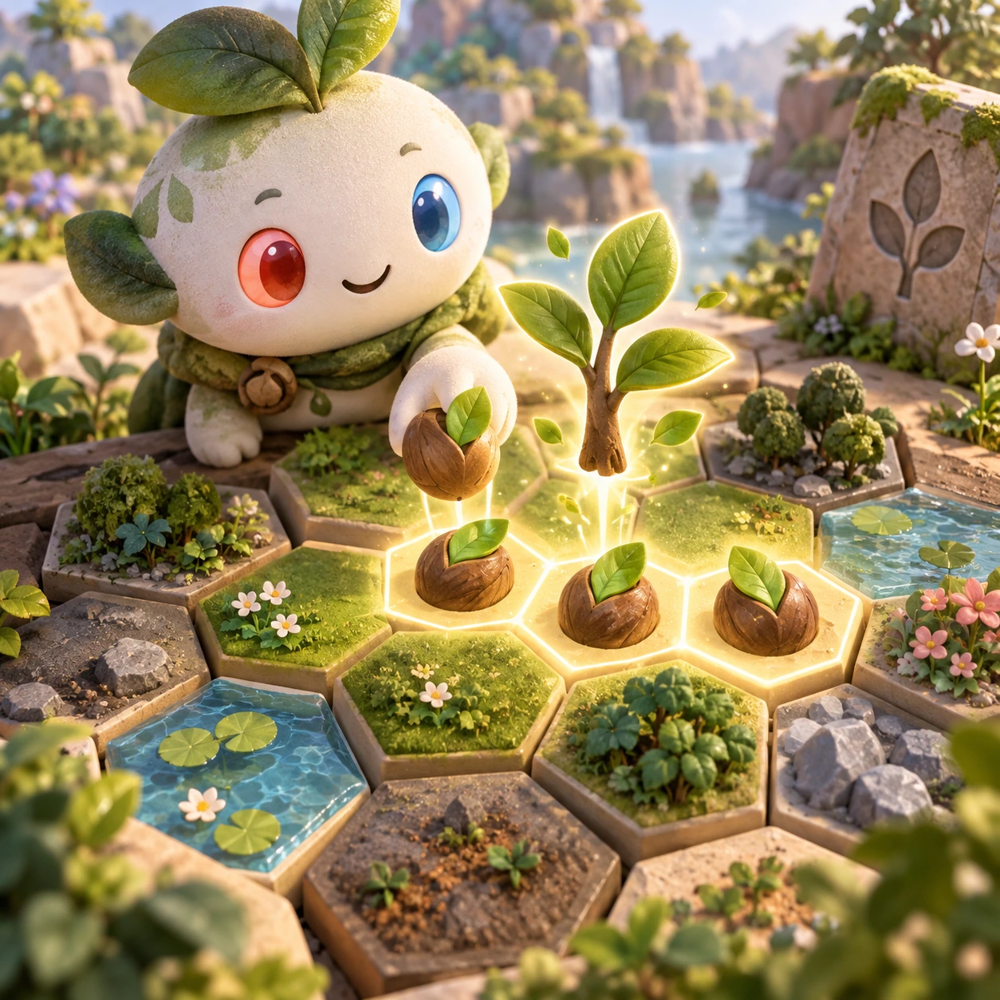
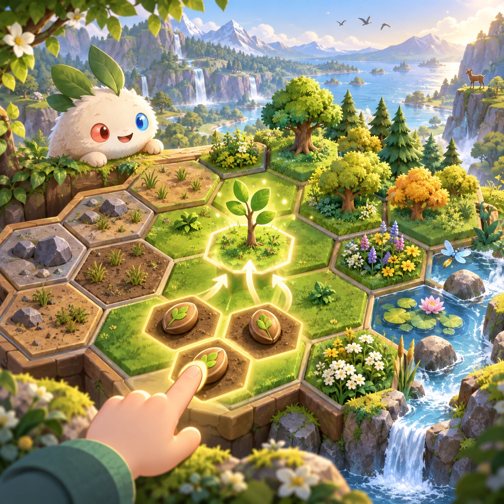

# Habitat Merge

PZ-24 · [Puzzles](../pz.md) · Cx 2 · Added in the visual-catalog expansion

**The idea:** Arrange three seed tokens on a hexagonal restoration map to unlock a sapling model, with growth clearly presented as a game abstraction.

| Decision             | Proposal                                                                                                                                                                                    |
| -------------------- | ------------------------------------------------------------------------------------------------------------------------------------------------------------------------------------------- |
| Familiar mechanic    | Merge-3 map puzzle                                                                                                                                                                          |
| Learning objective   | Habitat succession and spatial planning                                                                                                                                                     |
| First prototype      | One authored challenge built around the interaction above, with a clear goal, immediate feedback, restart and unlimited retries.                                                            |
| Technology           | React + SVG/DOM; deterministic state, undo and seeded levels. Start with one local screen and touch plus keyboard input.                                                                    |
| Scope boundary       | One board and one rule set; defer accounts, multiplayer, procedural content and platform SDKs.                                                                                              |
| Reuse                | Shared input, saves, accessibility, seeded state and the puzzles collection shell.                                                                                                          |
| Prototype acceptance | A player can identify the next action from the screen, complete one challenge, explain the practiced idea and restart without help. Check touch and keyboard play at narrow and wide sizes. |
| Main uncertainty     | Test whether the lesson follows from play and whether the first interaction is understandable without reading.                                                                              |

## Estimated plan

**First playable version:** A hexagonal restoration map where three matching tokens merge from seed to sapling to grove across six tiers, with 10 goal maps and short succession notes. No storage slot, wandering creatures or endless mode.

| Measure              | Estimate                                                                               |
| -------------------- | -------------------------------------------------------------------------------------- |
| Youngest age         | 5+                                                                                     |
| Toddler learnability | 2 of 5 — Needs simple rules, turns, a sequence or remembering several steps; ages 4-6. |
| Code                 | 990 LOC, 8.3 days                                                                      |
| Assets               | 97 hours, 16.2 days                                                                    |
| Effort               | 24.4 days, risk 1 of 5                                                                 |
| Start score          | 48.8 (rank 117 of 300; lower is better)                                                |

**Algorithms:** `grid-board` (Grid board, 150 LOC) · `shuffle-deal` (Seeded shuffle and deal, 60 LOC) · `tap-feedback` (Tap feedback, 80 LOC)

**Assets:** 24 sprites, 6 animations, 2 backgrounds, 4 UI screens, 10 sound effects, 1 music track, 10 voice lines, 10 authored levels, 30 content items

How the numbers are computed: [development plan](../../development-plan.md#how-the-scores-work).

## Four visual directions

These are independently generated concept proposals for selecting a prototype.
The four views compare gameplay readability, world appeal, tactile identity and
room to grow. They are not screenshots of an implemented game. Native image
dimensions, hashes, exact prompts and generation provenance are recorded in the
[art manifest](../art/pz-24/manifest.json); see the [generation notes](../README.md#image-generation-and-provenance).

### Gameplay

### World

### Characters and materials

### Expanded play

## Design checks before prototyping

- Learning target: **Habitat succession and spatial planning**. Ask a domain reviewer to validate factual content in the mechanic.
- Keep goals cooperative or self-directed, using resources and needs. Avoid purchasable power. No pressure timers in the accessible mode.
- Use original layouts and character designs; the [legal checklist](../../legal.md) applies even when a mechanic is familiar.
- Choose the minimum [fidelity level](../../simulation-engine.md#determinism-and-fidelity-levels) the lesson needs; concept art does not establish scientific accuracy.
- Review silhouettes, text alternatives, reduced motion and non-color cues against the [adorability gate](../../lore/adorability-gate.md).

Genre context: [existing genre research](../../../case-studies/issue-1/data/research-genres-ideas.md)
and [expansion research](../../../case-studies/issue-1/data/research-visual-catalog.md).

[← Harvest Drop](pz-23.md) · [All concepts](../README.md) · [Bicycle Jam →](pz-25.md)
