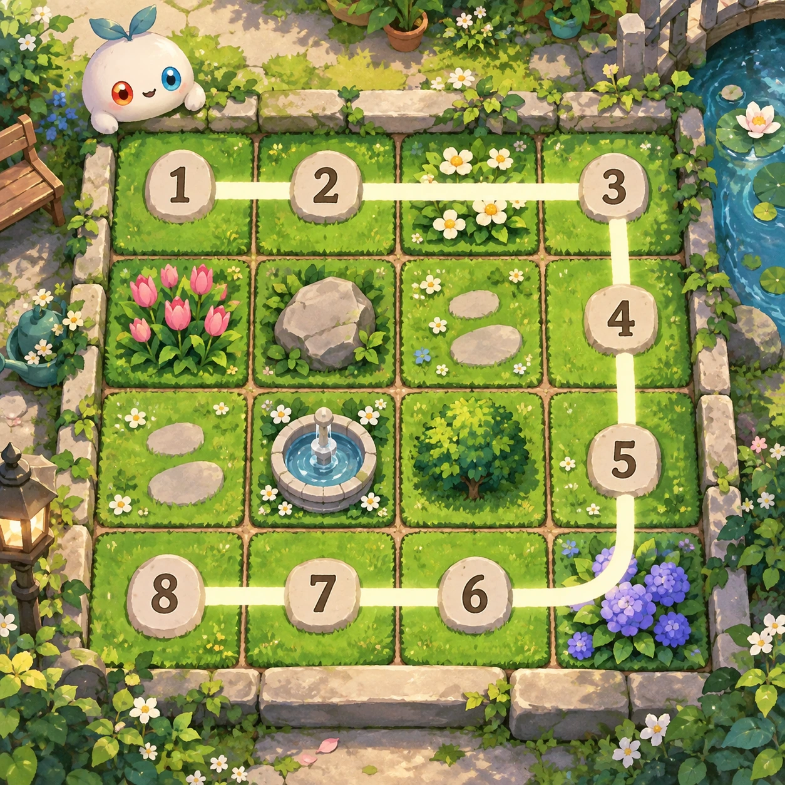
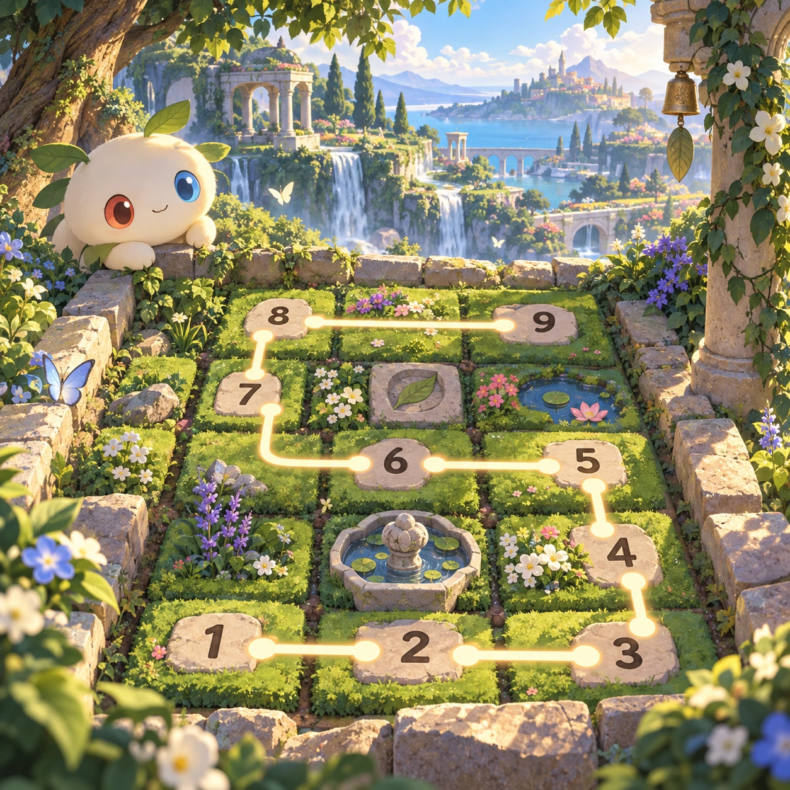
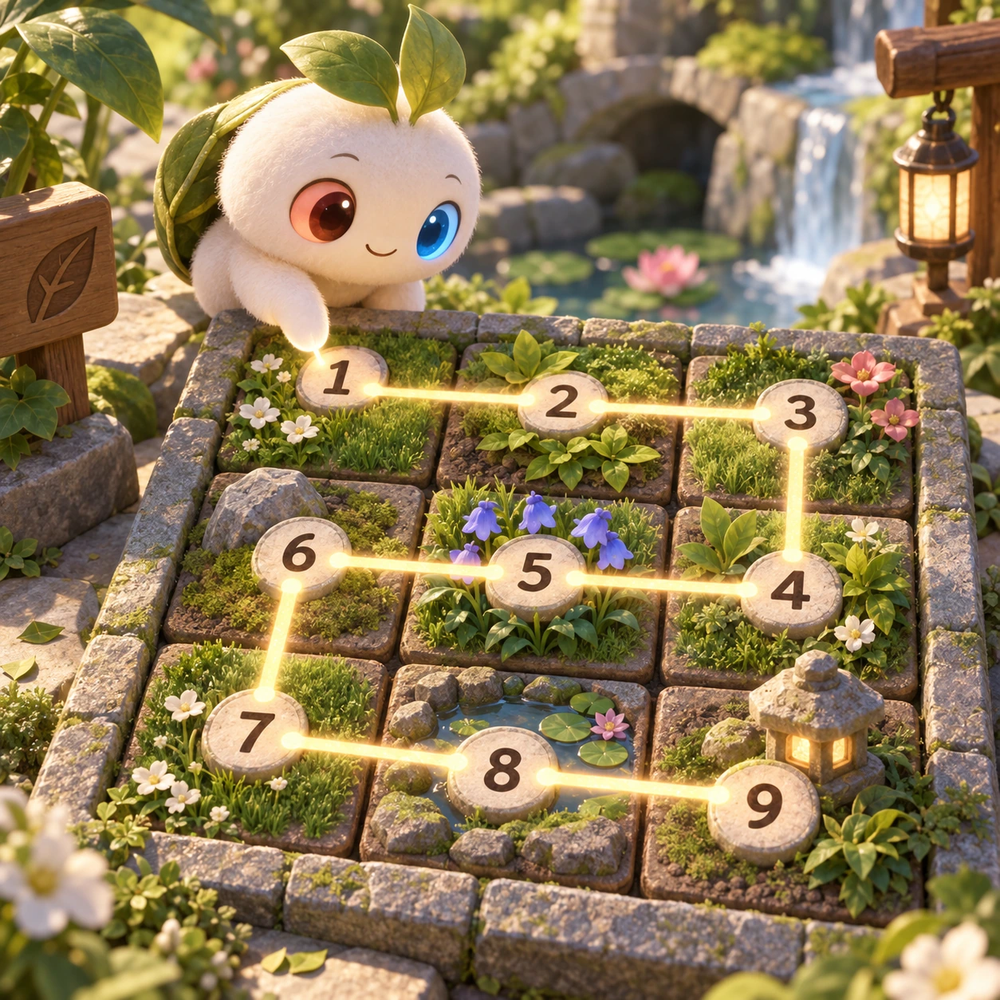
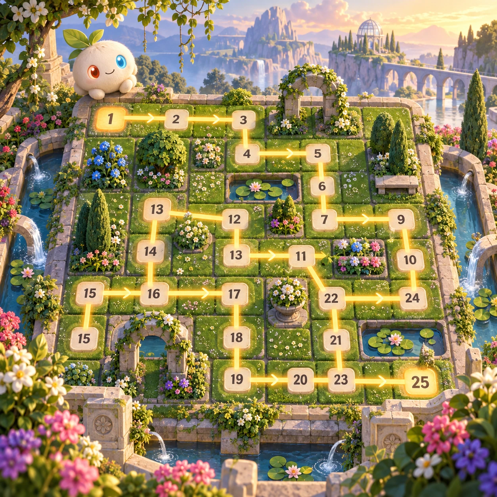

# Trail Numbers

PZ-30 · [Puzzles](../pz.md) · Cx 2 · Added in the visual-catalog expansion

**The idea:** Draw one continuous route through every garden square, visiting numbered checkpoints in order.

| Decision             | Proposal                                                                                                                                                                                    |
| -------------------- | ------------------------------------------------------------------------------------------------------------------------------------------------------------------------------------------- |
| Familiar mechanic    | Numbered Hamiltonian path puzzle                                                                                                                                                            |
| Learning objective   | Sequencing and constraint propagation                                                                                                                                                       |
| First prototype      | One authored challenge built around the interaction above, with a clear goal, immediate feedback, restart and unlimited retries.                                                            |
| Technology           | React + SVG/DOM; deterministic state, undo and seeded levels. Start with one local screen and touch plus keyboard input.                                                                    |
| Scope boundary       | One board and one rule set; defer accounts, multiplayer, procedural content and platform SDKs.                                                                                              |
| Reuse                | Shared input, saves, accessibility, seeded state and the puzzles collection shell.                                                                                                          |
| Prototype acceptance | A player can identify the next action from the screen, complete one challenge, explain the practiced idea and restart without help. Check touch and keyboard play at narrow and wide sizes. |
| Main uncertainty     | Test whether the lesson follows from play and whether the first interaction is understandable without reading.                                                                              |

## Estimated plan

**First playable version:** 40 grids from 3x3 to 7x7 where one drawn route must cover every square and pass numbered checkpoints in order, checked unique by the solver. No walls, timers or daily puzzles.

| Measure              | Estimate                                                                               |
| -------------------- | -------------------------------------------------------------------------------------- |
| Youngest age         | 5+                                                                                     |
| Toddler learnability | 2 of 5 — Needs simple rules, turns, a sequence or remembering several steps; ages 4-6. |
| Code                 | 950 LOC, 7.9 days                                                                      |
| Assets               | 86 hours, 14.4 days                                                                    |
| Effort               | 22.3 days, risk 3 of 5                                                                 |
| Start score          | 44.6 (rank 99 of 300; lower is better)                                                 |

**Algorithms:** `grid-board` (Grid board, 150 LOC) · `sudoku-solver` (Constraint puzzle solver, 400 LOC)

**Assets:** 8 sprites, 3 animations, 2 backgrounds, 3 UI screens, 8 sound effects, 1 music track, 4 voice lines, 40 authored levels

How the numbers are computed: [development plan](../../development-plan.md#how-the-scores-work).

## Four visual directions

These are independently generated concept proposals for selecting a prototype.
The four views compare gameplay readability, world appeal, tactile identity and
room to grow. They are not screenshots of an implemented game. Native image
dimensions, hashes, exact prompts and generation provenance are recorded in the
[art manifest](../art/pz-30/manifest.json); see the [generation notes](../README.md#image-generation-and-provenance).

### Gameplay

### World

### Characters and materials

### Expanded play

## Design checks before prototyping

- Learning target: **Sequencing and constraint propagation**. Ask a domain reviewer to validate factual content in the mechanic.
- Keep goals cooperative or self-directed, using resources and needs. Avoid purchasable power. No pressure timers in the accessible mode.
- Use original layouts and character designs; the [legal checklist](../../legal.md) applies even when a mechanic is familiar.
- Choose the minimum [fidelity level](../../simulation-engine.md#determinism-and-fidelity-levels) the lesson needs; concept art does not establish scientific accuracy.
- Review silhouettes, text alternatives, reduced motion and non-color cues against the [adorability gate](../../lore/adorability-gate.md).

Genre context: [existing genre research](../../../case-studies/issue-1/data/research-genres-ideas.md)
and [expansion research](../../../case-studies/issue-1/data/research-visual-catalog.md).

[← Ribbon Rescue](pz-29.md) · [All concepts](../README.md)
