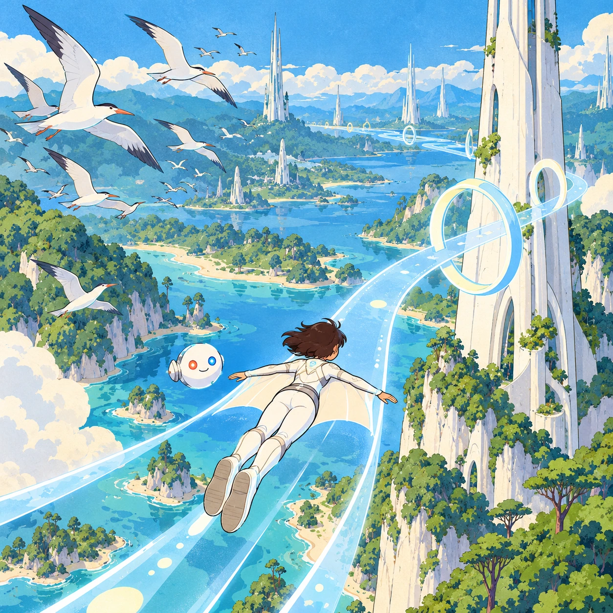
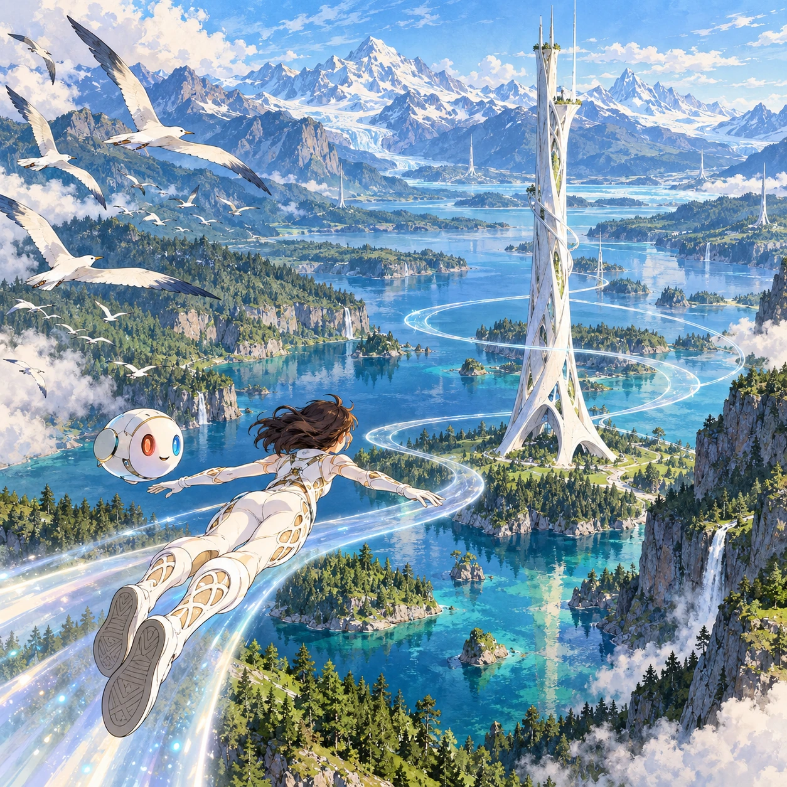

# Riding the Chord

RY-03 · [Raya life](../ry.md) · Cx 4 · Ages 8+ · Raya story catalog

**The idea:** Seen from just behind, a young flyer in a pearl-paneled white suit glides along a faint shimmering sky-lane that curves around a slender white tower, high above a clear river, while a flock of seabirds passes wide on the left.

| Decision             | Proposal                                                                                                                                                                                    |
| -------------------- | ------------------------------------------------------------------------------------------------------------------------------------------------------------------------------------------- |
| Familiar mechanic    | 3D gliding along guided sky-lanes                                                                                                                                                           |
| Learning objective   | Speed and distance, reading a map, sharing the sky with birds                                                                                                                               |
| First prototype      | One authored challenge built around the interaction above, with a clear goal, immediate feedback, restart and unlimited retries.                                                            |
| Technology           | React shell + PixiJS; use the shared simulation adapter only where motion or agent behavior requires it. Start with one bounded scene and measured frame time.                              |
| Scope boundary       | One bounded scenario and one core system; defer a full campaign, network play and production-scale content.                                                                                 |
| Reuse                | Shared input, saves, accessibility, seeded state and the raya life collection shell.                                                                                                        |
| Prototype acceptance | A player can identify the next action from the screen, complete one challenge, explain the practiced idea and restart without help. Check touch and keyboard play at narrow and wide sizes. |
| Main uncertainty     | Simulation accuracy and device cost need measured evidence before extending the scenario.                                                                                                   |

## Estimated plan

**First playable version:** One 3D glacier valley with one tower and 8 authored sky-lane routes inside its 2 km ring, speed 5 to 40 km/h, bird flocks to yield to and a soft landing at the ring edge. Multi-tower maps and the survey mode come later.

| Measure              | Estimate                                                                                                   |
| -------------------- | ---------------------------------------------------------------------------------------------------------- |
| Youngest age         | 8+                                                                                                         |
| Toddler learnability | 1 of 5 — Needs reading, precise motor control, timing pressure or abstract rules; not a toddler game (6+). |
| Code                 | 2970 LOC, 24.8 days                                                                                        |
| Assets               | 211 hours, 35.2 days                                                                                       |
| Effort               | 59.9 days, risk 4 of 5                                                                                     |
| Start score          | 179.7 (rank 294 of 310; lower is better)                                                                   |

**Algorithms:** `character-3d` (3D character controller, 700 LOC) · `camera-3d` (3D camera, 300 LOC) · `vehicle-sim` (Vehicle handling, 500 LOC) · `particle-effects` (Particles, 150 LOC) · `day-cycle` (Day and season cycle, 120 LOC)

**Assets:** 10 sprites, 6 animations, 3 backgrounds, 6 UI screens, 20 sound effects, 2 music tracks, 30 voice lines, 8 authored levels, 30 content items, 14 3D models

How the numbers are computed: [development plan](../../development-plan.md#how-the-scores-work).

## Story

Trip wanted to go fast. The lane hummed under his suit, and he leaned forward. Ten, twenty, thirty kilometers an hour. "Forty is the top," said his Orbi. "And look left." A flock of seabirds was crossing the lane. Trip slowed down and let them pass. Then the lane grew thin near the edge of the tower's ring, and his suit lowered him softly onto the grass. "Out of reach," said the Orbi. Trip lay in the flowers and laughed. "The sky is not a race," he said. "It is a path we share."

> **Wisdom:** The sky is a path we share.

## Four visual directions

These are independently generated concept proposals for selecting a prototype.
The four views compare gameplay readability, world appeal, tactile identity and
room to grow. They are not screenshots of an implemented game. Native image
dimensions, hashes, exact prompts and generation provenance are recorded in the
[art manifest](../art/ry-03/manifest.json); see the [generation notes](../README.md#image-generation-and-provenance).

The [core prompts](../jobs/ry.json) use IDs `ry-03/01-gameplay` to `ry-03/04-discovery`.

### Gameplay

Seen from just behind, a young flyer in a pearl-paneled white suit glides along a faint shimmering sky-lane that curves around a slender white tower, high above a clear river, while a flock of seabirds passes wide on the left.

### World

A glacier lake valley in clear morning air, with mountains visible far away and forests running down to the water. One white Chord tower, about 600 m tall and slightly twisted like a plant stem, stands on three root-like feet. Faint rippling bands of air mark the sky-lanes coiling around it inside a soft-edged ring, and the lanes fade to nothing farther out.

### Characters and materials

Flyers are young Rayans in tight white flight suits with pearl panels on the back, arms and shins, a coral-red left wrist and a sky-blue right wrist. A white Orbi floats beside each one at shoulder height. Speed shows as gentle air streaks, never blur. Textures: white ceramic tower, rippled lane light, cold blue water, green pines, white seabirds.

### Expanded play

New towers bring new routes: a mangrove tower standing in shallow water, a canyon tower on red rock, a sunset glide with a class in a calm line. A ring map shows each tower's 2 km reach, where the lane softly sets a flyer down on a meadow, and a slow mode follows a grazing herd for a nature survey.

## Design checks before prototyping

- Learning target: **Speed and distance, reading a map, sharing the sky with birds**. Ask a domain reviewer to validate factual content in the mechanic.
- Keep goals cooperative or self-directed, using resources and needs. Avoid purchasable power. No pressure timers in the accessible mode.
- Use original layouts and character designs; the [legal checklist](../../legal.md) applies even when a mechanic is familiar.
- Choose the minimum [fidelity level](../../simulation-engine.md#determinism-and-fidelity-levels) the lesson needs; concept art does not establish scientific accuracy.
- Review silhouettes, text alternatives, reduced motion and non-color cues against the [adorability gate](../../lore/adorability-gate.md).
- Check every detail against the [Raya canon](../../lore/raya.md): untouched nature, white towers and clothing, Orbis, the Guard and the Gentle Defaults.

Genre context: [existing genre research](../../../case-studies/issue-1/data/research-genres-ideas.md)
and [expansion research](../../../case-studies/issue-1/data/research-visual-catalog.md).

[← One Night Apple](ry-02.md) · [All concepts](../README.md) · [Ring Tuner →](ry-04.md)
