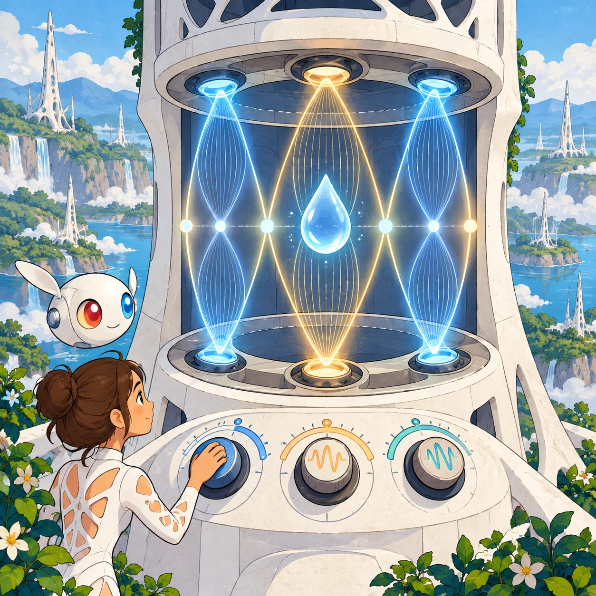
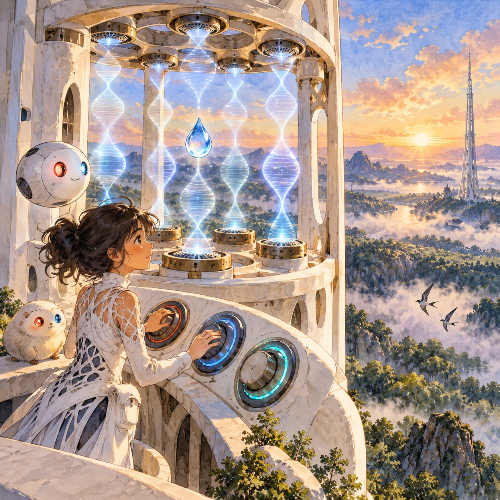

# Ring Tuner

RY-04 · [Raya life](../ry.md) · Cx 3 · Ages 10+ · Raya story catalog

**The idea:** A cutaway of one emitter ring on a white tower shows glowing standing waves between the emitters; the player turns three big dials until bright nodes line up and hold a floating water drop steady in the air.

| Decision             | Proposal                                                                                                                                                                                    |
| -------------------- | ------------------------------------------------------------------------------------------------------------------------------------------------------------------------------------------- |
| Familiar mechanic    | Wave-tuning puzzle                                                                                                                                                                          |
| Learning objective   | Sound waves, frequency, resonance and standing-wave nodes                                                                                                                                   |
| First prototype      | One authored challenge built around the interaction above, with a clear goal, immediate feedback, restart and unlimited retries.                                                            |
| Technology           | React shell + PixiJS; use the shared simulation adapter only where motion or agent behavior requires it. Start with one bounded scene and measured frame time.                              |
| Scope boundary       | One bounded scenario and one core system; defer a full campaign, network play and production-scale content.                                                                                 |
| Reuse                | Shared input, saves, accessibility, seeded state and the raya life collection shell.                                                                                                        |
| Prototype acceptance | A player can identify the next action from the screen, complete one challenge, explain the practiced idea and restart without help. Check touch and keyboard play at narrow and wide sizes. |
| Main uncertainty     | Test whether the lesson follows from play and whether the first interaction is understandable without reading.                                                                              |

## Estimated plan

**First playable version:** 24 tuning puzzles on one tower ring with two or three dials, a live standing-wave view, the eight-octaves-down listening mode and a test water drop held in the node. Wind, twin towers and whole sky-lanes are left out.

| Measure              | Estimate                                                                                                   |
| -------------------- | ---------------------------------------------------------------------------------------------------------- |
| Youngest age         | 10+                                                                                                        |
| Toddler learnability | 1 of 5 — Needs reading, precise motor control, timing pressure or abstract rules; not a toddler game (6+). |
| Code                 | 1550 LOC, 12.9 days                                                                                        |
| Assets               | 118 hours, 19.6 days                                                                                       |
| Effort               | 32.5 days, risk 3 of 5                                                                                     |
| Start score          | 97.5 (rank 227 of 310; lower is better)                                                                    |

**Algorithms:** `acoustics-sim` (Acoustics and waves, 450 LOC) · `audio-synth` (Playable instrument, 250 LOC) · `particle-effects` (Particles, 150 LOC)

**Assets:** 20 sprites, 4 animations, 4 backgrounds, 5 UI screens, 15 sound effects, 1 music track, 30 voice lines, 24 authored levels, 30 content items

How the numbers are computed: [development plan](../../development-plan.md#how-the-scores-work).

## Story

The north ring was out of tune, and the sky-lane wobbled like a loose string. Lina could not hear it. Tower song lives above human ears. "Let me bring it down for you," said her Orbi, and it played the ring eight octaves lower. Now Lina heard a slow wah, wah, wah: two notes, almost the same, rubbing against each other. She turned the dial a little. The wah slowed. A little more. Silence, then one clean tone. The water drop in the test node stopped shaking. "Listen closely," said Lina, "and small changes are enough."

> **Wisdom:** Listen closely; small changes are enough.

## Four visual directions

These are independently generated concept proposals for selecting a prototype.
The four views compare gameplay readability, world appeal, tactile identity and
room to grow. They are not screenshots of an implemented game. Native image
dimensions, hashes, exact prompts and generation provenance are recorded in the
[art manifest](../art/ry-04/manifest.json); see the [generation notes](../README.md#image-generation-and-provenance).

The [core prompts](../jobs/ry.json) use IDs `ry-04/01-gameplay` to `ry-04/04-discovery`.

### Gameplay

A cutaway of one emitter ring on a white tower shows glowing standing waves between the emitters; the player turns three big dials until bright nodes line up and hold a floating water drop steady in the air.

### World

A ridge at sunrise above a valley of untouched forest fading into blue haze. A slender white Chord tower rises from bedrock, its rings of acoustic emitters standing out like bamboo nodes. Mist curls over the treetops, a pair of swifts circles far below the rings, and a second tower stands far away on the horizon. Quiet, clear, scientific mood.

### Characters and materials

Lina, in a white lattice suit with red and blue hair clips, kneels on a maintenance ledge while her Orbi shows a floating, see-through panel of waves. The waves are soft sky-blue and coral-red ripples that meet in bright yellow nodes. Materials: white ceramic, pearl emitter discs, clear air, and a single levitating water drop catching the sun.

### Expanded play

Harder puzzles add more rings, wind that bends the waves, and a twin tower whose lane must meet this one. A listening mode lets the Orbi play the ultrasound eight octaves lower, so the player hears the beats fade as the tuning locks. Later levels hold a seed pod, then a feather, then a whole sky-lane ready for a flyer.

## Design checks before prototyping

- Learning target: **Sound waves, frequency, resonance and standing-wave nodes**. Ask a domain reviewer to validate factual content in the mechanic.
- Keep goals cooperative or self-directed, using resources and needs. Avoid purchasable power. No pressure timers in the accessible mode.
- Use original layouts and character designs; the [legal checklist](../../legal.md) applies even when a mechanic is familiar.
- Choose the minimum [fidelity level](../../simulation-engine.md#determinism-and-fidelity-levels) the lesson needs; concept art does not establish scientific accuracy.
- Review silhouettes, text alternatives, reduced motion and non-color cues against the [adorability gate](../../lore/adorability-gate.md).
- Check every detail against the [Raya canon](../../lore/raya.md): untouched nature, white towers and clothing, Orbis, the Guard and the Gentle Defaults.

Genre context: [existing genre research](../../../case-studies/issue-1/data/research-genres-ideas.md)
and [expansion research](../../../case-studies/issue-1/data/research-visual-catalog.md).

[← Riding the Chord](ry-03.md) · [All concepts](../README.md) · [Thought Postcards →](ry-05.md)
