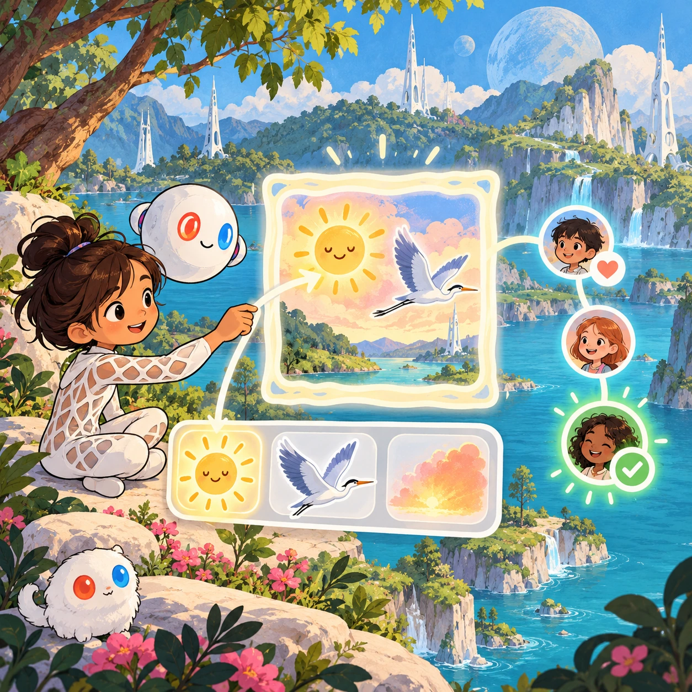
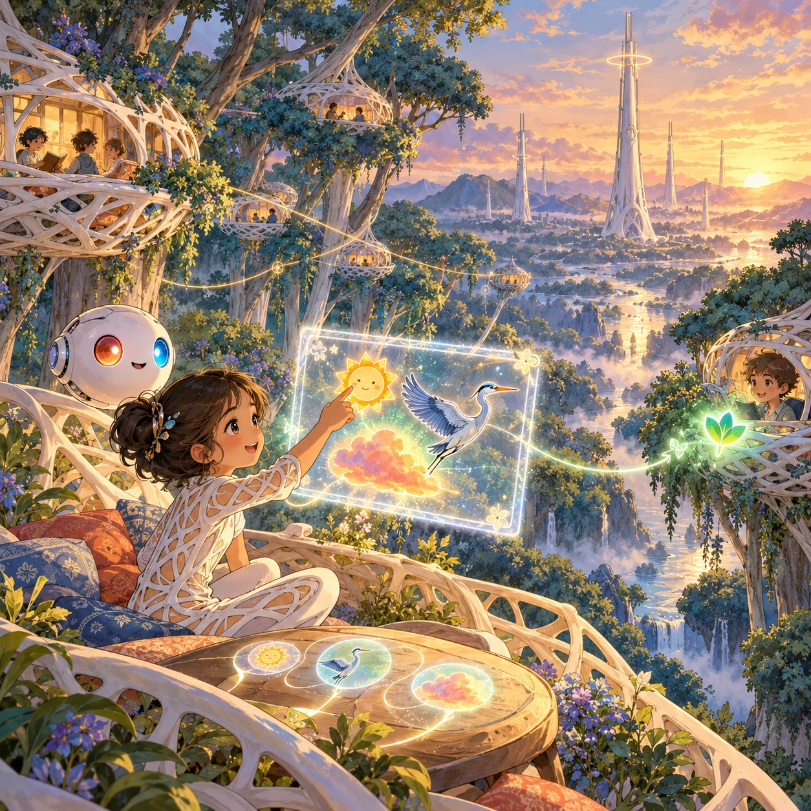
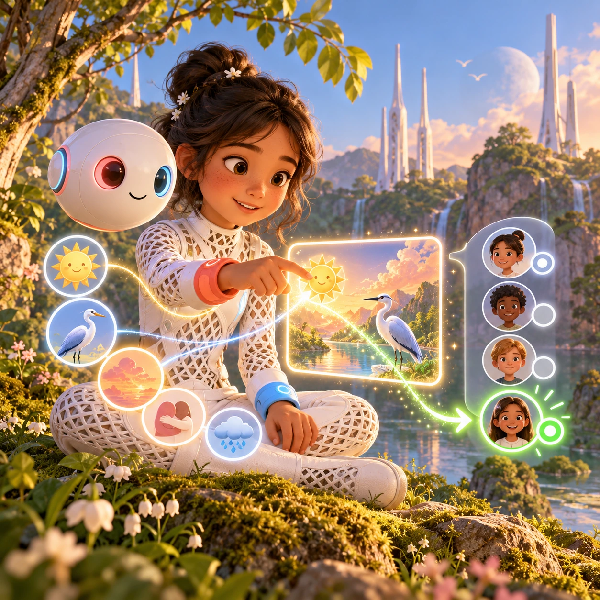
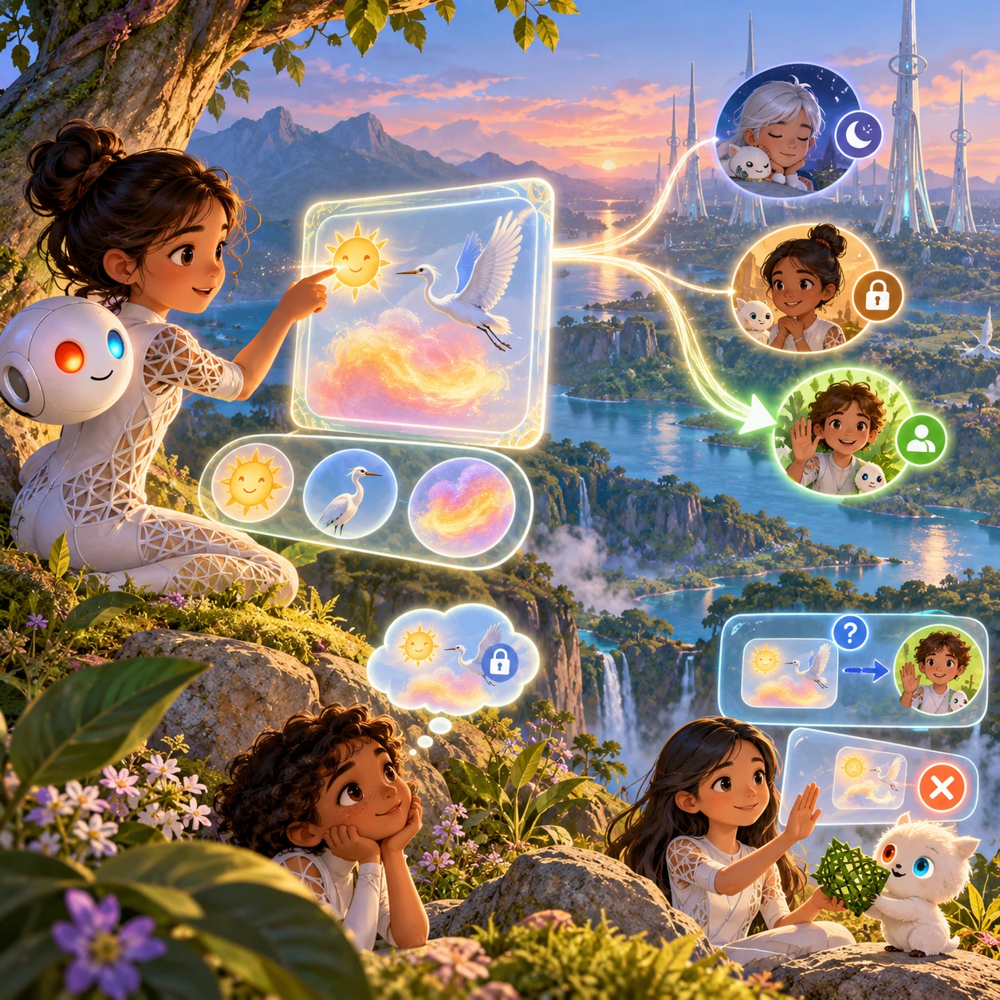

# Thought Postcards

RY-05 · [Raya life](../ry.md) · Cx 2 · Ages 6+ · Raya story catalog

**The idea:** A child's Orbi opens a soft glowing frame in the air; the player drags a smiling sun, a heron and a warm color glow into it, then taps a friend's thread, which ends in a green open light.

| Decision             | Proposal                                                                                                                                                                                    |
| -------------------- | ------------------------------------------------------------------------------------------------------------------------------------------------------------------------------------------- |
| Familiar mechanic    | Picture-message composer with consent steps                                                                                                                                                 |
| Learning objective   | Consent online, privacy, kind messages                                                                                                                                                      |
| First prototype      | One authored challenge built around the interaction above, with a clear goal, immediate feedback, restart and unlimited retries.                                                            |
| Technology           | React + SVG/DOM; deterministic state, undo and seeded levels. Start with one local screen and touch plus keyboard input.                                                                    |
| Scope boundary       | One board and one rule set; defer accounts, multiplayer, procedural content and platform SDKs.                                                                                              |
| Reuse                | Shared input, saves, accessibility, seeded state and the raya life collection shell.                                                                                                        |
| Prototype acceptance | A player can identify the next action from the screen, complete one challenge, explain the practiced idea and restart without help. Check touch and keyboard play at narrow and wide sizes. |
| Main uncertainty     | Test whether the lesson follows from play and whether the first interaction is understandable without reading.                                                                              |

## Estimated plan

**First playable version:** A picture-message composer with 40 icons and 12 short episodes where friends are quiet, open to friends or open to all, plus a private thought bubble that never sends by itself. Replies and passing on pictures come later.

| Measure              | Estimate                                                                                                   |
| -------------------- | ---------------------------------------------------------------------------------------------------------- |
| Youngest age         | 6+                                                                                                         |
| Toddler learnability | 1 of 5 — Needs reading, precise motor control, timing pressure or abstract rules; not a toddler game (6+). |
| Code                 | 1150 LOC, 9.6 days                                                                                         |
| Assets               | 147 hours, 24.4 days                                                                                       |
| Effort               | 34 days, risk 2 of 5                                                                                       |
| Start score          | 102 (rank 232 of 310; lower is better)                                                                     |

**Algorithms:** `sticker-scene` (Sticker scene, 200 LOC) · `drag-drop-snap` (Drag and snap, 150 LOC) · `dialogue-branching` (Branching dialogue, 300 LOC)

**Assets:** 35 sprites, 8 animations, 3 backgrounds, 5 UI screens, 12 sound effects, 1 music track, 60 voice lines, 12 authored levels, 60 content items

How the numbers are computed: [development plan](../../development-plan.md#how-the-scores-work).

## Story

Mira saw a heron shining in the sun and felt so happy that she wanted to share it. She thought of Theo. "Ask first," said Pip. Theo's light was gray. He was quiet today. "Then I will keep it for later," said Mira, and the picture waited in her mind, safe and hers. Next she asked Ana. Ana's light turned green. The heron flew from Mira's mind into Ana's, and Ana sent back a big warm glow. In the evening Theo came by, and Mira told him about the heron out loud.

> **Wisdom:** Ask first. Your thoughts are yours to share.

## Four visual directions

These are independently generated concept proposals for selecting a prototype.
The four views compare gameplay readability, world appeal, tactile identity and
room to grow. They are not screenshots of an implemented game. Native image
dimensions, hashes, exact prompts and generation provenance are recorded in the
[art manifest](../art/ry-05/manifest.json); see the [generation notes](../README.md#image-generation-and-provenance).

The [core prompts](../jobs/ry.json) use IDs `ry-05/01-gameplay` to `ry-05/04-discovery`.

### Gameplay

A child's Orbi opens a soft glowing frame in the air; the player drags a smiling sun, a heron and a warm color glow into it, then taps a friend's thread, which ends in a green open light.

### World

A reading nest village in giant blue-green tree crowns at golden hour. Nests of white lattice are linked by faint shimmering threads that only the children see, the Omi view of the Chord. A tall white tower rises beyond the canopy with a soft light at its crown, and a river glints far below between the trunks.

### Characters and materials

Mira, 9, in a white lattice suit with a coral-red left wrist and a sky-blue right wrist, sits cross-legged beside her Orbi Pip, a 30 cm white sphere with red and blue eyes. Message pictures are simple round icons: warm or cool feeling glows, animals, weather, a hug. Each friend's thread ends in a small light: pale gray for quiet, green for open.

### Expanded play

New friends join with their own settings: one is quiet for the day, one is open only to friends, one has no Orbi and prefers a voice visit or a woven note. Later levels add replying, saying no kindly, asking before passing on someone else's picture, and a thought bubble that stays private unless the player chooses to send it.

## Design checks before prototyping

- Learning target: **Consent online, privacy, kind messages**. Ask a domain reviewer to validate factual content in the mechanic.
- Keep goals cooperative or self-directed, using resources and needs. Avoid purchasable power. No pressure timers in the accessible mode.
- Use original layouts and character designs; the [legal checklist](../../legal.md) applies even when a mechanic is familiar.
- Choose the minimum [fidelity level](../../simulation-engine.md#determinism-and-fidelity-levels) the lesson needs; concept art does not establish scientific accuracy.
- Review silhouettes, text alternatives, reduced motion and non-color cues against the [adorability gate](../../lore/adorability-gate.md).
- Check every detail against the [Raya canon](../../lore/raya.md): untouched nature, white towers and clothing, Orbis, the Guard and the Gentle Defaults.

Genre context: [existing genre research](../../../case-studies/issue-1/data/research-genres-ideas.md)
and [expansion research](../../../case-studies/issue-1/data/research-visual-catalog.md).

[← Ring Tuner](ry-04.md) · [All concepts](../README.md) · [Soft Hold →](ry-06.md)
