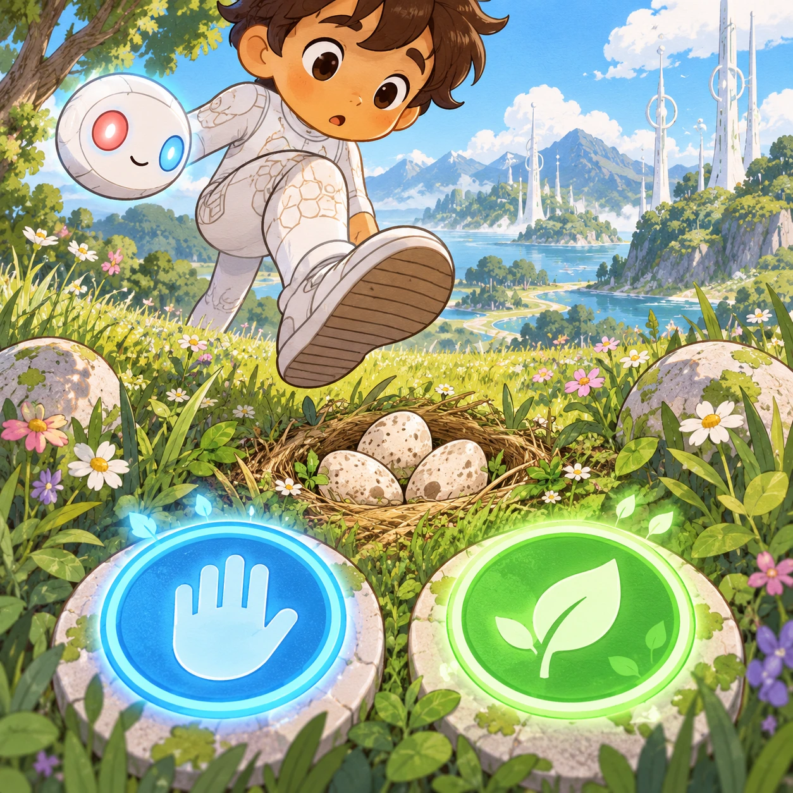
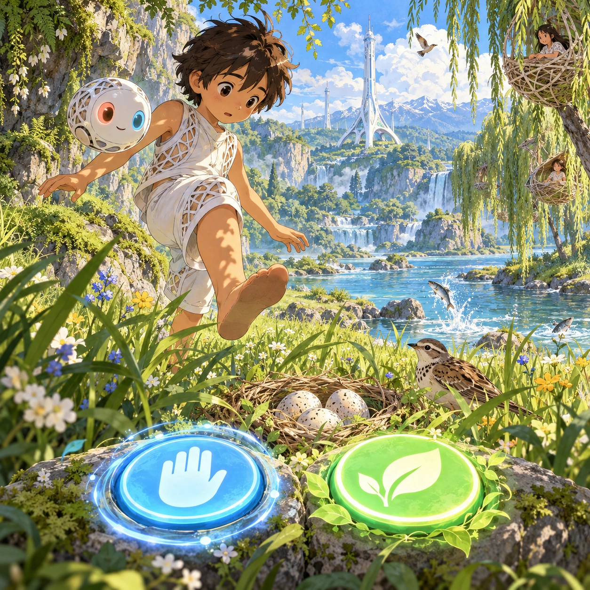
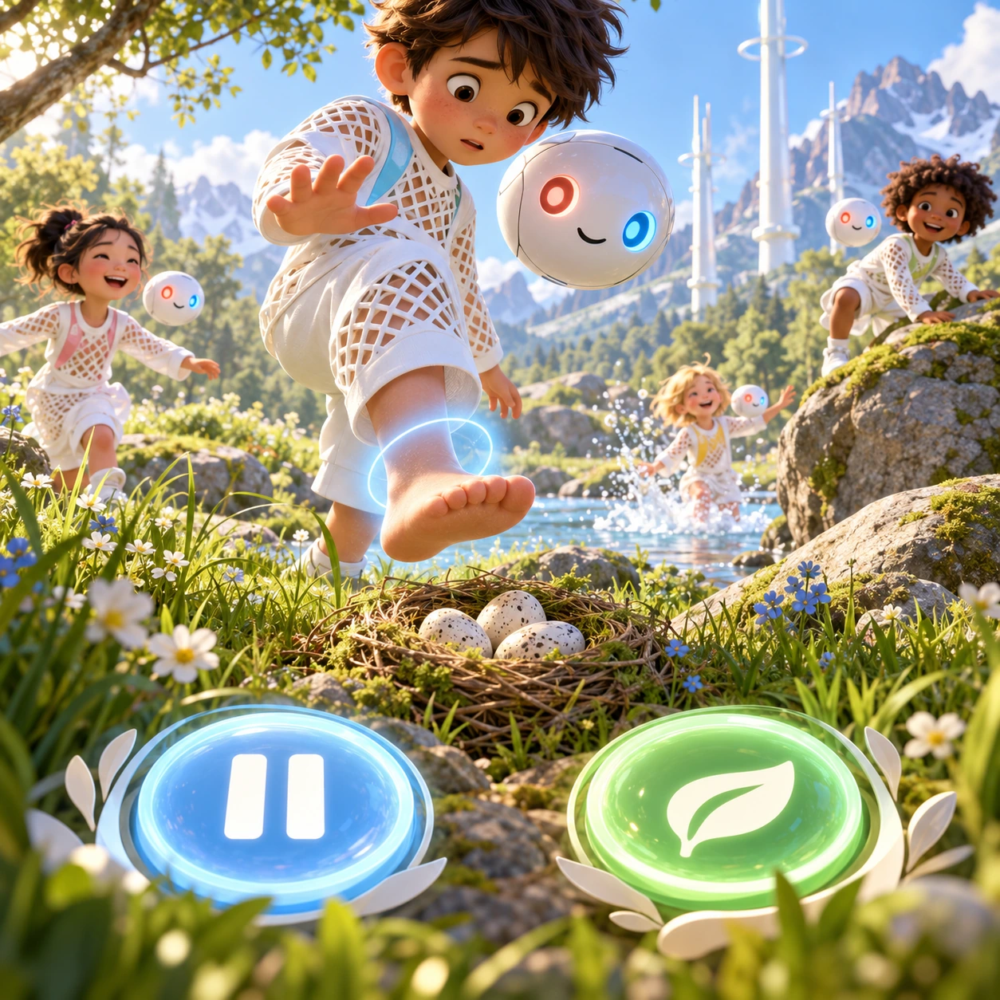
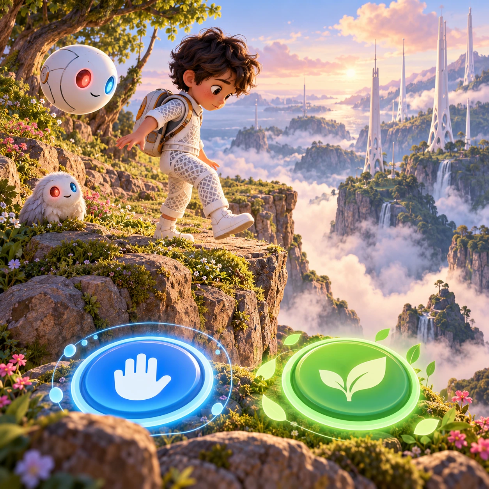

# Soft Hold

RY-06 · [Raya life](../ry.md) · Cx 2 · Ages 6+ · Raya story catalog

**The idea:** The player, as a child's Orbi, watches a meadow moment frozen in time: a boy's foot hovers above a ground nest of eggs. Two big buttons glow below, a soft blue hold ring and a green let-it-be leaf.

| Decision             | Proposal                                                                                                                                                                                    |
| -------------------- | ------------------------------------------------------------------------------------------------------------------------------------------------------------------------------------------- |
| Familiar mechanic    | Scenario choices (pause or let be)                                                                                                                                                          |
| Learning objective   | Body safety, consent, feelings are free while harmful moves pause                                                                                                                           |
| First prototype      | One authored challenge built around the interaction above, with a clear goal, immediate feedback, restart and unlimited retries.                                                            |
| Technology           | React + SVG/DOM; deterministic state, undo and seeded levels. Start with one local screen and touch plus keyboard input.                                                                    |
| Scope boundary       | One board and one rule set; defer accounts, multiplayer, procedural content and platform SDKs.                                                                                              |
| Reuse                | Shared input, saves, accessibility, seeded state and the raya life collection shell.                                                                                                        |
| Prototype acceptance | A player can identify the next action from the screen, complete one challenge, explain the practiced idea and restart without help. Check touch and keyboard play at narrow and wide sizes. |
| Main uncertainty     | Test whether the lesson follows from play and whether the first interaction is understandable without reading.                                                                              |

## Estimated plan

**First playable version:** 14 frozen meadow moments where the player, as an Orbi, chooses hold or let be, each followed by a short talk scene about feelings. Fog, cliff chapters and asked-for piggybacks are left for later.

| Measure              | Estimate                                                                                                   |
| -------------------- | ---------------------------------------------------------------------------------------------------------- |
| Youngest age         | 6+                                                                                                         |
| Toddler learnability | 1 of 5 — Needs reading, precise motor control, timing pressure or abstract rules; not a toddler game (6+). |
| Code                 | 1230 LOC, 10.3 days                                                                                        |
| Assets               | 147 hours, 24.5 days                                                                                       |
| Effort               | 34.8 days, risk 2 of 5                                                                                     |
| Start score          | 104.4 (rank 236 of 310; lower is better)                                                                   |

**Algorithms:** `dialogue-branching` (Branching dialogue, 300 LOC) · `tap-feedback` (Tap feedback, 80 LOC) · `quest-state` (Quest and story state, 300 LOC) · `tween-cause-effect` (Cause-and-effect animation, 100 LOC)

**Assets:** 30 sprites, 10 animations, 4 backgrounds, 4 UI screens, 12 sound effects, 1 music track, 60 voice lines, 14 authored levels, 40 content items

How the numbers are computed: [development plan](../../development-plan.md#how-the-scores-work).

## Story

Theo was cross. Mira had won the race again. He lifted his hands to push her into the river, and his arms simply stopped. A soft hold, like a hug from the inside. "Hey!" said Theo. "You are still allowed to be cross," said his Orbi. "I only paused your hands." Theo stamped his foot. Then he laughed, a little embarrassed. Mira grinned. "Race me again tomorrow?" Later, near the cliff, Theo stepped back from the edge all by himself. His Orbi did nothing at all. That was the best part.

> **Wisdom:** Feelings are free. Hands can wait.

## Four visual directions

These are independently generated concept proposals for selecting a prototype.
The four views compare gameplay readability, world appeal, tactile identity and
room to grow. They are not screenshots of an implemented game. Native image
dimensions, hashes, exact prompts and generation provenance are recorded in the
[art manifest](../art/ry-06/manifest.json); see the [generation notes](../README.md#image-generation-and-provenance).

The [core prompts](../jobs/ry.json) use IDs `ry-06/01-gameplay` to `ry-06/04-discovery`.

### Gameplay

The player, as a child's Orbi, watches a meadow moment frozen in time: a boy's foot hovers above a ground nest of eggs. Two big buttons glow below, a soft blue hold ring and a green let-it-be leaf.

### World

A riverbank meadow below a mossy cliff on a bright afternoon. A white Chord tower stands across the river on three root-like feet, and children's lattice nests hang in the willows. Ground birds nest in the tall grass, fish leap in the clear water, and the cliff edge is soft with ferns. Gentle, safe, sunlit mood.

### Characters and materials

Children aged 6 to 10 in white lattice suits, with looser cuts and big accent shapes, play tag, climb low rocks and splash. Each has a white Orbi at shoulder height. A hold shows as a soft pale-blue halo around one arm or foot, never a grip. Faces stay expressive: a frown, a laugh, a surprised blink. Palette: white, meadow green, river blue.

### Expanded play

Later chapters add trickier moments: a friend who asked for a piggyback, a girl who says no to a hug, an angry child who shouts but does not push, a step toward the cliff edge in fog. After each hold, a talk scene lets the children say how they feel, and the player learns that feelings never need a hold.

## Design checks before prototyping

- Learning target: **Body safety, consent, feelings are free while harmful moves pause**. Ask a domain reviewer to validate factual content in the mechanic.
- Keep goals cooperative or self-directed, using resources and needs. Avoid purchasable power. No pressure timers in the accessible mode.
- Use original layouts and character designs; the [legal checklist](../../legal.md) applies even when a mechanic is familiar.
- Choose the minimum [fidelity level](../../simulation-engine.md#determinism-and-fidelity-levels) the lesson needs; concept art does not establish scientific accuracy.
- Review silhouettes, text alternatives, reduced motion and non-color cues against the [adorability gate](../../lore/adorability-gate.md).
- Check every detail against the [Raya canon](../../lore/raya.md): untouched nature, white towers and clothing, Orbis, the Guard and the Gentle Defaults.

Genre context: [existing genre research](../../../case-studies/issue-1/data/research-genres-ideas.md)
and [expansion research](../../../case-studies/issue-1/data/research-visual-catalog.md).

[← Thought Postcards](ry-05.md) · [All concepts](../README.md) · [Two Yeses →](ry-07.md)
