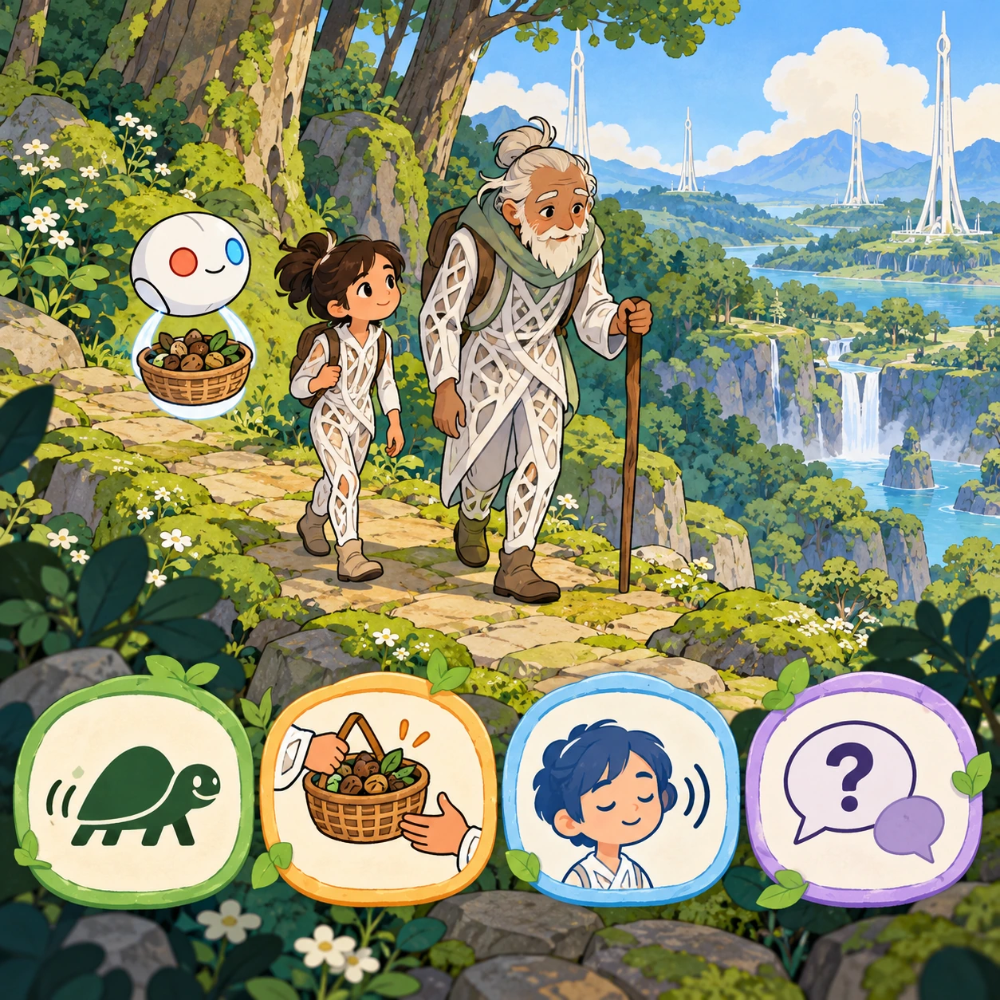
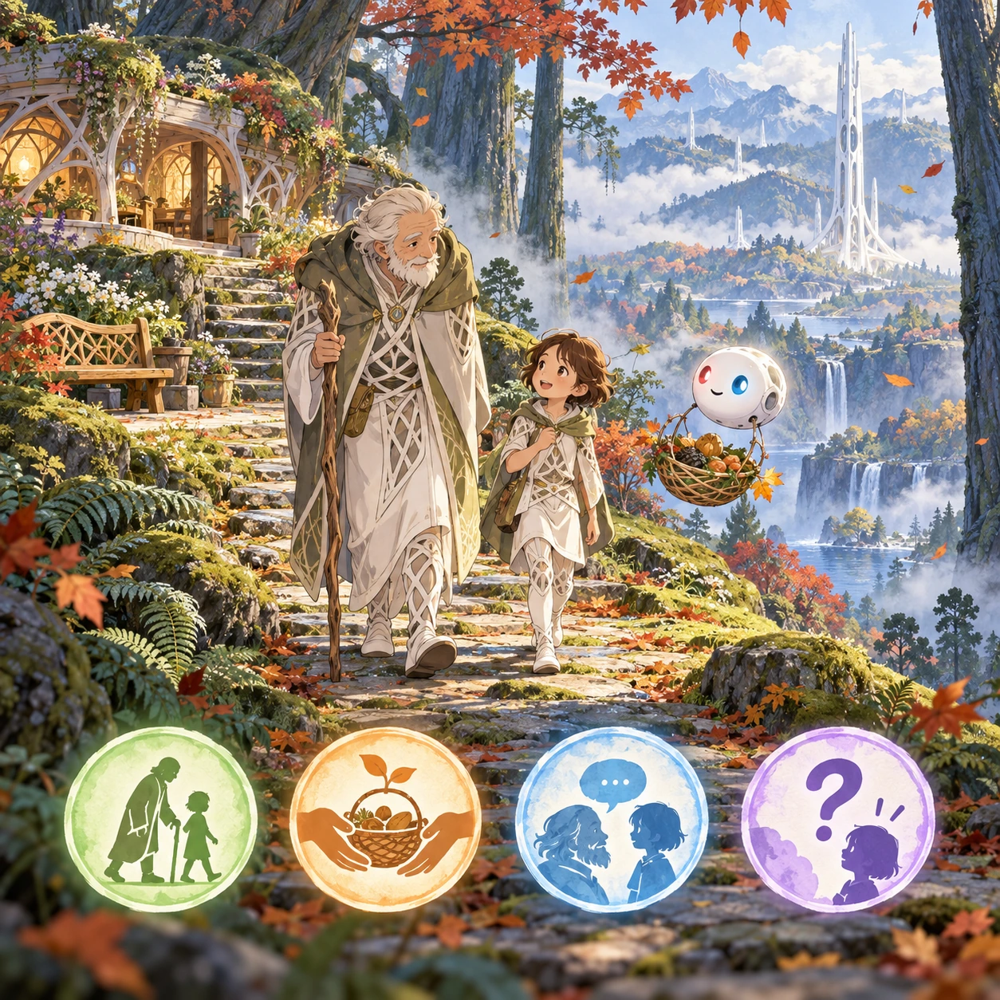
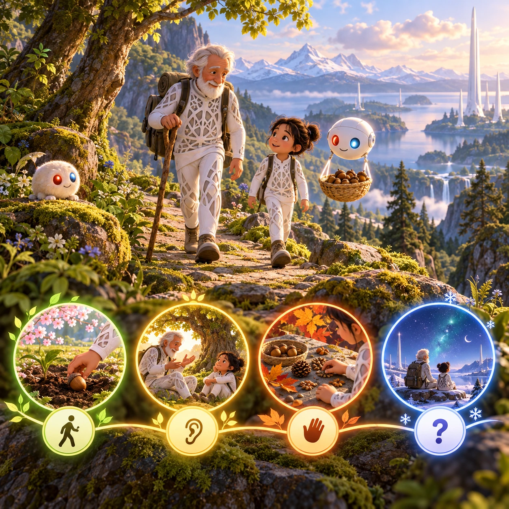

# Acorn's Long Seasons

RY-11 · [Raya life](../ry.md) · Cx 2 · Ages 6+ · Raya story catalog

**The idea:** Professor Acorn walks slowly along a mossy forest path with a child beside him; the child's Orbi floats his basket of seeds, and big picture choices offer ways to help: walk slower, carry, listen, or ask.

| Decision             | Proposal                                                                                                                                                                                    |
| -------------------- | ------------------------------------------------------------------------------------------------------------------------------------------------------------------------------------------- |
| Familiar mechanic    | Story visits with gentle helping tasks                                                                                                                                                      |
| Learning objective   | Respect for elders, respecting other people's choices, empathy                                                                                                                              |
| First prototype      | One authored challenge built around the interaction above, with a clear goal, immediate feedback, restart and unlimited retries.                                                            |
| Technology           | React + SVG/DOM; deterministic state, undo and seeded levels. Start with one local screen and touch plus keyboard input.                                                                    |
| Scope boundary       | One board and one rule set; defer accounts, multiplayer, procedural content and platform SDKs.                                                                                              |
| Reuse                | Shared input, saves, accessibility, seeded state and the raya life collection shell.                                                                                                        |
| Prototype acceptance | A player can identify the next action from the screen, complete one challenge, explain the practiced idea and restart without help. Check touch and keyboard play at narrow and wide sizes. |
| Main uncertainty     | Test whether the lesson follows from play and whether the first interaction is understandable without reading.                                                                              |

## Estimated plan

**First playable version:** Four seasonal visits to Professor Acorn with one helping task each (planting, walking, seed sorting, a winter talk about Renewal) and choices that ask before helping. The chapters about other Rayans' choices come later.

| Measure              | Estimate                                                                                                   |
| -------------------- | ---------------------------------------------------------------------------------------------------------- |
| Youngest age         | 6+                                                                                                         |
| Toddler learnability | 1 of 5 — Needs reading, precise motor control, timing pressure or abstract rules; not a toddler game (6+). |
| Code                 | 1370 LOC, 11.4 days                                                                                        |
| Assets               | 135 hours, 22.4 days                                                                                       |
| Effort               | 33.8 days, risk 2 of 5                                                                                     |
| Start score          | 101.4 (rank 230 of 310; lower is better)                                                                   |

**Algorithms:** `dialogue-branching` (Branching dialogue, 300 LOC) · `quest-state` (Quest and story state, 300 LOC) · `day-cycle` (Day and season cycle, 120 LOC) · `drag-drop-snap` (Drag and snap, 150 LOC)

**Assets:** 25 sprites, 8 animations, 4 backgrounds, 4 UI screens, 10 sound effects, 2 music tracks, 80 voice lines, 4 authored levels, 40 content items

How the numbers are computed: [development plan](../../development-plan.md#how-the-scores-work).

## Story

"Why are you old, Professor?" asked Trip. Everyone else in the valley looked twenty. Professor Acorn smiled, and his wrinkles smiled with him. "I switched off Renewal, a long time ago. I wanted children to know what old looks like. And I like feeling the years go by, like seasons." "Does it hurt?" "My knees grumble in the rain," he laughed. "But it was my choice, and choices are worth respecting." Trip walked slower after that. He offered to carry the seed basket with his Orbi, and he waited for a yes.

> **Wisdom:** Respect a choice, even one you would not make.

## Four visual directions

These are independently generated concept proposals for selecting a prototype.
The four views compare gameplay readability, world appeal, tactile identity and
room to grow. They are not screenshots of an implemented game. Native image
dimensions, hashes, exact prompts and generation provenance are recorded in the
[art manifest](../art/ry-11/manifest.json); see the [generation notes](../README.md#image-generation-and-provenance).

The [core prompts](../jobs/ry.json) use IDs `ry-11/01-gameplay` to `ry-11/04-discovery`.

### Gameplay

Professor Acorn walks slowly along a mossy forest path with a child beside him; the child's Orbi floats his basket of seeds, and big picture choices offer ways to help: walk slower, carry, listen, or ask.

### World

A misty forest path with old stone steps, ferns and blue-green giant trees in cool autumn light, with leaves drifting down. A distant white Chord tower glows softly through the haze. Professor Acorn's nest is a low, comfortable lattice home on a ledge near the ground, with a bench of grown wood and a quiet garden of wild perennials.

### Characters and materials

Professor Acorn is one of Raya's rare elders: white hair, a wrinkled smiling face and round, infinity-shaped spectacles, in a fitted white suit with a leaf pattern. The children wear tight white lattice suits with colored wrist accents, and Orbis float at shoulder height. Warm textures: the fine weave of fitted white lattice, moss, stone, acorn caps. Palette: autumn ochre, white, forest green.

### Expanded play

Each season brings a new visit: planting acorns in spring, listening to his stories in summer, sorting seeds in autumn, and a snowy winter evening when the children ask why he chose to grow old. Later chapters invite the player to notice the choices of other Rayans, such as quiet people and slow sea sailors, and to ask before judging.

## Design checks before prototyping

- Learning target: **Respect for elders, respecting other people's choices, empathy**. Ask a domain reviewer to validate factual content in the mechanic.
- Keep goals cooperative or self-directed, using resources and needs. Avoid purchasable power. No pressure timers in the accessible mode.
- Use original layouts and character designs; the [legal checklist](../../legal.md) applies even when a mechanic is familiar.
- Choose the minimum [fidelity level](../../simulation-engine.md#determinism-and-fidelity-levels) the lesson needs; concept art does not establish scientific accuracy.
- Review silhouettes, text alternatives, reduced motion and non-color cues against the [adorability gate](../../lore/adorability-gate.md).
- Check every detail against the [Raya canon](../../lore/raya.md): untouched nature, white towers and clothing, Orbis, the Guard and the Gentle Defaults.

Genre context: [existing genre research](../../../case-studies/issue-1/data/research-genres-ideas.md)
and [expansion research](../../../case-studies/issue-1/data/research-visual-catalog.md).

[← Field Sketchbook](ry-10.md) · [All concepts](../README.md) · [Share Basket →](ry-12.md)
