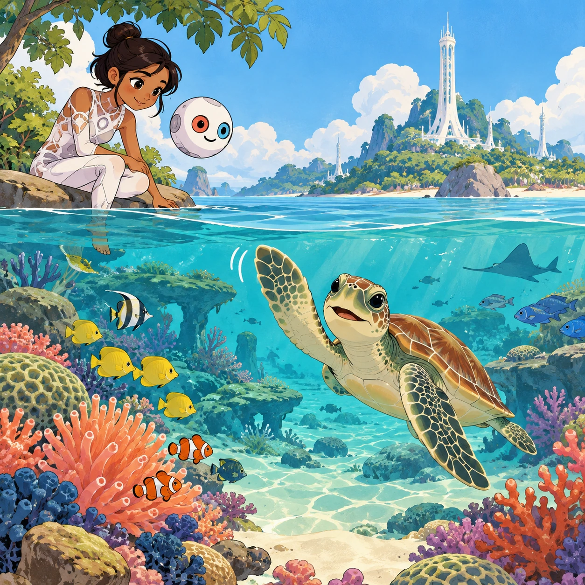
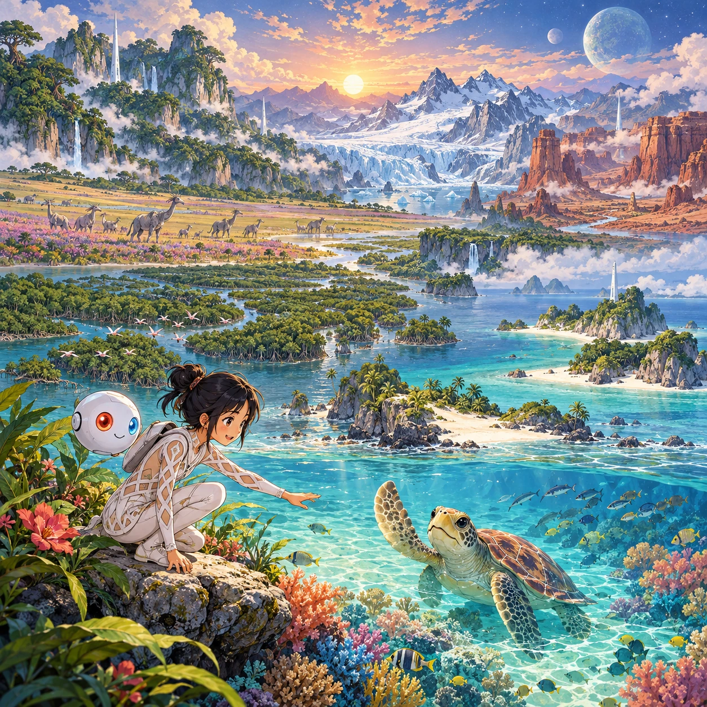
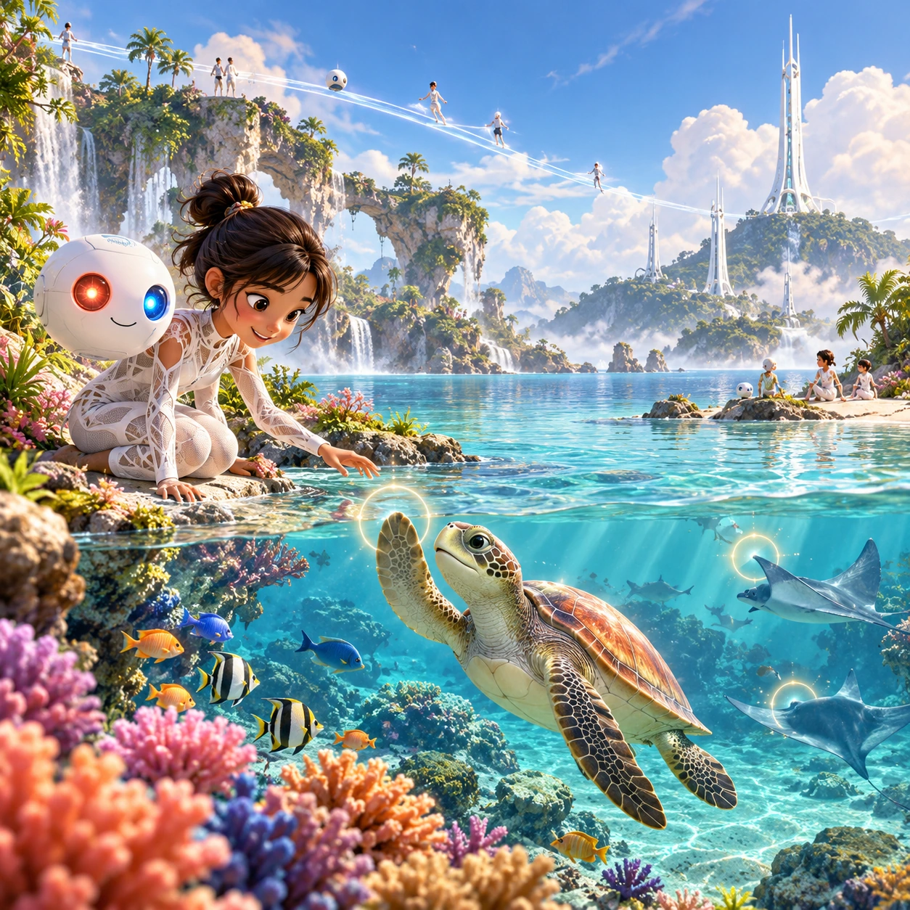
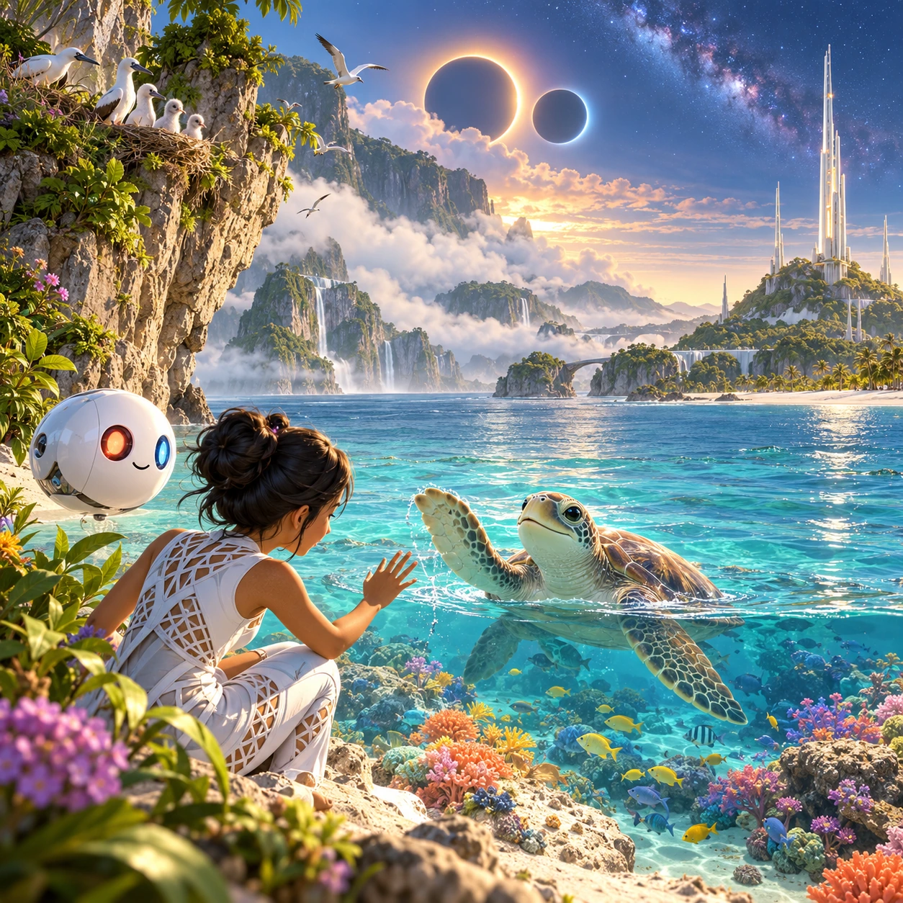

# Windows on Raya

RY-13 · [Raya life](../ry.md) · Cx 2 · Ages 3+ · Raya story catalog

**The idea:** A wide painted panorama of coral shallows drifts slowly sideways; a tap on a sea turtle makes it wave a flipper while the Orbi says its name, and a white tower stands far off on an island.

| Decision             | Proposal                                                                                                                                                                                    |
| -------------------- | ------------------------------------------------------------------------------------------------------------------------------------------------------------------------------------------- |
| Familiar mechanic    | Ambient landscape explorer                                                                                                                                                                  |
| Learning objective   | Biomes and animals of a living world, calm attention                                                                                                                                        |
| First prototype      | One authored challenge built around the interaction above, with a clear goal, immediate feedback, restart and unlimited retries.                                                            |
| Technology           | React + SVG/DOM; deterministic state, undo and seeded levels. Start with one local screen and touch plus keyboard input.                                                                    |
| Scope boundary       | One board and one rule set; defer accounts, multiplayer, procedural content and platform SDKs.                                                                                              |
| Reuse                | Shared input, saves, accessibility, seeded state and the raya life collection shell.                                                                                                        |
| Prototype acceptance | A player can identify the next action from the screen, complete one challenge, explain the practiced idea and restart without help. Check touch and keyboard play at narrow and wide sizes. |
| Main uncertainty     | Test whether the lesson follows from play and whether the first interaction is understandable without reading.                                                                              |

## Estimated plan

**First playable version:** Seven slowly drifting biome panoramas with 30 tappable animals that answer with a motion, a sound and a voiced name, plus a calm sleep mode. Weather, eclipses and festival windows come later; there are no goals.

| Measure              | Estimate                                                                          |
| -------------------- | --------------------------------------------------------------------------------- |
| Youngest age         | 3+                                                                                |
| Toddler learnability | 3 of 5 — Choose among 2-4 options, sort or match, or a two-step action; ages 3-4. |
| Code                 | 850 LOC, 7.1 days                                                                 |
| Assets               | 156 hours, 25.9 days                                                              |
| Effort               | 33 days, risk 1 of 5                                                              |
| Start score          | 49.5 (rank 123 of 310; lower is better)                                           |

**Algorithms:** `tap-feedback` (Tap feedback, 80 LOC) · `tween-cause-effect` (Cause-and-effect animation, 100 LOC) · `day-cycle` (Day and season cycle, 120 LOC) · `particle-effects` (Particles, 150 LOC)

**Assets:** 30 sprites, 14 animations, 7 backgrounds, 2 UI screens, 25 sound effects, 2 music tracks, 30 voice lines, 30 content items

How the numbers are computed: [development plan](../../development-plan.md#how-the-scores-work).

## Story

Some days are busy and loud. On those days the Orbi opens a window. "Look," it says, and the steppe rolls out like a green sea. A herd is walking. A calf runs to its mother. Far away, a white tower stands quiet. Tap. The calf lifts its head. Tap. A bird sings. Then the window turns to the sea, and a turtle glides by. "Breathe slowly," says the Orbi. "The world is big, and it is not in a hurry." And for a while, neither are we.

> **Wisdom:** The world is big and not in a hurry.

## Four visual directions

These are independently generated concept proposals for selecting a prototype.
The four views compare gameplay readability, world appeal, tactile identity and
room to grow. They are not screenshots of an implemented game. Native image
dimensions, hashes, exact prompts and generation provenance are recorded in the
[art manifest](../art/ry-13/manifest.json); see the [generation notes](../README.md#image-generation-and-provenance).

The [core prompts](../jobs/ry.json) use IDs `ry-13/01-gameplay` to `ry-13/04-discovery`.

### Gameplay

A wide painted panorama of coral shallows drifts slowly sideways; a tap on a sea turtle makes it wave a flipper while the Orbi says its name, and a white tower stands far off on an island.

### World

Seven wide, calm panoramas of untouched Raya: blue-green rainforest giants, a flower steppe with migrating herds, a mangrove delta, a glacier valley, coral shallows, red rock canyons and quiet islands. Each has one or two slender white Chord towers, thin and far away, and nature fills nearly the whole frame. The light changes slowly from dawn to night.

### Characters and materials

Tiny Rayans in white lattice suits appear far away, walking, gliding on sky-lanes or sitting by the water, each with a white Orbi. The narrator Orbi, a 30 cm white sphere with red and blue eyes, peeks in at one corner. Painted, airy textures: misty depth, glinting water, soft grass. No text and no buttons in the art, only gentle glowing tap spots.

### Expanded play

Over time the windows change with the 26-hour day: rain showers, a misty dawn, a double eclipse of Pim and Pom, the long green spring. New windows open on cliff nests, a tower festival and a night sky with the Milky Way. A sleep mode slowly dims the scene and ends as the tower lights softly turn down.

## Design checks before prototyping

- Learning target: **Biomes and animals of a living world, calm attention**. Ask a domain reviewer to validate factual content in the mechanic.
- Keep goals cooperative or self-directed, using resources and needs. Avoid purchasable power. No pressure timers in the accessible mode.
- Use original layouts and character designs; the [legal checklist](../../legal.md) applies even when a mechanic is familiar.
- Choose the minimum [fidelity level](../../simulation-engine.md#determinism-and-fidelity-levels) the lesson needs; concept art does not establish scientific accuracy.
- Review silhouettes, text alternatives, reduced motion and non-color cues against the [adorability gate](../../lore/adorability-gate.md).
- Check every detail against the [Raya canon](../../lore/raya.md): untouched nature, white towers and clothing, Orbis, the Guard and the Gentle Defaults.

Genre context: [existing genre research](../../../case-studies/issue-1/data/research-genres-ideas.md)
and [expansion research](../../../case-studies/issue-1/data/research-visual-catalog.md).

[← Share Basket](ry-12.md) · [All concepts](../README.md) · [Pim and Pom Night →](ry-14.md)
